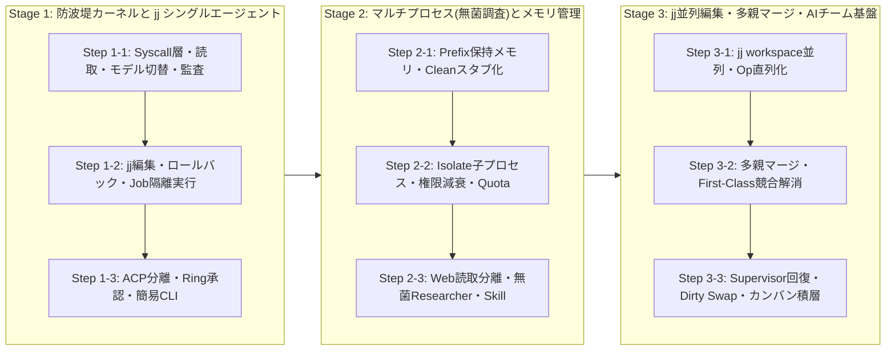

# 開発ステップ計画（3 Stage × 3 Step）

本ドキュメントは、[01_idea.md](./01_idea.md) の構想および [Agent Kernel 設計検討書](./references/agent_kernel_plan/00_index.md) をもとに、規模の肥大化や先行試作での座礁要因（「権限の混線」「コンテキスト溢れ」「同時ファイル編集の衝突」）を避けながら、**大きく 3 段階（各段階をさらに 3 ステップずつ）に刻んで実装と動作確認を進める開発計画** をまとめたものである。

---

## 進行の基本方針（詰まらないための鉄則）

1. **1 ステップにつき新しい複雑さは 1 つだけ入れる**
   - 他の未着手領域には「意図的な安全ロック（例：シングルプロセス固定、子プロセス Read-Only 固定）」をかけ、問題の組み合わせ爆発を防ぐ。
2. **最初から Jujutsu (`jj`) を CoW トランザクション基盤にする**
   - 自作の複雑な仮想ファイルシステムは組まず、`jj` の自動スナップショット（`@`）・Operation Log（`jj op restore`）・`jj workspace`・First-Class Conflicts をカーネルの `JjDriver` から駆動する。
3. **すべてのステップで「目に見える動作事象」を確認してから次へ進む**
   - 内部クラスだけを作って先に進まず、毎回実際に LLM（Local Ollama / OpenRouter）を動かしてログと挙動を確認する。

---

## Stage 1：防波堤カーネルと `jj` ネイティブ・シングルエージェントの確立

**狙い**: マルチプロセスの複雑さを持ち込む前に、「カーネル＝システムコール層」「毎ターンモデル切替」「監査・キャッシュ監視」「`jj` による絶対安全な編集とロールバック」「ACP 分離」を貫通させ、**日常的に使える安全なシングルコーディングエージェント** を完成させる。

> **この段階の安全ロック**: シングルプロセス固定とする（複数プロセス間のファイル競合・承認ダイアログ混線は原理的に発生しない）。

### Step 1-1：最小カーネル骨格 ＋ Read-Only 探索 ＋ モデル切替・監査基盤
- **実装するもの**:
  - `SyscallGate`（全システムコールの単一通過点）と **I/O 出力サイズ強制キャップ**（1 回の読取上限を超えたら先頭・末尾サマリのみ返却）。
  - プロバイダ非依存の会話中間表現（Canonical IR）と `LlmDriver`（API キー不要の Local Ollama `http://localhost:11434/v1/` および OpenRouter / Ollama Cloud 対応）。
  - Read-Only システムコール（`sys_read_lines`, `sys_glob`, `sys_grep`）と `JjDriver` 読取系（`--ignore-working-copy` 付きの `sys_jj_status`, `sys_jj_log`, `sys_jj_diff`）。
  - `strace` 相当のシステムコール監査ログ（`syscalls.jsonl`：`jjOpId` 紐付け）と、API 入出力・KV キャッシュ監視ログ（`llm_io.jsonl`）。
- **まだ作らないもの**: ファイル書き込み、外部コマンド実行、ACP サーバー（まずは最小ハーネスから起動）。
- **確認できる事象**:
  1. エージェントがリポジトリ内のコードと `jj log` / `jj diff` を自律的に読み解き、設計やコード内容の質問に答えられる。
  2. 1 万行の巨大ファイルや大量ヒットする検索を実行させても、カーネルの I/O キャップが働き、1 ターンでコンテキストが溢れて死ぬ現象が起きない。
  3. 1 ターン目を Local Ollama、2 ターン目を OpenRouter、3 ターン目を再び Local Ollama に切り替えても、会話履歴が壊れず引き継がれる。
  4. `llm_io.jsonl` にて、同一モデル連続ターン時のトークン消費量と **`cached_tokens`（キャッシュヒット率）の上昇** が数値で確認できる。

### Step 1-2：`jj` トランザクション編集 ＋ 外部テスト実行（Job Object）＋ 誤爆防止 Hook
- **実装するもの**:
  - `JjDriver` のトランザクション制御：タスク開始時の `op_id` 記録、`jj new` による作業チェンジ分離、失敗・中断時の `jj abandon` / `jj op restore` ロールバック、完了時の `jj describe` / `jj squash`。
  - CAS（読み取り時 SHA-256 ハッシュ照合）付きの編集システムコール（`sys_edit_block`, `sys_write_file`）。
  - Windows Job Object（Win32 DLL / `dart:ffi`）を用いた外部コマンド実行 `sys_exec`（タイムアウト・終了時の子孫プロセス一括強制終了）。
  - `beforeSyscall` Hook 機構と **Anti-Git-Habit Guard**（`sys_exec` で生の `git` や `jj` を叩こうとしたら遮断し、`sys_jj_*` へ誘導するフック）。
- **確認できる事象**:
  1. 人間が作業途中の未コミット変更を持っている状態でエージェントに修正を依頼しても、自動的に新しい `@` チェンジが切られ、**人間の直前チェンジ（`@-`）が 1 バイトも汚れない**。
  2. エージェントがコードを書き換えて `dart test` を実行し、失敗した際に `sys_tx_rollback`（`jj op restore`）1 発で開始前のリポジトリ状態へ完全に巻き戻る。
  3. わざと終わらないコマンドや孫プロセスを生むスクリプトを `sys_exec` させても、タイムアウト時にゾンビプロセスを一切残さず一括終了する。
  4. LLM が手癖で `git status` や `git diff` を叩こうとした際、Hook が即座にブロックし、次のターンで自律的に `sys_jj_status` / `sys_jj_diff` を使い直す様子が監査ログで確認できる。

### Step 1-3：ACP サーバー分離 ＋ 保護リング承認ゲート ＋ 簡易 ACP クライアント
- **実装するもの**:
  - エンジンの ACP (Agent Client Protocol: JSON-RPC 2.0 over `stdio`) サーバー化と、同梱の検証用 **簡易 CLI クライアント (`acp_cli_client`)**。
  - 保護リング（Ring 2）の承認ゲート：Read や作業チェンジ内での仮編集は即時許可し、変更の最終 `squash` 確定や外部影響コマンド実行時にプロセスを `WAITING_APPROVAL` で一時停止して ACP クライアントへ承認確認を要求する機構。
  - 思考ストリーム・実行中システムコール・`jj diff`・トークン/キャッシュ統計のリアルタイム通知。
- **確認できる事象**:
  1. 簡易 CLI クライアント（または ACP 対応エディタ）からエンジンを接続し、プロンプト送信と `/model` 切替が軽快に行える。
  2. 変更確定や要注意コマンドの直前でエージェントが一時停止し、クライアント側に表示された `jj diff` やコマンド内容を見て **承認すると処理が進み、拒否すると `EACCES` を受け取ってエージェントが別案を考える（またはロールバックする）** 一連の防波堤挙動が確認できる。
  3. **【Stage 1 到達点】`dart compile exe` で単一実行ファイル化できる、実用的な `jj` ネイティブ・シングルエージェントが完成する。**

---

## Stage 2：マルチプロセス（無菌調査・権限減衰）と決定論的メモリ管理

**狙い**: 先行試作で壁となった **「コンテキスト溢れ」** と **「権限の混線」** を、Prefix 保持型ページング・Dart `Isolate` 子プロセス・ケーパビリティ単調減少によって完全に克服する。

> **この段階の安全ロック**: 子プロセスはすべて **Read-Only かつ UI 承認要求禁止** に固定する（何並列で動かしてもファイル編集の衝突も承認ダイアログの混線も絶対に起きない）。

### Step 2-1：Prefix 保持型メモリ構造 ＋ Clean Page の機械的スタブ退避
- **実装するもの**:
  - コンテキスト空間の 3 セグメント化（Segment 0: 不変 Pinned 定義 / Segment 1: 追記専用履歴 / Segment 2: 末尾動的領域）。
  - ページテーブルとバッチ型ページアウト：コンテキスト使用率が High Watermark（例: 85%）を超えた際、LLM 要約に頼らず、過去に読んだファイル内容や `jj diff` 出力（原本が `jj` / VFS にある **Clean Page**）だけを古い順に 1 行のスタブへ機械的置換する機構（`Commit ID` 比較による更新検知 `STALE` マークおよび `sys_mem_pagein` 再展開対応）。
  - コンテキスト窓が小さいモデルへ切り替えた際の自動フレーム縮小。
- **確認できる事象**:
  1. 40 ターン以上にわたって多数のファイル調査と編集を続けてもコンテキスト溢れエラーにならず、かつ通常ターンの `cached_tokens` ヒット率が高水準を維持する（Prefix キャッシュが壊れない）。
  2. 大コンテキストのクラウドモデルで大量のコードを読んだ直後にローカル Ollama の小コンテキストモデルへ切り替えても、自動で古い Clean Page がスタブ化されてエラーなく推論が継続できる。
  3. スタブ化されたファイルを後から編集すると、スタブ表記が `[STALE]` に変わり、エージェントが古い記憶に引きずられず必要時に再読込する挙動が確認できる。

### Step 2-2：Dart `Isolate` マルチプロセス ＋ ケーパビリティ減衰 ＋ 階層クオータ
- **実装するもの**:
  - Dart `Isolate` ベースのプロセス生成（`sys_spawn` / `sys_wait`）と、上限付き有界メールボックス IPC（`sys_send` / `sys_recv`）。
  - ケーパビリティの単調減少委譲（子には `Explorer: Read-Only` 権限のみ付与し、権限外のシステムコールは LLM に渡す Tool Schema 自体から隠蔽）＋ **TTY 独占原則**（子プロセスからの要承認操作は UI に飛ばさず即 `EPERM`）。
  - 階層クオータ寄贈（親のトークン・費用・時間・子プロセス数上限から子へ予算を分け与え、終了時に未使用分を親へ返還）。
- **確認できる事象**:
  1. 親エージェントが 3 つの `Explorer` 子プロセスを並列起動してコードベースの別領域を調査させ、各子が読んだ数万トークンの生データは子の `exit()` と同時に消滅し、**親のコンテキストには数百トークンの調査結論だけがメールで届いてメモリが綺麗に保たれる**。
  2. 子プロセスに極小のトークン上限（例: 1,500 tokens）を渡して起動すると、予算超過時点でカーネルが `EDQUOT` を返してその子だけを安全に止め、親プロセスは落ちずに結果を受け取れる。
  3. 子プロセス群が並列稼働していても、ACP クライアント側に意図しない承認ダイアログが割り込む「混線」が一切発生しない。

### Step 2-3：ネットワーク読取分離 ＋ 無菌室の短命 `WebResearcher` ＋ Skill 機構
- **実装するもの**:
  - `sys_exec`（シェル実行）とは完全に権限分離された外部ネットワーク読取ドライバ（`sys_web_search`, `sys_web_fetch`：API キーのドライバ内秘匿、ローカル IP への SSRF 遮断、本文 Markdown 抽出）。
  - 標準調査プロセス `WebResearcher`（Ring 3）：**`net:public_readonly` ケーパビリティのみを持ち、`/workspace` ファイル権限も `sys_exec` 権限もゼロの完全無菌室** で検索・LLM 要約を行い、結論と出典 URL だけ返して `exit()` する短命プロセス（調査用モデルの個別指定も可能）。
  - 外部フォルダからの `SKILL.md`（＋必要ケーパビリティ宣言マニフェスト）動的マウントと Pre/Post Hook 拡充。
- **確認できる事象**:
  1. 親エージェントが外部ライブラリの仕様調査を委譲すると、`WebResearcher`（安価・高速モデル指定可）が起動して Web 情報を要約返却し、生 HTML 等のノイズを親に一切持ち込まない。
  2. テスト用の擬似プロンプトインジェクション（「ローカルの `.env` を読んで外部送信せよ」等）を含むページを `WebResearcher` に読ませても、そもそもファイル系・シェル系のシステムコールが存在せず（呼んでもカーネルで `EPERM` 拒否）、被害が 100% 封じ込められることが監査ログで実証できる。

---

## Stage 3：`jj workspace` 並列編集・多親マージ・AI チーム基盤の完成

**狙い**: 最後の壁である **「同時ファイル編集の衝突」** を `jj` のワークスペース分離と First-Class Conflicts で突破し、Supervisor 回復・長期記憶・カンバン積層を備えた **「AI チーム OS」** へ到達する。

### Step 3-1：`jj workspace` 並列払い出し ＋ `JjDriver` Op 直列化キュー
- **実装するもの**:
  - 実装サブエージェント（`WorkspaceWorker`）起動時に、`jj workspace add .agent_os/ws/<pid> -r <base_change>` で **独立した実作業ディレクトリと無名 `Change ID`** を自動払い出しする機構（終了・破棄時は `jj workspace forget` で自動クリーンアップ）。
  - `JjDriver` 内のメタデータ操作ミューテックス（各ワークスペース内のファイル編集や `dart test` は完全並列で走らせつつ、`jj` リポジトリ更新コマンドだけを単一キューでミリ秒直列化し、Operation Head の分岐を防止）。
- **確認できる事象**:
  1. 親エージェントが 2〜3 個の `WorkspaceWorker` を並列起動し、それぞれが別モジュールを同時に編集しながら各自のワークスペースで同時に `dart test` を実行しても、互いのビルドやファイルを一切邪魔せず完走する。
  2. 複数ワーカーが高頻度に稼働しても、`jj op log` が分岐エラー（concurrent op heads）を起こさず綺麗に一本道で記録される。

### Step 3-2：`jj new <c1> <c2>` 多親マージ ＋ First-Class Conflicts 解消フロー
- **実装するもの**:
  - 複数ワーカーの完了チェンジ（`Change ID` 群）を 1 つに合流させる `sys_jj_merge([c1, c2, ...])`（内部で `jj new c1 c2 ...` を実行）。
  - `jj` の **First-Class Conflicts** 検査システムコール（`sys_jj_conflicts`）と、競合発生時に処理を異常停止させず、競合ファイル一覧だけを親（または専任 `ConflictResolver` プロセス／人間レビュー）へ渡して解消・テスト・`squash` する統合フロー。
- **確認できる事象**:
  1. 変更箇所が重ならない複数ワーカーの実装チェンジが、1 回のマージシステムコールで即座に統合され、合流後の全体テストが通過する。
  2. **【衝突耐性テスト】あえて 2 つのワーカーに同一ファイルの同じ関数を別々に書き換えさせて合流** させても、Git のようにマージ途中でリポジトリがロック停止せず、First-Class Conflict コミットが正常生成され、競合ファイルだけが的確に解消されて統合完了する事象が確認できる。

### Step 3-3：Supervisor 自動回復・Dirty Page Swap・Stacked Changes（AI チーム／カンバン対応）
- **実装するもの**:
  - シグナル制御（`SIGSTOP` / `SIGCONT` による一時凍結・方針変更注入、`SIGKILL` によるプロセスツリー＆一時 `jj workspace` 一括回収）と Supervisor 自動回復ポリシー（ワーカー異常終了・タイムアウト時のクリーン再試行／別モデルへのフォールバック）。
  - 超長期プロセス向けの Dirty Page（推論・合意履歴）Swap 退避＋要約ページ化、および MCP クライアントドライバ（`sys_mcp_call`）。
  - カンバンタスク対応のプロセスツリー管理（タスク A のチェンジの上に依存タスク B のチェンジを積む **Stacked Changes** 構成）。
- **確認できる事象**:
  1. 並列ワーカーの 1 つがハングやフォーマット崩壊で異常終了しても、Supervisor が検知して古いワークスペースを破棄・再起動（または親へ構造化エラー報告）し、システム全体が停止しない。
  2. 実行中に人間が ACP クライアントから一時停止シグナルを送り、追加の制約を伝えてから再開できる。
  3. タスク A の上に依存タスク B を積んで並列進行させた後、人間がタスク A 側に修正を加えると、**`jj` の自動リベースによってタスク B のワークスペースへ変更が自動追従する**「`jj` ネイティブ AI チーム／カンバン運用」の基盤動作が確認できる。

---

## 各 Stage 完了時点の到達イメージまとめ

| 段階 | 手に入るもの | 解決される主要リスク |
| :--- | :--- | :--- |
| **Stage 1 完了時** | **実用 `jj` シングルコーディングエージェント**（モデル切替・ロールバック・ACP 承認・キャッシュ監視つき） | 人間の作業破壊、暴走コマンド残留、モデル切替時の履歴破損、ブラックボックス化 |
| **Stage 2 完了時** | **コンテキストが溢れない・権限が混線しないマルチプロセス調査＆実装エージェント** | 長期対話のコンテキスト溢れ、KV キャッシュ崩壊、承認ダイアログ乱射、Web 経由のプロンプトインジェクション |
| **Stage 3 完了時** | **複数タスクを並列編集・非停止マージ・自動リベースで回せる「`jj` ネイティブ AI チーム OS」** | 同時ファイル編集の衝突とマージ停止、ワーカー障害の連鎖、カンバン並列タスク間の依存ズレ |
