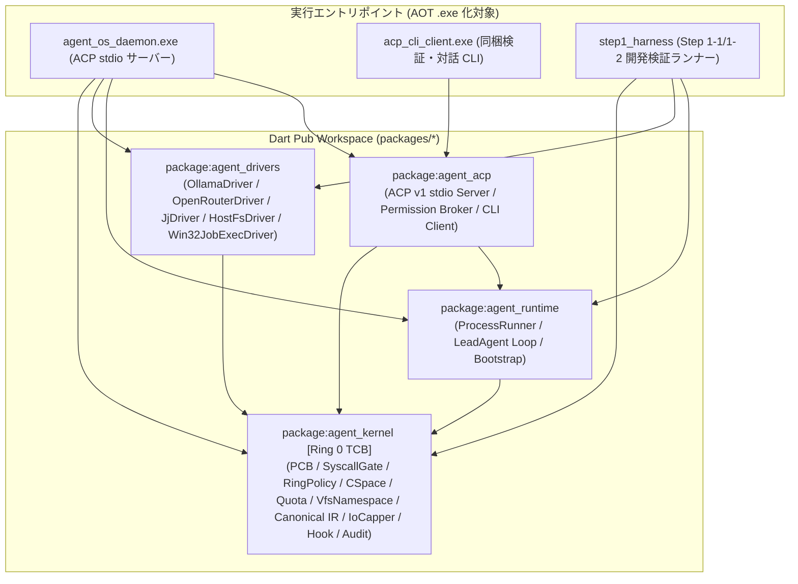
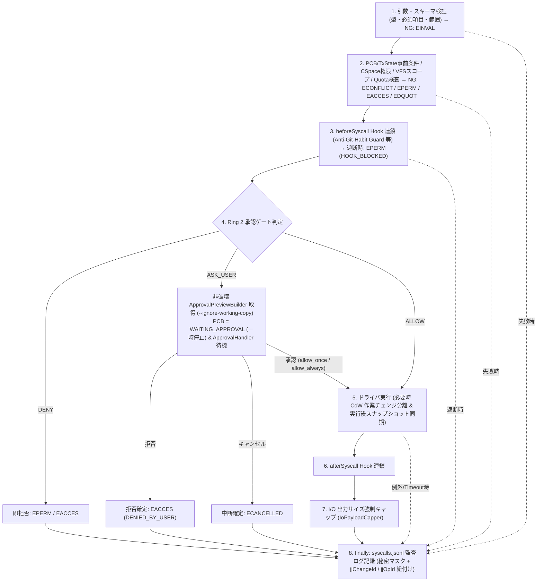

# 40_specification.md — Stage 1 全体アーキテクチャ・横断設計契約・仕様マップ

関連文書:
- 要望・背景: [10_claim.md](./10_claim.md)
- 利用場面・範囲境界: [20_app_requirement.md](./20_app_requirement.md)
- 要求・受け入れ条件: [30_requirement.md](./30_requirement.md)
- 進捗正本・おまかせ判断記録: [90_status.md](./90_status.md)
- 技術調査・実測根拠: [docs/cheatsheet/index.md](../cheatsheet/index.md)
- 分割詳細仕様:
  - [42_spec_kernel_and_llm.md](./42_spec_kernel_and_llm.md)（`REQ-01`, `REQ-03`, `REQ-04`）
  - [42_spec_vfs_jj_and_exec.md](./42_spec_vfs_jj_and_exec.md)（`REQ-02`, `REQ-05`, `REQ-06`, `REQ-07`, `REQ-08`）
  - [42_spec_acp_and_packaging.md](./42_spec_acp_and_packaging.md)（`REQ-09`, `REQ-10`, `REQ-11`）

---

## 1. 現行リポジトリ構造と Stage 1 ターゲット全体構造

### 1.1 現行構造と変更範囲
本リポジトリ（`fm-agent-os-2`）は計画策定時点で `docs/` 配下の構想・調査・計画文書のみが存在し、Dart パッケージや製品コードは未作成の新規構築（Greenfield）状態である。したがって既存製品コードとの後方互換制約はなく、Stage 1（Step 1-1〜1-3）で構築する Pub Workspaces 構成がそのまま初期コードベースとなる。

### 1.2 パッケージ構成と信頼境界（Ring 0 TCB の分離）

D-001: パッケージ構成と Ring 0 カーネル依存分離境界

対応要求: `REQ-01`, `REQ-11`（関連判断: `OM-01`, `OM-05`）

Dart Pub Workspaces を用い、リポジトリを以下の 4 パッケージへ分割する。依存方向は単方向 DAG とし、コアカーネル（`agent_kernel`）が特定 LLM API・HTTP 通信・Win32 FFI・ACP UI 層へ一切依存しないことをパッケージ境界で強制する。

| パッケージ / パス | 責務（持つもの） | 禁止される依存（持たないもの） |
| :--- | :--- | :--- |
| `packages/agent_kernel` | `[D-002]` `SyscallGate`、`[D-005]` `PCB`/`ProtectionRing`/`CSpace`/`Quota`、`[D-006]` I/O キャップ、`[D-007]` Canonical IR、ドライバ抽象 IF、`[D-010]` 監査ロガー、`[D-011]` VFS 名前空間、`[D-017]` Hook | `package:http`、`dart:ffi`、`package:win32`、特定 LLM ベンダー JSON 処理、ACP JSON-RPC 処理、エージェント思考ループ |
| `packages/agent_drivers` | `[D-008]` `OllamaDriver`、`[D-009]` `OpenRouterDriver`、`[D-012]`/`[D-013]` `HostFsDriver`、`[D-014]`/`[D-015]` `JjDriver`、`[D-016]` `Win32JobExecDriver` | エージェント思考ループ、ACP クライアント/サーバー制御 |
| `packages/agent_runtime` | `[D-005]` `ProcessRunner`（Stage 1 は同一 Isolate 論理タスク実行）、`LeadAgent` ReAct ループ、コンパイル時配線 `[D-022]` `KernelBootstrap` | 生ファイル/外部プロセスの直接操作（必ず `SyscallGate` 経由で呼ぶ） |
| `packages/agent_acp` | `[D-018]` ACP `stdio` サーバー、`[D-019]` ストリーム通知、`[D-020]` ACP 承認ハンドラ、`[D-021]` `acp_cli_client` | VFS や `jj` CLI の直接駆動 |

### 1.3 Stage 1 シングルプロセス安全ロックと Stage 2/3 拡張境界
- **Stage 1 で固定する安全ロック（`OM-01`, `OM-02`）**:
  - 稼働するエージェントプロセスは単一の `LeadAgent`（`pid = 1`, `ProtectionRing.ring2`）のみとし、`ResourceQuota.maxChildProcesses = 0` に固定する（`sys_spawn` 等は未登録／`EPERM` ロック）。これにより複数エージェント間の編集競合と承認ダイアログ混線を原理的にゼロにする。
  - Canonical IR は Stage 1 から Prefix 保持 3 セグメント構造 `[D-007]` で保持するが、High Watermark 連動の自動 Clean Page スタブ退避ページャ・小コンテキストモデル切替時の自動フレーム縮小は Stage 2（Step 2-1）の対象とする。
- **Stage 2/3 のために最初から維持する境界**:
  - `LeadAgent` はドライバ実装クラスを直接参照せず、全システムコール（LLM 推論 `sys_llm_chat` を含む）を `SyscallContext(pid, capHandle)` 付きで `[D-002]` `SyscallGate.invoke(...)` に通す。
  - `JjDriver` `[D-014]` は Stage 1 から更新系・スナップショット系操作を単一非同期ミューテックスで直列化し、Stage 3 の並列 `jj workspace` 導入時にそのまま機能する境界とする。

---

## 2. 横断設計契約：優先順位（勝敗規則）と副作用の許容境界【一元正本】

後続のテスト設計・作業分解・実装で解釈の食い違いが生じないよう、競合時の勝敗規則と副作用境界を本節に一元定義する。各 `42_spec_*.md` は本節を参照し、別表現で再定義しない。

### 2.1 `SyscallGate` パイプライン順序とモデル解決優先順位

D-002: SyscallGate 単一通過パイプライン順序と優先順位契約

対応要求: `REQ-01`, `REQ-03`, `REQ-04`, `REQ-08`, `REQ-10`（関連判断: `OM-01`, `OM-04`, `OM-08`）

#### (1) `SyscallGate` 実行パイプラインの厳密順序
すべてのシステムコール呼び出しは、例外なく以下の **Stage 1 → Stage 8** の順序で処理される。前段で拒否・遮断・エラーが確定した場合、それ以降のステージは Stage 8（`finally` 監査記録）を除き実行しない。

- **Stage 2 トランザクション状態事前条件（未分離チェンジ誤操作の即遮断）**: `TxState != TxState.active`（作業チェンジ未分離、または直前の `squash`/`rollback` 完了直後）で `sys_tx_describe` または `sys_tx_squash` が呼ばれた場合は、Stage 4 承認ゲートや Stage 5 `jj` 操作へ一切進まず Stage 2 で即座に `SyscallErrorCode.econflict`（`reason: "NO_ACTIVE_TRANSACTION"`）を返す。
- **最重要順序規約（Stage 3 → Stage 4）**: `beforeSyscall` Hook（`[D-017]` `AntiGitHabitGuardHook` 等）は **必ず Ring 2 承認ゲート判定（Stage 4）より前** に実行する。これにより、LLM が手癖で生の `git status` や `jj squash` を `sys_exec` に渡した際、利用者へ無駄な承認確認ダイアログを出すことなく即座にブロックし、`sys_jj_*` への誘導エラーを返せる。また Stage 4 で `ASK_USER` となった際のプレビュー構築は `SyscallDefinition` に登録された副作用ゼロの `ApprovalPreviewBuilder`（`--ignore-working-copy` 参照）経由で行い、`[D-001]` のパッケージ境界と承認前副作用ゼロを両立する。
- **監査の完全性（Stage 8）**: Stage 1〜7 のどの段階で終了（正常完了・引数エラー・スコープ違反・Hook 遮断・承認拒否・キャンセル・タイムアウト）しても、`try / finally` により必ず `syscalls.jsonl` `[D-010]` に 1 行の構造化監査レコードを出力する。

#### (2) プロバイダ／モデル指定の優先順位（勝敗規則）と切替境界
推論システムコール `sys_llm_chat` が使用する `<providerId>/<modelName>` は、以下の優先順位（上が常に勝つ）で決定する：

| 優先度 | 指定経路 | 有効範囲・勝敗規則 |
| :---: | :--- | :--- |
| **1（最優先）** | `session/prompt` の `params._meta["fm_agent_os/modelOverride"]` | **当該ユーザー入力ターンのみ**一時適用。セッションの現在設定値は上書きしない。 |
| **2** | `session/set_config_option` (`configId: "model"`) / CLI `/model` | セッションの現在選択モデルを更新し、以降のターンで優先度 1 が無い限り継続適用する。 |
| **3** | エンジン／セッション起動時指定（CLI `--model` 引数・起動設定） | セッション生成（`session/new`）時の初期モデル値となる。 |
| **4（既定）** | システム既定値（`local-ollama/gemma4:12b` 等の Local Ollama 既定設定） | 上記 1〜3 がいずれも未指定の場合に適用する。 |

- **モデル識別子の正規化規則**: 先頭の最初の `/` で `providerId`（`local-ollama` | `ollama-cloud` | `openrouter`）と `modelName`（残りの文字列全体、例: `anthropic/claude-sonnet-4` や `gemma4:12b`）へ一意に分割する。未知の `providerId` や空 `modelName` は通信前に `EINVAL` で拒否する。
- **モデル切替境界と Canonical IR 射影規則**: モデル切替は **ユーザー入力ターン境界**（新規 `session/prompt` 開始時点、またはエラー後の再試行境界）で確定し、1 ターン内の Tool Call 連続往復中は同一モデルを維持する。ドライバ射影時は `[D-007]` の規則（Segment 0 不変維持、`[a-zA-Z0-9]{9}` `tool_call_id` ペア正規化、異プロバイダ／異モデル間での `rawReasoningDetails` / `thought_signature` 剥離、空 `content` 正規化）を適用する。

---

### 2.2 副作用の許容境界とスナップショット・隔離規則

D-003: 副作用の許容境界とワークスペース保護規則

対応要求: `REQ-02`, `REQ-04`, `REQ-05`, `REQ-10`（関連課題: `A-02` 解決）

1. **`WAITING_APPROVAL` 承認完了前の外部・永続副作用ゼロ境界**:
   - Stage 4 で `ASK_USER` と判定された操作（`sys_tx_squash`、非定型 `sys_exec` 等）は、利用者から明示承認（`allow_once` または `allow_always`）が返るまで Stage 5（ドライバ実行）へ進まない。
   - 待機中の拒否（`reject_once` → `EACCES`）またはキャンセル（`session/cancel` → `ECANCELLED`）時は、ワークスペースファイル・`jj` リポジトリ履歴・外部 OS プロセスに対する副作用は **厳密に 0** とする（記録されるのは `.agent_os/logs/` 内の監査ログのみ）。
2. **`JjDriver` の Read-Only 非破壊境界と編集後スナップショット整合（`A-02` 解決）**:
   - **Read-Only 探索状態（`TxState.readOnly`）および履歴参照時**: セッション開始後、変更系システムコール（`sys_edit_block`, `sys_write_file`, `sys_exec`, 明示 `sys_tx_begin`）が一度も実行されていない間、ならびに過去リビジョン指定（`rev != "@"`）や `--at-op` 指定時は、`JjDriver` `[D-014]` がすべての `jj` 読取コマンド（監査用 `op_id` 取得を含む）に **`--ignore-working-copy`** を付与する。これにより、人間の未スナップショット変更があってもワーキングコピーのスナップショットは誘発されず、**Read-Only 探索前後で `jj op log` の先頭 `op_id` は一切変化しない**。
   - **初回変更直前の CoW 作業チェンジ分離（`TxState.active` への遷移）**: 初回の変更系操作（`sys_edit_block`, `sys_write_file`, `sys_exec`, または明示 `sys_tx_begin`）が Stage 5 に入る直前、`JjDriver` 単一ミューテックス内で ① `--ignore-working-copy` **なし** で当時の人間作業状態をスナップショットして開始 `baseOpId`（`op_start`）を記録し、直ちに ② `jj new` でエージェント専用の作業チェンジ `@` を切る `[D-015]`。これにより人間の直前チェンジ `@-` は 1 バイトも汚れず、`jj op restore <baseOpId>` で人間の未コミット編集を含め 100% 復元できる。
   - **アクティブ作業チェンジ編集後の明示スナップショット同期**: `TxState.active` 中に `sys_edit_block`, `sys_write_file`, `sys_exec` が実行された直後（および `sys_tx_squash` の承認完了後・Stage 5 統合実行直前。なお Stage 4 承認要求用の diff プレビュー生成は `--ignore-working-copy` による完全非破壊読取で行い、承認完了前に `op_id` や `commit_id` を一切進めない）は、`JjDriver` 単一ミューテックス内で明示スナップショット同期を実行して最新 `jjChangeId` / `jjOpId` を確定させる。これにより直後の監査ログ `syscalls.jsonl`、`sys_jj_status`、`sys_jj_diff`、承認ダイアログの diff が実ファイル状態と完全に一致する。
3. **カーネル管理ディレクトリ（`.agent_os/`）の非汚染隔離**:
   - 監査ログ（`syscalls.jsonl`, `llm_io.jsonl`）および I/O キャップ退避データ（`io_spill/`）は `/workspace/.agent_os/` 配下に保存する。
   - カーネル起動時（いかなる `jj` コマンド実行よりも前）に、`/workspace/.agent_os/.gitignore`（内容: `*\n`）を自動生成する（ユーザー管理下のルート `.gitignore` を勝手に編集して `@` に差分を作らないため、自己完結 `.agent_os/.gitignore` 方式を採用し、併せて本リポジトリ自身のルート `.gitignore` にも `.agent_os/` を記載する）。これにより監査ログ追記が `@` を汚すことも、`jj op restore` 実行時に監査ログが消去されることも起きない（`jj 0.46.0` 実機検証済み）。
   - VFS `[D-011]` はエージェントからの `/workspace/.agent_os`・`/workspace/.jj`・`/workspace/.git`（およびその配下すべて）、ならびに秘密情報ファイル `/workspace/.env`・`/workspace/.env.*` に対する **Read / Write 双方向（`sys_read_lines`・保護パス直指定の `sys_glob`/`sys_grep`・`sys_edit_block`・`sys_write_file` のすべて）** を一律 `SyscallErrorCode.eacces`（`reason: "PROTECTED_INTERNAL_PATH"`）で拒否する（`/workspace` 等の親に対する `sys_glob`/`sys_grep` 走査では `.jj/**`, `.git/**`, `.agent_os/**`, `.env`, `.env.*` を自動スキップする）。これにより監査ログや `.env` 内 API キー平文がエージェントのコンテキストへ読み取られる抜け穴も封じ込める。

---

### 2.3 Ring 2 承認ゲート選別規則（`OM-04` 確定契約）

`LeadAgent`（Ring 2）が発行する各システムコールの Stage 4 判定規則は以下の通りとする（実装詳細は `[D-016]`, `[D-020]`）。

| システムコール | Ring 2 判定 | 条件・根拠 |
| :--- | :---: | :--- |
| `sys_read_lines`, `sys_glob`, `sys_grep` | **`ALLOW`** | `/workspace` スコープ内かつ保護対象外の非破壊読取（スコープ外および保護内部パスは Stage 2 で `EACCES` 遮断済み）。 |
| `sys_jj_status`, `sys_jj_log`, `sys_jj_diff` | **`ALLOW`** | 非破壊 VCS 状態・履歴・差分参照。 |
| `sys_llm_chat` | **`ALLOW`** | クオータ上限内の LLM 推論要求。 |
| `sys_tx_begin`, `sys_tx_describe`, `sys_tx_rollback` | **`ALLOW`** | 作業チェンジ `@` の分離、アクティブ作業チェンジの説明更新（`TxState != TxState.active` での `sys_tx_describe` は Stage 2 で `ECONFLICT` 即拒否）、およびセッション内 `baseOpId` への安全ロールバック（セッション開始前 `op_id` 指定は Stage 2/5 で `EACCES` 拒否）。 |
| `sys_edit_block`, `sys_write_file` | **`ALLOW`** | `/workspace` 内かつ分離された作業チェンジ `@` 上での CAS 付き仮編集（`@-` 非破壊・いつでも `sys_tx_rollback` 可）。 |
| `sys_tx_squash` | **`ASK_USER`** | `TxState != TxState.active` の場合は Stage 2 で `ECONFLICT`（`NO_ACTIVE_TRANSACTION`）として即拒否。`TxState.active` の場合のみ Stage 4 へ進み、`--ignore-working-copy` で非破壊取得した統合対象 `jj diff` を提示して必ず利用者承認を要求する。 |
| `sys_exec`（定型安全検証コマンド） | **`ALLOW`** | **下記「即時許可 5 条件」をすべて満たす場合のみ**即時許可。 |
| `sys_exec`（上記以外の一般コマンド） | **`ASK_USER`** | パッケージ取得・ビルド・任意スクリプト・シェル演算子を含むコマンド等は、実行コマンド全文と作業ディレクトリを提示して利用者承認を要求する（なお生 `git`/`jj` は Stage 3 Hook で事前遮断済み）。 |
| 未許可・ロック対象（`sys_spawn` 等） | **`DENY`** | Stage 1 シングルプロセス安全ロックにより `EPERM`。 |

#### `sys_exec` が Ring 2 で即時許可（`ALLOW`）となる必須 5 条件
※ **単一文字列コマンドの事前正規化**: LLM が `{command: "dart test", args: null}` のように `args` 省略で空白区切りのコマンド文字列を渡した場合、シェルメタ文字（下記条件 1）を含まなければ、カーネルがクォート対応の空白分割により実行ファイル名と引数配列（例: `executable = "dart"`, `args = ["test"]`）へ正規化してから Stage 3 Hook・Stage 4 本判定・Stage 5 `Process.start(runInShell: false)` `[D-016]` へ引き渡す。

以下の **1〜5 をすべて同時に満たす場合のみ** `ALLOW` とし、1 つでも満たさない場合は `ASK_USER` とする：
1. **シェルメタ文字・制御文字ゼロ**: コマンド・全引数に `&`, `|`, `;`, `>`, `<`, `` ` ``, `$()`, `%`, `\r`, `\n` を一切含まないこと。
2. **シェルラッパー不使用**: 実行バイナリが `cmd`, `powershell`, `pwsh`, `sh`, `bash`, `wsl` 等のシェル解釈器ではなく、`runInShell: false` で直接起動されること。
3. **ワークスペース内完結**: `workingDir` が `/workspace` 配下であり、引数に `..` セグメントや `/workspace` 外を指す絶対パス／UNC パス／ドライブ指定を含まないこと。
4. **事前登録済みの定型検証コマンドパターンに一致**:
   - `dart test`（引数なし、またはワークスペース内相対テストパスと読取系オプション `-r`, `--reporter`, `-n`, `--name`, `-N`, `--plain-name`, `-t`, `--tags`, `-x`, `--exclude-tags`, `--fail-fast`, `--concurrency=<1..8>` のみ）
   - `dart analyze`（引数なし、またはワークスペース内相対パスと `--fatal-infos`, `--fatal-warnings`, `--format` のみ）
   - `dart format`（**`--output=none` が必須**。任意で `--set-exit-if-changed` およびワークスペース内相対パスのみ。ファイルを直接書き換える `--output=write` やフラグ省略時は即時許可対象外）
5. **タイムアウト上限内**: 要求 `timeoutMs` が `120,000` ms（2 分）以下であること。

---

### 2.4 統一エラーモデルと秘密情報非露出規則

D-004: 統一エラー体系（SyscallErrorCode）と秘密情報非露出規則

対応要求: `REQ-01`, `REQ-02`, `REQ-03`, `REQ-04`, `REQ-06`, `REQ-10`

1. **クラッシュしない構造化システムコール応答**:
   - すべてのシステムコールは未捕捉例外をユーザー空間へ漏らさず、`SyscallResult<T>`（`ok: true, value` または `ok: false, error: SyscallError`）を返す。LLM への Tool Result 返却時は `SyscallError`（`code`, `reason`, `message`, `recoverable`, `hint`）を JSON 文字列化して渡し、自律的な修正・別案検討・ロールバックを可能にする。
2. **標準エラーコード一覧（`SyscallErrorCode`）**:
   - `EINVAL`: 引数型不正、必須項目欠落、不正行範囲、未知プロバイダ／モデル形式、不正 `op_id` 指定。
   - `ENOENT`: 対象ファイル・ディレクトリ・リビジョンが存在しない。
   - `EEXIST`: `sys_write_file` の新規作成モード（`createOnly: true`）で既に対象ファイルが存在する。
   - `ECONFLICT`: CAS ハッシュ不一致（事前読取後にファイルが変化）、`sys_edit_block` の対象ブロックが 0 件一致／2 件以上重複一致で一意に定まらない、またはアクティブ作業チェンジ未分離状態（`TxState != TxState.active`）での `sys_tx_describe` / `sys_tx_squash` 呼び出し（`reason: "NO_ACTIVE_TRANSACTION"`）。
   - `EACCES`: `/workspace` スコープ外アクセス、保護領域（`.jj`, `.git`, `.agent_os`, `.env`, `.env.*`）への Read/Write アクセス、セッション開始前 `op_id` 復元要求、または **Ring 2 承認ゲートでの利用者拒否（`reason: "DENIED_BY_USER"`）**。
   - `EPERM`: ケーパビリティ不足、Stage 1 ロック機能呼び出し、または **`beforeSyscall` Hook によるポリシー遮断（`reason: "HOOK_BLOCKED"`）**。
   - `ETIMEDOUT`: `sys_exec` の Job Object 強制終了タイムアウト、または外部 API 通信タイムアウト。
   - `ECANCELLED`: ACP `session/cancel` 等による実行・承認待ち中断。
   - `EDQUOT`: トークン・費用・システムコール回数等のクオータ上限到達。
   - `EPROVIDER`: LLM API キー未設定、HTTP エラー（`401`/`429`/`5xx`）、接続失敗、不正レスポンス。
   - `EIO`: OS ファイル I/O 失敗、`jj` CLI 非ゼロ終了、Job Object Win32 API エラー。
3. **秘密情報の絶対非露出（Secret Redaction）**:
   - 環境変数 `OPENROUTER_API_KEY`、`OLLAMA_API_KEY`（および任意の `*_API_KEY`, `*_TOKEN`, `*_SECRET`）の実値、ならびに HTTP `Authorization` ヘッダ値（`Bearer ...`）は、`SecretRedactor` により **`syscalls.jsonl`、`llm_io.jsonl`、エラーメッセージ、ACP 通知、`stdout`/`stderr` のすべて** で出力前に `"<REDACTED>"` へ置換する。ログ・状態確認には環境変数名と設定有無（`bool isConfigured`）のみを記録する。

---

## 3. 採用技術の根拠・代案比較・未確認前提条件

### 3.1 主要な設計判断と代案比較

| 論点 | 採用案 | 検討した代案と見送り理由 | 根拠（Cheatsheet / 合意） |
| :--- | :--- | :--- | :--- |
| **VCS / CoW トランザクション基盤** | `JjDriver`（`jj 0.46.0` CLI：`runInShell: false`、カスタム JSON Lines `-T`、非対話 `squash -u`/`-m`） | **代案 A**: 自作インメモリ OverlayFS → `dart test` 等の外部プロセスと実ファイル同期が破綻するため却下。 **代案 B**: `jj log -T 'json(self)'` 単体利用 → 実測で `conflict` と `empty` が欠落するためカスタムテンプレートを採用。 | [jujutsu_cli_046.md](../cheatsheet/jujutsu_cli_046.md) §1.1〜§2（本機実測済み） |
| **Ollama (Local / Cloud) の API 選択** | `OllamaDriver` はネイティブ `/api/chat`（NDJSON）、`OpenRouterDriver` は `/api/v1/chat/completions`（SSE） | **代案**: 3 プロバイダを OpenAI 互換 `/v1/chat/completions` に統一 → 本機 `ollama 0.40.16` 実測で `stream: true` 時に `cached_tokens` が常に `0` になる不具合を確認したため却下（`OM-07`）。 | [llm_providers_and_cache.md](../cheatsheet/llm_providers_and_cache.md) §1.2〜§1.3（本機実測済み） |
| **外部プロセス隔離・強制終了** | `dart:ffi` + `kernel32.dll` Job Object（144 byte 非 `@Packed` 構造体 + `Process.start` 直後 `OpenProcess(0x0101)` 同期割当） | **代案 A**: `Process.killPid` のみ → Windows では孫プロセスが残留するため却下。 **代案 B**: `CreateProcessW(CREATE_SUSPENDED)` + 自前パイプ実装 → 非同期 Stream ブリッジが複雑なため、まず対策 A（同期即時割当＋瞬時終了ハンドリング）を標準とし、漏れ観測時のみ対策 B へ移行する。 | [env_and_dart_windows.md](../cheatsheet/env_and_dart_windows.md) §3〜§4（本機 `<windows.h>`・強制終了実測済み） |
| **ACP モデル切替と固有テレメトリ通知** | ACP v1 標準 `configOptions` (`id: "model"`) + `session/set_config_option` + `_meta["fm_agent_os/..."]` / `_fm_agent_os/tx_rollback` | **代案**: 標準オブジェクト直下に `cachedTokens` や `jjOpId` を追加 → ACP Extensibility 仕様違反（MUST NOT）となり一般 ACP エディタ互換を壊すため却下（`OM-08`）。 | [acp_protocol.md](../cheatsheet/acp_protocol.md) §2〜§3（ACP v1 公式仕様） |

### 3.2 確認済み技術事実と未確認の開始前提条件の区別
本設計では、既に実機確認された能力と、実装・検証工程の開始前に環境整備が必要な未確認事項を厳格に区別する。

1. **本機で実測・確認済みの事実**:
   - Windows 11 Pro 64-bit (`Build 26300`) 上での `jj 0.46.0`（`jj git init`、`--ignore-working-copy`、`--at-op`、カスタム `-T` JSON Lines、`jj new` による `@-` 不変保護、`jj squash -u`/`-m`、`jj op restore` バイト完全一致復元、`.agent_os/.gitignore` による監査ログ非汚染・復元保持）。
   - Local Ollama `0.40.16`（`http://localhost:11434`、`gemma4:12b` / `ministral-3:14b` / `gpt-oss:20b` 導入済み、`/api/chat` ストリーミング + Tool Call + `prompt_eval_cached_count` 返却、およびホスト環境変数 `OLLAMA_HOST=0.0.0.0` の存在）。
   - Win32 `kernel32.dll` Job Object の 64-bit 構造体レイアウト（144 byte、offset 16 `LimitFlags = 0x2000`）およびネスト Job 環境下での子・孫プロセス一括消滅（ゾンビ残留 0 件）。
2. **未確認事項と後続作業の開始条件（隠蔽せず明記）**:
   - **前提条件 P-1（Dart SDK 未導入）**: 現在ホストマシンに `dart.exe` が導入されていない（[env_and_dart_windows.md](../cheatsheet/env_and_dart_windows.md) §1.1, §5）。
     - **影響と開始条件**: 実装工程の最初の WP（ワークスペース骨格構築）開始時に `winget install --id Google.DartSDK`（Dart `>=3.10.0`、確認時点安定版 `3.13.7`）を導入し、`dart --version`、`dart pub get`、および `dart:ffi` を含む最小 `dart compile exe` の成功を確認することを後続実装 WP のゲート条件とする。
   - **前提条件 P-2（クラウド 2 プロバイダの API キー未設定）**: 現在ホスト環境変数に `OPENROUTER_API_KEY` と `OLLAMA_API_KEY` が設定されていない（[llm_providers_and_cache.md](../cheatsheet/llm_providers_and_cache.md) §5）。
     - **影響と開始条件**: コード実装・モック単体テスト（`E1`）および Local Ollama 実機検証は直ちに実施可能である。`REQ-03`・`REQ-04` の実機受け入れ検証（`E2`：3 プロバイダすべてでの疎通・切替・キャッシュ観測）を実施する前までに、利用者が `OPENROUTER_API_KEY` と `OLLAMA_API_KEY` を実行環境（プロセス環境変数、または `.agent_os/.env` 等の Git/jj 追跡外読み込み機構）へ設定することを `E2` 実行開始条件とする。また Ollama Cloud インフラが `prompt_eval_cached_count` を返すか否かは実機疎通時に観測し、未返却モデルでは `[D-010]` の規定通り `cachedTokens: null` として安全に記録する（`OM-06`）。

---

## 4. 分割詳細仕様マップと REQ ↔ 設計ID トレーサビリティ表

### 4.1 分割仕様ファイル一覧

| ファイル | 対象 REQ | 収録する設計項目ID（定義先） | 主な内容 |
| :--- | :--- | :--- | :--- |
| **本ファイル (`40_specification.md`)** | 横断全体 | `[D-001]`〜`[D-004]` | パッケージ依存境界、`SyscallGate` 順序・モデル優先順位、副作用許容境界、Ring 2 選別規則、エラー体系・秘密保護 |
| **[42_spec_kernel_and_llm.md](./42_spec_kernel_and_llm.md)** | `REQ-01`, `REQ-03`, `REQ-04` | `[D-005]`〜`[D-010]` | `PCB`/Ring/安全ロック、I/O 強制キャップ、3 セグメント Canonical IR、`OllamaDriver`、`OpenRouterDriver`、`syscalls.jsonl` / `llm_io.jsonl` |
| **[42_spec_vfs_jj_and_exec.md](./42_spec_vfs_jj_and_exec.md)** | `REQ-02`, `REQ-05`, `REQ-06`, `REQ-07`, `REQ-08` | `[D-011]`〜`[D-017]` | VFS `/workspace` 境界、Read-Only 探索、CAS 編集、`JjDriver` 直列化・非破壊読取・トランザクション制御、Win32 Job Object `sys_exec`、Hook & Anti-Git-Habit Guard |
| **[42_spec_acp_and_packaging.md](./42_spec_acp_and_packaging.md)** | `REQ-09`, `REQ-10`, `REQ-11` | `[D-018]`〜`[D-022]` | ACP v1 `stdio` サーバー、リアルタイム通知、Ring 2 `WAITING_APPROVAL` 承認ゲート、`acp_cli_client`、Pub Workspaces & `dart compile exe` |

### 4.2 `REQ-01` 〜 `REQ-11` 対応設計ID・確認観点一覧（`90_status.md` 転記原票）

| REQ ID | 要求要約 | 対象設計ID | 主な確認箇所・観測結果（詳細は各 `42_spec_*` 参照） | 証跡区分 |
| :--- | :--- | :--- | :--- | :--- |
| **`REQ-01`** | 防波堤カーネル骨格（`SyscallGate` 単一通過・`PCB`/Ring・依存分離）と I/O 出力サイズ強制キャップ | `[D-001]`, `[D-002]`, `[D-004]`, `[D-005]`, `[D-006]` | `agent_kernel/pubspec.yaml` の外部非依存確認（`E3`）、I/O キャップ境界値単体テスト（`E1`）、1万行超ファイル・大量ヒット検索での継続推論観測（`E2`） | `E1 / E2 / E3` |
| **`REQ-02`** | Read-Only 探索（`sys_read_lines`/`glob`/`grep`）と `JjDriver` 非破壊読取による自律読解 | `[D-003]`, `[D-004]`, `[D-011]`, `[D-012]`, `[D-014]` | スコープ外 `EACCES`・`op_id` 不変テスト（`E1`）、実 `jj` リポジトリへの質問応答と前後 `jj op log` 不変観測（`E2`） | `E1 / E2` |
| **`REQ-03`** | Canonical IR と 3 プロバイダ（Local Ollama / OpenRouter / Ollama Cloud）実機対応・毎ターン切替 | `[D-002]`, `[D-004]`, `[D-007]`, `[D-008]`, `[D-009]` | IR 射影（9文字 `tool_call_id`・署名剥離）・秘密マスク・異常系テスト（`E1`）、3 プロバイダ実機 Tool Call 往復および連続ターン切替観測（`E2`） | `E1 / E2` |
| **`REQ-04`** | `syscalls.jsonl`（`jjOpId` 紐付け）監査ログと `llm_io.jsonl`（`cached_tokens` 上昇）監視 | `[D-002]`, `[D-003]`, `[D-004]`, `[D-010]`, `[D-014]` | JSONL スキーマ・全経路出力・秘密マスクテスト（`E1`）、実機実行後の `jj op log` ID 一致突合と連続ターン `cachedTokens` 上昇観測（`E2`） | `E1 / E2` |
| **`REQ-05`** | `JjDriver` トランザクション制御（`op_id` 記録・`jj new` 分離・`describe`/`squash`・`op restore` 復元） | `[D-003]`, `[D-014]`, `[D-015]` | `@-` 不変・`op restore` バイト完全一致・不正 `op_id` 拒否テスト（`E1`）、未コミット変更保護およびテスト失敗時 1 発ロールバック実機観測（`E2`） | `E1 / E2` |
| **`REQ-06`** | CAS（SHA-256 ハッシュ照合）付き編集システムコール（`sys_edit_block`, `sys_write_file`） | `[D-004]`, `[D-011]`, `[D-012]`, `[D-013]` | CAS 一致/不一致・未読上書き `EEXIST`・重複一致 `ECONFLICT`・スコープ外拒否テスト（`E1`）、実エージェントによる読取→CAS編集観測（`E2`） | `E1 / E2` |
| **`REQ-07`** | Windows Job Object（Win32 FFI）外部コマンド実行 `sys_exec` と子孫プロセス一括強制終了 | `[D-006]`, `[D-016]` | 144 byte Job Object FFI 構造確認（`E3`）、孫プロセス生成スクリプトのタイムアウト強制終了（生存 0 件）自動テスト（`E1`）および実機観測（`E2`） | `E1 / E2 / E3` |
| **`REQ-08`** | `beforeSyscall` Hook 機構と Anti-Git-Habit Guard（生 `git`/`jj` 遮断と `sys_jj_*` 誘導） | `[D-002]`, `[D-017]` | 単体/連結シェルでの生 `git`/`jj` 遮断と承認前インターセプトの自動テスト（`E1`）、LLM の生 `git` 試行遮断→次ターン `sys_jj_*` 自律切替の監査ログ観測（`E2`） | `E1 / E2` |
| **`REQ-09`** | ACP（JSON-RPC 2.0 over `stdio`）サーバー分離・リアルタイム状態通知・`acp_cli_client` | `[D-018]`, `[D-019]`, `[D-021]` | NDJSON 入出力・`stdout` 純度・異常 JSON 応答テスト（`E1`）、`acp_cli_client` 接続対話・ストリーム表示・`/model` 切替実機観測（`E2`） | `E1 / E2` |
| **`REQ-10`** | Ring 2 承認ゲート（`WAITING_APPROVAL` 一時停止・ACP 承認確認・拒否時 `EACCES` 防波堤） | `[D-002]`, `[D-003]`, `[D-004]`, `[D-016]`, `[D-020]` | 定型/非定型選別・`WAITING_APPROVAL` 一時停止・拒否時副作用ゼロ＆`EACCES` テスト（`E1`）、`acp_cli_client` での承認確定と拒否→代替行動/ロールバック実機観測（`E2`） | `E1 / E2` |
| **`REQ-11`** | `dart compile exe` 単一ネイティブ実行ファイル化と Stage 1 通しシナリオ完走 | `[D-001]`, `[D-021]`, `[D-022]` | エンジン・CLI 双方の `dart compile exe` ビルド成功（`E1`）、コンパイル済み `.exe` 同士の接続による Stage 1 通し E2E 実機観測（`E2`） | `E1 / E2` |
