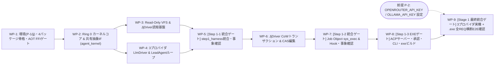

# 41_work_packages.md — Stage 1 作業パッケージ分解・依存関係・段階確認計画

関連文書:
- 進行原則（3 Stage × 3 Step）: [docs/02_development_step.md](../02_development_step.md)
- 利用場面・対象環境・範囲境界: [20_app_requirement.md](./20_app_requirement.md)
- 要求・受け入れ条件（正本）: [30_requirement.md](./30_requirement.md)
- 全体設計・優先順位・副作用境界（一元正本）: [40_specification.md](./40_specification.md)
- 分割詳細仕様:
  - [42_spec_kernel_and_llm.md](./42_spec_kernel_and_llm.md)（`[D-005]`〜`[D-010]`）
  - [42_spec_vfs_jj_and_exec.md](./42_spec_vfs_jj_and_exec.md)（`[D-011]`〜`[D-017]`）
  - [42_spec_acp_and_packaging.md](./42_spec_acp_and_packaging.md)（`[D-018]`〜`[D-022]`）
- 環境・技術実測リファレンス: [docs/cheatsheet/index.md](../cheatsheet/index.md)
- 進捗正本: [90_status.md](./90_status.md)

---

## 1. 作業編成の基本方針と共通規律

1. **判断規則の一元正本参照（再定義禁止）**:
   - システムコール実行パイプライン順序・モデル指定の優先順位（`[D-002]`）、副作用の許容境界・スナップショット規則（`[D-003]`）、Ring 2 承認選別規則（`40_specification.md` §2.3）、統一エラー体系・秘密情報マスク規則（`[D-004]`）、および各ドライバ・プロトコル詳細（`[D-005]`〜`[D-022]`）は、すべて `40_specification.md` および `42_spec_*.md` を唯一の正本とする。本書では判断規則を別表現で書き直さず、各 WP の「入力・編集範囲・成果・開始条件・完了確認・統合と引き渡し」のみを規定する。
2. **`docs/02_development_step.md` の段階確認ゲート厳守**:
   - 「1 ステップにつき新しい複雑さは 1 つだけ入れる」「すべてのステップで目に見える動作事象を確認してから次へ進む」という鉄則に従い、以下の段階ゲートを設ける：
     - **基盤ゲート（`WP-1`）**: 前提 `P-1`（Dart SDK 導入）、ワークスペースルートの `jj git init --colocate`、Pub Workspaces 4 パッケージ骨格、および `kernel32.dll` Job Object FFI を含む最小 `dart compile exe` 動作確認。
     - **Step 1-1 統合確認ゲート（`WP-5`）**: カーネルコア（`WP-2`）、Read-Only 探索・`JjDriver` 読取（`WP-3`）、3 プロバイダ `LlmDriver`・`LeadAgent`（`WP-4`）を `step1_harness` で束ね、Step 1-1 の全 4 事象を実機・自動テストで確認してから Step 1-2 へ進む。
     - **Step 1-2 統合確認ゲート（`WP-7`）**: `JjDriver` CoW トランザクション・CAS 編集（`WP-6`）と Win32 Job Object `sys_exec`・Anti-Git-Habit Guard Hook（`WP-7`）を `step1_harness` で統合し、Step 1-2 の全 4 事象を確認してから Step 1-3 へ進む。
     - **Step 1-3 実装・EXE 化ゲート（`WP-8`）と Stage 1 通し実機統合ゲート（`WP-9`）**: ACP `stdio` サーバー・承認ゲート・`acp_cli_client` の実装および両 `.exe` の `dart compile exe` ビルド・Local Ollama 実機検証（`WP-8`）を先行完了させ、前提 `P-2`（クラウド 2 プロバイダの API キー設定）を満たした状態で 3 プロバイダ全実機＋ネイティブ `.exe` による Stage 1 全 REQ 横断 E2E 確認（`WP-9`）を実施する。
3. **一時ファイル隔離と秘密情報保護の共通制約（全 WP 共通）**:
   - smoke 検証、一時リポジトリ生成、バッチ入力等の作業用一時ファイルは、必ず `c:\Users\rero2\develop\fm-agent-os-2\.planworks\` 配下（または単体テスト内で作成・`tearDown` 即削除する OS 一時ディレクトリ）のみを使用し、製品コードツリーや `docs/` 配下に一時ファイルを残さない。
   - `OPENROUTER_API_KEY`、`OLLAMA_API_KEY` 等の秘密情報の値そのものは、コード・テスト資産・監査ログ・標準出力・証跡文書のいずれにも絶対に書き出さない（環境変数名と設定有無の真偽値のみ記録可：`[D-004]`）。
   - WP の完了確認は実装担当による作業結果確認であり、最終的な `Acceptance` 判定（`pass` 等）は独立した `fm-dev-acceptance` が担う。

---

## 2. WP 依存グラフと並列実行規約

### 2.1 依存関係と段階確認ゲート図



### 2.2 並列実装可能な WP ペアと同時編集防止条件

| 並列可能ペア | 前提（先に確定すべき境界） | 編集範囲の分離境界（同一ファイル同時編集の禁止） | 作業場所（共有ツリー / 分離作業場所）の運用条件 | 統合担当 WP |
| :--- | :--- | :--- | :--- | :--- |
| **`WP-3` ∥ `WP-4`** | `WP-1` で全 4 パッケージの `pubspec.yaml` 依存定義とルート `pubspec.lock` が確定済みであり、かつ `WP-2` で `packages/agent_kernel` の全共有抽象 IF・Canonical IR・`SyscallGate` が確定・テスト通過していること。 | - **`WP-3` 専用編集範囲**: `packages/agent_drivers/lib/src/fs/**`, `packages/agent_drivers/lib/src/jj/**`, `packages/agent_drivers/lib/fs_jj_drivers.dart`, `packages/agent_drivers/test/fs_read_test.dart`, `packages/agent_drivers/test/jj_read_test.dart`<br>- **`WP-4` 専用編集範囲**: `packages/agent_drivers/lib/src/llm/**`, `packages/agent_drivers/lib/llm_drivers.dart`, `packages/agent_drivers/test/llm_drivers_test.dart`, `packages/agent_runtime/lib/src/process_runner.dart`, `packages/agent_runtime/test/lead_agent_loop_test.dart`<br>- **両 WP とも編集禁止**: ルートおよび各パッケージの `pubspec.yaml` / `pubspec.lock`、共有バレル `packages/agent_drivers/lib/agent_drivers.dart`、`packages/agent_runtime/lib/agent_runtime.dart`。 | - **共有作業ツリーで並列実行する場合**: leader が `WP-2` 完了時点の基準 `commit_id` / `jjOpId` を記録して宣言する。両 WP は上記の分離ファイル集合のみを作成・編集し、テスト用 `jj` リポジトリは必ず `.planworks/wp3_tmp/` 等の隔離ディレクトリに生成して本リポジトリルートの `jj` 状態を操作しない。<br>- **分離作業場所（`jj workspace` 等）で並列実行する場合**: `WP-2` 完了リビジョンから分岐し、`WP-5` 開始前に leader が差分を合流・照合する。 | **`WP-5`**（`agent_drivers.dart` / `agent_runtime.dart` / `KernelBootstrap` への束ねと統合検証を実施） |

- 上記以外の WP 間（`WP-1 → WP-2`、`WP-5 → WP-6 → WP-7 → WP-8 → WP-9`）は、前段の段階確認ゲートの成立または同一ファイル（`host_fs_driver.dart`, `jj_driver.dart`, `kernel_bootstrap.dart`, `step1_harness.dart`）への積み上げ変更を伴うため、**直列実行**とする。

---

## 3. Work Package 概要一覧とトレーサビリティ

### 3.1 Work Package 概要テーブル

| WP | Step 区分 | 目的・対応REQ・対象設計ID | 入力・対象箇所 | 成果・完了条件 | 依存・統合・確認 |
| :--- | :--- | :--- | :--- | :--- | :--- |
| **`WP-1`** | 基盤ゲート | 環境整備（`P-1` Dart SDK / `jj` 初期化）・4 パッケージ骨格・AOT FFI 最小ゲート確認<br>`REQ-01`, `REQ-07`, `REQ-11`<br>`[D-001]`, `[D-016]`, `[D-022]` | `40` §1.2/§3.2、`42_acp` §4、`env_and_dart_windows.md`<br>対象: ルート設定、`packages/*` 骨格、`.planworks/wp1_ffi_gate/` | Dart `>=3.10.0` 導入、ルート `.gitignore` + `jj git init --colocate`、`dart pub get` / `analyze` 成功、144 byte Job Object FFI の最小 `dart compile exe` 実行成功 | 依存なし（`P-1` 解消含む）。本 WP の成功を `WP-2`〜`WP-9` 全作業の開始条件とする |
| **`WP-2`** | Step 1-1（コア） | Ring 0 カーネルコア基盤と共有抽象 IF 実装<br>`REQ-01`〜`04`, `REQ-06`, `REQ-08`, `REQ-10`<br>`[D-001]`〜`[D-008]`, `[D-010]`, `[D-011]`, `[D-017]`, `[D-020]` | `40` §1〜§2、`42_kernel` §1〜§3、`42_vfs` §1.1/§4、`42_acp` §2<br>対象: `packages/agent_kernel/**` | `PCB` / Ring 2 安全ロック、`SyscallGate`、`IoPayloadCapper`、3セグメント Canonical IR & 射影器、`AuditLogger` & `SecretRedactor`、`VfsNamespace`、各抽象 IF の実装と単体テスト通過 | `WP-1` 完了後開始。外部非依存（`E3`）と境界値単体テスト（`E1`）を確認し `WP-3`・`WP-4` へ共有 IF を引き渡す |
| **`WP-3`** | Step 1-1（ドライバA） | Read-Only VFS 探索と `JjDriver` 直列化・非破壊読取実装<br>`REQ-02`, `REQ-04`, `REQ-05`<br>`[D-003]`, `[D-004]`, `[D-006]`, `[D-011]`, `[D-012]`, `[D-014]` | `40` §2.2/§2.4、`42_vfs` §1.1/§1.2/§2.1、`jujutsu_cli_046.md`<br>対象: `packages/agent_drivers/lib/src/{fs,jj}/` | `sys_read_lines` / `glob` / `grep`、`JjDriver`（`AsyncMutex`・`--ignore-working-copy`・カスタム `-T`）の `sys_jj_status` / `log` / `diff` 実装と `op_id` 不変・境界遮断単体テスト通過 | `WP-2` 完了後開始（**`WP-4` と並列可**）。`WP-5` でランタイムへ統合 |
| **`WP-4`** | Step 1-1（ドライバB） | 3 プロバイダ `LlmDriver` と `LeadAgent` コアループ実装<br>`REQ-03`, `REQ-04`, `REQ-01`<br>`[D-002]`, `[D-004]`, `[D-005]`, `[D-007]`〜`[D-010]` | `40` §2.1/§2.4、`42_kernel` §1.1/§2/§3、`llm_providers_and_cache.md`<br>対象: `packages/agent_drivers/lib/src/llm/`、`packages/agent_runtime/lib/src/process_runner.dart` | `OllamaDriver`（Local/Cloud `/api/chat`）、`OpenRouterDriver`（Sticky Routing / `cache_control` / SSE）、`ProcessRunner` & `LeadAgent` ループ実装とモック単体テスト・Local Ollama 疎通通過 | `WP-2` 完了後開始（**`WP-3` と並列可**）。`WP-5` で全ドライバと束ねる |
| **`WP-5`** | **Step 1-1 統合ゲート** | `KernelBootstrap`・`step1_harness` 統合と Step 1-1 動作事象確認<br>`REQ-01`〜`REQ-04`<br>`[D-001]`〜`[D-003]`, `[D-005]`〜`[D-007]`, `[D-010]`, `[D-022]` | `WP-3`・`WP-4` 成果、`20` §2.1、`42_acp` §4.2<br>対象: `agent_drivers.dart`, `packages/agent_runtime/**` | `step1_harness` による Step 1-1 全 4 事象（自律読解＆`op_id`不変、1万行 I/O キャップ、ターン毎切替、`syscalls.jsonl`/`llm_io.jsonl` `cachedTokens` 上昇）の確認完了 | `WP-3`・`WP-4` 完了後開始。Step 1-1 ゲート通過を `WP-6` の開始条件とする |
| **`WP-6`** | Step 1-2（VCS/編集） | `JjDriver` CoW トランザクション制御と CAS ファイル編集実装<br>`REQ-05`, `REQ-06`<br>`[D-003]`, `[D-004]`, `[D-011]`〜`[D-015]` | `40` §2.2〜§2.4、`42_vfs` §1.3/§2.2<br>対象: `packages/agent_drivers/lib/src/{fs,jj}/` | `ensureActiveTransaction` / `sys_tx_begin` / `describe` / `squash` / `rollback`・明示スナップショット同期、および CAS 付き `sys_edit_block` / `sys_write_file` 実装と単体テスト通過 | `WP-5` 完了後開始。`@-` 無傷・バイト完全一致復元・CAS 異常系（`E1`）を確認し `WP-7` へ引き渡す |
| **`WP-7`** | **Step 1-2 統合ゲート** | Win32 Job Object `sys_exec`・Anti-Git-Habit Guard Hook 実装と Step 1-2 動作事象確認<br>`REQ-05`〜`REQ-08`, `REQ-10`<br>`[D-002]`, `[D-006]`, `[D-016]`, `[D-017]`, `[D-022]` | `WP-6` 成果、`20` §2.2、`40` §2.1/§2.3、`42_vfs` §3〜§4<br>対象: `packages/agent_drivers/lib/src/{exec,hooks}/`、`packages/agent_runtime/**` | `Win32JobExecDriver`、`SysExecClassifier`、`AntiGitHabitGuardHook` 実装、`step1_harness` 統合、Step 1-2 全 4 事象（`@-` 無傷、1発復元、孫プロセス残留0件、生 `git`/`jj` 遮断→`sys_jj_*` 切替）確認 | `WP-6` 完了後開始。Step 1-2 ゲート通過を `WP-8` の開始条件とする |
| **`WP-8`** | **Step 1-3 EXEゲート** | ACP v1 `stdio` サーバー・ストリーム通知・Ring 2 承認ゲート・`acp_cli_client`・ネイティブ `.exe` 化確認<br>`REQ-09`, `REQ-10`, `REQ-11`<br>`[D-002]`〜`[D-004]`, `[D-018]`〜`[D-022]` | `WP-7` 成果、`20` §2.3、`42_acp` §1〜§4、`acp_protocol.md`<br>対象: `packages/agent_acp/**`、`build/*.exe`（ビルド出力） | ACP サーバー・通知・`AcpApprovalHandler`・`acp_cli_client` 実装、`dart compile exe` による両 `.exe` 生成成功、Local Ollama 実機での ACP 対話・承認進行・拒否 `EACCES` 確認 | `WP-7` 完了後開始（`P-2` 未設定でも完遂可）。生成 `.exe` 一式を `WP-9` へ引き渡す |
| **`WP-9`** | **Stage 1 最終統合ゲート** | 3 プロバイダ実機 API（前提 `P-2`）＋ ネイティブ `.exe` による Stage 1 全 REQ 横断 E2E 動作確認<br>`REQ-01`〜`REQ-11`（全 REQ 統合）<br>`[D-001]`〜`[D-022]` | `WP-8` 成果（両 `.exe`）、前提 `P-2` API キー、`30` §1〜§3<br>対象: 実機検証証跡（必要時の実機通信微調整のみ） | `build/acp_cli_client.exe` ⇄ `build/agent_os_daemon.exe` と `Local Ollama`・`OpenRouter`・`Ollama Cloud` 3 実機すべてを用いた全確認事象完走とログ突合完了 | `WP-8` 完了 **かつ 前提 `P-2` 設定済み** で開始。完了後に独立 `fm-dev-acceptance` へ引き渡す |

---

### 3.2 `REQ-01` 〜 `REQ-11` ↔ WP 対応表（`90_status.md` `WP` 列転記原票）

| REQ ID | 要求要約 | 対象設計ID | 対応 WP（主実装 → 段階/最終統合確認） |
| :--- | :--- | :--- | :--- |
| **`REQ-01`** | 防波堤カーネル骨格（`SyscallGate` 単一通過・`PCB`/Ring・依存分離）と I/O 出力サイズ強制キャップ | `D-001, D-002, D-004, D-005, D-006` | `WP-1, WP-2, WP-4, WP-5, WP-9` |
| **`REQ-02`** | Read-Only 探索（`sys_read_lines`/`glob`/`grep`）と `JjDriver` 非破壊読取による自律読解 | `D-003, D-004, D-011, D-012, D-014` | `WP-2, WP-3, WP-5, WP-9` |
| **`REQ-03`** | Canonical IR と 3 プロバイダ（Local Ollama / OpenRouter / Ollama Cloud）実機対応・毎ターン切替 | `D-002, D-004, D-007, D-008, D-009` | `WP-2, WP-4, WP-5, WP-9` |
| **`REQ-04`** | `syscalls.jsonl`（`jjOpId` 紐付け）監査ログと `llm_io.jsonl`（`cached_tokens` 上昇）監視 | `D-002, D-003, D-004, D-010, D-014` | `WP-2, WP-3, WP-4, WP-5, WP-9` |
| **`REQ-05`** | `JjDriver` トランザクション制御（`op_id` 記録・`jj new` 分離で `@-` 保護・`squash`・`op restore` 1発復元） | `D-003, D-014, D-015` | `WP-3, WP-6, WP-7, WP-9` |
| **`REQ-06`** | CAS（SHA-256 ハッシュ照合）付きファイル編集（`sys_edit_block`, `sys_write_file`） | `D-004, D-011, D-012, D-013` | `WP-2, WP-6, WP-7, WP-9` |
| **`REQ-07`** | Windows Job Object（Win32 FFI）外部コマンド実行 `sys_exec` とタイムアウト時の子孫一括強制終了 | `D-006, D-016` | `WP-1, WP-7, WP-9` |
| **`REQ-08`** | `beforeSyscall` Hook 機構と Anti-Git-Habit Guard（生 `git`/`jj` 遮断と `sys_jj_*` 自律誘導） | `D-002, D-017` | `WP-2, WP-7, WP-9` |
| **`REQ-09`** | ACP（JSON-RPC 2.0 over `stdio`）サーバー分離・リアルタイム状態通知・簡易 CLI クライアント | `D-018, D-019, D-021` | `WP-8, WP-9` |
| **`REQ-10`** | 保護リング（Ring 2）承認ゲート（`WAITING_APPROVAL` 一時停止・承認進行・拒否時 `EACCES` 防波堤） | `D-002, D-003, D-004, D-016, D-020` | `WP-2, WP-7, WP-8, WP-9` |
| **`REQ-11`** | `dart compile exe` 単一ネイティブ実行ファイル化と Stage 1 通しシナリオ完走 | `D-001, D-021, D-022` | `WP-1, WP-8, WP-9` |

### 3.3 全設計項目（`[D-001]` 〜 `[D-022]`）カバレッジ照合表

| 設計ID | 定義文書 | 主実装 WP | 統合・実機確認 WP |
| :--- | :--- | :--- | :--- |
| `[D-001]` | `40_specification.md` §1.2 | `WP-1`, `WP-2` | `WP-5`, `WP-8`, `WP-9` |
| `[D-002]` | `40_specification.md` §2.1 | `WP-2`, `WP-4` | `WP-5`, `WP-7`, `WP-8`, `WP-9` |
| `[D-003]` | `40_specification.md` §2.2 | `WP-2`, `WP-3`, `WP-6` | `WP-5`, `WP-7`, `WP-8`, `WP-9` |
| `[D-004]` | `40_specification.md` §2.4 | `WP-2`（全ドライバ適用: `WP-3`〜`WP-8`） | `WP-5`, `WP-7`, `WP-8`, `WP-9` |
| `[D-005]` | `42_spec_kernel_and_llm.md` §1.1 | `WP-2`, `WP-4` | `WP-5`, `WP-9` |
| `[D-006]` | `42_spec_kernel_and_llm.md` §1.2 | `WP-2` | `WP-3`, `WP-5`, `WP-7`, `WP-9` |
| `[D-007]` | `42_spec_kernel_and_llm.md` §2.1 | `WP-2` | `WP-4`, `WP-5`, `WP-9` |
| `[D-008]` | `42_spec_kernel_and_llm.md` §2.2 | `WP-2`（抽象）, `WP-4`（具象） | `WP-5`, `WP-8`, `WP-9` |
| `[D-009]` | `42_spec_kernel_and_llm.md` §2.3 | `WP-4` | `WP-5`（モック）, `WP-9`（実機） |
| `[D-010]` | `42_spec_kernel_and_llm.md` §3 | `WP-2` | `WP-3`, `WP-4`, `WP-5`, `WP-9` |
| `[D-011]` | `42_spec_vfs_jj_and_exec.md` §1.1 | `WP-2`, `WP-3` | `WP-5`, `WP-6`, `WP-9` |
| `[D-012]` | `42_spec_vfs_jj_and_exec.md` §1.2 | `WP-3` | `WP-5`, `WP-9` |
| `[D-013]` | `42_spec_vfs_jj_and_exec.md` §1.3 | `WP-6` | `WP-7`, `WP-9` |
| `[D-014]` | `42_spec_vfs_jj_and_exec.md` §2.1 | `WP-3`, `WP-6`（同期部） | `WP-5`, `WP-7`, `WP-9` |
| `[D-015]` | `42_spec_vfs_jj_and_exec.md` §2.2 | `WP-6` | `WP-7`, `WP-8`, `WP-9` |
| `[D-016]` | `42_spec_vfs_jj_and_exec.md` §3 | `WP-1`（FFIゲート）, `WP-7`（本実装） | `WP-7`, `WP-8`, `WP-9` |
| `[D-017]` | `42_spec_vfs_jj_and_exec.md` §4 | `WP-2`（抽象）, `WP-7`（具象） | `WP-7`, `WP-9` |
| `[D-018]` | `42_spec_acp_and_packaging.md` §1.1 | `WP-8` | `WP-8`, `WP-9` |
| `[D-019]` | `42_spec_acp_and_packaging.md` §1.2 | `WP-8` | `WP-8`, `WP-9` |
| `[D-020]` | `42_spec_acp_and_packaging.md` §2 | `WP-2`（コア抽象）, `WP-8`（ACP実装） | `WP-8`, `WP-9` |
| `[D-021]` | `42_spec_acp_and_packaging.md` §3 | `WP-8` | `WP-8`, `WP-9` |
| `[D-022]` | `42_spec_acp_and_packaging.md` §4 | `WP-1`（骨格）, `WP-5`/`WP-7`（束ね）, `WP-8`（EXE化） | `WP-8`, `WP-9` |

---

## 4. 各 Work Package 詳細定義（`WP-1` 〜 `WP-9`）

### WP-1：開発環境整備（`P-1` Dart SDK / `jj` 初期化）・Pub Workspaces 4パッケージ骨格・AOT FFI 最小ゲート確認

```text
WP-ID / 目的 / 対応REQ:
  WP-1 / 前提 P-1（Dart SDK 導入）と本リポジトリの jj git init --colocate 初期化を実施し、[D-001]・[D-022] の Pub Workspaces 4パッケージ骨格および kernel32.dll Job Object FFI を含む最小 dart compile exe 動作を検証して後続全 WP の技術基盤ゲートを通過させる / REQ-01, REQ-07, REQ-11（対象設計ID: [D-001], [D-016], [D-022]）

必要な入力・参照版:
  - 40_specification.md §1.2 [D-001], §2.2 [D-003](3), §3.2（前提条件 P-1）
  - 42_spec_acp_and_packaging.md §4 [D-022]（ターゲット構成・依存定義・AOT 制約）
  - 42_spec_vfs_jj_and_exec.md §3 [D-016]（144 byte Job Object FFI 構造体仕様）
  - docs/cheatsheet/env_and_dart_windows.md §1〜§5, docs/cheatsheet/jujutsu_cli_046.md §1.1

変更する範囲と維持する振る舞い:
  - 作成範囲:
    - ルート `.gitignore`、`pubspec.yaml`、`analysis_options.yaml`
    - ルート VCS 初期化（`.jj/`・`.git/`：colocated 構成）
    - `packages/agent_kernel/`、`packages/agent_drivers/`、`packages/agent_runtime/`、`packages/agent_acp/` の各 `pubspec.yaml`（[D-022] §4.1 の依存パッケージをこの時点で一括定義し、後続並列 WP での `pubspec.lock` 更新競合を防ぐ）、初期 `lib/<pkg>.dart`、最小疎通 `test/`
    - 一時検証用領域: `.planworks/wp1_ffi_gate/`（AOT FFI 検証用コード・出力バイナリ。確認後に不要バイナリを掃除し製品ツリーへは一切混ぜない）
  - 維持する振る舞い:
    - 既存の `docs/**` 配下の計画・調査文書を一切変更・毀損しないこと。
    - `[D-001]` のパッケージ依存分離境界（特に `agent_kernel` が HTTP・FFI・UI 依存を持たないこと）を `pubspec.yaml` 上で厳守すること。

作る成果:
  1. ホスト環境に導入・PATH 解決された Dart SDK（`>=3.10.0`）。
  2. `.dart_tool/`, `build/`, `.agent_os/`, `.planworks/`, `.env` 等を除外設定したルート `.gitignore` と、`jj git init --colocate`（およびローカル `user.name` / `user.email` 設定）済みのワークスペースリポジトリ。
  3. 単一 `pubspec.lock` で依存解決済みの Pub Workspaces 4 パッケージ骨格一式。
  4. `.planworks/wp1_ffi_gate/` を用いた、`DynamicLibrary.open('kernel32.dll')` + `[D-016]` 144 byte Job Object FFI（子孫プロセス強制終了確認含む）の `dart compile exe` ビルド・ネイティブ実行成功確認結果。

開始条件・依存:
  - 先行 WP 依存なし（実装工程の先頭ゲート WP）。
  - ホストマシンで `winget install --id Google.DartSDK` 等による Dart SDK 導入コマンドを実行可能であること。

完了条件・確認方法:
  - [E1] `dart --version` が `3.10.0` 以上を返すこと。
  - [E1] ワークスペースルートで `jj status` と `jj op log --limit 2` が終了コード `0` で動作し、`.planworks/` や `.dart_tool/` が未追跡除外されていること。
  - [E1/E3] ワークスペースルートで `dart pub get`、`dart analyze`、`dart test` がすべて終了コード `0` で通過し、`packages/agent_kernel/pubspec.yaml` に禁止依存が含まれないこと。
  - [E1/E2] `.planworks/wp1_ffi_gate/` の最小 Job Object FFI 検証コードが `dart compile exe` で終了コード `0` で `.exe` 化され、生成 `.exe` 単体実行で `SetInformationJobObject`・`AssignProcessToJobObject`・子孫プロセス強制終了（残留 0 件）が観測できること。
  - **Go / No-Go 条件**: 上記 4 点がすべて成功した場合のみ Go とし、1 点でも不成立の場合は後続 WP を開始せず要因を leader へ報告する。

統合先・後続への引き渡し:
  - 確定した Pub Workspaces 骨格・`pubspec.lock`・初期 `jj` コミット/チェンジ ID を `WP-2`（および後続全 WP）の基準版として引き渡す。

未実施・未解決: 実行前に決めること
  - なし（本機の Dart SDK 未導入 `P-1` は本 WP の作業内で解消する）。
```

---

### WP-2：Ring 0 カーネルコア基盤と共有抽象インターフェース実装（`agent_kernel`）

```text
WP-ID / 目的 / 対応REQ:
  WP-2 / 外部通信・FFI・UI 非依存の `packages/agent_kernel` にて、PCB・シングルプロセス安全ロック・SyscallGate・IoPayloadCapper・3セグメント Canonical IR & 射影器・AuditLogger & SecretRedactor・VfsNamespace・各ドライバ/Hook/承認の共有抽象 IF を実装し、後続の並列ドライバ実装境界を確定する / REQ-01, REQ-02, REQ-03, REQ-04, REQ-06, REQ-08, REQ-10（対象設計ID: [D-001]〜[D-008], [D-010], [D-011], [D-017], [D-020]）

必要な入力・参照版:
  - WP-1 完了後のワークスペース基準版
  - 40_specification.md §1.2〜§1.3 [D-001], §2.1 [D-002], §2.2 [D-003], §2.3, §2.4 [D-004]
  - 42_spec_kernel_and_llm.md §1.1 [D-005], §1.2 [D-006], §2.1 [D-007], §2.2 [D-008]（抽象IF部）, §3 [D-010]
  - 42_spec_vfs_jj_and_exec.md §1.1 [D-011]（`VfsNamespace` 仮想パス解決・保護境界）, §4 [D-017]（`SyscallHook` 抽象IF）
  - 42_spec_acp_and_packaging.md §2 [D-020]（`ApprovalHandler` / `ApprovalGate` 抽象と `PolicyApprovalHandler`）

変更する範囲と維持する振る舞い:
  - 編集範囲: `packages/agent_kernel/lib/**` および `packages/agent_kernel/test/**` のみ。
  - 維持する振る舞い:
    - `[D-001]` の依存分離制約（`package:http`, `dart:ffi`, `package:win32`, 具象 LLM/ACP 型への依存ゼロ）を維持し、既存の `pubspec.yaml` / `pubspec.lock` や他パッケージを変更しないこと。

作る成果:
  1. `pcb.dart`, `capability.dart`, `quota.dart`（`[D-005]`：Ring 2 単一プロセス安全ロックを含む PCB・CSpace・Quota モデル）。
  2. `syscall_gate.dart` 等（`[D-002]` Stage 1〜8 実行パイプライン、`[D-004]` `SyscallResult` / `SyscallError` / `SyscallErrorCode`）。
  3. `io_payload_capper.dart`（`[D-006]`：行数・UTF-8 バイト上限、`.agent_os/io_spill/` 保存、構造化メタフィールド保護）。
  4. `context_memory.dart`（`[D-007]`：Prefix 保持 3 セグメント Canonical IR と State Spill 防止射影器 `CanonicalIrProjector`）。
  5. `llm_driver.dart`（`[D-008]`：`LlmDriver` 抽象およびリクエスト・ストリーム・Usage テレメトリ型）。
  6. `audit_logger.dart`（`[D-003]` `.agent_os/.gitignore` 保証連携、`[D-004]` `SecretRedactor`、`[D-010]` `syscalls.jsonl` / `llm_io.jsonl` 出力）。
  7. `vfs_namespace.dart`（`[D-011]`：`/workspace` 正規化とスコープ外・保護領域遮断）、`syscall_hook.dart`（`[D-017]` 抽象）、`approval_gate.dart`（`[D-020]`：`ApprovalHandler` / `ApprovalGate` 抽象 + `PolicyApprovalHandler`、および `SyscallDefinition` 等から非破壊の承認プレビュー情報（diff 等）を受け取る `ApprovalPreviewBuilder` コールバック抽象）、ならびにトランザクション同期コールバック抽象。
  8. 上記全モジュールの正常系・境界値・異常系を網羅する単体テスト群（`packages/agent_kernel/test/**`）。

開始条件・依存:
  - `WP-1` が完了（Go 判定通過）していること。

完了条件・確認方法:
  - [E3] `packages/agent_kernel` 内に禁止依存（HTTP / FFI / 具象ドライバ / ACP）が存在しないこと。
  - [E1] `dart analyze packages/agent_kernel` および `dart test packages/agent_kernel` が終了コード `0` で通過すること（確認項目：`[D-002]` パイプライン順序と Stage 3→4 先行遮断、`[D-005]` `maxChildProcesses=0` ロック・クオータ超過 `EDQUOT`、`[D-006]` キャップ未満・境界・1万行超過・超長1行バイト超過・構造化フィールド非破壊、`[D-007]` 9文字 `tool_call_id` ペア一致・モデル切替時の署名剥離・Segment 0 不変、`[D-010]` 全終了経路での JSONL 出力と Bearer/API キーの `"<REDACTED>"` 化、`[D-011]` `../`・絶対パス・UNC・保護内部パス `.jj`/`.git`/`.agent_os`/`.env*` の Read/Write 遮断、`[D-020]` `WAITING_APPROVAL` 停止と拒否時副作用ゼロ/`EACCES`）。

統合先・後続への引き渡し:
  - `packages/agent_kernel/lib/agent_kernel.dart` の公開 API を確定基準版とし、並列実装可能な `WP-3` と `WP-4` へ引き渡す。

未実施・未解決: 実行前に決めること
  - なし。
```

---

### WP-3：Step 1-1 Read-Only VFS 探索ドライバと `JjDriver` 直列化・非破壊読取基盤実装

```text
WP-ID / 目的 / 対応REQ:
  WP-3 / `/workspace` 実体ファイル探索（`sys_read_lines`, `sys_glob`, `sys_grep`）を行う `HostFsDriver` 読取部と、単一ミューテックス直列化および `--ignore-working-copy` 非破壊規約に従う `JjDriver` 読取部（`sys_jj_status`, `sys_jj_log`, `sys_jj_diff`）を実装・単体検証する / REQ-02, REQ-04, REQ-05（直列化基盤）（対象設計ID: [D-003], [D-004], [D-006], [D-011], [D-012], [D-014]）

必要な入力・参照版:
  - WP-2 完了後のワークスペース基準版（確定済み `package:agent_kernel` IF）
  - 40_specification.md §2.2 [D-003], §2.4 [D-004]
  - 42_spec_vfs_jj_and_exec.md §1.1 [D-011], §1.2 [D-012], §2.1 [D-014]
  - docs/cheatsheet/jujutsu_cli_046.md §1〜§3

変更する範囲と維持する振る舞い:
  - 編集範囲（`WP-4` との並列安全性のため厳守）:
    - `packages/agent_drivers/lib/src/fs/**`
    - `packages/agent_drivers/lib/src/jj/**`
    - `packages/agent_drivers/lib/fs_jj_drivers.dart`（本 WP 専用のサブエクスポートファイル）
    - `packages/agent_drivers/test/fs_read_test.dart`, `packages/agent_drivers/test/jj_read_test.dart`
  - 編集禁止・維持条件:
    - `pubspec.yaml` / `pubspec.lock`、`packages/agent_drivers/lib/agent_drivers.dart`、`packages/agent_drivers/lib/src/llm/**`、および他パッケージには一切手を触れないこと。
    - テストでは必ず隔離一時ディレクトリ内に `jj git init --colocate` した検証用リポジトリを使用し、本リポジトリ自身の `jj` 履歴・作業ツリーを変更しないこと。

作る成果:
  1. `packages/agent_drivers/lib/src/fs/host_fs_driver.dart`（`[D-011]` シンボリックリンク/ジャンクション解決後の実パス境界検証、および `[D-012]` `sys_read_lines`（全体 SHA-256 算出付き）・`sys_glob`・`sys_grep`）。
  2. `packages/agent_drivers/lib/src/jj/jj_driver.dart`（`[D-014]`：`runInShell: false`、非対話環境変数注入、単一 `AsyncMutex` 直列化キュー、`TxState.readOnly` / 過去 rev / `--at-op` 時の `--ignore-working-copy` 強制、カスタム JSON Lines `-T` テンプレート、`sys_jj_status`・`sys_jj_log`・`sys_jj_diff`、監査用 `jjChangeId`/`jjOpId` 提供）。
  3. 実ファイル・隔離 `jj 0.46.0` リポジトリを用いた単体テスト群。

開始条件・依存:
  - `WP-2` が完了していること。
  - **並列可否**: §2.2 の編集分離条件のもとで **`WP-4` と並列実行可能**。

完了条件・確認方法:
  - [E1] `dart analyze packages/agent_drivers` および `dart test packages/agent_drivers/test/fs_read_test.dart packages/agent_drivers/test/jj_read_test.dart` が終了コード `0` で通過すること（確認項目：`sys_read_lines` の行範囲スライスと SHA-256 算出、バイナリ/不正行番号 `EINVAL`、シンボリックリンク/ジャンクション脱出および `[D-011]` 保護パス `.jj`/`.git`/`.agent_os`/`.env*` 直指定時の `EACCES` 拒否と親走査 `glob`/`grep` での自動スキップ、未スナップショット編集が存在する隔離 `jj` リポジトリに対する `sys_jj_status`/`log`/`diff` 実行前後での先頭 `op_id` 完全不変、カスタム `-T` による `conflict`/`empty` 取得）。

統合先・後続への引き渡し:
  - `lib/fs_jj_drivers.dart` を通じて `WP-5`（`agent_drivers.dart` バレル統合および `KernelBootstrap` 配線）および `WP-6`（CoW トランザクション・CAS 書込拡張）へ引き渡す。

未実施・未解決: 実行前に決めること
  - なし。
```

---

### WP-4：Step 1-1 3プロバイダ `LlmDriver`（`OllamaDriver` / `OpenRouterDriver`）と `LeadAgent` コアループ実装

```text
WP-ID / 目的 / 対応REQ:
  WP-4 / Local Ollama・Ollama Cloud 対応の `OllamaDriver`（ネイティブ `/api/chat`）と `OpenRouterDriver`（Sticky Routing・Claude `cache_control`・SSE Usage）、および `SyscallGate` 経由のみで動作する `ProcessRunner` / `LeadAgent` ReAct コアループを実装・単体検証する / REQ-03, REQ-04, REQ-01（対象設計ID: [D-002], [D-004], [D-005], [D-007], [D-008], [D-009], [D-010]）

必要な入力・参照版:
  - WP-2 完了後のワークスペース基準版（確定済み `package:agent_kernel` IF）
  - 40_specification.md §2.1(2) [D-002]（モデル解決優先順位・切替境界）, §2.4 [D-004]
  - 42_spec_kernel_and_llm.md §1.1 [D-005]（`ProcessRunner` / `LeadAgent`）, §2.1 [D-007], §2.2 [D-008], §2.3 [D-009], §3.2 [D-010]
  - docs/cheatsheet/llm_providers_and_cache.md §1〜§5

変更する範囲と維持する振る舞い:
  - 編集範囲（`WP-3` との並列安全性のため厳守）:
    - `packages/agent_drivers/lib/src/llm/**`
    - `packages/agent_drivers/lib/llm_drivers.dart`（本 WP 専用のサブエクスポートファイル）
    - `packages/agent_drivers/test/llm_drivers_test.dart`
    - `packages/agent_runtime/lib/src/process_runner.dart`（`ProcessRunner`, `LeadAgent` ReAct ループ、および `[D-002]` §2.1(2) モデル解決器）
    - `packages/agent_runtime/test/lead_agent_loop_test.dart`
  - 編集禁止・維持条件:
    - `pubspec.yaml` / `pubspec.lock`、`packages/agent_drivers/lib/agent_drivers.dart`、`packages/agent_drivers/lib/src/{fs,jj}/**`、`packages/agent_runtime/lib/agent_runtime.dart` には手を触れないこと。
    - `[D-005]` の通り、`LeadAgent` はドライバ具象クラスを一切参照せず、推論（`sys_llm_chat`）を含む全操作を `SyscallGate.invoke` 経由で呼び出すこと。

作る成果:
  1. `ollama_driver.dart`（`[D-008]`：`local-ollama` / `ollama-cloud` 共通 `/api/chat` NDJSON ストリーム、`OLLAMA_HOST=0.0.0.0` / `[::]` の `127.0.0.1` 正規化、`keep_alive`、Tool Call JSON Object 変換、`prompt_eval_cached_count` 抽出、`OLLAMA_API_KEY` 未設定時 `EPROVIDER`）。
  2. `openrouter_driver.dart`（`[D-009]`：`/api/v1/chat/completions` SSE ストリーム、`x-session-id` / `session_id` 付与、`anthropic/` モデル時の `cache_control` 射影、分割 Tool Call 引数結合、`cached_tokens` / `cost` 抽出、`OPENROUTER_API_KEY` 未設定時 `EPROVIDER`）、および追跡外 `.agent_os/.env` 任意読込ヘルパー（秘密値は `SecretRedactor` へ登録）。
  3. `process_runner.dart`（`[D-005]` 単一論理タスク `GreenTaskProcessRunner`、`LeadAgent` ターン実行ループ、`[D-002]` モデル解決優先順位 1〜4）。
  4. モック HTTP サーバーによる 3 プロバイダワイヤ変換・異常系・秘密マスク単体テスト、`LeadAgent` ループ単体テスト、および本機稼働中 Local Ollama への最小実機疎通確認。

開始条件・依存:
  - `WP-2` が完了していること。
  - **並列可否**: §2.2 の編集分離条件のもとで **`WP-3` と並列実行可能**（前提 `P-2` 未設定でもモック単体テストおよび Local Ollama 疎通確認で本 WP は完了可能）。

完了条件・確認方法:
  - [E1] `dart analyze packages/agent_drivers packages/agent_runtime`、および `dart test packages/agent_drivers/test/llm_drivers_test.dart packages/agent_runtime/test/lead_agent_loop_test.dart` が終了コード `0` で通過すること（確認項目：NDJSON/SSE パース、分割 Tool Call 引数結合、`OLLAMA_HOST=0.0.0.0` 正規化、`x-session-id` 付与、`anthropic/` のみ `cache_control` 付与、API キー未設定/401/500/Timeout 時の `EPROVIDER`/`ETIMEDOUT` 構造化変換、ログ・エラー内の API キー `"<REDACTED>"` マスク、モデル優先順位 1〜4 の勝敗、`LeadAgent` の Tool Call 往復とクオータ上限停止）。
  - [E2] 本機 Local Ollama（`http://localhost:11434`）に対して `OllamaDriver` 単体疎通を実行し、応答ストリームと Usage（`promptTokens`, `completionTokens`, `cachedTokens`）が取得できること。

統合先・後続への引き渡し:
  - `lib/llm_drivers.dart` および `process_runner.dart` を `WP-5`（Step 1-1 ランタイム・ハーネス統合）へ引き渡す。

未実施・未解決: 実行前に決めること
  - なし（`OpenRouter` / `Ollama Cloud` の実機 API 通信検証は前提 `P-2` 設定後の `WP-9`、またはキー設定済みであれば `WP-5` で実施する）。
```

---

### WP-5：【Step 1-1 統合確認ゲート】`KernelBootstrap`・`step1_harness` 統合と Step 1-1 動作事象確認

```text
WP-ID / 目的 / 対応REQ:
  WP-5 / `WP-2`・`WP-3`・`WP-4` の全成果を `KernelBootstrap` と `step1_harness` へ統合配線し、`docs/02_development_step.md` Step 1-1 の全確認事象（自律読解＆`op_id`不変、1万行 I/O キャップ、ターン毎プロバイダ/モデル切替、監査ログ `jjOpId` 一致と `cached_tokens` 上昇）を目に見える動作として確認する / REQ-01, REQ-02, REQ-03, REQ-04（対象設計ID: [D-001], [D-002], [D-003], [D-005], [D-006], [D-007], [D-010], [D-022]）

必要な入力・参照版:
  - WP-3 および WP-4 完了・合流後のワークスペース版
  - docs/02_development_step.md Step 1-1（事象 1〜4）, 20_app_requirement.md §2.1（S1-1a〜S1-1c）
  - 40_specification.md §2.1〜§2.2, 42_spec_acp_and_packaging.md §4.2 [D-022]

変更する範囲と維持する振る舞い:
  - 編集範囲:
    - `packages/agent_drivers/lib/agent_drivers.dart`（`fs_jj_drivers.dart` と `llm_drivers.dart` の公開バレル統合）
    - `packages/agent_runtime/lib/agent_runtime.dart`, `packages/agent_runtime/lib/src/kernel_bootstrap.dart`
    - `packages/agent_runtime/bin/step1_harness.dart`
    - `packages/agent_runtime/test/step1_1_integration_test.dart`
    - 実機検証用の一時対象リポジトリ・1万行検証データ: `.planworks/wp5_step1_1_verify/` のみ使用（製品ツリー無汚染）
  - 維持する振る舞い:
    - `WP-2`〜`WP-4` の全単体テストが引き続き緑であること。
    - Read-Only 探索実行中に本リポジトリおよび検証対象リポジトリの `jj op log` 先頭 `op_id` を一切汚さないこと（`[D-003]`）。

作る成果:
  1. Step 1-1 の全システムコール（`sys_read_lines`, `sys_glob`, `sys_grep`, `sys_jj_status`, `sys_jj_log`, `sys_jj_diff`, `sys_llm_chat`）を `SyscallGate` に束ねる `KernelBootstrap`。
  2. プロンプト連続投入・ターン毎 `--model` / `/model` 切替・セッションログ出力先確認が可能な開発検証 CLI `bin/step1_harness.dart`。
  3. 異プロバイダ間（Local Ollama ⇄ OpenRouter ⇄ Ollama Cloud ワイヤモック含む）連続ターン切替・I/O キャップ統合自動テスト（`step1_1_integration_test.dart`）。
  4. `step1_harness` + 実機 Local Ollama（および `P-2` 設定済み時は 3 プロバイダ実機）による Step 1-1 全 4 事象の実行確認結果。

開始条件・依存:
  - `WP-3` と `WP-4` の双方が完了し、共有ツリー（または統合先ツリー）で差分照合済みであること。
  - 本機で Local Ollama（`http://localhost:11434`）が稼働していること。

完了条件・確認方法:
  - [E1] ワークスペース全体の `dart analyze` および `dart test` がすべて終了コード `0` で通過すること。
  - [E2] `dart run packages/agent_runtime/bin/step1_harness.dart` を用いて以下の Step 1-1 全 4 事象を実際に観測・確認すること：
    1. **事象 1-1-1**: 実 `jj` リポジトリに対しコード構成と直近変更の質問を与え、`sys_glob`/`sys_grep`/`sys_read_lines`/`sys_jj_log`/`sys_jj_diff` を自律発行して正答し、実行前後で `jj op log` の先頭 `op_id` が不変であること。
    2. **事象 1-1-2**: `.planworks/wp5_step1_1_verify/` 内の 1 万行超ファイル読取および数千件ヒットする検索を実行させ、`IoPayloadCapper` サマリが返ってコンテキスト溢れを起こさず後続の行範囲指定読取・応答が完走すること。
    3. **事象 1-1-3**: ターン毎モデル/プロバイダ切替で履歴が壊れず文脈を引き継いで応答できること（Local Ollama 実機での異モデル切替対話 ＋ 3 プロバイダワイヤモック往復、および `P-2` 設定済みならクラウド実機切替）。
    4. **事象 1-1-4**: 出力された `.agent_os/logs/<sessionId>/syscalls.jsonl` の `jjOpId` が `jj op log` 実在 ID と一致し、かつ最小キャッシュ閾値（固定 Prefix `>= 2,048` tokens）を満たす同一モデル連続ターン対話の `llm_io.jsonl` で 2 ターン目以降の `cachedTokens`（`cacheHitRate`）上昇が数値で確認できること。

統合先・後続への引き渡し:
  - Step 1-1 段階確認ゲート通過版として、Step 1-2 の `WP-6` へ `KernelBootstrap` および `step1_harness` 一式を引き渡す。

未実施・未解決: 実行前に決めること
  - 前提 `P-2`（`OPENROUTER_API_KEY` / `OLLAMA_API_KEY`）が本 WP 時点で未設定の場合、クラウド 2 プロバイダの実機 API 観測は `WP-9` で実施する（未設定のまま成功扱いにせず、確認済み範囲と `WP-9` 実施対象を明確に記録して引き渡す）。
```

---

### WP-6：Step 1-2 `JjDriver` CoW トランザクション制御と CAS ファイル編集システムコール実装

```text
WP-ID / 目的 / 対応REQ:
  WP-6 / 人間の未コミット変更（`@-`）を 1 バイトも汚さず作業チェンジ `@` を分離・確定・1発完全復元する `JjDriver` CoW トランザクション制御（`[D-015]`）と、SHA-256 ハッシュ照合付きの編集システムコール `sys_edit_block` / `sys_write_file`（`[D-013]`）を実装・単体検証する / REQ-05, REQ-06（対象設計ID: [D-003], [D-004], [D-011], [D-012], [D-013], [D-014], [D-015]）

必要な入力・参照版:
  - WP-5 完了後のワークスペース基準版（Step 1-1 確認ゲート通過済み）
  - 40_specification.md §2.2 [D-003]（初回変更前スナップショット＆`jj new` 分離、編集後明示スナップショット同期）, §2.3（Ring 2 選別）, §2.4 [D-004]
  - 42_spec_vfs_jj_and_exec.md §1.3 [D-013], §2.1 [D-014], §2.2 [D-015]
  - docs/cheatsheet/jujutsu_cli_046.md §1.2〜§3

変更する範囲と維持する振る舞い:
  - 編集範囲:
    - `packages/agent_drivers/lib/src/jj/**`（`[D-015]` CoW トランザクション・スナップショット同期追加）
    - `packages/agent_drivers/lib/src/fs/**`（`[D-013]` `sys_edit_block`, `sys_write_file` 追加）
    - `packages/agent_drivers/lib/fs_jj_drivers.dart`, `packages/agent_drivers/lib/agent_drivers.dart`
    - `packages/agent_drivers/test/jj_tx_test.dart`, `packages/agent_drivers/test/fs_cas_test.dart`
  - 維持する振る舞い:
    - `TxState.readOnly` 中（変更系システムコール未実行時）は `WP-3`・`WP-5` で確立した `--ignore-working-copy` による `op_id` 不変動作を完全に維持すること。
    - テストは隔離一時 `jj` リポジトリのみで実行し、本リポジトリ自身の作業ツリー・履歴を操作しないこと。

作る成果:
  1. `JjDriver` の CoW トランザクション機能（`[D-015]`：`ensureActiveTransaction`、`sys_tx_begin`、`sys_tx_describe`、`sys_tx_squash` 用の `--ignore-working-copy` 非破壊承認プレビュービルダー提供（`[D-015]`, `[D-020]`：スナップショット同期＋非対話 `squash`（`-m` / `-u`）本体は承認後 Stage 5 のみ実行）、セッション内チェックポイント `op_id` 検証付きの `sys_tx_rollback`（`jj op restore`）、および `[D-014]` `syncWorkingCopySnapshot`）。
  2. `HostFsDriver` の CAS 編集システムコール（`[D-013]`：`sys_edit_block` および `sys_write_file`、各検証失敗時の実ファイル無変更保証、`ensureActiveTransaction` → アトミック置換 → `syncWorkingCopySnapshot` 連携）。
  3. トランザクション分離・復元および CAS 正常/競合/境界条件を網羅する単体テスト群。

開始条件・依存:
  - `WP-5`（Step 1-1 統合確認ゲート）が完了していること。

完了条件・確認方法:
  - [E1] `dart analyze` および `dart test packages/agent_drivers/test/jj_tx_test.dart packages/agent_drivers/test/fs_cas_test.dart`（ならびに既存全テスト）が終了コード `0` で通過すること（確認項目：未スナップショット変更を持つ隔離 `jj` リポジトリでの `ensureActiveTransaction` 後に `@` を編集・ファイル追加しても `@-` が 1 バイトも変化しないこと、`TxState.readOnly`（未分離または `squash`/`rollback` 直後）での `sys_tx_describe` / `sys_tx_squash` 呼び出しが承認要求や `jj` 操作へ進まず `ECONFLICT`（`NO_ACTIVE_TRANSACTION`）で拒否されること、非破壊承認プレビュー生成前後で `op_id`・`commit_id` が不変であること、`sys_tx_rollback` 後に開始前全ファイルとバイト完全一致し新規ファイルも消滅し `.agent_os/logs/` は残ること、セッション開始前 `op_id` 指定時の `EACCES` 拒否、`sys_tx_squash` のハングなき完了、CAS 不一致 `ECONFLICT`・対象ブロック未存在/重複 `ECONFLICT`・既存ファイル未読 `sys_write_file` の `EEXIST`・保護パス `.jj`/`.git`/`.agent_os` 書込 `EACCES` の全異常系で元ファイルが 1 バイトも変化しないこと）。

統合先・後続への引き渡し:
  - `JjDriver` のトランザクション・スナップショット同期 API と CAS 編集システムコール一式を `WP-7`（`Win32JobExecDriver` 連携および Step 1-2 統合確認）へ引き渡す。

未実施・未解決: 実行前に決めること
  - なし。
```

---

### WP-7：【Step 1-2 統合確認ゲート】Win32 Job Object `sys_exec`・Anti-Git-Habit Guard Hook 実装と Step 1-2 動作事象確認

```text
WP-ID / 目的 / 対応REQ:
  WP-7 / Win32 Job Object FFI による子孫プロセス一括強制終了付き `sys_exec`（`[D-016]`）と Ring 2 承認ゲート前段で生 `git`/`jj` を遮断・誘導する `AntiGitHabitGuardHook`（`[D-017]`）を実装し、`WP-6` の成果と合わせて `step1_harness` へ統合、Step 1-2 の全 4 事象を実機確認する / REQ-05, REQ-06, REQ-07, REQ-08, REQ-10（対象設計ID: [D-002], [D-006], [D-016], [D-017], [D-022]）

必要な入力・参照版:
  - WP-6 完了後のワークスペース基準版
  - docs/02_development_step.md Step 1-2（事象 1〜4）, 20_app_requirement.md §2.2（S1-2a〜S1-2d）
  - 40_specification.md §2.1(1) [D-002]（Stage 3 Hook → Stage 4 Ring 2 承認の順序）, §2.3（`sys_exec` 即時許可 5 条件）
  - 42_spec_vfs_jj_and_exec.md §3 [D-016], §4 [D-017]
  - docs/cheatsheet/env_and_dart_windows.md §3〜§4

変更する範囲と維持する振る舞い:
  - 編集範囲:
    - `packages/agent_drivers/lib/src/exec/**`（`win32_job_exec_driver.dart`, `sys_exec_classifier.dart`）
    - `packages/agent_drivers/lib/src/hooks/**`（`anti_git_habit_guard_hook.dart`）
    - `packages/agent_drivers/lib/agent_drivers.dart`
    - `packages/agent_drivers/test/win32_job_exec_test.dart`, `packages/agent_drivers/test/anti_git_habit_hook_test.dart`
    - `packages/agent_runtime/lib/src/kernel_bootstrap.dart`, `packages/agent_runtime/bin/step1_harness.dart`, `packages/agent_runtime/test/step1_2_integration_test.dart`
    - 実機検証用一時リポジトリ・スクリプト: `.planworks/wp7_step1_2_verify/` のみ使用
  - 維持する振る舞い:
    - Step 1-1 の全機能・テストを維持し、テスト終了後に OS 上へ待機子プロセス・孫プロセスを一切残留させないこと。

作る成果:
  1. `win32_job_exec_driver.dart`（`[D-016]`：144 byte `JOBOBJECT_EXTENDED_LIMIT_INFORMATION` FFI、`KILL_ON_JOB_CLOSE`、`BREAKAWAY_OK` 不使用、同期 `OpenProcess(0x0101)` 割当、瞬時終了レース処理、タイムアウト/キャンセル時の `TerminateJobObject` + `CloseHandle`、`ensureActiveTransaction` / `syncWorkingCopySnapshot` 連携、`[D-006]` 出力キャップ連携）および `sys_exec_classifier.dart`（`40_specification.md` §2.3 の選別器）。
  2. `anti_git_habit_guard_hook.dart`（`[D-017]`：連結・パイプ・シェルラッパー再帰展開対応の生 `git`/`jj` 遮断と `sys_jj_*` 誘導エラー返却）。
  3. `KernelBootstrap` および `step1_harness` への Step 1-2 全システムコール・Hook 登録と、Step 1-2 全 4 事象の統合テスト・実機確認結果。

開始条件・依存:
  - `WP-6` が完了していること。
  - 本機で Local Ollama が稼働していること。

完了条件・確認方法:
  - [E3] `win32_job_exec_driver.dart` が `[D-016]` 規定の 144 byte アライメント構造体（offset 16 = `0x2000`、`BREAKAWAY_OK` 無し）および子プロセス環境変数サニタイズ（API キー除外）を使用していること。
  - [E1] ワークスペース全体の `dart analyze` および `dart test` が終了コード `0` で通過すること（確認項目：短命コマンドのレース誤エラーなし、`args: null` 正規化と子プロセス環境からの `*_API_KEY` 除外、孫プロセスを生成して待機するスクリプトのタイムアウト/キャンセル強制終了直後に親・孫ともに OS 上の生存プロセスが 0 件であること、単体および複合シェル引数での生 `git`/`jj` が Stage 4 承認要求より前の Stage 3 で `ApprovalHandler` 呼び出し 0 回のまま `HOOK_BLOCKED` になること、`dart test test/git_helper_test.dart` 等の通常コマンドは誤遮断されず通過すること、`SysExecClassifier` の選別判定）。
  - [E2] `.planworks/wp7_step1_2_verify/` の隔離 `jj` リポジトリと `step1_harness`（実機 Local Ollama 等）を用いて Step 1-2 全 4 事象を観測・確認すること：
    1. **事象 1-2-1**: 人間の未コミット変更がある状態で編集タスクを実行させ、新 `@` が分離されて **`@-` が 1 バイトも汚れない** こと。
    2. **事象 1-2-2**: 複数ファイル編集後に `sys_exec("dart test")` 失敗→`sys_tx_rollback` 1 発で開始前状態と完全一致復元すること。
    3. **事象 1-2-3**: 孫プロセスを生成して無限待機するスクリプトを `sys_exec` させ、タイムアウト後に OS 上のゾンビ残留プロセスが 0 件でありエージェントへ `ETIMEDOUT` が返り制御継続すること。
    4. **事象 1-2-4**: 実 LLM に生 `git status` / `git diff` 試行を誘発させ、Hook が即遮断して次ターンで自律的に `sys_jj_status` / `sys_jj_diff` を呼び直す一連の記録が `syscalls.jsonl` で確認できること。

統合先・後続への引き渡し:
  - Step 1-2 段階確認ゲート通過版として、Step 1-3 の `WP-8`（ACP サーバー化・承認ゲート接続・ネイティブ `.exe` パッケージング）へ引き渡す。

未実施・未解決: 実行前に決めること
  - なし。
```

---

### WP-8：【Step 1-3 実装・EXE 化ゲート】ACP v1 `stdio` サーバー・ストリーム通知・Ring 2 承認ゲート・`acp_cli_client`・`dart compile exe` ビルド確認

```text
WP-ID / 目的 / 対応REQ:
  WP-8 / エンジンを UI 非依存の ACP v1（JSON-RPC 2.0 over `stdio`）サーバーとして分離し、リアルタイム通知・Ring 2 `WAITING_APPROVAL` 承認ゲート・同梱 `acp_cli_client` を実装した上で、`dart compile exe` によりエンジンとクライアント双方のネイティブ `.exe` をビルドし Local Ollama 実機で Step 1-3 の防波堤挙動を確認する / REQ-09, REQ-10, REQ-11（対象設計ID: [D-002], [D-003], [D-004], [D-018], [D-019], [D-020], [D-021], [D-022]）

必要な入力・参照版:
  - WP-7 完了後のワークスペース基準版（Step 1-2 確認ゲート通過済み）
  - docs/02_development_step.md Step 1-3（事象 1〜3）, 20_app_requirement.md §2.3（S1-3a〜S1-3c）
  - 40_specification.md §2.1〜§2.4
  - 42_spec_acp_and_packaging.md §1.1 [D-018], §1.2 [D-019], §2 [D-020], §3 [D-021], §4 [D-022]
  - docs/cheatsheet/acp_protocol.md §1〜§4

変更する範囲と維持する振る舞い:
  - 編集範囲:
    - `packages/agent_acp/lib/**`（`json_rpc_peer.dart`, `acp_server.dart`, `acp_event_mapper.dart`, `acp_approval_handler.dart`, `cli/acp_cli_runner.dart`）
    - `packages/agent_acp/bin/agent_os_daemon.dart`, `packages/agent_acp/bin/acp_cli_client.dart`
    - `packages/agent_acp/test/**`
    - ビルド出力先（`.gitignore` 除外済み）: `build/agent_os_daemon.exe`, `build/acp_cli_client.exe`
    - 実機検証用一時リポジトリ・バッチスクリプト: `.planworks/wp8_step1_3_verify/` のみ使用
  - 維持する振る舞い:
    - `agent_os_daemon` の `stdout` には JSON-RPC NDJSON フレーム以外の文字列を 1 バイトたりとも出力しないこと（`[D-018]` Zone `print` リダイレクト保証）。
    - ACP Extensibility 規約（標準オブジェクト直下への独自キー追加禁止、`_meta["fm_agent_os/..."]` および `_fm_agent_os/...` 使用）を厳守すること（`[D-019]`）。

作る成果:
  1. `json_rpc_peer.dart`・`acp_server.dart`・`agent_os_daemon.dart`（`[D-018]`：双方向 NDJSON 多重化、`initialize`, `session/new`, `session/set_config_option`, `session/set_mode`, `session/prompt`, `session/cancel`, `_fm_agent_os/tx_rollback`、異常 JSON `-32700`・未知メソッド `-32601`・`stdin` EOF クリーン終了）。
  2. `acp_event_mapper.dart`（`[D-019]`：思考・本文・システムコール進行・標準 `diff`・`usage_update` + `_meta` キャッシュ統計リアルタイム通知）。
  3. `acp_approval_handler.dart`（`[D-020]`：`WAITING_APPROVAL` 一時停止、`session/request_permission` 双方向待機、`allow_once`/`allow_always` 実行再開、`reject_once` 時の副作用ゼロ保証と `DENIED_BY_USER` / `EACCES` 返却）。
  4. `acp_cli_runner.dart`・`acp_cli_client.dart`（`[D-021]`：対話 REPL `/model`, `/rollback`, `/status`, `/cancel`, `/quit`、リアルタイム表示、承認プロンプト、および再現検証用 `--batch-commands` / `--permission-policy`）。
  5. `dart compile exe` で生成された `build/agent_os_daemon.exe` および `build/acp_cli_client.exe` と、それらを用いた Local Ollama 実機での ACP 対話・承認/拒否確認結果。

開始条件・依存:
  - `WP-7`（Step 1-2 統合確認ゲート）が完了していること。
  - 本機で Local Ollama が稼働していること（※前提 `P-2` のクラウド API キーが未設定でも本 WP の全コード実装・単体テスト・両 `.exe` ビルド・Local Ollama 実機確認は完結可能）。

完了条件・確認方法:
  - [E1] ワークスペース全体の `dart analyze` および `dart test`（`packages/agent_acp/test/**` のインメモリ Stream プロトコル純度・異常系・`WAITING_APPROVAL` 承認/拒否副作用ゼロ・`session/cancel` テストを含む）が終了コード `0` で通過すること。
  - [E1] `[D-022]` §4.2 の通り `dart compile exe` により `build/agent_os_daemon.exe` と `build/acp_cli_client.exe` の双方が終了コード `0` でビルド成功し、`PATH` から `dart-sdk\bin` を除外した子プロセス環境でも単体起動・ACP ハンドシェイクが成功すること。
  - [E2] `dart run` を介さず `build/acp_cli_client.exe --daemon build/agent_os_daemon.exe`（隔離検証リポジトリ対象、Local Ollama 使用）を起動し、以下を確認すること：
    1. プロンプト応答、思考・システムコール・`jj diff`・トークン/キャッシュ統計のリアルタイム表示、および `/model` 切替・`/status`・`/rollback` が動作すること。
    2. `sys_tx_squash` および要承認 `sys_exec` の直前で一時停止し、①**承認時**に変更確定/コマンド実行が完了し、②**拒否時**に副作用ゼロのまま `DENIED_BY_USER` 監査記録と `EACCES` が返りエージェントが異常終了せず別案検討またはロールバックへ移行すること。

統合先・後続への引き渡し:
  - コンパイル済み `build/agent_os_daemon.exe`・`build/acp_cli_client.exe` および再現バッチ実行手順を、最終統合確認ゲート `WP-9` へ引き渡す。

未実施・未解決: 実行前に決めること
  - なし（クラウド 2 プロバイダを含む 3 プロバイダ全実機 API での通し検証は次工程 `WP-9` で実施する）。
```

---

### WP-9：【Stage 1 最終統合確認ゲート】3プロバイダ実機 API（前提 `P-2`）＋ ネイティブ `.exe` による Stage 1 全 REQ 横断 E2E 動作確認

```text
WP-ID / 目的 / 対応REQ:
  WP-9 / 前提条件 `P-2`（`OPENROUTER_API_KEY` および `OLLAMA_API_KEY` 設定）を満たした実機環境にて、コンパイル済みネイティブバイナリ（`acp_cli_client.exe` ⇄ `agent_os_daemon.exe`）と `Local Ollama`・`OpenRouter`・`Ollama Cloud` の 3 プロバイダ実機 API すべてを用い、Stage 1 全要求（`REQ-01`〜`REQ-11`）のエンドツーエンド通し動作と監査・キャッシュ証跡を確認して独立受け入れ（`acceptance`）へ引き渡す / REQ-01〜REQ-11（全 REQ 横断統合、対象設計ID: [D-001]〜[D-022]）

必要な入力・参照版:
  - WP-8 完了後のワークスペース版およびビルド済み `build/agent_os_daemon.exe`, `build/acp_cli_client.exe`
  - 30_requirement.md §1〜§3（`REQ-01`〜`REQ-11` 全受け入れ条件・検証範囲）
  - 40_specification.md §3.2（前提条件 P-2）, §4.2（REQ ↔ 設計ID 確認観点一覧）
  - 42_spec_kernel_and_llm.md §4, 42_spec_vfs_jj_and_exec.md §5, 42_spec_acp_and_packaging.md §5

変更する範囲と維持する振る舞い:
  - 対象範囲:
    - 原則としてビルド済み `.exe` を用いた実機 E2E 検証・ログ突合・再現コマンド整備（`.planworks/wp9_stage1_e2e/` を作業用一時リポジトリ領域として使用）。
    - 実機クラウド API（OpenRouter / Ollama Cloud）固有のレスポンス差異により軽微なドライバ修正が必要と判明した場合のみ、該当ドライバと単体テストを更新した上で `dart analyze` → 全 `dart test` → 両 `.exe` の `dart compile exe` 再ビルドを必ず再実行して同一版に揃えること。
  - 維持する振る舞い:
    - **秘密情報の絶対非露出（`[D-004]`）**: `OPENROUTER_API_KEY` / `OLLAMA_API_KEY` の実値が `syscalls.jsonl`、`llm_io.jsonl`、コンソール出力、証跡記録のいずれにも 1 文字たりとも出力されていないことを検証すること。
    - 設計上の優先順位・副作用境界（`40_specification.md`）を変更する必要がある問題を発見した場合は、コード内で勝手に仕様変更せず leader へ報告すること。

作る成果:
  1. 3 プロバイダ実機 API（`local-ollama`・`openrouter`・`ollama-cloud`）すべてでの単体 Tool Call 往復成功および同一セッション内連続ターン切替（`local-ollama` → `openrouter` → `local-ollama` → `ollama-cloud` 等）の完走確認結果。
  2. コンパイル済み `acp_cli_client.exe` + `agent_os_daemon.exe` による Stage 1 通しシナリオ（「リポジトリ読解＆`op_id`不変 → 1万行キャップ防御 → `/model` 3プロバイダ切替＆同一モデル連続ターン `cachedTokens` 上昇 → 未コミット変更がある状態での `jj new` 分離 CAS 編集（`@-` 無傷） → 生 `git`/`jj` Hook 遮断→`sys_jj_*` 自律切替 → Job Object `dart test` と孫プロセス強制終了 → Ring 2 承認拒否 `EACCES`＆`/rollback` 1発復元 → 再編集＆承認 `squash` 確定」）の実機完走確認結果と再現コマンド一式。
  3. 全自動テスト（`E1`）・パッケージ依存/FFI 構造（`E3`）・実機監査ログ（`syscalls.jsonl` の `jjOpId` 実在突合、`llm_io.jsonl` の 3 プロバイダ記録と秘密マスク）の最終整合確認。

開始条件・依存:
  - `WP-8` が完了していること。
  - **必須外部開始条件（前提条件 `P-2`）**: ホスト実行環境（プロセス環境変数、または追跡外 `.agent_os/.env`）に有効な `OPENROUTER_API_KEY` と `OLLAMA_API_KEY` の双方が設定済みであり（設定有無の `bool` のみ事前確認）、かつ本機で `Local Ollama` が稼働中であること。`P-2` 未設定の場合は実行をごまかさず開始待ち（`blocked` 要因）として leader へ報告する。

完了条件・確認方法:
  - [E1/E3] 最終ソース版に対し `dart analyze`、`dart test`、および `dart compile exe`（両 `.exe`）がすべて終了コード `0` で成功し、`agent_kernel` 非依存境界と 144 byte Job Object FFI 構造が維持されていること。
  - [E2] ビルド済み両 `.exe` と 3 実機プロバイダすべてを用いて上記「作る成果 1・2」の全シナリオが未捕捉例外や `400 Bad Request` なく完走すること。
  - [E2] 生成された `syscalls.jsonl`（全 `jjOpId` が対象リポジトリの `jj op log` に実在すること、Hook 遮断・承認・拒否が正確に記録されていること）および `llm_io.jsonl`（3 プロバイダすべてのレコード出力、対応モデルでの連続ターン `cachedTokens` 上昇、API キー文字列の完全非露出）を確認すること。

統合先・後続への引き渡し:
  - 最終確定コミット/チェンジ ID、ビルド済み `.exe` パス、全自動テスト・実機再現コマンド、およびセッション監査ログ参照先をまとめ、Lv.2 implement leader 経由で独立受け入れ担当（`fm-dev-acceptance`）および `env_manifest.md` 最終更新へ引き渡す。

未実施・未解決: 実行前に決めること
  - 利用者による `OPENROUTER_API_KEY` および `OLLAMA_API_KEY` の実行環境への設定（前提 `P-2`：`WP-9` 開始前までに必要）。
```
