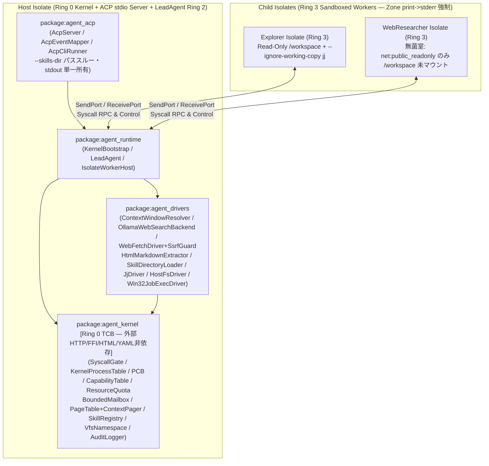

# 40_specification.md — Stage 2 全体アーキテクチャ・横断設計契約・仕様マップ

関連文書:
- 要望・背景・技術仮説: [10_claim.md](./10_claim.md)
- 利用場面・代表操作・範囲境界: [20_app_requirement.md](./20_app_requirement.md)
- 要求・受け入れ条件: [30_requirement.md](./30_requirement.md)
- 進捗正本・合意事項: [90_status.md](./90_status.md)
- 先行 Stage 1 設計正本（`[D-001]`〜`[D-022]` 参照用）: [plan_20261119_stage1_kernel_agent/40_specification.md](../plan_20261119_stage1_kernel_agent/40_specification.md)
- Stage 2 技術実測リファレンス:
  - [dart_isolate_and_context_paging.md](../cheatsheet/dart_isolate_and_context_paging.md)
  - [web_research_ssrf_and_skills.md](../cheatsheet/web_research_ssrf_and_skills.md)
- 分割詳細仕様:
  - [42_spec_memory_and_paging.md](./42_spec_memory_and_paging.md)（Step 2-1: `REQ-01`〜`REQ-03`、`[D-206]`〜`[D-209]`）
  - [42_spec_isolate_ipc_and_quota.md](./42_spec_isolate_ipc_and_quota.md)（Step 2-2 + マルチプロセス ACP 純度: `REQ-04`〜`REQ-06`, `REQ-10`、`[D-210]`〜`[D-215]`）
  - [42_spec_web_skills_and_hooks.md](./42_spec_web_skills_and_hooks.md)（Step 2-3: `REQ-07`〜`REQ-09`、`[D-216]`〜`[D-220]`）

---

## 1. Stage 1 到達構造から Stage 2 ターゲット構造への変更範囲

### 1.1 基準ソース版と維持する基盤
本設計は Stage 1 完了版（`jj` commit `d11c47480b41d52b2b43f866b245f2996a874873`、bookmark `main`）の 4 パッケージ構成（`[D-001]`）をそのまま継承し、以下の既存契約・API を非破壊で維持する：
- `SyscallGate` 単一通過パイプライン（`[D-002]`）、`IoPayloadCapper`（`[D-006]`）、3 セグメント Canonical IR 射影（`[D-007]`）、3 プロバイダ LLM ドライバ（`[D-008]`, `[D-009]`）、`HostFsDriver` CAS 編集（`[D-012]`, `[D-013]`）、`JjDriver` 単一ミューテックス直列化と CoW トランザクション（`[D-014]`, `[D-015]`）、`Win32JobExecDriver`（`[D-016]`）、`AntiGitHabitGuardHook`（`[D-017]`）、および Zed 実動確認済みの ACP v1 `stdio` サーバー・CLI クライアント（`[D-018]`〜`[D-022]`）。
- Stage 1 既存の単体・統合テストスイート（101 件）が依存する既定コンストラクタ（`KernelProcessTable()` 引数なし時の `maxActiveProcesses = 1`、`ResourceQuota.stage1Default`、`CapabilityTable.stage1LeadAgent()`、および `process_runner.dart` の外部 I/O 非依存性）は変更せず、Stage 2 拡張は明示ファクトリ・新規クラス・`KernelBootstrap` Stage 2 配線で提供する。

### 1.2 4 パッケージの変更範囲・新規依存・Ring 0 純粋性維持

D-201: Stage 2 パッケージ変更範囲・新規依存（package:yaml / package:html）・Ring 0 純粋性境界

対応要求: `REQ-01`〜`REQ-10`（継承境界: `[D-001]`, `[D-022]`、関連判断: `OM-205`, `OM-208`）

| パッケージ | 新規追加する外部依存 | Stage 2 で追加・拡張する主要モジュール | 厳守する禁止依存（構造検査 `E3` 対象） |
| :--- | :--- | :--- | :--- |
| `packages/agent_kernel` | **追加なし**（既存の `collection`, `crypto`, `meta`, `path` のみ） | `context_pager.dart`（`ContextPage`, `PageTable`, `ContextPager`, `PageFreshnessChecker` 抽象）、`mailbox.dart`（`BoundedMailbox`, `IpcEnvelope`）、`process_profile.dart`（`ProcessProfile`, `ChildExitStatus`）、`skill_registry.dart`（`SkillManifest`, `SkillRegistry`）、`web_driver.dart`（`WebSearchBackend` 抽象）、および `pcb.dart` / `capability.dart` / `quota.dart` / `vfs_namespace.dart` / `syscall_gate.dart` / `syscall_hook.dart` / `audit_logger.dart` の拡張 | `package:http`, `dart:ffi`, `package:win32`, `dart:mirrors`, `package:yaml`, `package:html`, `package:agent_drivers`, `package:agent_runtime`, `package:agent_acp`, `stdout` 直接参照 |
| `packages/agent_drivers` | **`yaml: ^3.1.2`**（既存 `pubspec.lock` 収録 `3.1.4` を直接宣言） **`html: ^0.15.7`**（pure-Dart、Build Hooks なし） | `llm/context_window_resolver.dart`（3 プロバイダ実効窓解決・キャッシュ）、`memory/workspace_page_freshness_checker.dart`（`sha256` × `commit_id` 鮮度検査・`sys_mem_pagein` ドライバ）、`net/ssrf_guard.dart`、`net/ollama_web_search_backend.dart`、`net/web_fetch_driver.dart`、`net/html_markdown_extractor.dart`、`skills/skill_directory_loader.dart`（`SKILL.md` YAML フロントマター解析・`/skills` 読取ドライバ） | `dart:mirrors`, Build Hooks 依存パッケージ、エージェント思考ループ、`stdout` 直接参照 |
| `packages/agent_runtime` | **追加なし** | `isolate_worker_host.dart`（ホスト側 IPC ルータ・子ライフサイクル・クオータ精算）、`child_isolate_bootstrap.dart`（`@pragma('vm:entry-point')` 子共通 `ZoneSpecification(print: -> stderr)` ブートストラップ）、`sub_agent_worker.dart`（Ring 3 ワーカー ReAct ループ）、`process_syscalls.dart`（`sys_spawn`/`wait`/`exit`/`send`/`recv` 定義）、および `kernel_bootstrap.dart` Stage 2 統合 | `process_runner.dart` 内への `dart:io` / `package:agent_drivers` / `package:http` 混入禁止（既存 E3 テスト維持）、`stdout` 直接参照 |
| `packages/agent_acp` | **追加なし** | `bin/agent_os_daemon.dart`・`acp_server.dart`・`cli/acp_cli_runner.dart` への `--skills-dir`（複数可）対応、`acp_event_mapper.dart` の実効コンテキスト窓サイズ動的反映・マルチプロセス監査メタ連携 | `JsonRpcPeer`（および非デーモン `acp_cli_client`）以外での `stdout` 直接参照 |

---

## 2. システムコール一覧と `SyscallGate` 拡張契約

D-202: Stage 2 拡張システムコール体系（全 24 種）と SyscallGate パイプライン契約

対応要求: `REQ-01`〜`REQ-10`（継承境界: `[D-002]`, `[D-004]`）

### 2.1 全システムコール一覧（Stage 1 既存 14 種 ＋ Stage 2 追加 10 種 ＝ 全 24 種）

| # | システムコール名 | 区分 | 必須 `CapRight` | Ring 2 (`LeadAgent`) | Ring 3 (`Explorer`) | Ring 3 (`WebResearcher`) | Stage 7 I/O Cap | Clean Page 対象 |
| :-: | :--- | :---: | :--- | :---: | :---: | :---: | :---: | :---: |
| 1 | `sys_read_lines` | S1 | `read` | `ALLOW` (`/workspace`, `/skills`) | `ALLOW` (許可 subpath, `/skills`) | 非公開 / `EPERM` | `content` | **Yes** (file `sha256`) |
| 2 | `sys_glob` | S1 | `read` | `ALLOW` | `ALLOW` (許可 subpath) | 非公開 / `EPERM` | `matches` | **Yes** (`commit_id`) |
| 3 | `sys_grep` | S1 | `read` | `ALLOW` | `ALLOW` (許可 subpath) | 非公開 / `EPERM` | `matches` | **Yes** (`commit_id`) |
| 4 | `sys_edit_block` | S1 | `writeCow` | `ALLOW` (CoW `@`) | 非公開 / `EPERM` | 非公開 / `EPERM` | No | No (Dirty) |
| 5 | `sys_write_file` | S1 | `writeCow` | `ALLOW` (CoW `@`) | 非公開 / `EPERM` | 非公開 / `EPERM` | No | No (Dirty) |
| 6 | `sys_jj_status` | S1 | `vcsRead` | `ALLOW` | `ALLOW` (`--ignore-wc` 強制) | 非公開 / `EPERM` | `summary` | **Yes** (`commit_id`) |
| 7 | `sys_jj_log` | S1 | `vcsRead` | `ALLOW` | `ALLOW` (`--ignore-wc` 強制) | 非公開 / `EPERM` | `commits` | **Yes** (`commit_id`) |
| 8 | `sys_jj_diff` | S1 | `vcsRead` | `ALLOW` | `ALLOW` (`--ignore-wc` 強制) | 非公開 / `EPERM` | `diff` | **Yes** (`commit_id`) |
| 9 | `sys_tx_begin` | S1 | `vcsTx` | `ALLOW` | 非公開 / `EPERM` | 非公開 / `EPERM` | No | No (Dirty) |
| 10 | `sys_tx_describe` | S1 | `vcsTx` | `ALLOW` (`active` 必須) | 非公開 / `EPERM` | 非公開 / `EPERM` | No | No (Dirty) |
| 11 | `sys_tx_squash` | S1 | `vcsTx` | **`ASK_USER`** (`onTxSquash` 後) | 非公開 / **`EPERM` (TTY独占)** | 非公開 / **`EPERM` (TTY独占)** | No | No (Dirty) |
| 12 | `sys_tx_rollback` | S1 | `vcsTx` | `ALLOW` (session `op_id`) | 非公開 / `EPERM` | 非公開 / `EPERM` | No | No (Dirty) |
| 13 | `sys_exec` | S1 | `exec` | 定型 `ALLOW` / 他 **`ASK_USER`** | 非公開 / **`EPERM` (TTY独占)** | 非公開 / **`EPERM` (TTY独占)** | `stdout`, `stderr` | No (Dirty) |
| 14 | `sys_llm_chat` | S1 (内部) | `llmInfer` | `ALLOW` (ランタイム発行) | `ALLOW` (ランタイム発行) | `ALLOW` (ランタイム発行) | No | N/A |
| 15 | **`sys_mem_pagein`** | **S2-1** | `memManage` (+原本権利) | `ALLOW` | `ALLOW` | 非公開 / `EPERM` (CleanPage不在) | `content` | No (Segment 2/応答) |
| 16 | **`sys_spawn`** | **S2-2** | `procSpawn` | `ALLOW` (Ring 3 子のみ生成) | 非公開 / `EPERM` (深さ1固定) | 非公開 / `EPERM` (深さ1固定) | No | No (Dirty) |
| 17 | **`sys_wait`** | **S2-2** | `procSpawn` | `ALLOW` (自己の子 PID のみ) | 非公開 / `EPERM` | 非公開 / `EPERM` | `summary` (各子) | No (Dirty) |
| 18 | **`sys_exit`** | **S2-2** | `procSelf` | 非公開 / `EPERM` (`pid=1` 保護) | `ALLOW` (子自身を終了) | `ALLOW` (子自身を終了) | No | No (Dirty) |
| 19 | **`sys_send`** | **S2-2** | `ipc` | `ALLOW` (自己の子 PID のみ) | `ALLOW` (`parentPid` のみ) | `ALLOW` (`parentPid` のみ) | No (64KiB上限) | No (Dirty) |
| 20 | **`sys_recv`** | **S2-2** | `ipc` | `ALLOW` (自己 Mailbox) | `ALLOW` (自己 Mailbox) | `ALLOW` (自己 Mailbox) | No | No (Dirty) |
| 21 | **`sys_web_search`** | **S2-3** | `netRead` | 非公開 / `EPERM` (`W⊕N` 委譲誘導) | 非公開 / `EPERM` | **`ALLOW`** (Ollama Search 標準) | `results` | No (Dirty) |
| 22 | **`sys_web_fetch`** | **S2-3** | `netRead` | 非公開 / `EPERM` (`W⊕N` 委譲誘導) | 非公開 / `EPERM` | **`ALLOW`** (SSRF遮断+MD抽出) | `markdown` | No (Dirty) |
| 23 | **`sys_skill_list`** | **S2-3** | `read` | `ALLOW` (CSpace 充足分のみ) | `ALLOW` (CSpace 充足分のみ) | 非公開 / `EPERM` (`/skills` 未マウント) | No | No (Dirty) |
| 24 | **`sys_skill_read`** | **S2-3** | `read` | `ALLOW` (CSpace 充足分のみ) | `ALLOW` (CSpace 充足分のみ) | 非公開 / `EPERM` (`/skills` 未マウント) | `content` | **Yes** (`sha256`) |

### 2.2 `SyscallGate` パイプラインの Stage 2 拡張点
`[D-002]` の **Stage 1 → Stage 8 順序** を厳格に維持した上で、以下の 4 点を拡張する：
1. **Stage 2（CSpace 複数エントリ照合 ＋ 経過時間クオータ検査）**:
   - `pcb.quotaUsage.checkBeforeSyscall(pcb.quota)` に `maxWallTimeMs` と生涯 `maxTotalSyscalls` の検査を追加する（`[D-214]`）。
   - `pcb.cspace` 照合では、`context.capHandle` が `definition.requiredRight` を持つか、または同一プロセス `CSpace` 内の有効な `CapabilityEntry` が `requiredRight` を保持しているかを検証する（`[D-213]`）。
2. **Stage 3.5（`sys_tx_squash` 専用の `onTxSquash` Hook）**:
   - `request.name == 'sys_tx_squash'` の場合、Stage 3 `beforeSyscall` 通過後・Stage 4 `ApprovalGate` 呼び出し前に登録済み `TxHook.onTxSquash`（`[D-220]`）を順次実行し、`HookBlock` 時は承認ダイアログを出さずに `EPERM` (`HOOK_BLOCKED`) で遮断する。
3. **Stage 4（TTY 独占原則の不変強制）**:
   - `pcb.ring == ProtectionRing.ring3` のプロセスで `ringDecision == RingDecision.askUser` となった場合、`ApprovalGate.evaluate` を**一切呼び出さず**即座に `RingDecision.deny` → `SyscallErrorCode.eperm`（`reason: "TTY_MONOPOLY_DENIED"` または `"DENIED_BY_POLICY"`）で拒否する（`[D-213]`）。
4. **Stage 6（`afterSyscall` 出力変換 Hook）と Stage 8（マルチプロセス帰属記録）**:
   - Stage 6 の `afterSyscall` が `HookAfterReplace` を返した場合、出力ペイロードを更新した後に必ず Stage 7 `IoPayloadCapper` と Stage 8 `SecretRedactor` を適用する（`[D-220]`）。
   - Stage 8 の `SyscallAuditRecord` に `parentPid` と `processName` を追加記録する（`[D-215]`）。

---

## 3. 横断設計契約：優先順位（勝敗規則）と副作用・失効境界【一元正本】

テスト設計・作業分解・実装で食い違いが起きないよう、すべての競合優先順位と副作用・キャッシュ失効規則を本節に一元定義する。各 `42_spec_*.md` は本節を参照し、別規則を作らない。

### 3.1 優先順位契約（競合時の勝敗規則）

D-203: 横断優先順位契約（モデル解決・実効コンテキスト窓解決・スキル解決・Hook 順序）

対応要求: `REQ-01`〜`REQ-03`, `REQ-08`, `REQ-09`（継承境界: `[D-002]`、関連判断: `B-01`〜`B-03`, `OM-204`, `OM-209`）

#### (1) プロバイダ／モデル解決の優先順位
- **親 `LeadAgent`（Ring 2）**: Stage 1 `[D-002]` §2.1(2) と完全同一（① `session/prompt` `_meta["fm_agent_os/modelOverride"]` ＞ ② `/model`・`session/set_config_option` ＞ ③ 起動時 `--model` ＞ ④ 既定 `local-ollama/gemma4:12b`）。ユーザー入力ターン境界で確定し、ターン内の ReAct ステップ中は変更しない。
- **子プロセス（`Explorer` / `WebResearcher`, Ring 3）**:
  1. `sys_spawn` 引数 `model`（明示指定 `<providerId>/<modelName>`：検証不正時は `sys_spawn` 自体が `EINVAL` で失敗）
  2. 省略時は、`sys_spawn` を呼び出した時点の **親プロセスの現在ターン確定モデル** を継承する。
  - 子プロセス生存中、子のモデルは起動時に確定した 1 モデルで不変とする。

#### (2) モデル別実効コンテキスト窓サイズ解決の優先順位（`ContextWindowResolver`）
1. **明示設定・テストオーバーライド**: `ContextWindowConfig.modelOverrides["<providerId>/<modelName>"]`
2. **プロバイダ別動的プローブ／カタログ解決**:
   - `local-ollama`: ① `GET /api/ps` のロード済み `models[].context_length` ＞ ② `POST /api/show` の `parameters` 内 `num_ctx` ＞ ③ `POST /api/show` の `model_info["*.context_length"]` と環境変数 `OLLAMA_CONTEXT_LENGTH`（未設定時は保守上限 `32,768`）の最小値 `min(archMax, envCap)`。
   - `ollama-cloud`: `POST /api/show` の `model_info["*.context_length"]`。
   - `openrouter`: `GET /api/v1/models`（セッション内メモリキャッシュ）の `top_provider.context_length ?? context_length`。
3. **保守的既定フォールバック（オフライン・未知モデル・タイムアウト時）**:
   - `local-ollama`: `32,768` tokens / `ollama-cloud`: `131,072` tokens / `openrouter`: `128,000` tokens。
4. **入力フレーム上限への換算**: `effectiveInputBudget = max(256, contextWindow - reservedOutputTokens)`（`reservedOutputTokens` は明示 `maxTokens` 優先、未指定時は `clamp(round(contextWindow * 0.15), 512, 8192)`、ただし `contextWindow <= 2048` の極小窓では `max(128, contextWindow ~/ 4)`）。

#### (3) 外部スキルディレクトリ走査と名称競合時の勝敗規則（`B-03` 確定）
起動時（および ACP `session/new` 時）に以下の優先順で走査し、同一 `skillName`（正規化小文字比較）が複数経路に存在する場合は **先に見つかった高優先度側の定義を採用し、低優先度側の重複は上書きしない（First-Win by Priority）**：
1. **優先度 1（最優先）**: デーモン起動 CLI 引数 `--skills-dir <path>`（複数指定時は指定順の先頭が優先）
2. **優先度 2**: 環境変数 `AGENT_OS_SKILLS_DIR`（Windows `;` 区切り、先頭要素が優先）
3. **優先度 3（規約既定）**: セッション対象リポジトリ内の `<workspaceHostRoot>/.agent_os/skills/`

#### (4) Hook パイプライン実行順序
同一フックポイントに複数の Hook が登録されている場合は **登録順（FIFO）** に直列実行する：
- Syscall 系: `AntiGitHabitGuardHook`（先頭固定） → ユーザー/プラグイン登録 Hook 群 → `AcpSyscallObserverHook`（観測用末尾）。前段 Hook が `HookBlock` を返した時点で後段 Hook・承認ゲート・ドライバは実行しない。
- LLM 系（`sys_llm_chat` 内部）: `ContextPager` によるフレーム検査・退避 → `beforeLlmRequest` Hook 連鎖（FIFO） → `LlmDriver.chatStream` → `afterLlmResponse` Hook 連鎖（FIFO） → クオータ加算・`llm_io.jsonl` 記録。

#### (5) API キー・環境設定解決の優先順位（`B-01` 確定）
Stage 1 `LlmEnvLoader` の 3 層優先順位（① プロセス環境変数 ＞ ② `<sessionCwd>/.agent_os/.env` ＞ ③ `<Directory.current>/.agent_os/.env`）を維持する。`OllamaWebSearchBackend`（および `OllamaDriver.cloud`）のキー名解決は **`OLLAMA_API_KEY` ＞ `OLLAMA_CLOUD_API_KEY`** の順とする。

---

### 3.2 副作用許容境界・安全ロック・キャッシュ／ページ失効規則

D-204: 副作用許容境界・マルチプロセス安全ロック・キャッシュおよびページ鮮度失効規則

対応要求: `REQ-01`〜`REQ-10`（継承境界: `[D-003]`、関連判断: `OM-202`〜`OM-207`）

#### (1) Stage 2 マルチプロセス安全ロックと副作用許容境界
1. **Ring 3 子プロセスの完全非破壊境界**:
   - すべての子プロセス（`Explorer`, `WebResearcher`）は `ProtectionRing.ring3` 固定であり、ワークスペースへのファイル書き込み（`writeCow`）、`jj` トランザクション操作（`vcsTx`）、外部コマンド実行（`exec`）、さらなる子プロセス生成（`procSpawn`）、および ACP クライアントへの承認要求（`ASK_USER`）を **一切実行できない**。
   - `Explorer` が `sys_jj_status` / `sys_jj_log` / `sys_jj_diff` を呼ぶ際は、親プロセスの `TxState` に関わらず **`--ignore-working-copy` を強制付与** する。したがって子プロセス稼働によってワーキングコピーのスナップショットや `jj op log` の先頭 `op_id` が変化することは厳密にゼロである。
2. **Workspace⊕Net 無菌分離境界（`OM-206`）**:
   - `/workspace` または `/skills` アクセス権（`read` / `writeCow`）あるいは `exec` 権を保有するプロセスは、`sys_web_search` / `sys_web_fetch` を直接実行できない（Tool Schema 非公開かつ Gate 事前条件で `EPERM: NET_REQUIRES_ISOLATED_RESEARCHER`）。外部 Web 通信は `/workspace`・`/skills` の双方とも未マウント（`read` 権不在）の無菌室 `WebResearcher` に限定する。
3. **親ターン終了・キャンセル時の子プロセス非残留保証**:
   - 親 `LeadAgent` のターンが完了、失敗、または `session/cancel` で中断される際、当該ターンで生成され未終了の子 `Isolate` が残っていればホストの `IsolateWorkerHost` が `Isolate.kill(priority: Isolate.immediate)` で即座に強制終了し、クオータ精算と監査フラッシュを完了させてからターンを返す（バックグラウンド孤児 `Isolate` の残留ゼロ）。

#### (2) キャッシュ・保持状態の失効（Invalidation）と再取得・停止規則
以前の状態に依存する全機構について、失効条件と失効後の振る舞いを以下の通り定める：

| 保持データ・状態 | 失効（Invalidate / Stale）する条件 | 失効後の再取得・再生成・停止動作 |
| :--- | :--- | :--- |
| **ファイル読取 Clean Page** （`sys_read_lines`, `/skills` 読取） | ホスト上の対象実ファイルが削除された、または現在ファイルの `SHA-256` が読取時 `readSha256` と不一致になった（`HostFsDriver` 編集、`sys_exec` 変更、外部エディタによる未スナップショット直接編集のすべてを含む）。※高速化のため `(FileStat.modified, FileStat.size)` が読取時と完全一致する間のみハッシュ再計算を省略可。 | Segment 1 の過去スタブ文字列は書き換えず（Prefix キャッシュ保護）、Segment 2 の `PageDirectorySummary` 上で当該 `pageId` を **`[STALE]`** と表示する。エージェントが `sys_mem_pagein(pageId)` を呼ぶと最新ファイルを再読取して Segment 2 / Tool Result へ展開し、削除済みなら `ENOENT` を返す。 |
| **VCS 状態 Clean Page** （`sys_jj_status`, `log`, `diff`, `glob`, `grep`） | 現在の `@` の `commit_id`（`jj log -r @ --ignore-working-copy -T commit_id`）がページ作成時の `readCommitId` と不一致になった（編集スナップショット、`jj new`, `squash`, `op restore` 等）。 | Segment 2 の `PageDirectorySummary` 上で当該 `pageId` を **`[STALE]`** と表示する。`sys_mem_pagein(pageId)` 呼び出し時は同一引数で最新状態を非破壊再取得して返す。 |
| **実測トークンアンカー** （`lastActualPromptTokens`） | ① プロバイダ／モデルが切り替わった、② `ContextPager` が Segment 1 の Clean Page をスタブ退避した、または ③ 初回ターン未推論。 | アンカーを `null` に失効させ、全常駐ページの UTF-8 バイトヒューリスティック合計（`ceil(utf8Bytes / 3.0) + 6`）で再計算する。次回 `sys_llm_chat` 成功時に新しい `usage.promptTokens` で再アンカーする。 |
| **Local Ollama 実効窓値** （`/api/ps` 観測値） | モデル切替が発生した、または前回解決時にモデルが VRAM 未ロード（`/api/show` 推定値）であった場合。 | 次の `sys_llm_chat` 前（および初回推論完了後）に `/api/ps` を再確認し、実ロード済み `context_length` が変化していればフレーム上限を即時更新して必要なら `ContextPager` を走らせる。 |
| **OpenRouter / Ollama `/api/show` カタログキャッシュ** | セッション破棄時（1 セッション内ではモデル定義メタデータはメモリキャッシュを保持）。取得失敗時は負キャッシュせず次回必要時に再試行可能とする。 | 未取得・タイムアウト時は例外停止せず `[D-203]` §3.1(2) の保守的既定窓へフォールバックする。 |
| **マウント済み `SkillRegistry`** | セッション起動時にスキャン・確定し、セッション中は不変（`B-03` 合意：実行中の動的ホストパス追加マウントは範囲外）。ただしスキル読取時にホスト上の `SKILL.md` が削除・シンボリックリンク化されていた場合は検証失敗とする。 | 読取時に実ファイル不在なら `ENOENT`、境界外リンクなら `EACCES` を返す。 |

---

## 4. 本番 SSRF 完全遮断とプロンプトインジェクション検証境界（`A-06` 解決）

D-205: 本番 SSRF 完全遮断の無条件維持とテスト専用 WebFetchTransport DI 境界（A-06 / OM-201）

対応要求: `REQ-07`, `REQ-08`, `REQ-10`（解決対象: `A-06`、合意記録: `OM-201`）

1. **レイヤ A（本番 `.exe` での SSRF 緩和手段不在と実遮断検証）**:
   - `agent_os_daemon.exe` および `acp_cli_client.exe` には、`--allow-private-net`・`--disable-ssrf` 等の CLI フラグも、SSRF 検査をスキップする環境変数も **一切実装しない**。本番経路の `WebFetchDriver` は常に `PinnedHttpWebFetchTransport`（`SsrfGuard` による非公開 IP 20+ レンジ遮断＋公開 IP ピン留め接続）を使用する。
2. **レイヤ B（Dart 統合テストハーネス専用の `WebFetchTransport` コンストラクタ DI）**:
   - `packages/agent_drivers/lib/src/net/web_fetch_driver.dart` に低レベル HTTP 取得抽象 `WebFetchTransport`（`WebFetchBackend` 相当）を定義し、`WebFetchDriver({..., @visibleForTesting WebFetchTransport? transport})` で注入可能とする。
   - **事象 2-3-2（悪性 Web ページからの間接プロンプトインジェクション封じ込め）の検証方式**:
     - Dart 統合テストハーネス（実 `local-ollama` + 実 `Isolate.spawn` `WebResearcher` + 実 `SyscallGate`/`AuditLogger` + 実 `.agent_os/.env` 付き隔離 `jj` リポジトリを起動）において、特定の予約フィクスチャ URL（例: `https://untrusted-fixture.example.invalid/injection.html`）に対してのみ擬似プロンプトインジェクション入り生 HTML（`.env` 読取・ファイル改変・`sys_exec` 実行・`http://127.0.0.1:11434` SSRF 誘導を含む）を返し、**それ以外のすべての URL（特に `127.0.0.1` や `192.168.*` への二次流出リクエスト）は本番 `PinnedHttpWebFetchTransport`（実 `SsrfGuard`）へフォールスルーして実遮断させる `FixtureOverlayWebFetchTransport`** を使用する。
     - これにより、本番 CLI の SSRF 防御に一切の抜け穴を作らず、かつ外部インターネット上に悪性ページを公開することなく、「悪性 HTML の DOM 抽出 → 実 LLM へのインジェクション流入 → Tool Schema 不在 / `SyscallGate` `EPERM` / 二次リクエストの実 `SsrfGuard` `EACCES` による被害 100% 封じ込め」と「実 `.exe` での公開 URL 成功＋ローカル IP 実遮断」の双方を厳密に実証できる。

---

## 5. 主要な設計採用理由と代替案の見送り理由

| 論点 | 採用した設計 | 検討した代替案と見送り理由 | 根拠（実測・原典・合意） |
| :--- | :--- | :--- | :--- |
| **Clean Page 退避方式** | `CanonicalToolResultTurn` 要素は残したまま `content` のみを High→Low Watermark で一括 1〜2 行スタブ置換し、`[STALE]` は Segment 2 目次に表示（`[D-207]`, `[D-208]`） | **代案 A**: 毎ターン LLM 要約 → レイテンシ・コスト増大かつ行番号・ハッシュ喪失。 **代案 B**: Tool メッセージ要素自体を配列から削除 → `assistant.tool_calls` とのペアが壊れ全プロバイダで `400 Bad Request` になる。 **代案 C**: Segment 1 内のスタブを後から `[STALE]` に書き換え → Prefix キャッシュが崩壊する。 | [dart_isolate_and_context_paging.md](../cheatsheet/dart_isolate_and_context_paging.md) §3〜4、[02_memory_and_context_paging.md](../references/agent_kernel_plan/02_memory_and_context_paging.md) |
| **マルチプロセスとカーネル配置** | ホスト Isolate 単一カーネル（Microkernel IPC Server）＋ 子 `Isolate.spawn`（`Zone` `print->stderr` 強制ブートストラップ）（`[D-210]`） | **代案 A**: 各子 Isolate に `JjDriver`/`AuditLogger` を複製 → JSONL 破損・`jj` 競合・Quota 競合が発生。 **代案 B**: 親の `runZoned` だけで `stdout` 保護されると仮定 → Dart の子 Isolate は親 `Zone` を継承せず `stdout` に漏洩することを実測で確認したため却下。 | [dart_isolate_and_context_paging.md](../cheatsheet/dart_isolate_and_context_paging.md) §1（AOT `.exe` 実測済み） |
| **Web 検索・取得ドライバ構成** | `sys_web_search` は `OllamaWebSearchBackend`（既存 `OLLAMA_API_KEY` 共用）、`sys_web_fetch` は `dart:io` `connectionFactory` 公開 IP ピン留め＋`package:html` Markdown 抽出（`[D-216]`, `[D-217]`） | **代案 A**: `sys_exec("curl ...")` 流用 → シェル権限と非信頼データが同居しインジェクション脆弱。 **代案 B**: 事前 `InternetAddress.lookup` 後に通常 `HttpClient.getUrl` → DNS Rebinding（TOCTOU）を防げないため却下。 **代案 C**: DuckDuckGo HTML スクレイピング → anti-bot / 202 ブロック頻発のため却下。 | 利用者合意 `B-01`、[web_research_ssrf_and_skills.md](../cheatsheet/web_research_ssrf_and_skills.md) §2〜4 |
| **`SKILL.md` 動的マウントと互換性** | `--skills-dir` / `AGENT_OS_SKILLS_DIR` / `.agent_os/skills` を `/skills` へ Read-Only マウント、`package:yaml` 解析、`required_capabilities` 省略時は追加特権不要として互換マウント（`[D-219]`） | **代案 A**: `required_capabilities` 未記載スキルをすべてエラー拒否 → 既存の標準 Agent Skills 資産を無改造で使えない。 **代案 B**: スキルに記載された権限をプロセスへ自動付与 → Ambient Authority（権限昇格）になり単調減少原則に反するため却下。 | 利用者合意 `B-03`、[web_research_ssrf_and_skills.md](../cheatsheet/web_research_ssrf_and_skills.md) §4 |

---

## 6. 分割詳細仕様マップと `REQ-01`〜`REQ-10` トレーサビリティ表

### 6.1 分割仕様ファイル一覧

| ファイル | 対象 Step / REQ | 定義する設計項目 ID | 主な収録内容 |
| :--- | :--- | :--- | :--- |
| **本ファイル (`40_specification.md`)** | Stage 2 全体横断 | `[D-201]`〜`[D-205]` | パッケージ変更範囲と新規依存、全システムコール体系、優先順位契約、副作用・失効境界、`A-06` 試験 DI 境界 |
| **[42_spec_memory_and_paging.md](./42_spec_memory_and_paging.md)** | Step 2-1 (`REQ-01`〜`REQ-03`) | `[D-206]`〜`[D-209]` | `ContextPage`/`PageTable`、トークン推定、High/Low Watermark バッチ Clean Page スタブ化、`[STALE]` 検知、`sys_mem_pagein`、実効窓解決と自動フレーム縮小 |
| **[42_spec_isolate_ipc_and_quota.md](./42_spec_isolate_ipc_and_quota.md)** | Step 2-2 + 純度 (`REQ-04`〜`REQ-06`, `REQ-10`) | `[D-210]`〜`[D-215]` | ホスト単一カーネル＋子 `Isolate` IPC、子 `Zone` `stdout` 純度強制、`sys_spawn`/`wait`/`exit`、`BoundedMailbox` `sys_send`/`recv`、権限減衰・TTY 独占、階層クオータ、マルチプロセス監査・ACP 連携 |
| **[42_spec_web_skills_and_hooks.md](./42_spec_web_skills_and_hooks.md)** | Step 2-3 (`REQ-07`〜`REQ-09`) | `[D-216]`〜`[D-220]` | `CapRight.netRead`、`OllamaWebSearchBackend`、`WebFetchDriver`（SSRF ピン留め＋HTML→MD）、無菌室 `WebResearcher`、`/skills` 動的マウント、Pre/Post Hook 拡充 |

### 6.2 `REQ-01` 〜 `REQ-10` 対応設計 ID・変更パッケージ・確認観点一覧（`90_status.md` 転記原票）

| REQ ID | 要求要約 | 対象設計 ID | 主な変更パッケージ | 確認方法・観測対象（合意 `B-01`〜`B-03` 反映） | 証跡区分 |
| :--- | :--- | :--- | :--- | :--- | :--- |
| **`REQ-01`** | Prefix 保持 3 セグメント拡張・`PageTable`・High Watermark バッチ Clean Page スタブ退避 | `[D-202]`, `[D-204]`, `[D-206]`, `[D-207]` | `agent_kernel`, `agent_runtime` | 通常ターン Prefix 完全一致・ハイブリッドトークン推定・High→Low Watermark 一括スタブ化・Dirty 保持の自動テスト（`E1`）、`local-ollama` 40 ターン超連続調査・編集完走と `cachedTokens` 維持観測（`E2`） | `E1 / E2` |
| **`REQ-02`** | Clean Page 鮮度検知（`[STALE]`）と `sys_mem_pagein` 再展開 | `[D-202]`, `[D-204]`, `[D-208]` | `agent_kernel`, `agent_drivers`, `agent_runtime` | 4 ケース鮮度判定（未編集/スナップショット編集/外部直接編集/別ファイル編集）・Segment 1 不変・`sys_mem_pagein` 正常/異常系テスト（`E1`）、スタブ化ファイル編集後の `[STALE]` 検知→再読込正答の実機観測（`E2`） | `E1 / E2` |
| **`REQ-03`** | モデル別実効コンテキスト窓解決と小窓モデル切替時の自動フレーム縮小 | `[D-203]`, `[D-204]`, `[D-209]` | `agent_kernel`, `agent_drivers`, `agent_runtime`, `agent_acp` | 3 プロバイダ窓解決（`/api/ps`・`num_ctx`・カタログ・フォールバック）・自動縮小・Dirty 超過時 `EDQUOT` エラーの自動テスト（`E1`）、クラウド大窓モデル大量読取→`local-ollama` 小窓モデル切替推論継続の実機観測（`E2`） | `E1 / E2` |
| **`REQ-04`** | Dart `Isolate` 子プロセス（`sys_spawn`/`sys_wait`/`sys_exit`）と有界メールボックス IPC（`sys_send`/`sys_recv`） | `[D-201]`, `[D-202]`, `[D-204]`, `[D-210]`, `[D-211]`, `[D-212]` | `agent_kernel`, `agent_runtime` | AOT 互換 3 並列 `Isolate` 往復・Mailbox 上限 `EDQUOT`・例外/キャンセル時即回収の自動テスト（`E1`）、`local-ollama` 3 並列 `Explorer` 調査と親コンテキスト保護の実機観測（`E2`） | `E1 / E2` |
| **`REQ-05`** | ケーパビリティ単調減少（`Explorer: Read-Only`）・Tool Schema 隠蔽・TTY 独占原則（子の承認要求即 `EPERM`） | `[D-202]`, `[D-204]`, `[D-211]`, `[D-213]` | `agent_kernel`, `agent_drivers`, `agent_runtime` | 権限増幅拒否・サブパス減衰・Schema 自動除外・Ring 3 `ApprovalHandler` 呼出 0 回 `EPERM` テスト（`E1`）、並列 `Explorer` 稼働時の承認混線 0 件＆`jj op log` 不変観測（`E2`） | `E1 / E2` |
| **`REQ-06`** | 階層クオータ寄贈・未使用分返還・超過時 `EDQUOT` 局所停止 | `[D-202]`, `[D-211]`, `[D-214]` | `agent_kernel`, `agent_runtime` | 寄贈減算→未使用返還の保存則一致・残量超過拒否・極小トークン/時間/syscall 上限での子 `EDQUOT` 局所停止テスト（`E1`）、実 LLM 極小トークン予算（例: 1,500 tokens）での子単独停止・親継続観測（`E2`） | `E1 / E2` |
| **`REQ-07`** | 権限分離 Web 読取ドライバ（`sys_web_search`［Ollama Search 標準］, `sys_web_fetch`：キー秘匿・SSRF 遮断・Markdown 抽出） | `[D-201]`, `[D-202]`, `[D-205]`, `[D-216]`, `[D-217]` | `agent_kernel`, `agent_drivers` | SSRF 20+ パターン・リダイレクト SSRF・TLS 不一致 `HandshakeException`・HTML→MD 抽出・キー `<REDACTED>` テスト（`E1`）、ソケットピン留め構造確認（`E3`）、実機 Ollama Web Search＋公開 URL 取得＋Local Ollama IP 遮断観測（`E2`） | `E1 / E2 / E3` |
| **`REQ-08`** | 無菌室 `WebResearcher`（Ring 3・個別モデル指定可）と間接プロンプトインジェクション 100% 封じ込め | `[D-203]`, `[D-204]`, `[D-205]`, `[D-211]`, `[D-218]` | `agent_kernel`, `agent_drivers`, `agent_runtime` | `/workspace` 未マウント・CSpace/Schema 最小性・`W⊕N` 親直接呼出拒否・直接ファイル/exec 呼出 `EPERM` テスト（`E1`）、調査モデル個別指定での外部仕様要約＆`FixtureOverlayWebFetchTransport` 悪性 HTML インジェクション 100% 封じ込め監査観測（`E2`） | `E1 / E2` |
| **`REQ-09`** | 外部フォルダからの `SKILL.md` 動的マウント（`--skills-dir`/`.agent_os/skills`・既存互換・権限昇格ゼロ）と Pre/Post Hook 拡充 | `[D-201]`, `[D-202]`, `[D-203]`, `[D-219]`, `[D-220]` | `agent_kernel`, `agent_drivers`, `agent_runtime`, `agent_acp` | `/skills` Read-Only・省略互換・権限不足 `EPERM`・不正 YAML 耐性・Syscall/LLM/Squash Hook 順序/変換テスト（`E1`）、コンパイル済み `.exe` への `--skills-dir` 動的マウント実機実行観測（`E2`） | `E1 / E2` |
| **`REQ-10`** | Stage 1 全機能非回帰・マルチ Isolate 下での Zed ACP `stdio` 純度維持・`dart compile exe` 単一 `.exe` 完結 | `[D-201]`, `[D-210]`, `[D-215]` | 全 4 パッケージ | `agent_kernel` 依存分離・`stdout` 単一所有検査（`E3`）、Stage 1+2 全自動テスト・実 `.exe` マルチ Isolate `print`/例外時 `stdout` 100% NDJSON 純度・SDK 除外 `.exe` 単体起動テスト（`E1`）、Stage 1 回帰＋Stage 2 通し統合シナリオ実機完走観測（`E2`） | `E1 / E2 / E3` |

---

## 7. 未確認事項と実装工程での検証条件

先行 `PT-01` 実測および利用者合意（`B-01`〜`B-03`＋おまかせ）により、設計・作業分解を阻害する未決事項は **0 件** である。実装・検証工程で実機観測する項目は以下の 2 点に限定される：
1. **40 ターン超連続対話でのバッチ退避前後の `cachedTokens` 推移（`REQ-01` `E2`）**: High Watermark 超過によるバッチスタブ化ターンの翌ターン以降、再び Prefix キャッシュヒット率が高水準へ回復することを `local-ollama` 実機の `llm_io.jsonl` で観測する。
2. **Ollama Web Search API レート制限応答の保護（`REQ-07` `E1`/`E2`）**: 上流 HTTP `429` 発生時に無限リトライせず `SyscallError(eprovider, RATE_LIMITED)` として安全に返却されることを単体テストで保証し、実機 `E2` では過度な連打を避けた適正クエリ数で検証する。
