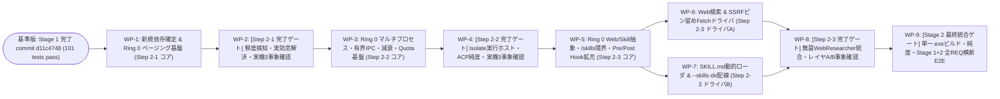

# 41_work_packages.md — Stage 2 作業パッケージ分解・依存関係・段階確認計画

関連文書:
- 進行原則（3 Stage × 3 Step）: [02_development_step.md](../02_development_step.md)
- 利用場面・代表操作・対象環境・範囲境界: [20_app_requirement.md](./20_app_requirement.md)
- 要求・受け入れ条件・検証範囲（正本 / 版 `r1`）: [30_requirement.md](./30_requirement.md)
- 全体アーキテクチャ・優先順位・副作用境界・`A-06` 試験境界（一元正本）: [40_specification.md](./40_specification.md)（`[D-201]`〜`[D-205]`）
- 分割詳細仕様:
  - [42_spec_memory_and_paging.md](./42_spec_memory_and_paging.md)（Step 2-1: `[D-206]`〜`[D-209]`）
  - [42_spec_isolate_ipc_and_quota.md](./42_spec_isolate_ipc_and_quota.md)（Step 2-2 + 純度: `[D-210]`〜`[D-215]`）
  - [42_spec_web_skills_and_hooks.md](./42_spec_web_skills_and_hooks.md)（Step 2-3: `[D-216]`〜`[D-220]`）
- 技術・環境実測リファレンス:
  - [dart_isolate_and_context_paging.md](../cheatsheet/dart_isolate_and_context_paging.md)
  - [web_research_ssrf_and_skills.md](../cheatsheet/web_research_ssrf_and_skills.md)
- 進捗正本: [90_status.md](./90_status.md)

---

## 1. 作業編成の基本方針と共通規律

1. **判断規則の一元正本参照（仕様の二重定義禁止）**:
   - パッケージ変更境界と Ring 0 純粋性（`[D-201]`）、全 24 システムコールと `SyscallGate` パイプライン契約（`[D-202]`）、優先順位（勝敗）契約（`[D-203]`：`40_specification.md` §3.1）、副作用許容境界・安全ロック・キャッシュ／ページ失効規則（`[D-204]`：同 §3.2）、本番 SSRF 完全遮断とテスト専用 `WebFetchTransport` DI 境界（`[D-205]` / `OM-201`：同 §4）、および各詳細設計（`[D-206]`〜`[D-220]`）は、すべて `40_specification.md` と `42_spec_*.md` を唯一の正本とする。
   - 本書では判断規則を独自の表現に書き直さず、安定 ID・見出しを参照して各 WP の「入力・編集範囲・作る成果・開始条件・完了確認・統合と引き渡し」を規定する。
2. **`docs/02_development_step.md` の「1 ステップ・1 複雑さ・毎ステップ実機確認ゲート」厳守**:
   - 内部クラスだけをまとめて実装して最後に初めて動かす編成を禁止し、Stage 1 完了版（`jj` commit `d11c47480b41d52b2b43f866b245f2996a874873`、既存テスト 22 ファイル・101 件 pass）の上に以下の段階確認ゲートを順に積み上げる：
     - **Step 2-1 完了ゲート（`WP-1` → `WP-2`）**: シングルプロセス固定ロックを維持したまま Prefix 保持 3 セグメント拡張・Clean Page バッチ退避・`[STALE]` 検知・`sys_mem_pagein`・3 プロバイダ実効窓解決と自動フレーム縮小を完成させ、Step 2-1 の全 3 事象を実機 `E2` で確認してからマルチプロセスへ進む。
     - **Step 2-2 完了ゲート（`WP-3` → `WP-4`）**: Ring 3 子プロセス Read-Only ＆ TTY 独占ロックの下で Dart `Isolate` 子プロセス・有界メールボックス IPC・ケーパビリティ単調減少・CSpace 連動 Tool Schema 隠蔽・階層クオータを導入し、AOT 子 `Isolate` `stdout` 純度と Step 2-2 の全 3 事象を実機 `E2` で確認してから外部 Web / Skill へ進む。
     - **Step 2-3 完了ゲート（`WP-5` → `WP-6` ∥ `WP-7` → `WP-8`）**: Ring 0 の Web/Skill/Hook 共有抽象 IF（`WP-5`）確定後にファイル非重複の Web 読取ドライバ（`WP-6`）と `SKILL.md` 動的マウント／CLI 配線（`WP-7`）を実装し、`WP-8` で無菌室 `WebResearcher` 統合およびレイヤ A（本番 `.exe` 実通信・実 SSRF 遮断・動的スキルマウント）＋レイヤ B（`[D-205]` DI ハーネス悪性 HTML インジェクション封じ込め）の全事象を確認する。
     - **Stage 2 最終 AOT `.exe` E2E 統合ゲート（`WP-9`）**: 最終ソースに対する全パッケージ `E3` 構造検査・Stage 1+2 全自動テスト一括通過・`dart compile exe` 単一 `.exe` 生成・SDK 除外単体起動・マルチ `Isolate` `stdout` 100% NDJSON 純度・Stage 1 非回帰＋Stage 2 全 REQ 横断 E2E 完走と `env_manifest.md` 更新材料確定を行う。
3. **隔離リポジトリ実機 `E2` における秘密環境変数注入と非露出手順（`PT-03` 引き渡し `SG-T02` 厳守）**:
   - 実機 `E2`（`WP-2`, `WP-4`, `WP-8`, `WP-9`）で `.planworks/<wp_id>_e2/` 等の隔離一時 `jj` リポジトリに対して `--cwd <isolated_repo>` で `agent_os_daemon.exe`（または `acp_cli_client.exe`）を起動する際、**ワークスペースルートの `.agent_os/.env` を隔離ディレクトリへファイルコピーしてはならない**（秘密ファイル複製・残留防止）。
   - 代わりに、テスト／検証ランナープロセス内でワークスペースルートの `.agent_os/.env` から設定済みキー（`OLLAMA_API_KEY`, `OPENROUTER_API_KEY` 等、`[D-203]` §3.1(5) 参照）を**メモリ内のみ**で読み取り、子デーモン起動時のプロセス環境変数マップ（`Process.start(..., environment: ...)` 等）へ注入して引き渡すこと。その際、**キー実値を `stdout` / `stderr` / ログ / 証跡文書へ 1 文字たりとも表示・保存してはならない**（キー名と設定有無の真偽値のみ記録可）。
   - 併せて、親デーモンに秘密環境変数が注入された状態でも、`Win32JobExecDriver` が `sys_exec` の子孫プロセス環境変数から秘密キー（`*_API_KEY`, `*_SECRET`, `*_TOKEN`, `*_PASSWORD` 等）を引き続き完全除去していることを検証対象に含める。
4. **リポジトリ無汚染・一時物クリーンアップ・プロセス非残留（全 WP 共通完了条件）**:
   - 検証用の一時 `jj` リポジトリ・一時スキルディレクトリ・バッチ入力・中間スクリプトはすべてリポジトリルートの `.planworks/` 配下（または単体テスト `tearDown` で即時削除する OS 一時ディレクトリ）に限定し、`docs/` や製品パッケージ配下に一時ファイルを作らない。
   - 各統合・実機検証 WP の完了時点で、①本リポジトリの意図しないワーキングコピー変更ゼロ・検証操作による本リポジトリ `jj op log` 汚染ゼロ、②`.planworks/` 内の不要一時バイナリ・一時ディレクトリの削除完了、③起動した `agent_os_daemon`・子 `Isolate`・`sys_exec` 子孫プロセスの残留ゼロを確認してから完了報告を返す。
   - WP の完了確認は実装・試験担当による作業結果確認であり、各 REQ の最終 `Acceptance` 判定は独立した `fm-dev-acceptance` が担う。

---

## 2. WP 依存グラフと並列実行規約

### 2.1 依存関係 DAG と段階確認ゲート図



### 2.2 並列実装可能な WP ペアと同時編集防止境界

特定の並列実行数を実行環境の必須条件とはしない（直列実行でもそのまま完遂可能）。並列実行を選択する場合は、以下の共有 IF 先行確定条件とファイル非重複境界を厳守する。

| 並列可能ペア | 先に確定している前提境界 | 各 WP の専用編集範囲（ファイル完全非重複） | 両 WP とも編集禁止とする共有ファイル | 作業場所運用条件と統合担当 WP |
| :--- | :--- | :--- | :--- | :--- |
| **`WP-6` ∥ `WP-7`** | 1. `WP-1` で `packages/agent_drivers/pubspec.yaml`（`yaml`, `html` 追加）とルート `pubspec.lock` が確定済み。<br>2. `WP-5` で `packages/agent_kernel` の全共有抽象 IF（`WebSearchBackend`, `SkillManifest`/`SkillRegistry`, `/skills` VFS 解決, `LlmHook`/`TxHook`/`HookAfterResult`）および `llm_router.dart` の `LlmHook` 配線が確定・テスト通過済み。 | - **`WP-6` 専用範囲**:<br>  `packages/agent_drivers/lib/src/net/**`（新規 4 ファイル）、<br>  `packages/agent_drivers/lib/web_drivers.dart`（新規専用バレル）、<br>  `packages/agent_drivers/test/ssrf_and_web_drivers_test.dart`（新規）<br>- **`WP-7` 専用範囲**:<br>  `packages/agent_drivers/lib/src/skills/**`（新規）、<br>  `packages/agent_drivers/lib/src/fs/host_fs_driver.dart`（`/skills` 読取照合・書込拒否連携）、<br>  `packages/agent_drivers/lib/skill_drivers.dart`（新規専用バレル）、<br>  `packages/agent_drivers/test/skills_and_hooks_test.dart`（新規）、<br>  `packages/agent_acp/bin/agent_os_daemon.dart`、<br>  `packages/agent_acp/lib/src/acp_server.dart`、<br>  `packages/agent_acp/lib/src/cli/acp_cli_runner.dart` | - ルートおよび全パッケージの `pubspec.yaml` / `pubspec.lock`<br>- `packages/agent_kernel/**`<br>- `packages/agent_drivers/lib/agent_drivers.dart`（統合バレル）<br>- `packages/agent_runtime/**` | - **共有作業ツリーで並列実行する場合**: leader が `WP-5` 完了時点の基準 `commit_id` を記録して宣言し、各 worker は専用範囲のみを編集する。テスト用一時ディレクトリは `.planworks/wp6_tmp/` と `.planworks/wp7_tmp/` に分離し、本リポジトリの `jj` コマンド更新を行わない。<br>- **分離作業場所（`jj workspace` 等）で並列実行する場合**: `WP-5` 完了コミットから分岐し、`WP-8` 開始前に leader が差分と基準版を照合して合流する。<br>- **統合担当**: **`WP-8`**（`agent_drivers.dart` への両バレル公開と `KernelBootstrap` / `WebResearcher` への一括配線を担当）。 |

- 上記以外の区間（`WP-1 → WP-2 → WP-3 → WP-4 → WP-5` および `WP-8 → WP-9`）は、前段の段階確認ゲートの成立確認または `agent_kernel` / `kernel_bootstrap.dart` への段階的積み上げを伴うため **直列実行** とする。

---

## 3. Work Package 概要一覧とトレーサビリティ

### 3.1 Work Package 概要テーブル

| WP | 目的・対応REQ・設計ID | 入力・変更範囲 | 成果・完了条件 | 依存・開始条件 | 統合・確認 |
| :--- | :--- | :--- | :--- | :--- | :--- |
| **`WP-1`** | Pub Workspaces 新規依存確定と Ring 0 コンテキストページング基盤実装（Step 2-1 コア）<br>`REQ-01`, `REQ-02`, `REQ-03`, `REQ-05`, `REQ-07`, `REQ-09`, `REQ-10`<br>`[D-201]`, `[D-204]`, `[D-206]`, `[D-207]`, `[D-208]`, `[D-209]`, `[D-213]`, `[D-215]` | 基準版 commit `d11c4748`、`40` §1.2/§3.2、`42_memory` §1〜§4、`42_isolate` §4.1/§6<br>変更: `packages/agent_drivers/pubspec.yaml`, `pubspec.lock`, `packages/agent_kernel/**` | `yaml`/`html` 依存解決、`ContextPage`/`PageTable`/`TokenEstimator`/`ContextPager`、Segment 2 目次、`AuditLogger` 統計・帰属項目拡張、単体テスト緑、Ring 0 純粋性維持 | 先行 WP 依存なし（**即時開始可能**） | `E1`/`E3`: `context_pager_test.dart`＋既存 `agent_kernel` 全テスト緑＋外部非依存確認。`WP-2` へ共有 IF を引き渡す |
| **`WP-2`** | **【Step 2-1 完了ゲート】** 鮮度検知・`sys_mem_pagein`・3 プロバイダ実効窓解決・ランタイム統合と Step 2-1 実機確認<br>`REQ-01`, `REQ-02`, `REQ-03`, `REQ-10`<br>`[D-202]`〜`[D-204]`, `[D-206]`〜`[D-209]`, `[D-215]` | `WP-1` 成果、`20` §3.1、`40` §2/§3、`42_memory` §3〜§5<br>変更: `packages/agent_drivers/lib/src/{memory,llm,fs,jj}/**`, `packages/agent_runtime/**`, `packages/agent_acp/lib/src/acp_event_mapper.dart` | `WorkspacePageFreshnessChecker`, `sys_mem_pagein`, `ContextWindowResolver`, `LlmRouter` 自動フレーム縮小配線、Step 2-1 全自動テスト＋実機全 3 事象確認完了 | `WP-1` 完了後 | `E1`/`E2`: `page_freshness_and_window_test.dart` 緑＋実機 40 ターン連続・クラウド→ローカル小窓切替・`[STALE]` 再読込完走。通過後に Step 2-2（`WP-3`）を解禁 |
| **`WP-3`** | Ring 0 マルチプロセス・有界 IPC・権限単調減少・TTY 独占・階層クオータ基盤（Step 2-2 コア）<br>`REQ-04`, `REQ-05`, `REQ-06`, `REQ-08`<br>`[D-202]`, `[D-204]`, `[D-211]`, `[D-212]`, `[D-213]`, `[D-214]` | `WP-2` 成果、`40` §2.2/§3.2、`42_isolate` §2〜§5<br>変更: `packages/agent_kernel/lib/src/{mailbox,process_profile,pcb,capability,vfs_namespace,quota,syscall_gate}.dart`, `packages/agent_kernel/test/**` | `BoundedMailbox`、`ProcessProfile`、`KernelProcessTable.stage2`、`deriveForChild` 単調減少＆サブパス減衰、TTY 独占 Stage 4 即 `EPERM`、`QuotaLedger` 保存則と単体テスト緑 | `WP-2`（Step 2-1 ゲート）通過後 | `E1`/`E3`: メールボックス上限・権限減衰・Approval 0 回・クオータ保存則の単体テスト緑＋Stage 1 互換維持。`WP-4` へ引き渡す |
| **`WP-4`** | **【Step 2-2 完了ゲート】** Dart `Isolate` 実行ホスト・子 `Zone` `stdout` 純度強制・ACP 連携と Step 2-2 実機確認<br>`REQ-04`, `REQ-05`, `REQ-06`, `REQ-08`, `REQ-10`<br>`[D-201]`〜`[D-204]`, `[D-210]`〜`[D-215]` | `WP-3` 成果、`20` §3.2、`42_isolate` §1〜§7<br>変更: `packages/agent_runtime/lib/src/{process_runner,child_isolate_bootstrap,sub_agent_worker,isolate_worker_host,process_syscalls,kernel_bootstrap}.dart`, `llm_router.dart`, `jj_driver.dart`, `host_fs_driver.dart`, `{acp_server,acp_event_mapper}.dart`, 各 `test/` | Microkernel IPC Server、回復可能 `EDQUOT` 継続＆ペア補完、`sys_spawn`/`wait`/`exit`/`send`/`recv`、Schema フィルタ、`pid==1` ACP 通知分離、AOT 子 `stdout` 純度テスト＋Step 2-2 実機全 3 事象確認完了 | `WP-3` 完了後 | `E1`/`E2`/`E3`: 3 並列 `Isolate`・回復可能/非回復 `EDQUOT`＆ペア補完・`pid==1` ACP 非混線・AOT `.exe` `stdout` 純度テスト緑＋実機 3 並列 `Explorer`・`EDQUOT` 局所停止・承認混線 0 件確認。通過後に Step 2-3（`WP-5`）を解禁 |
| **`WP-5`** | Ring 0 Web/Skill 共有抽象・`/skills` Read-Only VFS 境界・Pre/Post Hook パイプライン拡充（Step 2-3 コア）<br>`REQ-07`, `REQ-09`<br>`[D-201]`, `[D-202]`, `[D-203]`, `[D-216]`, `[D-219]`, `[D-220]` | `WP-4` 成果、`40` §2.2/§3.1、`42_web` §1.1/§4.1/§5<br>変更: `packages/agent_kernel/lib/src/{web_driver,skill_registry,vfs_namespace,syscall_hook,syscall_gate}.dart`, `packages/agent_drivers/lib/src/llm/llm_router.dart`, `packages/agent_kernel/test/**` | `WebSearchBackend` 抽象、`SkillManifest`/`SkillRegistry`、`/skills` Read-Only パス解決、5 フックポイント（`beforeSyscall`/`onTxSquash`/`afterSyscall` 変換/`beforeLlmRequest`/`afterLlmResponse`）実装・テスト緑 | `WP-4`（Step 2-2 ゲート）通過後 | `E1`/`E3`: `/skills` 境界・CSpace 照合・全 5 Hook FIFO/遮断/変換・キャップ＆マスク維持テスト緑。`WP-6`・`WP-7` の並列実装を解禁 |
| **`WP-6`** | 権限分離 Web 検索（Ollama Search 標準）＆ SSRF 完全遮断・Markdown 抽出 `WebFetchDriver` 実装（Step 2-3 ドライバA）<br>`REQ-07`, `REQ-08`<br>`[D-201]`〜`[D-205]`, `[D-216]`, `[D-217]` | `WP-5` 成果、`40` §3/§4、`42_web` §1〜§2、`web_research_ssrf_and_skills.md`<br>変更: `packages/agent_drivers/lib/src/net/**`, `packages/agent_drivers/lib/web_drivers.dart`, `packages/agent_drivers/test/ssrf_and_web_drivers_test.dart` | `OllamaWebSearchBackend`、`SsrfGuard`（20+ レンジ）、公開 IP ピン留め `PinnedHttpWebFetchTransport`、`@visibleForTesting` `FixtureOverlayWebFetchTransport`、`HtmlMarkdownExtractor` と単体テスト緑 | `WP-5` 完了後（**`WP-7` と並列実行可**） | `E1`/`E3`: SSRF/リダイレクト/TLS 不一致 20+ ケース・HTML→MD・2MiB 切断・キー秘匿テスト緑＋ピン留め構造確認。`WP-8` へ引き渡す |
| **`WP-7`** | 外部 `SKILL.md` 動的マウントドライバ（`SkillDirectoryLoader`）と ACP `--skills-dir` CLI 配線（Step 2-3 ドライバB）<br>`REQ-09`<br>`[D-201]`〜`[D-204]`, `[D-219]`, `[D-220]` | `WP-5` 成果、`40` §3.1(3)/§3.2、`42_web` §4〜§5<br>変更: `packages/agent_drivers/lib/src/skills/**`, `host_fs_driver.dart`, `skill_drivers.dart`, `skills_and_hooks_test.dart`, `packages/agent_acp/{bin,lib}/**` | `SkillDirectoryLoader`（`package:yaml` アンラップ・省略互換・昇格ゼロ・不正拒否）、`sys_skill_list`/`sys_skill_read`、デーモン＆CLI `--skills-dir`/`AGENT_OS_SKILLS_DIR` パススルーと単体/統合テスト緑 | `WP-5` 完了後（**`WP-6` と並列実行可**） | `E1`/`E3`: 優先順位・省略互換・`Explorer`/`WebResearcher` 権限拒否・不正 YAML/トラバーサル耐性・Hook 統合テスト緑＋SSRF バイパス CLI 不在維持。`WP-8` へ引き渡す |
| **`WP-8`** | **【Step 2-3 完了ゲート】** 無菌室 `WebResearcher`・Skill/Hook ランタイム統合と Step 2-3 事象確認（レイヤA ＆ レイヤB）<br>`REQ-07`, `REQ-08`, `REQ-09`<br>`[D-202]`〜`[D-205]`, `[D-211]`, `[D-213]`, `[D-216]`〜`[D-220]` | `WP-6`・`WP-7` 成果、`20` §3.3、`40` §3/§4、`42_web` §3/§6<br>変更: `packages/agent_drivers/lib/agent_drivers.dart`, `packages/agent_runtime/lib/src/{kernel_bootstrap,sub_agent_worker,process_syscalls}.dart`, `web_researcher_isolation_test.dart` | 無菌室 `WebResearcher`（`/workspace`・`/skills` 未マウント、5 ツール限定、個別モデル指定、`W⊕N` 強制）統合、レイヤ B インジェクション封じ込めテスト＋レイヤ A 本番 `.exe` 実機観測完了 | `WP-6` および `WP-7` の双方完了後 | `E1`/`E2`: `web_researcher_isolation_test.dart`（実 `local-ollama` レイヤ B 封じ込め含む）緑＋本番 `.exe` レイヤ A 実通信/Local IP 遮断/個別モデル調査/`--skills-dir` 動的マウント確認。通過後に `WP-9` へ進む |
| **`WP-9`** | **【Stage 2 最終 AOT `.exe` E2E 統合ゲート】** 単一 `.exe` 完結ビルド・`stdout` 純度・Stage 1+2 全 REQ 横断 E2E 確認・`env_manifest.md` 更新材料確定<br>`REQ-01`〜`REQ-10`（全 REQ 最終統合）<br>`[D-201]`〜`[D-220]` | `WP-8` 成果、`30` §2〜§4、`40` §1〜§6、`env_manifest.md`<br>変更: 最終検証テスト・必要時の軽微な統合調整のみ（新機能追加なし） | 全パッケージ `E3` 構造検査合格、`dart analyze` 0 件、Stage 1+2 全テスト緑、両 `.exe` ビルド＆SDK 除外起動、マルチ `Isolate` `stdout` 100% NDJSON 純度、Stage 1 非回帰＋Stage 2 通し実機 E2E 完走 | `WP-8`（Step 2-3 ゲート）通過後 | `E1`/`E2`/`E3`: 全自動テスト・AOT 純度・通し実機ログ突合・秘密環境除去確認・クリーンアップ完了。確定 `commit_id`/SHA-256 を揃え独立 `fm-dev-acceptance` へ引き渡す |

---

### 3.2 `REQ-01` 〜 `REQ-10` ↔ WP 対応マトリクス（`90_status.md` `WP` 列転記原票）

| REQ ID | 要求要約 | 対象設計 ID | 対応 WP（コア/ドライバ実装 → Step ゲート → 最終統合ゲート） | `90_status.md` `WP` 列転記値 |
| :--- | :--- | :--- | :--- | :--- |
| **`REQ-01`** | Prefix 保持 3 セグメント拡張・`PageTable`・High Watermark バッチ Clean Page スタブ退避 | `D-202, D-204, D-206, D-207, D-215` | `WP-1`（コア）→ `WP-2`（Step 2-1 ゲート `E1`/`E2`）→ `WP-9`（最終通し確認） | `WP-1, WP-2, WP-9` |
| **`REQ-02`** | Clean Page 鮮度検知（`[STALE]`）と `sys_mem_pagein` 再展開 | `D-202, D-204, D-208` | `WP-1`（抽象/目次）→ `WP-2`（ドライバ・Step 2-1 ゲート `E1`/`E2`）→ `WP-9`（最終通し確認） | `WP-1, WP-2, WP-9` |
| **`REQ-03`** | モデル別実効コンテキスト窓解決と小窓モデル切替時の自動フレーム縮小 | `D-203, D-204, D-209` | `WP-1`（縮小判定）→ `WP-2`（窓解決・Step 2-1 ゲート `E1`/`E2`）→ `WP-9`（最終通し確認） | `WP-1, WP-2, WP-9` |
| **`REQ-04`** | Dart `Isolate` 子プロセス（`sys_spawn`/`sys_wait`/`sys_exit`）と有界メールボックス IPC（`sys_send`/`sys_recv`） | `D-201, D-202, D-204, D-210, D-211, D-212, D-215` | `WP-3`（PCB/Mailbox）→ `WP-4`（`Isolate` ホスト・Step 2-2 ゲート `E1`/`E2`）→ `WP-9`（最終通し確認） | `WP-3, WP-4, WP-9` |
| **`REQ-05`** | ケーパビリティ単調減少（`Explorer: Read-Only`）・Tool Schema 隠蔽・TTY 独占原則（子の承認要求即 `EPERM`） | `D-202, D-204, D-211, D-213` | `WP-1`（`CapRight`）→ `WP-3`（減衰/TTY 独占）→ `WP-4`（Schema 隠蔽・Step 2-2 ゲート `E1`/`E2`）→ `WP-9`（最終通し確認） | `WP-1, WP-3, WP-4, WP-9` |
| **`REQ-06`** | 階層クオータ寄贈・未使用分返還・超過時 `EDQUOT` 局所停止 | `D-202, D-211, D-214` | `WP-3`（`QuotaLedger` 保存則）→ `WP-4`（ホスト強制停止・Step 2-2 ゲート `E1`/`E2`）→ `WP-9`（最終通し確認） | `WP-3, WP-4, WP-9` |
| **`REQ-07`** | 権限分離 Web 読取ドライバ（`sys_web_search`［Ollama Web Search API 標準］, `sys_web_fetch`：キー秘匿・SSRF 完全遮断・Markdown 抽出） | `D-201, D-202, D-205, D-216, D-217` | `WP-1`（`html` 依存）→ `WP-5`（抽象）→ `WP-6`（Web/SSRF ドライバ `E1`/`E3`）→ `WP-8`（Step 2-3 ゲート `E2`）→ `WP-9`（最終 `E2`/`E3`） | `WP-1, WP-5, WP-6, WP-8, WP-9` |
| **`REQ-08`** | 無菌室 `WebResearcher`（Ring 3・個別モデル指定可）と間接プロンプトインジェクション 100% 封じ込め | `D-203, D-204, D-205, D-211, D-218` | `WP-3`/`WP-4`（プロファイル骨格）→ `WP-6`（DI 境界）→ `WP-8`（無菌統合・レイヤ A/B ゲート `E1`/`E2`）→ `WP-9`（最終通し確認） | `WP-3, WP-4, WP-6, WP-8, WP-9` |
| **`REQ-09`** | 外部フォルダからの `SKILL.md` 動的マウント（`--skills-dir`/`.agent_os/skills`・既存形式互換・権限昇格ゼロ）と Pre/Post Hook 拡充 | `D-201, D-202, D-203, D-219, D-220` | `WP-1`（`yaml` 依存）→ `WP-5`（Registry/Hook コア）→ `WP-7`（ローダ/CLI 配線 `E1`）→ `WP-8`（Step 2-3 ゲート `E2`）→ `WP-9`（最終通し確認） | `WP-1, WP-5, WP-7, WP-8, WP-9` |
| **`REQ-10`** | Stage 1 全機能非回帰・マルチ Isolate 下での Zed ACP `stdio` 純度維持・`dart compile exe` 単一 `.exe` 完結 | `D-201, D-210, D-215` | `WP-1`（依存/監査拡張）→ `WP-4`（子 `Zone` 純度強制）→ `WP-9`（全パッケージ `E3`・単一 `.exe`・Stage 1+2 全回帰 `E1`/`E2`） | `WP-1, WP-4, WP-9` |

---

### 3.3 全設計項目（`[D-201]` 〜 `[D-220]`）カバレッジ照合表

| 設計 ID | 正本文書・見出し | 主実装 WP | 統合・実機確認 WP |
| :--- | :--- | :--- | :--- |
| `[D-201]` | `40_specification.md` §1.2 パッケージ変更範囲・新規依存・Ring 0 純粋性境界 | `WP-1` | `WP-3`, `WP-5`, `WP-6`, `WP-7`, `WP-9` |
| `[D-202]` | `40_specification.md` §2 拡張システムコール体系（全 24 種）と `SyscallGate` 契約 | `WP-2`, `WP-3`, `WP-4`, `WP-5`, `WP-6`, `WP-7` | `WP-2`, `WP-4`, `WP-8`, `WP-9` |
| `[D-203]` | `40_specification.md` §3.1 横断優先順位契約（モデル・窓・スキル・Hook・API キー） | `WP-2`, `WP-4`, `WP-5`, `WP-6`, `WP-7` | `WP-2`, `WP-4`, `WP-8`, `WP-9` |
| `[D-204]` | `40_specification.md` §3.2 副作用許容境界・安全ロック・キャッシュ／ページ失効規則 | `WP-1`, `WP-2`, `WP-3`, `WP-4`, `WP-6`, `WP-7`, `WP-8` | `WP-2`, `WP-4`, `WP-8`, `WP-9` |
| `[D-205]` | `40_specification.md` §4 本番 SSRF 完全遮断とテスト専用 `WebFetchTransport` DI 境界 | `WP-6`, `WP-8` | `WP-6` (`E1`/`E3`), `WP-8` (`E1`/`E2`), `WP-9` (`E2`/`E3`) |
| `[D-206]` | `42_spec_memory_and_paging.md` §1 `VirtualContextMemory`・`PageTable`・トークン推定 | `WP-1`, `WP-2` | `WP-2`, `WP-9` |
| `[D-207]` | `42_spec_memory_and_paging.md` §2 High/Low Watermark バッチ Clean Page スタブ退避 | `WP-1`, `WP-2` | `WP-2`, `WP-9` |
| `[D-208]` | `42_spec_memory_and_paging.md` §3 Clean Page 鮮度検知・Segment 2 目次・`sys_mem_pagein` | `WP-1`（抽象/目次）, `WP-2`（具象） | `WP-2`, `WP-9` |
| `[D-209]` | `42_spec_memory_and_paging.md` §4 3 プロバイダ `ContextWindowResolver` と自動縮小 | `WP-1`（縮小判定）, `WP-2`（リゾルバ/統合） | `WP-2`, `WP-9` |
| `[D-210]` | `42_spec_isolate_ipc_and_quota.md` §1 Microkernel IPC Server・子 `Isolate` `stdout` 純度 | `WP-4` | `WP-4`, `WP-9` |
| `[D-211]` | `42_spec_isolate_ipc_and_quota.md` §2 プロセスプロファイルと `sys_spawn`/`wait`/`exit` | `WP-3`, `WP-4`, `WP-8` | `WP-4`, `WP-8`, `WP-9` |
| `[D-212]` | `42_spec_isolate_ipc_and_quota.md` §3 `BoundedMailbox` と `sys_send`/`sys_recv` | `WP-3`, `WP-4` | `WP-4`, `WP-9` |
| `[D-213]` | `42_spec_isolate_ipc_and_quota.md` §4 単調減少・サブパス減衰・Schema 隠蔽・TTY 独占 | `WP-1`, `WP-3`, `WP-4` | `WP-4`, `WP-8`, `WP-9` |
| `[D-214]` | `42_spec_isolate_ipc_and_quota.md` §5 階層型クオータ寄贈・未使用返還・`EDQUOT` 停止 | `WP-3`, `WP-4` | `WP-4`, `WP-9` |
| `[D-215]` | `42_spec_isolate_ipc_and_quota.md` §6 マルチプロセス `AuditLogger`・ページング統計・ACP 連携 | `WP-1`, `WP-2`, `WP-4` | `WP-2`, `WP-4`, `WP-9` |
| `[D-216]` | `42_spec_web_skills_and_hooks.md` §1 `CapRight.netRead` と `OllamaWebSearchBackend` | `WP-5`（抽象）, `WP-6`（具象） | `WP-8`, `WP-9` |
| `[D-217]` | `42_spec_web_skills_and_hooks.md` §2 `WebFetchDriver`（SSRF ピン留め・HTML→MD 抽出） | `WP-6` | `WP-6`, `WP-8`, `WP-9` |
| `[D-218]` | `42_spec_web_skills_and_hooks.md` §3 無菌室 `WebResearcher` とインジェクション封じ込め | `WP-3`, `WP-4`, `WP-8` | `WP-8`, `WP-9` |
| `[D-219]` | `42_spec_web_skills_and_hooks.md` §4 外部 `SKILL.md` 動的マウント（`/skills`・CSpace 照合） | `WP-5`, `WP-7`, `WP-8` | `WP-7`, `WP-8`, `WP-9` |
| `[D-220]` | `42_spec_web_skills_and_hooks.md` §5 Pre/Post Hook パイプライン拡充（全 5 ポイント） | `WP-5` | `WP-5`, `WP-7`, `WP-8`, `WP-9` |

---

## 4. 各 Work Package 詳細定義（`WP-1` 〜 `WP-9`）

### WP-1：Pub Workspaces 新規依存確定と Ring 0 コンテキストページング基盤実装（Step 2-1 コア）

```text
WP-ID / 目的 / 対応REQ:
  WP-1 / Stage 2 で追加する pure-Dart 依存（package:yaml, package:html）を先にワークスペース全体で解決・固定し、外部非依存の packages/agent_kernel に 3 セグメント拡張・PageTable・ハイブリッドトークン推定・High/Low Watermark バッチ Clean Page スタブ退避・Segment 2 鮮度目次・AuditLogger 拡張項目を実装する / REQ-01, REQ-02, REQ-03, REQ-05, REQ-07, REQ-09, REQ-10（対象設計ID: [D-201], [D-204], [D-206], [D-207], [D-208], [D-209], [D-213], [D-215]）

必要な入力・参照版:
  - 基準ソース版: jj commit d11c47480b41d52b2b43f866b245f2996a874873 (main)
  - 40_specification.md §1.2 [D-201]（パッケージ境界・新規依存・禁止依存）, §3.2 [D-204](2)（アンカーおよびページ失効規則）
  - 42_spec_memory_and_paging.md §1 [D-206], §2 [D-207], §3.1/§3.3 [D-208]（抽象 IF と Segment 2 目次）, §4.1/§4.3 [D-209]（窓仕様型・フレーム縮小＆超過エラー判定）
  - 42_spec_isolate_ipc_and_quota.md §4.1 [D-213]（CapRight 追加列挙子）, §6 [D-215]（SyscallAuditRecord / LlmIoAuditRecord 拡張フィールド）
  - docs/cheatsheet/dart_isolate_and_context_paging.md §3〜§4, docs/cheatsheet/web_research_ssrf_and_skills.md §4

変更する範囲と維持する振る舞い:
  - 変更範囲:
    - packages/agent_drivers/pubspec.yaml（yaml: ^3.1.2, html: ^0.15.7 の追加）およびルート pubspec.lock（後続並列 WP で pubspec.* 競合を起こさないよう本 WP で一括解決する）
    - packages/agent_kernel/lib/src/context_pager.dart（新規: ContextPage, PageKind, CleanSourceKind, CleanPageSourceMeta, PageFreshnessStatus, PageTable, TokenEstimator, PagerWatermarkConfig, ContextPager, PageFreshnessChecker 抽象, ContextWindowSpec, ContextWindowSource 抽象）
    - packages/agent_kernel/lib/src/context_memory.dart（VirtualContextMemory / AppendOnlyHistorySegment / EphemeralTailSegment の PageTable 統合、replaceToolResultContentWithStub、Segment 2 PageDirectorySummary、実測トークンアンカー保持・[D-204] 失効処理）
    - packages/agent_kernel/lib/src/capability.dart（CapRight への memManage, procSpawn, procSelf, ipc, netRead 追加）
    - packages/agent_kernel/lib/src/audit_logger.dart（SyscallAuditRecord への parentPid / processName 追加、LlmIoAuditRecord への pid / parentPid / processName / ring およびページング統計 5 フィールド追加）
    - packages/agent_kernel/lib/agent_kernel.dart（公開エクスポート追加）
    - packages/agent_kernel/test/context_pager_test.dart（新規）および packages/agent_kernel/test/audit_logger_and_redactor_test.dart（新フィールド検証追記）
  - 維持する振る舞い:
    - Stage 1 既存のシングルプロセスロック（KernelProcessTable() の maxActiveProcesses = 1, ResourceQuota.stage1Default, CapabilityTable.stage1LeadAgent()）および既存公開コンストラクタ互換を 100% 維持すること。
    - [D-201] の Ring 0 純粋性（packages/agent_kernel が http / ffi / win32 / mirrors / yaml / html / 上位パッケージ / stdout に一切依存しないこと）を厳守すること。

作る成果:
  1. yaml / html を解決済みかつ Build Hooks / dart:mirrors 非依存であることを確認した pubspec.yaml & pubspec.lock。
  2. [D-206]〜[D-209] の Ring 0 コンテキストページングエンジン・抽象 IF 一式と、[D-215] 拡張済み AuditLogger。
  3. Prefix バイト完全一致・ハイブリッドトークン推定・in-place スタブ置換（tool_call_id ペア維持）・Dirty/Pinned 保護・縮小限界超過 EDQUOT 判定を検証する単体テスト（context_pager_test.dart）。

開始条件・依存:
  - 先行 WP 依存なし（基準ソース版から即時開始可能）。

完了条件・確認方法:
  - [E1] mise exec -- dart pub get および mise exec -- dart analyze が全 4 パッケージで警告・エラー 0 件で成功すること。
  - [E3] packages/agent_kernel/pubspec.yaml および lib/** に [D-201] の禁止依存・stdout 直接参照が存在しないこと。
  - [E1] context_pager_test.dart（通常ターン Segment 0/1 バイト完全一致、日本語・JSON/Hex 混在トークン推定＋アンカー補正・失効、High->Low Watermark 一括スタブ化、tool_call_id ペア不変、Segment 2 目次生成、Dirty 超過時 CONTEXT_FRAME_EXCEEDED）および Stage 1 既存テスト 101 件がすべて通過すること。

統合先・後続への引き渡し:
  - 確定した pubspec.lock と packages/agent_kernel のページング・監査共有 IF を WP-2 へ引き渡す。

未実施・未解決: 実行前に決めること
  - なし。
```

---

### WP-2：【Step 2-1 完了ゲート】鮮度検知・`sys_mem_pagein`・3 プロバイダ実効窓解決・ランタイム統合と Step 2-1 実機確認

```text
WP-ID / 目的 / 対応REQ:
  WP-2 / [D-208] の SHA-256 × Commit ID 鮮度検査と sys_mem_pagein、[D-209] の 3 プロバイダ ContextWindowResolver を実装して LlmRouter・KernelBootstrap・AcpEventMapper へ統合し、シングルプロセス安全ロック下で Step 2-1 の全 3 動作事象を自動テスト（E1）および実機（E2）で確認するゲートを通過させる / REQ-01, REQ-02, REQ-03, REQ-10（対象設計ID: [D-202], [D-203], [D-204], [D-206], [D-207], [D-208], [D-209], [D-215]）

必要な入力・参照版:
  - WP-1 の完了成果
  - 20_app_requirement.md §3.1（シナリオ S2-1a, S2-1b, S2-1c）
  - 30_requirement.md §2 REQ-01〜REQ-03
  - 40_specification.md §2.1 [D-202]（#15 sys_mem_pagein, Clean Page 対象表）, §3.1(2) [D-203]（実効コンテキスト窓解決の優先順位）, §3.2(2) [D-204]（Clean Page・アンカー・Local Ollama 実効窓・カタログ失効規則）
  - 42_spec_memory_and_paging.md §3 [D-208], §4 [D-209], §5（Step 2-1 確認手順）
  - 42_spec_isolate_ipc_and_quota.md §6 [D-215]（llm_io.jsonl ページング統計および LlmStreamObserver の {Pid pid = 1} 後方互換伝搬）
  - docs/cheatsheet/dart_isolate_and_context_paging.md §2〜§4

変更する範囲と維持する振る舞い:
  - 変更範囲:
    - packages/agent_drivers/lib/src/memory/workspace_page_freshness_checker.dart（新規: WorkspacePageFreshnessChecker と sys_mem_pagein SyscallDefinition / SyscallToolSchema）
    - packages/agent_drivers/lib/src/llm/context_window_resolver.dart（新規: ContextWindowResolver — [D-203] §3.1(2) 優先順位および [D-204] 失効・再プローブ実装）
    - packages/agent_drivers/lib/src/llm/ollama_driver.dart（[D-209] §4.2 再ロード防止: 毎ターン変動する options.num_ctx を送らないことの保証）
    - packages/agent_drivers/lib/src/llm/llm_router.dart（sys_llm_chat 実行前の実効窓解決・鮮度更新・自動フレーム縮小・CONTEXT_FRAME_EXCEEDED 返却・llm_io.jsonl ページング統計 5 項目記録、および [D-215] に従う LlmStreamObserver への呼び出し元 {Pid pid = 1} 後方互換伝搬）
    - packages/agent_drivers/lib/src/fs/host_fs_driver.dart & packages/agent_drivers/lib/src/jj/jj_driver.dart（Clean Page 生成に必要な readSha256 / modified / size / readCommitId メタデータの返却・補完）
    - packages/agent_drivers/lib/{agent_drivers.dart, fs_jj_drivers.dart, llm_drivers.dart}
    - packages/agent_runtime/lib/src/{process_runner.dart, kernel_bootstrap.dart}（CleanPageSourceMeta 自動記録、sys_mem_pagein 登録、ContextWindowResolver 配線）
    - packages/agent_acp/lib/src/acp_event_mapper.dart（usage_update の size への実効窓サイズ反映および turnSummary._meta ページング統計追加）
    - packages/agent_drivers/test/page_freshness_and_window_test.dart（新規）
  - 維持する振る舞い:
    - シングルプロセス安全ロック（子プロセス生成不可）をそのまま維持すること。
    - packages/agent_runtime/lib/src/process_runner.dart に dart:io / package:agent_drivers / package:http をインポートしない構造制約（[D-201]）を維持すること。
    - VCS 鮮度検査は必ず --ignore-working-copy を用い、[D-204] の非破壊境界（jj op log 不変）を守ること。

作る成果:
  1. 鮮度検知 4 ケース完全対応の WorkspacePageFreshnessChecker と sys_mem_pagein ドライバ。
  2. 3 プロバイダ対応の ContextWindowResolver と LlmRouter 推論前動的フレーム縮小パイプライン。
  3. Step 2-1 単体・統合テスト（page_freshness_and_window_test.dart）および隔離 jj リポジトリ上での Step 2-1 実機 3 事象（S2-1a / S2-1b / S2-1c）観測証跡。

開始条件・依存:
  - WP-1 が完了していること。
  - 実機 E2 用に Local Ollama およびクラウドプロバイダ（.agent_os/.env の OPENROUTER_API_KEY または OLLAMA_API_KEY）が利用可能であること。

完了条件・確認方法:
  - [E1/E3] mise exec -- dart analyze が 0 件であり、page_freshness_and_window_test.dart（①未編集 Fresh / ②スナップショット編集 [STALE] / ③未スナップショット外部直接編集 [STALE] / ④別ファイル編集での対象外 Fresh 維持、Segment 1 文字列不変、sys_mem_pagein 正常・ENOENT・EINVAL・EPERM、3 プロバイダ窓解決モック、大窓->小窓自動退避、Dirty 超過時 EDQUOT）および既存テスト全件が通過すること。
  - [E2] 本書 §1-3 の秘密環境変数メモリ内ロード規約に従い、.planworks/wp2_e2/ 配下の隔離一時 jj リポジトリ上で以下の 3 事象すべてを実機観測し、syscalls.jsonl / llm_io.jsonl で確認すること:
    1. 事象 2-1-1（REQ-01）: local-ollama（セッション中固定実効窓）で 40 ターン以上かつ実効窓の 2.5 倍超の累積読取と編集を連続実行し、evictedPagesInStep > 0 のバッチ退避が 2 回以上実発火して溢れエラー 0 件で完走し、通常連続ステップ（evictedPagesInStep == 0、初回除く）で cachedTokens > 0 高水準維持、退避直後の次ターンで cachedTokens が即時再上昇すること。
    2. 事象 2-1-2（REQ-03）: クラウド大窓モデルで切替先 local-ollama 小窓モデルの上限を超える Clean Page を常駐させた直後に /model 切替を行い、新 effectiveWindowTokens 検知と evictedPagesInStep > 0 の自動縮小が発火して 400 エラーなく正答継続すること。
    3. 事象 2-1-3（REQ-02）: スタブ退避済みファイルを編集後に当該ファイル依存の質問を行い、stalePagesCount > 0 検知から sys_mem_pagein（または sys_read_lines）が記録され編集後の最新値で正答すること。
  - [衛生確認] 本リポジトリのワーキングコピー無変更・jj op log 汚染ゼロ、.planworks/wp2_e2/ クリーンアップ完了、残留プロセス 0 件を確認すること。
  - **ゲート条件**: 上記 E1/E2 がすべて成立した場合のみ Step 2-1 ゲート通過とし、WP-3（Step 2-2）を開始可能とする。

統合先・後続への引き渡し:
  - Step 2-1 メモリ管理が稼働確認されたランタイム一式を WP-3（Step 2-2 マルチプロセス基盤）へ引き渡す。

未実施・未解決: 実行前に決めること
  - なし。
```

---

### WP-3：Ring 0 マルチプロセス・有界 IPC・権限単調減少・TTY 独占・階層クオータ基盤（Step 2-2 コア）

```text
WP-ID / 目的 / 対応REQ:
  WP-3 / packages/agent_kernel にて、Stage 2 マルチプロセス用の PCB 表・標準プロセスプロファイル・2 レーン BoundedMailbox・ケーパビリティ単調減少と VFS サブパス減衰・TTY 独占原則（Ring 3 要承認操作の即 EPERM）・階層型クオータ寄贈/返還台帳（QuotaLedger）を実装する / REQ-04, REQ-05, REQ-06, REQ-08（対象設計ID: [D-202], [D-204], [D-211], [D-212], [D-213], [D-214]）

必要な入力・参照版:
  - WP-2（Step 2-1 完了ゲート）通過版
  - 40_specification.md §2.2 [D-202]（SyscallGate Stage 2/Stage 4 拡張）, §3.2(1) [D-204]（Stage 2 マルチプロセス安全ロック・W⊕N 分離境界）
  - 42_spec_isolate_ipc_and_quota.md §2 [D-211], §3 [D-212], §4 [D-213], §5 [D-214]

変更する範囲と維持する振る舞い:
  - 変更範囲:
    - packages/agent_kernel/lib/src/mailbox.dart（新規: IpcEnvelope, ControlSignalKind, ControlSignalMessage, BoundedMailbox — Control 16 通 / Data 32 通・64 KiB 上限）
    - packages/agent_kernel/lib/src/process_profile.dart（新規: ProcessProfileId [explorer, webResearcher], SpawnSpec, ChildExitStatus）
    - packages/agent_kernel/lib/src/pcb.dart（KernelProcessTable.stage2 ファクトリ、単調増加 PID 採番、parentPid / processName / BoundedMailbox 保持、および [D-211] に従う Stage 1 ロック時 [EPERM: STAGE1_SINGLE_PROCESS_LOCK] と Stage 2 同時子数上限超過時 [EDQUOT: CHILD_PROCESS_QUOTA_EXCEEDED, recoverable: true] の分岐維持）
    - packages/agent_kernel/lib/src/capability.dart（CapabilityTable.stage2LeadAgent()、deriveForChild による単調減少検証および Stage 2 子禁止権利ロック）
    - packages/agent_kernel/lib/src/vfs_namespace.dart（allowedWorkspaceSubpaths サブパス減衰検証、workspaceHostRoot nullable / VfsNamespace.empty() 無菌マウント対応）
    - packages/agent_kernel/lib/src/quota.dart（ResourceQuota.stage2Default, maxTotalSyscalls, maxWallTimeMs, QuotaConsumption 予約寄贈追跡、QuotaLedger.donateToChild / settleChildExit 保存則）
    - packages/agent_kernel/lib/src/syscall_gate.dart（Stage 2 複数 CSpace エントリ照合・経過時間/生涯回数クオータ検査・spawn 上限超過 EDQUOT 監査区分連携、Stage 4 Ring 3 TTY 独占強制 TTY_MONOPOLY_DENIED）
    - packages/agent_kernel/lib/agent_kernel.dart（公開エクスポート更新）
    - packages/agent_kernel/test/pcb_capability_quota_test.dart, syscall_gate_and_approval_test.dart, vfs_namespace_test.dart（拡張）および packages/agent_kernel/test/mailbox_test.dart（新規）
  - 維持する振る舞い:
    - Stage 1 既存テストが使う KernelProcessTable() 引数なし（maxActiveProcesses = 1）、ResourceQuota.stage1Default、CapabilityTable.stage1LeadAgent()、VfsNamespace(workspaceHostRoot: ...) の動作を一切変えないこと。
    - [D-201] の Ring 0 外部非依存を厳守すること。

作る成果:
  1. [D-211]〜[D-214] を満たす Ring 0 マルチプロセス・IPC・減衰・TTY 独占・階層クオータ基盤一式。
  2. メールボックス容量/サイズ境界、単調減少違反 EPERM、サブパス範囲外 EACCES、Ring 3 ApprovalHandler 呼び出し 0 回 EPERM、並列予約寄贈と未使用返還の厳密算数一致を確認する単体テスト群。

開始条件・依存:
  - WP-2（Step 2-1 完了ゲート）が通過していること。

完了条件・確認方法:
  - [E1/E3] mise exec -- dart analyze が 0 件かつ agent_kernel の外部非依存（[D-201]）が維持されていること。
  - [E1] mailbox_test.dart（32 通超過時 EDQUOT: MAILBOX_FULL、64 KiB 超過時 EINVAL、満杯時の制御シグナル優先配送）、権限減衰・サブパス減衰・VfsNamespace.empty() 拒否テスト、Ring 3 からの要承認操作で ApprovalHandler 呼出回数 0 回のまま即 EPERM となるテスト、および並列事前予約寄贈・返還保存則テストが既存テストと合わせて全件通過すること。

統合先・後続への引き渡し:
  - Ring 0 マルチプロセス制御機構一式を WP-4（Isolate ワーカーホスト統合）へ引き渡す。

未実施・未解決: 実行前に決めること
  - なし。
```

---

### WP-4：【Step 2-2 完了ゲート】Dart `Isolate` 実行ホスト・子 `Zone` `stdout` 純度強制・ACP 連携と Step 2-2 実機確認

```text
WP-ID / 目的 / 対応REQ:
  WP-4 / [D-210] のホスト単一カーネル（Microkernel IPC Server）と @pragma('vm:entry-point') 子 Isolate 共通 Zone ブートストラップ、sys_spawn / sys_wait / sys_exit / sys_send / sys_recv、CSpace 連動 Tool Schema 自動フィルタリングを実装し、AOT .exe での子 Isolate stdout 純度検証および Step 2-2 実機 3 事象の確認ゲートを通過させる / REQ-04, REQ-05, REQ-06, REQ-08, REQ-10（対象設計ID: [D-201], [D-202], [D-203], [D-204], [D-210], [D-211], [D-212], [D-213], [D-214], [D-215]）

必要な入力・参照版:
  - WP-3 の完了成果
  - 20_app_requirement.md §3.2（シナリオ S2-2a, S2-2b, S2-2c）
  - 30_requirement.md §2 REQ-04〜REQ-06, REQ-10
  - 40_specification.md §2.1 [D-202]（#16〜#20）, §3.1(1) [D-203]（子モデル解決優先順位）, §3.2(1) [D-204]（Explorer --ignore-working-copy 強制・親終了/キャンセル時子非残留保証）
  - 42_spec_isolate_ipc_and_quota.md §1 [D-210], §2.3 [D-211], §3.3 [D-212], §4.2/§4.3 [D-213], §5.3 [D-214], §6 [D-215], §7（Step 2-2 確認手順）
  - docs/cheatsheet/dart_isolate_and_context_paging.md §1

変更する範囲と維持する振る舞い:
  - 変更範囲:
    - packages/agent_runtime/lib/src/process_runner.dart（[D-201] の外部 I/O・ドライバ非依存を厳守した最小更新: ①[D-212]/[D-214] に従い非回復 !recoverable EDQUOT のみターン終了とし MAILBOX_FULL / INSUFFICIENT_PARENT_TOKEN_QUOTA / CHILD_PROCESS_QUOTA_EXCEEDED 等の recoverable: true EDQUOT はエラーツール結果として推論継続、②複数 toolCalls ループ途中中断時の未実行後続 CanonicalToolCall への CanonicalToolResultTurn(isError: true) ペア補完、③[D-204]/[D-210] に従うターン終了 finally の純粋 Dart onTurnExitCleanup コールバック）
    - packages/agent_runtime/lib/src/child_isolate_bootstrap.dart（新規: @pragma('vm:entry-point') childIsolateEntryPoint — ZoneSpecification(print: -> stderr) と未捕捉例外保護）
    - packages/agent_runtime/lib/src/sub_agent_worker.dart（新規: RemoteSyscallInvoker, SubAgentWorker ReAct ループ [recoverable EDQUOT 継続＆途中中断時ペア補完準拠], ChildWorkerBackend [IsolateChildWorkerBackend / GreenTaskChildWorkerBackend]）
    - packages/agent_runtime/lib/src/isolate_worker_host.dart（新規: ホスト側 RPC ルータ、onError/onExit 監視、maxWallTimeMs タイマー・キャンセル時 Isolate.kill(priority: immediate)、QuotaLedger 精算）
    - packages/agent_runtime/lib/src/process_syscalls.dart（新規: sys_spawn, sys_wait, sys_exit, sys_send, sys_recv 定義と親子宛先制限、CSpace 連動 SyscallToolSchema 自動フィルタリング）
    - packages/agent_runtime/lib/src/kernel_bootstrap.dart & packages/agent_runtime/lib/agent_runtime.dart（Stage 2 マルチプロセス配線、[D-215] §6.3 に従う pid == 1 限定 LeadAgent.forwardLlmStreamEvent 中継、onTurnExitCleanup での未終了子強制回収・クオータ精算待機 — Stage 1 単体テスト用の stage1Default 設定時は既存ロック動作を維持）
    - packages/agent_drivers/lib/src/llm/llm_router.dart（WP-2 で導入した [D-215] LlmStreamObserver {Pid pid = 1} 伝搬のマルチプロセス連携調整が必要な場合）
    - packages/agent_drivers/lib/src/fs/host_fs_driver.dart & packages/agent_drivers/lib/src/jj/jj_driver.dart（呼び出し元 context.pcb.namespace のサブパス境界適用、および Ring 3 プロセスからの jj 読取に対する常時 --ignore-working-copy 強制）
    - packages/agent_acp/lib/src/{acp_server.dart, acp_event_mapper.dart}（Stage 2 既定クオータ/CSpace 有効化、[D-215] §6.3 に従い LlmStreamObserver と AcpSyscallObserverHook / _DeferredAcpObserverHook の双方へ pid == 1 フィルタを適用して親の session/update ストリームおよび sys_wait の tool_call_update 上書きを防止、_meta への activeChildProcesses / spawnedChildrenCount 追加）
    - packages/agent_runtime/test/lead_agent_loop_test.dart（recoverable: true EDQUOT 継続・複数 toolCalls 途中中断時 CanonicalToolResultTurn ペア補完・onTurnExitCleanup 待機の単体テスト追記）
    - packages/agent_runtime/test/isolate_multiprocess_ipc_test.dart（新規）
    - packages/agent_runtime/test/capability_tty_and_quota_test.dart（新規）
    - packages/agent_acp/test/multiprocess_stdout_purity_test.dart（新規）
  - 維持する振る舞い:
    - [D-210] 規則に従い、SendPort メッセージはプリミティブ値（および必要時 TransferableTypedData）のみとし、全 4 パッケージで JsonRpcPeer / 非デーモン CLI 以外の stdout 直接参照を禁止すること。
    - process_runner.dart の外部 I/O・ドライバ依存禁止（[D-201]）および Stage 1 既存テスト 101 件の完全通過を維持すること。

作る成果:
  1. AOT .exe 互換の Dart Isolate マルチプロセス実行基盤・有界メールボックス IPC・CSpace 連動 Tool Schema 隠蔽・pid==1 限定 ACP ストリーム分離機構。
  2. 回復可能 EDQUOT 継続＆tool_call_id ペア補完・実 Isolate 3 並列・IPC 上限・強制回収・権限減衰・クオータ保存則・ACP 通知非混線・AOT .exe 子 print/例外時 stdout 純度を検証する自動テスト群。
  3. ビルド済み acp_cli_client.exe / agent_os_daemon.exe を用いた Step 2-2 実機 3 事象（S2-2a / S2-2b / S2-2c）観測証跡。

開始条件・依存:
  - WP-3 が完了していること。

完了条件・確認方法:
  - [E1/E3] mise exec -- dart analyze が 0 件かつ process_runner.dart の外部 I/O 非依存（[D-201]）が維持されており、lead_agent_loop_test.dart・isolate_multiprocess_ipc_test.dart・capability_tty_and_quota_test.dart・acp_server_test.dart 等で以下が全件通過すること:
    1. MAILBOX_FULL / INSUFFICIENT_PARENT_TOKEN_QUOTA / CHILD_PROCESS_QUOTA_EXCEEDED 等の recoverable: true EDQUOT 発生時に親ターンが異常終了せずエラーツール結果として継続し、非回復 !recoverable EDQUOT や ECANCELLED による複数 toolCalls ループ途中中断時にも未実行後続 CanonicalToolCall へ CanonicalToolResultTurn(isError: true) が補完されて tool_call_id 1 対 1 対応が保たれ、かつ onTurnExitCleanup で未回収子の強制回収・精算が完了すること。
    2. 実 Isolate 3 並列往復、キャンセル/例外時の子残留 0 件、Explorer の書込/exec/tx Tool Schema 0 個、Approval 0 回 EPERM、並列同時 spawn 時の二重引き当て阻止、極小予算子の EDQUOT 局所停止と親継続。
    3. LlmStreamObserver および AcpSyscallObserverHook / _DeferredAcpObserverHook の pid == 1 フィルタにより、並列子プロセス稼働中に子の思考/応答チャンクや内部システムコール結果が親の ACP session/update 通知や sys_wait の tool_call_update へ混入・上書きされないこと。
  - [E1] dart compile exe で build/agent_os_daemon.exe と build/acp_cli_client.exe をビルドし、multiprocess_stdout_purity_test.dart（本番 childIsolateEntryPoint 上で子 Isolate が意図的に print() と未捕捉例外を発火させてもデーモンの stdout 全行が 100% 有効 JSON-RPC NDJSON であり print が stderr へ退避されること、および Dart SDK を PATH から除いた単体起動確認）が通過すること。
  - [E2] 本書 §1-3 の秘密環境変数メモリ内ロード規約に従い、.planworks/wp4_e2/ の隔離一時 jj リポジトリ上で両 .exe と実 LLM（local-ollama 主軸）を用いて以下の 3 事象すべてを実機観測すること:
    1. 事象 2-2-1（REQ-04）: 親が 3 つの Explorer（Ring 3）を並列起動して 3 パッケージを調査させ、syscalls.jsonl / llm_io.jsonl 上で 3 子プロセス（異なる pid, parentPid: 1, ring: "ring3"）の稼働・終了が確認でき、親（pid: 1）の promptTokens に子の生ファイル読取分が流入せず結論のみ統合されること。
    2. 事象 2-2-2（REQ-06）: 子に極小トークン上限（例: 1,500 tokens）を渡して実 LLM 調査を起動し、上限到達時点で EDQUOT によりその子だけが停止し、親プロセスが結果を引き取って ACP stopReason: "end_turn" で正常完走すること。
    3. 事象 2-2-3（REQ-05）: 並列 Explorer 稼働中に acp_cli_client.exe 側で子由来の session/request_permission が 0 件であり、隔離リポジトリのワーキングコピーと jj op log 先頭 op_id が子の調査中 1 バイトも変化しないこと。
  - [衛生確認] 本リポジトリのワーキングコピー無変更・jj op log 汚染ゼロ、.planworks/wp4_e2/ クリーンアップ完了、デーモン・子 Isolate 残留 0 件を確認すること。
  - **ゲート条件**: 上記 E1/E2/E3 がすべて成立した場合のみ Step 2-2 ゲート通過とし、WP-5（Step 2-3）を開始可能とする。

統合先・後続への引き渡し:
  - マルチプロセス実行基盤と AOT 純度テスト資産を WP-5（Step 2-3 コア）へ引き渡す。

未実施・未解決: 実行前に決めること
  - なし。
```

---

### WP-5：Ring 0 Web/Skill 共有抽象・`/skills` Read-Only VFS 境界・Pre/Post Hook パイプライン拡充（Step 2-3 コア）

```text
WP-ID / 目的 / 対応REQ:
  WP-5 / 後続の Web ドライバ（WP-6）と Skill/CLI ドライバ（WP-7）をファイル非重複で並列実装できるよう、packages/agent_kernel に WebSearchBackend 抽象・SkillRegistry・/skills Read-Only VFS 解決・拡充 Pre/Post Hook（全 5 ポイント）を実装し、SyscallGate と LlmRouter へ Hook 実行順序を配線する / REQ-07, REQ-09（対象設計ID: [D-201], [D-202], [D-203], [D-216], [D-219], [D-220]）

必要な入力・参照版:
  - WP-4（Step 2-2 完了ゲート）通過版
  - 40_specification.md §1.2 [D-201], §2.2 [D-202]（Stage 3.5 onTxSquash・Stage 6 afterSyscall 変換）, §3.1(4) [D-203]（Hook FIFO 実行順序）
  - 42_spec_web_skills_and_hooks.md §1.1 [D-216]（WebSearchBackend 抽象）, §4.1/§4.2 [D-219]（SkillManifest / SkillRegistry / VFS /skills 解決）, §5 [D-220]（HookAfterResult / LlmHook / TxHook と TCB 安全制約）

変更する範囲と維持する振る舞い:
  - 変更範囲:
    - packages/agent_kernel/lib/src/web_driver.dart（新規: WebSearchResultItem, WebSearchResponse, WebSearchBackend 抽象 IF）
    - packages/agent_kernel/lib/src/skill_registry.dart（新規: SkillManifest, SkillLoadSkip, SkillRegistry — isAccessibleBy による CSpace 照合・権限昇格ゼロ強制）
    - packages/agent_kernel/lib/src/vfs_namespace.dart（/skills/<skillName>/... の Read-Only 仮想パス解決拡張、書込操作に対する READ_ONLY_SKILL_MOUNT 拒否）
    - packages/agent_kernel/lib/src/syscall_hook.dart（HookAfterResult [HookAfterKeep / HookAfterReplace], LlmHook, LlmHookContext, LlmHookBeforeResult, LlmHookAfterResult, TxHook 追加 — 既存 BaseSyscallHook 後方互換維持）
    - packages/agent_kernel/lib/src/syscall_gate.dart（Stage 3.5 TxHook.onTxSquash 実行、Stage 6 transformAfterSyscall 出力変換と Stage 7 IoPayloadCapper・Stage 8 SecretRedactor 強制再適用、失敗結果の成功偽装禁止）
    - packages/agent_kernel/lib/agent_kernel.dart（公開エクスポート追加）
    - packages/agent_drivers/lib/src/llm/llm_router.dart（[D-203] §3.1(4) / [D-220] に従う beforeLlmRequest [Segment 2 末尾一時注釈のみ許可・Segment 0/1 不変] および afterLlmResponse [クオータ減算禁止] の FIFO 配線）
    - packages/agent_kernel/test/{syscall_gate_and_approval_test.dart, vfs_namespace_test.dart} 拡張および packages/agent_kernel/test/skill_registry_and_hooks_test.dart（新規）
  - 維持する振る舞い:
    - Stage 1 の既存 Hook（AntiGitHabitGuardHook, AcpSyscallObserverHook）が無修正のままコンパイル・動作すること。
    - [D-201] の Ring 0 純粋性を厳守すること。

作る成果:
  1. WP-6 と WP-7 が依存する確定済み Ring 0 共有抽象 IF 一式（WebSearchBackend, SkillRegistry, /skills VFS 解決, 5 フックポイント IF）。
  2. SyscallGate および LlmRouter における全 5 フックポイント（beforeSyscall, onTxSquash, afterSyscall 変換, beforeLlmRequest, afterLlmResponse）の実行・TCB 保護配線と単体テスト。

開始条件・依存:
  - WP-4（Step 2-2 完了ゲート）が通過していること。

完了条件・確認方法:
  - [E1/E3] mise exec -- dart analyze が 0 件かつ agent_kernel の外部非依存が維持されていること。
  - [E1] skill_registry_and_hooks_test.dart（SkillRegistry の省略互換・CSpace 照合・権限昇格ゼロ、/skills 書込拒否、5 フックポイントの FIFO 順序・HookBlock 遮断・onTxSquash 遮断時の ApprovalHandler 0 回・afterSyscall 変換後の Capper/Redactor 適用・beforeLlmRequest での Segment 0/1 不変維持）および既存全テストが通過すること。

統合先・後続への引き渡し:
  - 確定した共有 IF 基準版を WP-6（Web ドライバ）および WP-7（Skill/CLI ドライバ）へ引き渡す（本書 §2.2 の境界に従い WP-6 と WP-7 は並列開始可能）。

未実施・未解決: 実行前に決めること
  - なし。
```

---

### WP-6：権限分離 Web 検索（Ollama Search 標準）＆ SSRF 完全遮断・Markdown 抽出 `WebFetchDriver` 実装（Step 2-3 ドライバ A）

```text
WP-ID / 目的 / 対応REQ:
  WP-6 / sys_exec と完全に権限分離された CapRight.netRead 専用の OllamaWebSearchBackend（sys_web_search）および SsrfGuard 公開 IP ソケットピン留め＋package:html 本文 Markdown 抽出付きの WebFetchDriver（sys_web_fetch、および [D-205] テスト専用 FixtureOverlayWebFetchTransport）を実装する / REQ-07, REQ-08（対象設計ID: [D-201], [D-202], [D-203], [D-204], [D-205], [D-216], [D-217]）

必要な入力・参照版:
  - WP-5 の完了成果
  - 30_requirement.md §2 REQ-07, §4.1（anti-bot/CAPTCHA 回避禁止・SSRF バイパス禁止）
  - 40_specification.md §2.1 [D-202]（#21 sys_web_search, #22 sys_web_fetch）, §3.1(5) [D-203]（OLLAMA_API_KEY 解決優先順位）, §3.2(1) [D-204]（Workspace⊕Net 分離境界）, §4 [D-205]（本番 SSRF 無条件維持とテスト専用 WebFetchTransport DI 境界）
  - 42_spec_web_skills_and_hooks.md §1 [D-216], §2 [D-217], §6.1
  - docs/cheatsheet/web_research_ssrf_and_skills.md §2〜§4

変更する範囲と維持する振る舞い:
  - 専用変更範囲（WP-7 との並列実行時は下記ファイルのみ作成・編集し、本書 §2.2 の編集禁止ファイルには一切触れないこと）:
    - packages/agent_drivers/lib/src/net/ssrf_guard.dart（新規: [D-217] §2.2 のスキーム・userinfo・localhost/.local/.internal・IPv4/IPv6/埋め込み IPv4 全レンジ検査）
    - packages/agent_drivers/lib/src/net/html_markdown_extractor.dart（新規: [D-217] §2.3 の package:html ノイズ要素除去＋ATX Markdown 変換）
    - packages/agent_drivers/lib/src/net/ollama_web_search_backend.dart（新規: [D-216] の OllamaWebSearchBackend、キー秘匿登録、401/403/429 正規化、sys_web_search 定義＆W⊕N 事前条件検査）
    - packages/agent_drivers/lib/src/net/web_fetch_driver.dart（新規: [D-205]/[D-217] の WebFetchTransport 抽象、connectionFactory 公開 IP ピン留め＋SecureSocket.secure(raw, host: uri.host)＋手動リダイレクト再検証＋2 MiB ストリーミング上限の PinnedHttpWebFetchTransport、@visibleForTesting FixtureOverlayWebFetchTransport、WebFetchDriver、sys_web_fetch 定義＆W⊕N 事前条件検査）
    - packages/agent_drivers/lib/web_drivers.dart（新規専用バレルファイル）
    - packages/agent_drivers/test/ssrf_and_web_drivers_test.dart（新規）
  - 維持する振る舞い:
    - 本番経路に SSRF 遮断を緩和・無効化するフラグや環境変数を一切設けないこと（[D-205]）。
    - anti-bot / CAPTCHA チャレンジを自動突破・迂回する処理を一切実装しないこと（遭遇時は構造化エラー返却）。
    - テスト用の一時ファイルを作る場合は .planworks/wp6_tmp/（または OS 一時ディレクトリ）に隔離し、本リポジトリの jj 状態を操作しないこと。

作る成果:
  1. [D-216] OllamaWebSearchBackend & sys_web_search ドライバ一式。
  2. [D-217] SsrfGuard・PinnedHttpWebFetchTransport・HtmlMarkdownExtractor・WebFetchDriver & sys_web_fetch ドライバ一式、および [D-205] @visibleForTesting FixtureOverlayWebFetchTransport。
  3. 20 パターン以上の SSRF/DNS Rebinding/リダイレクト遮断・TLS ホスト名検証・Markdown 抽出・API キー秘匿を確認する単体テスト（ssrf_and_web_drivers_test.dart）。

開始条件・依存:
  - WP-5 が完了していること（WP-7 と並列実行可能）。

完了条件・確認方法:
  - [E3] PinnedHttpWebFetchTransport が findProxy = (_) => 'DIRECT'・connectionFactory 公開 IP ピン留め・SecureSocket.secure(raw, host: uri.host) を実装しており、SSRF バイパス用環境変数参照が存在しないこと。
  - [E1] mise exec -- dart analyze packages/agent_drivers が警告・エラー 0 件で成功し、ssrf_and_web_drivers_test.dart（①IPv4/IPv6/::ffff:127.0.0.1/::ffff:192.168.0.5/NAT64/6to4/Teredo/localhost/不正スキーム/userinfo 計 20 パターン以上のブロック、②302 リダイレクト SSRF 遮断、③不正ホスト名証明書の TLS HandshakeException -> EIO 拒否維持、④script/style/nav/footer 完全除去と Markdown 抽出・バイナリ MIME 拒否・2 MiB 超過即時切断、⑤OLLAMA_API_KEY 未設定時 MISSING_API_KEY・429 RATE_LIMITED・エラー文字列 `<REDACTED>` マスク、⑥Workspace⊕Net 違反時の EPERM: NET_REQUIRES_ISOLATED_RESEARCHER）が全件通過すること。

統合先・後続への引き渡し:
  - packages/agent_drivers/lib/web_drivers.dart を統合担当の WP-8 へ引き渡す。

未実施・未解決: 実行前に決めること
  - なし。
```

---

### WP-7：外部 `SKILL.md` 動的マウントドライバ（`SkillDirectoryLoader`）と ACP `--skills-dir` CLI 配線（Step 2-3 ドライバ B）

```text
WP-ID / 目的 / 対応REQ:
  WP-7 / package:yaml を用いた外部 SKILL.md 動的走査ローダ（SkillDirectoryLoader: 既存形式無改造互換・権限昇格ゼロ・不正定義拒否）、sys_skill_list / sys_skill_read、HostFsDriver の /skills 読取連携、および agent_os_daemon / acp_cli_client の --skills-dir（複数可）・AGENT_OS_SKILLS_DIR 配線を実装する / REQ-09（対象設計ID: [D-201], [D-202], [D-203], [D-204], [D-219], [D-220]）

必要な入力・参照版:
  - WP-5 の完了成果
  - 30_requirement.md §2 REQ-09, §5.2 B-03
  - 40_specification.md §2.1 [D-202]（#23 sys_skill_list, #24 sys_skill_read）, §3.1(3) [D-203]（スキルディレクトリ走査 First-Win 優先順位）, §3.2(2) [D-204]（SkillRegistry 読取時実在/リンク失効検査）
  - 42_spec_web_skills_and_hooks.md §4 [D-219], §5 [D-220], §6.1
  - docs/cheatsheet/web_research_ssrf_and_skills.md §4

変更する範囲と維持する振る舞い:
  - 専用変更範囲（WP-6 との並列実行時は下記ファイルのみ作成・編集し、本書 §2.2 の編集禁止ファイルには一切触れないこと）:
    - packages/agent_drivers/lib/src/skills/skill_directory_loader.dart（新規: [D-203] §3.1(3) 優先順位走査、YAML フロントマター解析とプレーン Map/List アンラップ、required_capabilities 省略互換・未知権利フェイルクローズ拒否・パストラバーサル/シンボリックリンク脱出拒否、sys_skill_list / sys_skill_read 定義＆スキーマ）
    - packages/agent_drivers/lib/src/fs/host_fs_driver.dart（/skills/<name>/SKILL.md に対する sys_read_lines での SkillRegistry 権限照合連携および書込系 READ_ONLY_SKILL_MOUNT 拒否）
    - packages/agent_drivers/lib/skill_drivers.dart（新規専用バレルファイル）
    - packages/agent_drivers/test/skills_and_hooks_test.dart（新規）
    - packages/agent_acp/bin/agent_os_daemon.dart, packages/agent_acp/lib/src/acp_server.dart, packages/agent_acp/lib/src/cli/acp_cli_runner.dart（マルチオプション --skills-dir <path> 追加・デーモン起動引数パススルー・AGENT_OS_SKILLS_DIR 受け渡し設定保持）
  - 維持する振る舞い:
    - 本番 CLI 引数パーサに SSRF 無効化オプション等を一切追加しないこと（[D-205]）。
    - 既存の ACP CLI 引数・スラッシュコマンド・Zed ACP stdio ハンドシェイク互換を壊さないこと。
    - テスト用の一時ファイルを作る場合は .planworks/wp7_tmp/（または OS 一時ディレクトリ）に隔離し、本リポジトリの jj 状態を操作しないこと。

作る成果:
  1. [D-219] SkillDirectoryLoader および sys_skill_list / sys_skill_read ドライバ一式。
  2. agent_os_daemon / acp_cli_client 双方の --skills-dir（複数指定可）および AGENT_OS_SKILLS_DIR CLI/サーバー設定配線。
  3. スキル優先順位・省略互換・権限不足拒否・不正 YAML/トラバーサル耐性・全 5 Hook 統合動作を検証する自動テスト（skills_and_hooks_test.dart）。

開始条件・依存:
  - WP-5 が完了していること（WP-6 と並列実行可能）。

完了条件・確認方法:
  - [E3] agent_os_daemon.dart / acp_cli_runner.dart に --skills-dir が実装され、かつ SSRF 緩和フラグが存在しないこと。
  - [E1] mise exec -- dart analyze packages/agent_drivers packages/agent_acp が警告・エラー 0 件で成功し、skills_and_hooks_test.dart（①--skills-dir > AGENT_OS_SKILLS_DIR > .agent_os/skills の First-Win 優先順位、②required_capabilities 省略スキルが LeadAgent/Explorer で参照可・無菌 WebResearcher [read 不在・/skills 未マウント] から参照不可、③特権要求スキル [exec / writeCow] が Explorer から一覧非表示かつ直接読取時 EPERM 拒否・CSpace 昇格ゼロ、④/skills への書込試行 EACCES、⑤壊れた YAML・`..` トラバーサル・境界外シンボリックリンク・未知権利名の安全スキップ、⑥ドライバ連携下での 5 Hook ポイント網羅検証）および既存の fs_read_test / fs_cas_test / acp_server_test が全件通過すること。

統合先・後続への引き渡し:
  - packages/agent_drivers/lib/skill_drivers.dart と ACP --skills-dir 設定配線を統合担当の WP-8 へ引き渡す。

未実施・未解決: 実行前に決めること
  - なし。
```

---

### WP-8：【Step 2-3 完了ゲート】無菌室 `WebResearcher`・Skill/Hook ランタイム統合と Step 2-3 事象確認（レイヤ A ＆ レイヤ B）

```text
WP-ID / 目的 / 対応REQ:
  WP-8 / WP-6（Web/SSRF ドライバ）と WP-7（Skill ローダ・ACP CLI 配線）を agent_drivers.dart および KernelBootstrap へ統合し、完全無菌室の短命調査プロセス WebResearcher（個別モデル指定・Workspace⊕Net 分離強制）を完成させた上で、Step 2-3 の全事象をレイヤ B（[D-205] 統合 DI ハーネス悪性インジェクション封じ込め）とレイヤ A（本番 .exe 実通信・Local IP 実遮断・動的スキルマウント）の 2 層で確認するゲートを通過させる / REQ-07, REQ-08, REQ-09（対象設計ID: [D-202], [D-203], [D-204], [D-205], [D-211], [D-213], [D-216], [D-217], [D-218], [D-219], [D-220]）

必要な入力・参照版:
  - WP-6 および WP-7 の完了成果
  - 20_app_requirement.md §3.3（シナリオ S2-3a, S2-3b, S2-3c）
  - 30_requirement.md §2 REQ-07〜REQ-09, §5.1 A-06, §5.2 B-01〜B-03 / OM-201
  - 40_specification.md §3.1 [D-203], §3.2 [D-204], §4 [D-205]（レイヤ A / レイヤ B 2 層検証境界）
  - 42_spec_web_skills_and_hooks.md §3 [D-218], §4 [D-219], §5 [D-220], §6（Step 2-3 確認手順）

変更する範囲と維持する振る舞い:
  - 変更範囲:
    - packages/agent_drivers/lib/agent_drivers.dart（web_drivers.dart および skill_drivers.dart のエクスポート統合）
    - packages/agent_runtime/lib/src/{kernel_bootstrap.dart, process_syscalls.dart, sub_agent_worker.dart}（OllamaWebSearchBackend / WebFetchDriver 登録、SkillDirectoryLoader 起動時マウント統合、[D-218] WebResearcher 無菌プロファイル［VfsNamespace.empty()、5 ツール限定、非信頼データ警告＆出典 URL 必須システムプロンプト、個別 model 指定］配線、親 LeadAgent の W⊕N 委譲誘導）
    - packages/agent_acp/lib/src/acp_server.dart（セッション生成時の skillsDirs / AGENT_OS_SKILLS_DIR -> KernelBootstrapConfig 接続）
    - packages/agent_runtime/test/web_researcher_isolation_test.dart（新規）
  - 維持する振る舞い:
    - 本番バイナリ（agent_os_daemon.exe / acp_cli_client.exe）には [D-205] の通り SSRF 緩和フラグ・環境変数を一切入れず、常に PinnedHttpWebFetchTransport で動作させること。
    - Ollama Web Search API 実機検証ではレート制限を避けるため過度なループ連打を行わないこと。

作る成果:
  1. WebResearcher・Skill 動的マウント・拡充 Pre/Post Hook が完全統合された KernelBootstrap / ACP サーバー一式。
  2. WebResearcher 無菌性検証および [D-205] レイヤ B（FixtureOverlayWebFetchTransport ＋ 実 local-ollama ＋ 実 Isolate WebResearcher ＋ 実 SyscallGate/AuditLogger）による悪性 HTML プロンプトインジェクション＆二次 SSRF 100% 封じ込め統合テスト（web_researcher_isolation_test.dart）。
  3. ビルド済み .exe を用いた Step 2-3 レイヤ A 実機観測証跡（REQ-07 / 事象 2-3-1 / 事象 2-3-3）。

開始条件・依存:
  - WP-6 および WP-7 の双方が完了していること（並列実行していた場合は leader による差分照合・合流完了後）。

完了条件・確認方法:
  - [E1] mise exec -- dart analyze が全 4 パッケージで 0 件であり、web_researcher_isolation_test.dart（①WebResearcher の /workspace・/skills 未マウント、ProjectedPrompt.tools が 5 個のみであること、個別 model 指定の反映、②親 LeadAgent からの sys_web_* 直接呼出 EPERM、③WebResearcher からの sys_read_lines / sys_skill_read / sys_write_file / sys_exec 強制発行時の決定論的 EPERM/EACCES）が通過すること。
  - [E1/E2: レイヤ B 封じ込め実証（事象 2-3-2 / REQ-08）] [D-205] の FixtureOverlayWebFetchTransport ハーネス＋実 local-ollama 推論＋実 WebResearcher Isolate＋実 SyscallGate/AuditLogger にて、.agent_os/.env 窃取・ファイル改変・sys_exec・http://127.0.0.1:11434 二次 SSRF を指示する悪性 HTML を読ませても、ローカル漏洩・改変・コマンド実行・内部網到達が 0 件（万一の試行もすべて EPERM / EACCES 遮断）であることが syscalls.jsonl で実証されること。
  - [E2: レイヤ A 本番 .exe 実機観測] dart compile exe で最新 build/agent_os_daemon.exe と build/acp_cli_client.exe をビルドし、本書 §1-3 の秘密環境変数メモリ内ロード規約に従って .planworks/wp8_e2/ の隔離一時 jj リポジトリ上で以下を観測すること:
    1. REQ-07 実疎通＆実遮断: 既存 OLLAMA_API_KEY による sys_web_search 成功、公開 URL（例: https://dart.dev/...）への sys_web_fetch 成功、および本機 Local Ollama（http://127.0.0.1:11434/... と http://192.168.0.5:11434/...）への sys_web_fetch がドライバ層で即座に EACCES 遮断されること（かつ全ログで API キー露出 0 件）。
    2. 事象 2-3-1（REQ-08）: クラウド＋ローカル横断で親とは別の調査用モデルを個別指定して WebResearcher に外部仕様調査を委譲し、結論＋出典 URL のみが親へ届いて exit() し、生 HTML ノイズが親に流入しないこと。
    3. 事象 2-3-3（REQ-09）: 再コンパイルなしで --skills-dir に外部一時スキルフォルダ（required_capabilities 省略形式＋明示形式）を渡して .exe を起動し、エージェントが /skills 上の SKILL.md をオンデマンド参照してタスクを遂行し、拡充 Pre/Post Hook の発火とあわせてログ確認できること。
  - [衛生確認] 本リポジトリのワーキングコピー無変更・jj op log 汚染ゼロ、.planworks/wp8_e2/ クリーンアップ完了、残留プロセス 0 件を確認すること。
  - **ゲート条件**: 上記レイヤ A / レイヤ B を含む全確認が成立した場合のみ Step 2-3 ゲート通過とし、WP-9（Stage 2 最終統合ゲート）へ進む。

統合先・後続への引き渡し:
  - Stage 2 全機能実装済みのコードベースと検証済み .exe ビルド構成を WP-9 へ引き渡す。

未実施・未解決: 実行前に決めること
  - なし。
```

---

### WP-9：【Stage 2 最終 AOT `.exe` E2E 統合ゲート】単一 `.exe` 完結ビルド・`stdout` 純度・Stage 1+2 全 REQ 横断 E2E 確認・`env_manifest.md` 更新材料確定

```text
WP-ID / 目的 / 対応REQ:
  WP-9 / Stage 2 最終コミット候補に対して全 4 パッケージの E3 構造検査・Stage 1（101 件）＋Stage 2 全自動テスト一括実行・dart compile exe による単一ネイティブ .exe クリーンビルド・SDK 除外起動＆マルチ Isolate stdout 100% NDJSON 純度検証・Stage 1 非回帰＋Stage 2 全機能横断通し E2E 実機観測を実施し、env_manifest.md 更新用の確定ハッシュ・件数を揃えて独立受け入れ判定へ引き渡す / REQ-01〜REQ-10（全 REQ 最終統合、特に REQ-10）（対象設計ID: [D-201]〜[D-220]）

必要な入力・参照版:
  - WP-8（Step 2-3 完了ゲート）通過版
  - 30_requirement.md §2 REQ-01〜REQ-10, §4.1〜§4.2（全検証範囲・非機能制約・環境分離規則）
  - 40_specification.md §1.2 [D-201], §4 [D-205], §6.2（全 REQ 対応一覧）
  - docs/plan_20261119_stage2_multiprocess_memory/env_manifest.md（計画時宣言との突合および完了時更新材料の整理）

変更する範囲と維持する振る舞い:
  - 変更範囲:
    - 原則として新規機能追加は行わない（通し検証の自動検証スクリプト追加や、統合で発見された軽微な不具合修正のみ。万一修正が発生した場合は全自動テストと両 .exe ビルド・実機確認を同一最終版上で再実行する）
    - ビルド出力: build/agent_os_daemon.exe, build/acp_cli_client.exe（.gitignore 対象、SHA-256 を記録）
  - 維持する振る舞い:
    - Stage 1 REQ-01〜REQ-11 の全機能および Zed ACP v1 Extensibility 規約（_meta["fm_agent_os/..."] 格納・stdout 100% NDJSON 純度）を完全維持すること。

作る成果:
  1. 全 4 パッケージ E3 構造検査・dart analyze 0 件・Stage 1+2 全自動テスト一括通過結果（E1/E3）。
  2. 最終ソース版からクリーンビルドした build/agent_os_daemon.exe / build/acp_cli_client.exe とその SHA-256 ハッシュ、SDK 除外単体起動およびマルチ Isolate stdout 純度結果（E1/E2）。
  3. Stage 1 非回帰＋Stage 2 通し横断 E2E 実機完走結果（E2）と、Lv.2 implement leader が env_manifest.md および 90_status.md へ反映するための確定メタデータ一式。

開始条件・依存:
  - WP-8（Step 2-3 完了ゲート）が通過していること。

完了条件・確認方法:
  - [E3: 最終構造検査] ①packages/agent_kernel の外部/FFI/HTML/YAML 非依存、②process_runner.dart の外部 I/O 非依存、③全パッケージでの直接 stdout 参照ゼロ（ホスト JsonRpcPeer と非デーモン CLI のみ）、④PinnedHttpWebFetchTransport のソケットピン留め＋TLS ホスト検証実装、⑤本番 CLI/環境変数での SSRF バイパス手段不在を確認すること。
  - [E1: 全自動確認・AOT 単一バイナリ検証]
    1. mise exec -- dart analyze が警告・エラー 0 件であること。
    2. mise exec -- dart test により Stage 1 既存 101 件＋Stage 2 全新規テストが 1 件の skip/fail もなく全件緑であること。
    3. build/agent_os_daemon.exe と build/acp_cli_client.exe をクリーンビルドし、multiprocess_stdout_purity_test.dart（本番子 Isolate ブートストラップ上での意図的 print()・未捕捉例外時の stdout 100% 有効 JSON-RPC かつ print の stderr 退避）および PATH から dart / mise を除外した環境での .exe 単体起動・ACP ハンドシェイクが成功すること。
  - [E2: Stage 1 非回帰 ＋ Stage 2 通し横断 E2E 実機観測]
    本書 §1-3 の秘密環境変数メモリ内ロード規約に従い、.planworks/wp9_final_e2/ の隔離一時 jj リポジトリ上で最新 build/acp_cli_client.exe ⇄ build/agent_os_daemon.exe を起動し、以下を一貫確認すること:
    1. Stage 1 非回帰（REQ-10）: 人間の未コミット変更がある状態からの CoW `@` 分離編集で `@-` が 1 バイトも汚れないこと、Anti-Git-Habit Guard 遮断、Win32 Job Object sys_exec 実行（**親デーモンにメモリ内注入された OLLAMA_API_KEY / OPENROUTER_API_KEY 等の秘密環境変数が sys_exec 子孫プロセス環境から引き続き完全除去されていることの実証を含む**）、Ring 2 承認ゲートの一時停止・拒否 EACCES・承認 squash・sys_tx_rollback 復元がすべて正常動作すること。
    2. Stage 2 通し統合（REQ-01〜REQ-10）: --skills-dir 動的スキル参照＋並列 Explorer 調査＋無菌 WebResearcher 外部調査＋親 LeadAgent 編集＆ページング統計記録を 1 セッション通しで完走させ、デーモンの全 stdout 出力行が 100% 有効な NDJSON としてパース成功し、syscalls.jsonl / llm_io.jsonl の全行が破損ゼロ・秘密露出ゼロ・親子 pid/parentPid 整合状態であること。
  - [衛生・引き渡し確認]
    1. 本リポジトリの jj status で意図しない変更が 0 件であり、検証による本リポジトリ jj op log 汚染が 0 件であること。
    2. .planworks/ 配下の不要な一時リポジトリ・一時バイナリが削除済みであり、バックグラウンドに agent_os_daemon / 子プロセスが 1 個も残留していないこと。
    3. env_manifest.md 更新用の確定データ（最終 jj commit_id、対象パッケージファイル集合、自動テスト総ファイル数・総件数、build/agent_os_daemon.exe および build/acp_cli_client.exe の SHA-256 ハッシュ）を報告に含めること。

統合先・後続への引き渡し:
  - 確定ソース版・全証跡アンカー・env_manifest.md 更新材料を Lv.2 implement leader へ返却し、独立した fm-dev-acceptance（最終受け入れ判定）へ引き渡す。

未実施・未解決: 実行前に決めること
  - なし。
```

---

## 5. 現在の着手可能状態と実行前判断事項の整理

1. **今すぐ開始できる作業（implement 工程移行直後）**:
   - **`WP-1`**（Pub Workspaces 新規依存確定と Ring 0 コンテキストページング基盤実装）：基準ソース版 `d11c47480b41d52b2b43f866b245f2996a874873` のみで開始でき、外部未決事項や先行 WP 待ちは存在しない。
2. **先行 WP・段階ゲートの完了を待って開始する作業**:
   - **`WP-2`（Step 2-1 完了ゲート）**: `WP-1` 完了後。
   - **`WP-3`（Step 2-2 コア）**: `WP-2` で Step 2-1 の全 `E1`/`E2` ゲート通過を確認した後。
   - **`WP-4`（Step 2-2 完了ゲート）**: `WP-3` 完了後。
   - **`WP-5`（Step 2-3 コア）**: `WP-4` で Step 2-2 の全 `E1`/`E2`/`E3` ゲート通過を確認した後。
   - **`WP-6` および `WP-7`（並列開始可）**: `WP-5` で Ring 0 共有抽象 IF と Hook 配線が完了した後（本書 §2.2 のファイル非重複境界に従い並列または順次に実行）。
   - **`WP-8`（Step 2-3 完了ゲート）**: `WP-6` と `WP-7` の双方が完了した後。
   - **`WP-9`（Stage 2 最終 AOT `.exe` E2E 統合ゲート）**: `WP-8` で Step 2-3 の全 `E1`/`E2` ゲート通過を確認した後。
3. **未実施・未解決（実装開始前に利用者や leader が追加決定すべき事項）**:
   - **0 件**（利用者判断 `B-01`〜`B-03`、おまかせ判断 `OM-201`〜`OM-209`、および `PT-01`/`PT-03`/`PT-04` の全技術・検証境界は確定済み）。
