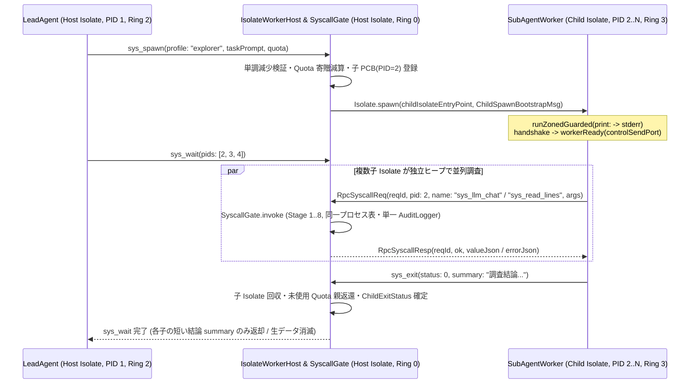

# 42_spec_isolate_ipc_and_quota.md — Step 2-2: Dart Isolate マルチプロセス・有界 IPC・権限減衰・TTY 独占・階層クオータ・ACP 純度仕様

関連文書:
- 全体アーキテクチャ・優先順位・副作用境界（正本）: [40_specification.md](./40_specification.md)（`[D-201]`〜`[D-204]`）
- 対象要求: [30_requirement.md](./30_requirement.md)（`REQ-04`, `REQ-05`, `REQ-06`, `REQ-10`）
- 技術実測根拠: [dart_isolate_and_context_paging.md](../cheatsheet/dart_isolate_and_context_paging.md) §1
- 原典設計参照: [01_kernel_and_process_architecture.md](../references/agent_kernel_plan/01_kernel_and_process_architecture.md) §1.2〜1.6

---

## 1. ホスト単一カーネル ＋ 子 `Isolate.spawn` アーキテクチャと `stdout` 純度強制（`REQ-04`, `REQ-10`）

D-210: ホスト単一カーネル（Microkernel IPC Server）・子 Isolate ブートストラップ・stdout 純度強制

対応要求: `REQ-04`, `REQ-10`（継承境界: `[D-001]`, `[D-005]`, `[D-018]`、関連判断: `OM-205`）

### 1.1 配置パスと Stage 1 非回帰境界
- `packages/agent_runtime/lib/src/process_runner.dart`: Stage 1 の E3 構造検査（`dart:io`, `package:agent_drivers`, `package:http` インポート禁止：`[D-201]`）を厳守したまま、純粋 Dart の範囲で以下 3 点のみ最小拡張する：
  1. 回復可能 `EDQUOT`（`recoverable: true`）とプロセス自身枯渇 `EDQUOT`（`!recoverable`）の分岐分離（`[D-212]`, `[D-214]`）。
  2. 1 ステップ複数 `CanonicalToolCall` 実行途中に非回復 `EDQUOT` / `ECANCELLED` で早期 `return` する際の、未実行後続 `CanonicalToolCall` に対する中断エラー `CanonicalToolResultTurn(isError: true)` 補完追記（`[D-214]`）。
  3. 親ターン終了 `finally` で未回収子プロセスの強制終了・クオータ精算（`settleChildExit`）を ACP 集計前に確実に完了させるための純粋 Dart 非同期フック `Future<void> Function()? onTurnExitCleanup` の受け入れ。
- `packages/agent_runtime/lib/src/child_isolate_bootstrap.dart`（新規）: `@pragma('vm:entry-point')` 子 `Isolate` 共通エントリポイントと `ZoneSpecification(print: -> stderr)` 保護。
- `packages/agent_runtime/lib/src/sub_agent_worker.dart`（新規）: 子プロセス用 `RemoteSyscallInvoker` と Ring 3 ReAct ループ（`Isolate` モードと単体テスト用 `GreenTask` モードの双方で同一コードを実行）。
- `packages/agent_runtime/lib/src/isolate_worker_host.dart`（新規）: ホスト Isolate 側のシステムコール RPC サーバー、子 `Isolate` 監視（`onError` / `onExit`）、タイムアウト・強制終了・クオータ精算（`LeadAgent.onTurnExitCleanup` へ配線）。

### 1.2 Microkernel IPC Server 構造とシリアライズ RPC プロトコル
Dart の `Isolate` 間では `ProcessControlBlock`・`JjDriver` ミューテックス・`AuditLogger` ファイルハンドルを直接共有できないため、Ring 0 カーネルと全ドライバ実体は **ホスト（親）Isolate に単一常駐** させる。



1. **AOT 互換の子共通ブートストラップと Zed ACP `stdout` 純度 100% 維持**:
   - [dart_isolate_and_context_paging.md](../cheatsheet/dart_isolate_and_context_paging.md) §1.2 で実証された通り、子 `Isolate` は親の `Zone` を継承しないため、無保護の子 `Isolate` で `print()` が呼ばれると直接 OS FD 1（`stdout`）へ流出して ACP NDJSON ストリームを即破壊する。
   - したがって、`Isolate.spawn` に渡す関数は **必ず唯一の `@pragma('vm:entry-point') void childIsolateEntryPoint(Map<String, Object?> rawInit)` のみ** とし、その最外周を以下で包むことを絶対契約とする：
     ```dart
     @pragma('vm:entry-point')
     void childIsolateEntryPoint(Map<String, Object?> rawInit) {
       runZonedGuarded<void>(
         () {
           unawaited(runSubAgentIsolateWorker(rawInit));
         },
         (Object error, StackTrace stack) {
           stderr.writeln('[agent_os_worker] Unhandled isolate error: $error\n$stack');
           final hostPort = rawInit['hostPort'];
           if (hostPort is SendPort) {
             hostPort.send(<String, Object?>{
               'type': 'worker_fatal',
               'pid': rawInit['pid'],
               'error': error.toString(),
             });
           }
         },
         zoneSpecification: ZoneSpecification(
           print: (Zone self, ZoneDelegate parent, Zone zone, String line) {
             stderr.writeln(line);
           },
         ),
       );
     }
     ```
   - 併せて全 4 パッケージのライブラリコードにおいて `dart:io` の `stdout` 識別子を参照してよいのはホストの `JsonRpcPeer`（および `acp_cli_client` 側ランナー）のみとする Stage 1 規則を維持する。
2. **`SendPort` メッセージのプリミティブ限定契約**:
   - `hostPort` / `workerControlPort` 間で送受信するメッセージはすべてプリミティブ値（`Map<String, Object?>`, `List<Object?>`, `String`, `int`, `double`, `bool`, `null`, `SendPort`, および 16 KiB 超バイト列がある場合の `TransferableTypedData`）のみで構成し、カスタムクラスやクロージャを直接 `SendPort.send` に渡さない（AOT 環境での `ArgumentError: Illegal argument in isolate message` を構造的に防止）。
3. **実行バックエンド抽象（`ChildWorkerBackend`）**:
   - 標準本番実装は `IsolateChildWorkerBackend`（`Isolate.spawn` + `Isolate.kill(priority: Isolate.immediate)`）とする。
   - 単体テストでの高速・決定論的ステップ検証用に、同一 `ChildWorkerBackend` IF を満たす `GreenTaskChildWorkerBackend`（ホスト内独立 `Zone` 非同期タスク実行）も用意する。なお `REQ-04` / `REQ-10` の AOT・マルチ Isolate 検証は必ず実 `IsolateChildWorkerBackend` で実行する。

---

## 2. プロセスプロファイルと `sys_spawn` / `sys_wait` / `sys_exit`（`REQ-04`, `REQ-05`）

D-211: プロセスプロファイル（Explorer / WebResearcher）とライフサイクルシステムコール

対応要求: `REQ-04`, `REQ-05`, `REQ-08`（優先順位正本: `[D-203]`、副作用境界: `[D-204]`）

### 2.1 配置パス
- `packages/agent_kernel/lib/src/process_profile.dart`（新規）: `ProcessProfileId`, `SpawnSpec`, `ChildExitStatus`
- `packages/agent_kernel/lib/src/pcb.dart` & `syscall_gate.dart`: `KernelProcessTable.stage2({int maxActiveProcesses = 16})` ファクトリ追加（引数なし `KernelProcessTable()` は `maxActiveProcesses = 1` を維持し Stage 1 単体テスト互換を保持）、PID 単調採番（`pid = 1` が `LeadAgent`、子プロセスは `2, 3, 4, ...` で再利用しない）。`validateSpawnAllowed` / `SyscallGate` Stage 2 検査では、`parent.quota.maxChildProcesses == 0` または `maxActiveProcesses == 1` の Stage 1 ロック時は従来通り `EPERM: STAGE1_SINGLE_PROCESS_LOCK`（`AuditDecision.deniedByPolicy`, `recoverable: false`）を維持し、Stage 2 有効時の同時子プロセス上限到達時は `EDQUOT: CHILD_PROCESS_QUOTA_EXCEEDED`（`AuditDecision.quotaExceeded`, `recoverable: true`）を返す。
- `packages/agent_runtime/lib/src/process_syscalls.dart`（新規）: `sys_spawn`, `sys_wait`, `sys_exit`, `sys_send`, `sys_recv` の `SyscallDefinition` と `SyscallToolSchema`

### 2.2 Stage 2 標準プロセスプロファイル定義
Stage 2 では任意の無制限なプロセス生成を許さず、以下の 2 つの Ring 3 サンドボックスプロファイルに限定する：

| プロファイル ID | リング | 付与される `CapRight` 集合 | VFS 名前空間構成 | VCS 動作制約 |
| :--- | :---: | :--- | :--- | :--- |
| **`explorer`** | `ring3` | `{read, vcsRead, llmInfer, memManage, ipc, procSelf}` | `/workspace`（`allowedSubpaths` 指定時は当該サブパス配下のみ許可）＋ `/skills` (Read-Only) | `sys_jj_status`/`log`/`diff` は **常時 `--ignore-working-copy` 強制** |
| **`web_researcher`** | `ring3` | `{netRead, llmInfer, ipc, procSelf}`（`read` 等のファイル権完全ゼロ） | **`/workspace`・`/skills` ともに未マウント**（`VfsNamespace.empty()`） | `vcsRead` / `vcsTx` 権限ゼロ（呼び出し不可） |

### 2.3 `sys_spawn` / `sys_wait` / `sys_exit` インターフェースと状態遷移

#### (1) `sys_spawn`（必須権利: `CapRight.procSpawn`）
- **入力引数**:
  - `profile` (`string`, 必須): `"explorer"` | `"web_researcher"`
  - `taskPrompt` (`string`, 必須): 子プロセスへ渡す調査依頼・出力形式指示（非空文字列）
  - `name` (`string?`): 識別名（省略時 `"<profile>-<childPid>"`）
  - `model` (`string?`): `<providerId>/<modelName>` 形式の個別モデル指定（省略時は親の現在ターンモデルを継承：`[D-203]`）
  - `allowedSubpaths` (`List<string>?`): `explorer` 専用。`/workspace` 配下の許可サブパス配列（例: `["/workspace/packages/agent_kernel"]`）。`web_researcher` に指定された場合は `EINVAL`
  - `maxTotalTokens` (`int?`), `maxCostMicroUsd` (`int?`), `maxWallTimeMs` (`int?`, 既定 `90,000`, 上限 `300,000`), `maxSteps` (`int?`, 既定 `16`, 上限 `32`)
  - `requestedRights` (`List<string>?`): 明示減衰オプション（プロファイル既定権利のさらなる部分集合のみ指定可。`writeCow`, `vcsTx`, `exec`, `procSpawn`, `admin` やプロファイル外権利を含む場合は即 `EPERM`）
- **実行処理**:
  1. Stage 1 ロック確認（`parent.quota.maxChildProcesses == 0` または `maxActiveProcesses == 1` の場合は `EPERM: STAGE1_SINGLE_PROCESS_LOCK`, `recoverable: false`）。
  2. 同時稼働子プロセス上限確認（`parent.quotaUsage.activeChildProcesses >= parent.quota.maxChildProcesses` またはプロセス表上限到達時は `EDQUOT: CHILD_PROCESS_QUOTA_EXCEEDED`, `recoverable: true` — 親ターン自体は失敗終了させず `sys_wait` 後に再試行可能とする）。
  3. ケーパビリティ単調減少・サブパス包含確認（`[D-213]`）およびクオータ寄贈減算（`[D-214]`）。
  4. 新規 `childPid` で子 `ProcessControlBlock`（独立した `VirtualContextMemory`・`BoundedMailbox`・減衰 `CSpace`・専用 `VfsNamespace`）を登録し、`Isolate.spawn` で非同期起動を開始する。
- **返却値**: `{ "childPid": 2, "name": "explorer-2", "profile": "explorer", "model": "...", "donatedQuota": { ... } }`。

#### (2) `sys_wait`（必須権利: `CapRight.procSpawn`）
- **入力引数**:
  - `pids` (`List<int>?`): 待機対象の子 PID リスト（省略時は呼び出し元が生成した現在稼働中または未回収の子プロセス全件）。他プロセスが生成した PID や自分自身・存在しない PID を指定した場合は `EINVAL` / `EPERM`。
  - `timeoutMs` (`int?`, 既定 `120,000`, 上限 `300,000`)。
- **実行処理と返却値**:
  - 指定された全子プロセスが `ProcessState.terminated` になるまで非同期に待機する（既に終了済みの子が含まれる場合は即座にその結果を返す）。
  - タイムアウト超過時は未完了の子を強制終了（`ETIMEDOUT`）して回収結果を返す。親ターンの `cancelToken` 発火時は全稼働中子を `Isolate.kill(priority: Isolate.immediate)` で即回収して `ECANCELLED` を返す。
  - **返却ペイロード（親コンテキスト保護）**: 各子について以下の要約構造体 `ChildExitStatus` のみを返し、**子が内部で読み取った生ファイル内容・検索結果・生 HTML・中間思考履歴は一切含めない**（子の `Isolate` 終了とともに GC 回収）：
    ```json
    {
      "children": [
        {
          "pid": 2,
          "name": "explorer-kernel",
          "profile": "explorer",
          "ok": true,
          "exitCode": 0,
          "reason": "EXITED_NORMALLY",
          "summary": "agent_kernel は外部非依存で 13 ファイルを公開しており...",
          "consumedTokens": 4820,
          "consumedCostMicroUsd": 0,
          "durationMs": 3410
        }
      ]
    }
    ```

#### (3) `sys_exit`（必須権利: `CapRight.procSelf`、Ring 3 子専用）
- **入力引数**: `exitCode` (`int`, 既定 `0`), `summary` (`string`, 親へ返す調査結論・出典 URL 等)。
- **動作**: 親プロセス（`pid == 1`）から呼ばれた場合は誤終了防止のため `EPERM` (`ROOT_PROCESS_CANNOT_EXIT`) を返す。Ring 3 子プロセスから呼ばれた場合は子の ReAct ループを即終了させ、`ChildExitStatus` を確定してクオータ精算を行う。なお子 LLM が Tool Call なしの最終テキスト応答を返した場合も、ランタイムが自動的に `sys_exit(exitCode: 0, summary: finalContent)` 相当の正常終了処理を実行する。

---

## 3. 有界メールボックス `BoundedMailbox` と IPC（`REQ-04`）

D-212: 有界メールボックス BoundedMailbox（制御優先レーン分離）と sys_send / sys_recv

対応要求: `REQ-04`（関連判断: `OM-207`）

### 3.1 配置パス
- `packages/agent_kernel/lib/src/mailbox.dart`（新規）: `IpcEnvelope`, `ControlSignalKind`, `ControlSignalMessage`, `BoundedMailbox`

### 3.2 2 レーン有界構造（暴走洪水防止と制御シグナル即時配送）
各 `ProcessControlBlock` は専用の `BoundedMailbox` を保持する：
1. **Control / Signal レーン（カーネル予約・最優先枠）**:
   - 容量上限 `maxControlSignals = 16`（同一種別シグナルは最新状態へコアレッシング可）。
   - 種別: `cancel`, `shutdown`, `quotaExceeded`, `childExited`。データレーンが満杯でもブロックされず即座に配送される。
2. **Data レーン（`sys_send` / `sys_recv` 用）**:
   - 既定上限: **`maxMessages = 32` 通**、1 通あたり最大 UTF-8 バイト長 **`maxPayloadBytes = 65,536`（64 KiB）**。
   - エンベロープ構造 `IpcEnvelope`: `{ "msgId": "msg_0001", "fromPid": int, "toPid": int, "schemaType": String, "payload": Map<String, dynamic> | String, "timestamp": ISO8601 }`。
   - **容量超過時の保護**:
     - `payload` の JSON シリアライズ UTF-8 長が `maxPayloadBytes` を超える場合 → `SyscallError(code: einval, reason: 'IPC_PAYLOAD_TOO_LARGE', recoverable: true)`。
     - 宛先 Data レーンの未読件数が `maxMessages` に達している場合 → 送信側をデッドロック待機させず即座に `SyscallError(code: edquot, reason: 'MAILBOX_FULL', recoverable: true, hint: 'Recipient mailbox is full; wait or summarize into fewer messages.')` を返す（`recoverable: true` の局所エラーであるため、`LeadAgent.runTurn` / `SubAgentWorker` はプロセス自身のクオータ枯渇とは扱わず、`CanonicalToolResultTurn(isError: true)` として記録し次の ReAct ステップへ推論を継続する）。

### 3.3 `sys_send` / `sys_recv` の宛先スコープ制限
- **`sys_send({toPid, payload, schemaType?})`**:
  - 通信許可トポロジは **厳格な親子関係のみ** とする：
    - 親（`pid = 1`）が送信できる宛先: `child.parentPid == 1` である自身の生成した子 PID のみ（終了済み子への送信は `ENOENT: PROCESS_TERMINATED`）。
    - 子（Ring 3）が送信できる宛先: 自身の `parentPid`（`= 1`）のみ（兄弟子プロセス間や未知 PID への直接横流し通信は `EPERM: IPC_TARGET_FORBIDDEN` で遮断し、無菌室間のデータ汚染も防ぐ）。
- **`sys_recv({maxMessages?, waitTimeoutMs?})`**:
  - 自身の `BoundedMailbox` から最大 `maxMessages`（既定 `8`, 上限 `32`）件を FIFO でデキューして返す。
  - `waitTimeoutMs`（既定 `0` = ノンブロッキング即時返却、最大 `30,000` ms）指定時は、空の場合に新着メッセージまたはタイムアウト／キャンセルまで待機し、タイムアウト時はエラーではなく `{ "messages": [], "remainingCount": 0 }` を返す。

---

## 4. ケーパビリティ単調減少・Tool Schema 隠蔽・TTY 独占原則（`REQ-05`）

D-213: ケーパビリティ単調減少・VFS サブパス減衰・CSpace 連動 Tool Schema 隠蔽・TTY 独占原則

対応要求: `REQ-05`, `REQ-08`（副作用境界: `[D-204]`、関連判断: `OM-206`）

### 4.1 `CapRight` 拡張と単調減少（Monotonic Attenuation）検証
`packages/agent_kernel/lib/src/capability.dart` の `CapRight` 列挙体を以下の通り拡張する（既存の 7 要素名は完全維持）：

```dart
enum CapRight {
  read,       // /workspace および /skills の Read-Only 読取 (LeadAgent / Explorer のみ保有)
  writeCow,   // /workspace の CoW 仮編集 (Stage 2 では Ring 2 親のみ)
  exec,       // Win32 Job Object 外部コマンド実行 (Stage 2 では Ring 2 親のみ)
  vcsRead,    // jj 非破壊読取
  vcsTx,      // jj トランザクション操作 (Stage 2 では Ring 2 親のみ)
  llmInfer,   // sys_llm_chat 推論
  admin,      // 特権管理 (通常プロセス非保有)
  // --- Stage 2 追加権利 ---
  memManage,  // sys_mem_pagein (Clean Page を持つプロセスの PageTable 再展開)
  procSpawn,  // sys_spawn / sys_wait (Stage 2 では Ring 2 親のみ -> 深さ 1 固定)
  procSelf,   // sys_exit (子プロセス自身の正常終了)
  ipc,        // sys_send / sys_recv (親子間有界メールボックス)
  netRead,    // net:public_readonly (sys_web_search / sys_web_fetch)
}
```

1. **`CapabilityTable.stage2LeadAgent()` の構成**:
   - `cap_workspace_rw` (`resourceScope: "/workspace"`): `{read, writeCow, exec, vcsRead, vcsTx, llmInfer, memManage, procSpawn, ipc}`（＋子への委譲元としての `procSelf` 派生権）
   - `cap_net_public` (`resourceScope: "net:public_readonly"`): `{netRead}`（委譲元として保持。親自身の直接呼び出しは `W⊕N` 規則 `[D-204]` により抑止）
2. **`sys_spawn` 時の単調減少検査（`CapabilityTable.deriveForChild`）**:
   - **権利集合の部分集合検査**: 子へ付与しようとするすべての `CapRight`（`procSelf` を除く実資源権）が親 `CSpace` の有効権利和集合に含まれていなければ、即座に `SyscallError(code: eperm, reason: 'CAPABILITY_ATTENUATION_VIOLATION')` を返す（例えば `CapabilityTable.stage1LeadAgent()` のように `netRead` や `procSpawn` を持たない親からは決して派生できない）。
   - **Stage 2 安全ロック検査**: 子プロセスに禁止された変更・実行・再生成権利 `{writeCow, vcsTx, exec, procSpawn, admin}` が 1 つでも含まれる場合は `SyscallError(code: eperm, reason: 'STAGE2_READONLY_CHILD_LOCK')` で拒否する。
   - **VFS サブパス減衰（`VfsNamespace.allowedSubpaths`）**:
     - `VfsNamespace` にオプショナルな `List<String>? allowedWorkspaceSubpaths`（正規化 `/workspace/...` プレフィックス配列）を追加し、`workspaceHostRoot` を nullable（`null` の場合は `/workspace` 未マウント → あらゆる `/workspace` パス解決が `EACCES: WORKSPACE_NOT_MOUNTED`）へ拡張する（既存の `VfsNamespace({required String workspaceHostRoot})` コンストラクタは完全互換維持）。
     - 親が `allowedWorkspaceSubpaths` で制限されている場合、子にはその部分パスのみ指定でき、範囲外サブパス指定は `sys_spawn` 時点で `EPERM` (`SUBPATH_ATTENUATION_VIOLATION`)、子の実行時アクセスは `EACCES` (`OUT_OF_ALLOWED_SUBPATH`) で遮断する。

### 4.2 CSpace 連動 `SyscallToolSchema` 自動フィルタリング
プロセス起動時に Segment 0 の `PinnedSystemInstruction.tools` を構築する際、全ツールスキーマカタログから **当該 PCB が実際に呼び出し可能なシステムコールのみ** を決定論的に抽出（名前順ソート）して渡す：
1. `pcb.cspace` が `definition.requiredRight` を保有していないシステムコールの Tool Schema は **自動的に除外** する。
2. `pcb.ring == ProtectionRing.ring2`（親 `LeadAgent`）からは `sys_exit`、および `W⊕N` 分離規則 `[D-204]` により `sys_web_search` / `sys_web_fetch` の Tool Schema を除外する（Web 調査は `sys_spawn(profile: "web_researcher")` で行う）。
3. この結果、各プロセスに露出する Tool Schema は以下の通り最小化される：
   - **`Explorer`（Ring 3）**: `sys_glob`, `sys_grep`, `sys_jj_diff`, `sys_jj_log`, `sys_jj_status`, `sys_mem_pagein`, `sys_read_lines`, `sys_recv`, `sys_send`, `sys_exit`（＋可視スキル存在時 `sys_skill_list`, `sys_skill_read`）。書込・`exec`・`tx`・`web`・`spawn` は **0 個**。
   - **`WebResearcher`（Ring 3）**: **`sys_exit`, `sys_recv`, `sys_send`, `sys_web_fetch`, `sys_web_search` の 5 個のみ**。ファイル読取・スキル読取・書込・`jj`・`exec`・`spawn`・`pagein` は **0 個**。
4. 万一 LLM がハルシネーションやプロンプトインジェクションで隠蔽されたシステムコール名を Tool Call として直接生成しても、`SyscallGate` Stage 2 の CSpace 検査および VFS 境界検査が副作用ゼロで即座に `EPERM` / `EACCES` を返す（二重防御）。

### 4.3 TTY 独占原則（子の承認ダイアログ混線ゼロ保証）
- ACP クライアント（Zed エディタまたは `acp_cli_client`）への承認要求（`ApprovalGate.evaluate` → `session/request_permission`）を発火できるのは **`ProtectionRing.ring2` かつ `pid == 1`（フォアグラウンド親 `LeadAgent`）1 プロセスのみ** とする。
- `pcb.ring == ProtectionRing.ring3` の子プロセスが万一 `RingDecision.askUser` となる操作に到達した場合、`SyscallGate` Stage 4 は `ApprovalGate.evaluate` を **0 回呼び出し（一切触らず）** のまま即座に `SyscallError(code: eperm, reason: 'TTY_MONOPOLY_DENIED', recoverable: false)` を返し、`syscalls.jsonl` に `decision: "DENIED_BY_POLICY"`, `approvalRequired: false` として記録する。

---

## 5. 階層型クオータ寄贈・未使用分返還・`EDQUOT` 局所停止（`REQ-06`）

D-214: 階層型クオータ寄贈（Quota Donation）・未使用分自動返還・EDQUOT 子局所停止

対応要求: `REQ-06`

### 5.1 `ResourceQuota` / `QuotaConsumption` の拡張（Stage 1 互換維持）
`packages/agent_kernel/lib/src/quota.dart` を以下の通り拡張する：

```dart
class ResourceQuota {
  const ResourceQuota({
    this.maxChildProcesses = 0,
    this.maxSyscallCountPerTurn = 64,
    this.maxTotalSyscalls,   // Stage 2 追加: 子プロセスの生涯 syscall 回数上限
    this.maxTotalTokens,
    this.maxCostMicroUsd,
    this.maxWallTimeMs,      // Stage 2 追加: プロセス実行時間上限 (ms)
  });

  static const ResourceQuota stage1Default = ResourceQuota();
  static const ResourceQuota stage2Default = ResourceQuota(
    maxChildProcesses: 8,
    maxSyscallCountPerTurn: 64,
  );
  // ...
}
```

`QuotaConsumption` に以下の追跡フィールドを追加する：
- `int totalSyscallsExecuted = 0`: プロセス生涯のシステムコール実行総数
- `int donatedTokensOut = 0`: 現在稼働中の子プロセスへ切り出し（予約拘束）中のトークン枠合計
- `int donatedCostMicroUsdOut = 0`: 現在稼働中の子プロセスへ切り出し中の費用枠合計
- `DateTime? startedAtUtc`: プロセス開始時刻（`maxWallTimeMs` 判定用）

### 5.2 寄贈と返還の厳密保存則（Conservation Law）
1. **親の利用可能残枠の定義**:
   - `parent.quota.maxTotalTokens != null` のとき：
     `availableTokens = parent.quota.maxTotalTokens! - parent.quotaUsage.totalTokensUsed - parent.quotaUsage.donatedTokensOut`
   - `parent.quota.maxCostMicroUsd != null` のとき：
     `availableCost = parent.quota.maxCostMicroUsd! - parent.quotaUsage.costMicroUsdUsed - parent.quotaUsage.donatedCostMicroUsdOut`
2. **寄贈時（`QuotaLedger.donateToChild`）**:
   - 親に `maxTotalTokens` 上限がある場合、子への寄贈トークン `childMaxTokens`（省略時は `min(availableTokens, 16384)`、0 以下なら寄贈不能）が `availableTokens` を超えていれば、子を起動せず即座に `SyscallError(code: edquot, reason: 'INSUFFICIENT_PARENT_TOKEN_QUOTA', recoverable: true, hint: 'Requested child token budget exceeds parent available tokens; pass a smaller maxTotalTokens or perform inspection directly.')` を返す（`maxCostMicroUsd` 超過時も同様に `INSUFFICIENT_PARENT_COST_QUOTA`, `recoverable: true`）。これらは寄贈要求量の調整で回復できるため親ターン自体は失敗終了させない。
   - 検査通過時、原子的（ホスト単一スレッド上）に `parent.quotaUsage.donatedTokensOut += donatedTokens`、`parent.quotaUsage.donatedCostMicroUsdOut += donatedCost`、`parent.quotaUsage.activeChildProcesses += 1` を記録する。この瞬間から親自身の `checkBeforeSyscall` でも `totalTokensUsed + donatedTokensOut >= maxTotalTokens` として予約分が差し引かれるため、親子同時稼働でも初期予算合計を超過できない。
3. **子終了時の精算・未使用分返還（`QuotaLedger.settleChildExit`：1 子につき厳密 1 回のみ実行）**:
   - 子プロセスの実消費量 `(childUsedTokens, childUsedCost)` を確定させた上で：
     - `parent.quotaUsage.donatedTokensOut -= donatedTokens`（予約枠の解除）
     - `parent.quotaUsage.totalTokensUsed += childUsedTokens`（実消費分のみを親の累積消費へ確定計上 → 差額 `donatedTokens - childUsedTokens` が親の利用可能残枠へ自動的に返還される）
     - 費用も同様に `parent.quotaUsage.donatedCostMicroUsdOut -= donatedCost`、`parent.quotaUsage.costMicroUsdUsed += childUsedCost` とし、`parent.quotaUsage.activeChildProcesses -= 1` する。

### 5.3 子プロセスの `EDQUOT` 局所停止と親継続
- 子プロセス（Ring 3）において以下のいずれかが成立した瞬間、カーネルは当該子プロセスのみを `EDQUOT` で停止させる：
  1. `SyscallGate` Stage 2 事前検査で `totalTokensUsed >= maxTotalTokens`、`costMicroUsdUsed >= maxCostMicroUsd`、`totalSyscallsExecuted >= maxTotalSyscalls`、`syscallCountInTurn >= maxSyscallCountPerTurn`、または `elapsedMs >= maxWallTimeMs`。
  2. `IsolateWorkerHost` の `maxWallTimeMs` 監視タイマー満了（推論ストリーム待機中やスピン中であっても `Isolate.kill(priority: Isolate.immediate)` で即時強制停止）。
  3. `sys_llm_chat` 完了時の `usage` 加算直後に `totalTokensUsed >= maxTotalTokens` または `costMicroUsdUsed >= maxCostMicroUsd` に到達し、かつ未処理の追加 Tool Call が残っている場合（上限超過後のさらなるステップ継続を阻止）。
- **親への返却動作と ACP `end_turn` 正常完走**:
  - 停止した子プロセスは `ChildExitStatus(ok: false, exitCode: 77, reason: 'TOKEN_QUOTA_EXCEEDED' /* 等 */, errorCode: 'EDQUOT', summary: partialContentOrNotice, consumedTokens: ..., ...)` として正常に回収・クオータ精算される。
  - `sys_wait` 自体は成功応答（`ok: true`）として各子の `ChildExitStatus` を返すため、親 `LeadAgent` 自身はクラッシュもターン異常終了もせず、`sys_wait` 結果内の `ok: false, errorCode: "EDQUOT"` を踏まえてユーザーへ最終応答を返し、ACP `session/prompt` は **`stopReason: "end_turn"` で正常完走** する。
- **ReAct ループ（`LeadAgent.runTurn` / `SubAgentWorker`）における `EDQUOT` 分岐と複数 `toolCalls` 中断時のペア補完規則**:
  1. **非回復 `EDQUOT` vs 回復可能 `EDQUOT` の厳密分離**:
     - ツール実行結果が `SyscallErrorCode.edquot` のとき、ループを直ちに中断して `AgentTurnResult.failure`（親の場合は ACP `stopReason: "max_tokens"`、子の場合は当該子の `EDQUOT` 終了）とするのは **`!toolRes.error!.recoverable`（呼び出し元プロセス自身のクオータ枯渇：`SYSCALL_QUOTA_EXCEEDED`, `TOKEN_QUOTA_EXCEEDED`, `COST_QUOTA_EXCEEDED`, `WALL_TIME_QUOTA_EXCEEDED` 等）の場合に限定** する。
     - 一方、`recoverable == true` の局所制限（`MAILBOX_FULL` `[D-212]`、`CHILD_PROCESS_QUOTA_EXCEEDED` `[D-211]`、`INSUFFICIENT_PARENT_TOKEN_QUOTA` / `INSUFFICIENT_PARENT_COST_QUOTA` `[D-214]`）は通常のエラーツール結果（`CanonicalToolResultTurn(isError: true)`）として Segment 1 に記録し、ターンを終了させず次の ReAct ステップへ推論を継続させる。
  2. **複数 `toolCalls` 途中中断時の `CanonicalToolResultTurn` 補完（`[D-207]` ペア不変条件の維持）**:
     - 1 ステップで複数の `CanonicalToolCall` を含む `CanonicalAssistantTurn` を Segment 1 へ追記済みの状態で、途中のツール実行において非回復 `EDQUOT`（`!toolRes.error!.recoverable`）または `ECANCELLED`（キャンセル発火）によりループを早期脱出して `return` する際は、**未実行の後続 `CanonicalToolCall` すべてに対しても中断理由を格納した `CanonicalToolResultTurn(canonicalCallId: remainingTc.canonicalCallId, toolName: remainingTc.name, content: abortError.toJsonString(), isError: true)` を Segment 1 へ補完追記してから `return` する**。これにより、中断後の次ターン以降も `assistant.tool_calls[].id` ↔ `tool.tool_call_id` の 1 対 1 対応が全プロバイダで 100% 維持され、`400 Bad Request` が発生しない。

---

## 6. マルチプロセス監査ログと ACP 状態通知連携（`REQ-10`）

D-215: マルチプロセス対応 AuditLogger（pid / parentPid / processName / ring・ページング統計）と ACP 連携

対応要求: `REQ-01`, `REQ-04`, `REQ-10`（継承境界: `[D-010]`, `[D-019]`）

1. **単一ライター直列化による JSONL 非破損保証**:
   - 子 `Isolate` の全システムコールと全 `sys_llm_chat` はホスト Isolate 上の同一 `SyscallGate` / `LlmRouter` / `AuditLogger`（内部 `_writeChain` 直列追記キュー）を通過するため、何並列で稼働しても `syscalls.jsonl` / `llm_io.jsonl` の行混ざり（インターリーブ破損）は発生しない。
2. **プロセス帰属フィールド（4 点）とページング統計（5 点）の追加**:
   - `SyscallAuditRecord.toJson()`（`syscalls.jsonl`）に既存の `'pid'`・`'ring'` に加えて **`'parentPid': parentPid` (`int?`)** および **`'processName': processName` (`String?`)** を出力する（親 `LeadAgent` は `pid: 1, parentPid: null, processName: "lead-agent", ring: "ring2"`、子は `pid: 2, parentPid: 1, processName: "explorer-2", ring: "ring3"` 等）。
   - `LlmIoAuditRecord.toJson()`（`llm_io.jsonl`）にも同様に **`'pid': pid` (`int`), `'parentPid': parentPid` (`int?`), `'processName': processName` (`String?`), `'ring': ring.name` (`String`)** の 4 点、および `[D-207]` で定義したページング統計 **`'effectiveWindowTokens'`, `'evictedPagesInStep'`, `'residentCleanPages'`, `'evictedCleanPages'`, `'stalePagesCount'`** の 5 点をトップレベルで構造化出力する。これにより親コンテキストの `promptTokens` / `cachedTokens` と各子のトークン推移を `pid` で厳密に分離検証できる。
3. **ACP クライアントへの通知混線防止（`pid == 1` 厳格フィルタリング契約）**:
   - 子プロセスの内部思考・応答チャンクや子内部の個別システムコール結果を親の ACP `session/update` ストリームへ混入・上書きさせないため、共有 IF と観測フックで以下の **`pid == 1`（親 `LeadAgent`）厳格フィルタ** を強制する：
     1. **`LlmStreamObserver` への `pid` 伝搬（`packages/agent_drivers/lib/src/llm/llm_router.dart`）**:
        - 既存 Stage 1 テストとの後方互換を保つ名前付きオプション引数を用いてシグネチャを `typedef LlmStreamObserver = void Function(String sessionId, int turnIndex, LlmStreamEvent event, {Pid pid});` に拡張し、`buildLlmChatSyscallDefinition` から `onStreamEvent?.call(execContext.context.sessionId, turnIndex, event, pid: execContext.pcb.pid)` として呼び出し元 `pid` を渡す。
        - `KernelBootstrap` および `AcpEventMapper` は **`pid == 1` のストリームイベントのみ** を `LeadAgent.forwardLlmStreamEvent` および `AcpEventMapper.onLlmStreamEvent`（`agent_thought_chunk` / `agent_message_chunk` / `usage_update`）へ中継・送出し、Ring 3 子プロセス（`pid != 1`）の推論ストリームは ACP クライアントへ一切送出しない。
     2. **`AcpSyscallObserverHook` / `_DeferredAcpObserverHook` の `pid == 1` フィルタ（`packages/agent_acp/lib/src/acp_server.dart`, `acp_event_mapper.dart`）**:
        - `beforeSyscall` および `afterSyscall` の双方において **`context.pid == 1` かつ `context.syscallName != 'sys_llm_chat'` の場合のみ** `AcpEventMapper.recordBeforeSyscall` / `recordAfterSyscall` を呼び出し、`context.pid != 1`（子プロセス）のシステムコールはすべて無視する。これにより、親が `sys_wait` 実行待機中に裏で完了した子の `sys_read_lines` 等が親の `_activeToolArgs` / `_afterSyscallResult`（`sys_wait` の `tool_call_update` ペイロード）を上書き破壊することを完全に防ぐ。
   - `_fm_agent_os/status` 応答および `turnSummary` の `_meta` には、`activeChildProcesses`・`spawnedChildrenCount`・`evictedCleanPagesCount`・`effectiveContextWindow` を追加公開し、`/status` コマンドや検証スクリプトから観測可能にする。

---

## 7. Step 2-2 ＋ ACP 純度の確認手順と観測対象（`REQ-04`〜`REQ-06`, `REQ-10`）

1. **自動テスト（`E1` / `E3`）**:
   - `packages/agent_runtime/test/isolate_multiprocess_ipc_test.dart`（新規）:
     - 実 `IsolateChildWorkerBackend` による 3 並列 `Explorer` 生成・IPC 送受信・`sys_wait` 回収、および子終了後の `activeChildProcesses == 0` 確認。
     - `BoundedMailbox` 容量上限（32 通）超過時の `EDQUOT: MAILBOX_FULL`（`recoverable: true` により親ターンが異常終了せず次ステップへ継続できることを含む）、64 KiB 超過時の `EINVAL`、兄弟間・不正宛先送信の `EPERM`、データ満杯時の制御シグナル優先配送。
     - 子 `Isolate` 内で未捕捉例外を投げた場合、親が `sys_wait` を呼ばずターン終了した場合（`onTurnExitCleanup` 回収・精算）、および親ターン `cancelActiveTurn()` 実行時に、子 `Isolate` が残留なく即回収され親が生存継続すること。
     - 1 ステップ内の複数 `toolCalls` 途中で非回復 `EDQUOT` または `ECANCELLED` が発生した際、未実行の後続 `toolCalls` すべてに中断エラー `CanonicalToolResultTurn` が補完追記され、次ターンの `ProjectedPrompt` で `tool_call_id` ペア不整合が起きないこと。
   - `packages/agent_runtime/test/capability_tty_and_quota_test.dart`（新規）:
     - `sys_spawn` での権限増幅（`writeCow`, `exec`, `procSpawn` 等）要求が `EPERM` で拒否されること、および `allowedSubpaths` 外読取の `EACCES` 遮断。
     - `Explorer` / `WebResearcher` の `ProjectedPrompt.tools` に権限外スキーマが 0 個であること、および直接 `SyscallGate.invoke` で `sys_write_file` / `sys_exec` / `sys_tx_squash` を叩いた際に **`ApprovalHandler` 呼び出し回数 0 回** のまま即 `EPERM` となること。
     - 階層クオータ寄贈→未使用分返還の厳密一致、親残量超過寄贈（`INSUFFICIENT_PARENT_TOKEN_QUOTA`）や同時子数上限超過（`CHILD_PROCESS_QUOTA_EXCEEDED`）での `recoverable: true` 拒否と親継続、極小トークン／時間／syscall 上限での子単独 `EDQUOT` 停止と親 `end_turn` 完走。
   - `packages/agent_acp/test/multiprocess_stdout_purity_test.dart`（新規）:
     - 並列子プロセスが `sys_llm_chat`・`sys_read_lines` を実行している最中も、子の思考／テキストチャンク・`usage_update`・内部 syscall 結果が親の ACP `session/update` 通知へ一切混入せず、親 `sys_wait` の `tool_call_update` ペイロードも上書き破損しないこと。
     - `dart compile exe` でビルドした実 `agent_os_daemon.exe` サブプロセス上で、子 `Isolate` 群が並列稼働中に意図的な `print()` 出力や例外を起こしても、デーモンの `stdout` 全行が **100% 有効な JSON-RPC 2.0 NDJSON** であり非 JSON 混入が 0 バイトであること。
     - `PATH` から Dart SDK / `mise` を除外したクリーン環境変数の下で `agent_os_daemon.exe` / `acp_cli_client.exe` が単体起動・対話できること。
2. **実機観測（`E2`：合意 `B-02` 準拠）**:
   - **事象 2-2-1（3 並列 `Explorer` 実機調査）**: `local-ollama` を用い、親エージェントから 3 つの `Explorer` を並列起動して `agent_kernel`・`agent_drivers`・`agent_acp` を調査させ、`syscalls.jsonl` / `llm_io.jsonl` 上で `pid = 2, 3, 4` の並列実行・終了と、親（`pid = 1`）の `promptTokens` に子の生ファイル読取分が流入せず結論のみ統合されることを観測する。
   - **事象 2-2-2（極小クオータ `EDQUOT` 局所停止）**: 子に極小トークン上限（例: `1,500` tokens）を指定して実 LLM 調査を起動し、上限到達時点で `EDQUOT` が記録されてその子だけが停止し、親が落ちずに完了応答を返すことを観測する。
   - **事象 2-2-3（承認ダイアログ混線ゼロ）**: 並列 `Explorer` 調査中に `acp_cli_client.exe` 側で子由来の `session/request_permission` が 0 件であり、リポジトリのワーキングコピーと `jj op log` 先頭 `op_id` が 1 バイトも変化しないことを観測する。
