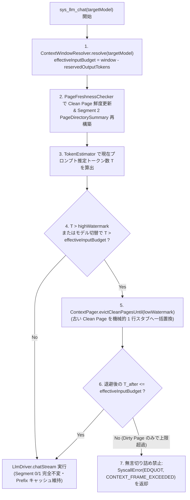

# 42_spec_memory_and_paging.md — Step 2-1: Prefix 保持メモリ拡張・バッチ Clean Page 退避・鮮度検知・動的フレーム縮小仕様

関連文書:
- 全体アーキテクチャ・優先順位・失効境界（正本）: [40_specification.md](./40_specification.md)（`[D-201]`〜`[D-204]`）
- 対象要求: [30_requirement.md](./30_requirement.md)（`REQ-01`, `REQ-02`, `REQ-03`）
- 技術実測根拠: [dart_isolate_and_context_paging.md](../cheatsheet/dart_isolate_and_context_paging.md) §2〜4
- 原典設計参照: [02_memory_and_context_paging.md](../references/agent_kernel_plan/02_memory_and_context_paging.md)

---

## 1. `VirtualContextMemory` 拡張・`PageTable`・ハイブリッドトークン推定（`REQ-01`）

D-206: VirtualContextMemory 拡張・ContextPage / PageTable・ハイブリッドトークン推定

対応要求: `REQ-01`, `REQ-03`（継承境界: `[D-007]`、失効規則: `[D-204]`、関連判断: `OM-202`, `OM-203`）

### 1.1 配置パスと変更箇所
- `packages/agent_kernel/lib/src/context_memory.dart`: `VirtualContextMemory`, `AppendOnlyHistorySegment`, `EphemeralTailSegment`, `CanonicalToolResultTurn` の非破壊拡張
- `packages/agent_kernel/lib/src/context_pager.dart`（新規）: `ContextPage`, `PageKind`, `CleanPageSourceMeta`, `PageFreshnessStatus`, `PageTable`, `TokenEstimator`, `ContextPager`

### 1.2 3 セグメント構造と `ContextPage` / `PageTable` モデル
既存の `VirtualContextMemory`（Segment 0 `SystemPinnedSegment` → Segment 1 `AppendOnlyHistorySegment` → Segment 2 `EphemeralTailSegment`）の公開メソッド互換を維持したまま、各コンテキスト要素を `PageTable` で追跡する。

```dart
enum PageKind {
  systemPinned, // Segment 0 (常駐・退避不可)
  conversation, // User / Assistant ターン (Dirty Page)
  fileView,     // sys_read_lines / sys_skill_read の成功結果 (Clean Page)
  vcsView,      // sys_jj_status / log / diff / sys_glob / sys_grep の成功結果 (Clean Page)
  toolOutput,   // sys_exec / sys_edit_block / sys_web_* / IPC / エラー応答 (Dirty Page)
}

enum CleanSourceKind {
  workspaceFile, // ファイル SHA-256 照合対象
  skillFile,     // /skills 内 SKILL.md SHA-256 照合対象
  vcsSnapshot,   // jj @ commit_id 照合対象
}

class CleanPageSourceMeta {
  const CleanPageSourceMeta({
    required this.sourceKind,
    required this.syscallName,
    required this.replayArgs,
    this.virtualPath,
    this.startLine,
    this.endLine,
    this.readSha256,
    this.readModifiedUtc,
    this.readByteLength,
    this.readChangeId,
    this.readCommitId,
    this.readOpId,
  });

  final CleanSourceKind sourceKind;
  final String syscallName;
  final Map<String, dynamic> replayArgs;
  final String? virtualPath;
  final int? startLine;
  final int? endLine;
  final String? readSha256;
  final DateTime? readModifiedUtc;
  final int? readByteLength;
  final String? readChangeId;
  final String? readCommitId;
  final String? readOpId;
}

class ContextPage {
  ContextPage({
    required this.pageId,
    required this.kind,
    required this.segmentIndex,
    this.historyTurnIndex,
    required this.createdAtTurn,
    required this.lastReferencedTurn,
    required this.dirty,
    this.pinned = false,
    this.resident = true,
    required this.estimatedTokens,
    this.originalTokens,
    this.cleanSource,
    this.freshness = PageFreshnessStatus.fresh,
  });

  final String pageId; // "pg_0000" (Segment 0), "pg_0001", "pg_0002", ...
  final PageKind kind;
  final int segmentIndex; // 0 or 1
  final int? historyTurnIndex; // AppendOnlyHistorySegment 内のインデックス
  final int createdAtTurn;
  int lastReferencedTurn;
  int referenceCount = 1;
  final bool dirty;
  bool pinned;
  bool resident; // false = Segment 1 内で機械的 Page Stub へ置換済み
  int estimatedTokens;
  final int? originalTokens;
  CleanPageSourceMeta? cleanSource;
  PageFreshnessStatus freshness; // fresh | stale | deleted
}
```

#### Clean Page vs Dirty Page の決定論的分類規則（`OM-203`）
1. **Clean Page (`dirty: false`) とする条件**:
   - `CanonicalToolResultTurn` であり、かつ **`isError == false`** であり、かつ元のシステムコールが以下のいずれかで `CleanPageSourceMeta` が付与されているものに限る：
     - `CleanSourceKind.workspaceFile`: `sys_read_lines`（`/workspace/...` 対象、`readSha256` 必須）
     - `CleanSourceKind.skillFile`: `sys_skill_read` または `/skills/...` 対象の `sys_read_lines`（`readSha256` 必須）
     - `CleanSourceKind.vcsSnapshot`: `sys_jj_status`, `sys_jj_log`, `sys_jj_diff`, `sys_glob`, `sys_grep`（`readCommitId` 必須）
2. **Dirty Page (`dirty: true`) として保護する対象**:
   - Segment 0（`pinned: true, dirty: false` だが退避対象外）
   - すべての `CanonicalUserTurn` および `CanonicalAssistantTurn`（思考・合意・計画・Tool Call 発行記録）
   - 副作用・外部非決定性・要約結論を含むツール結果：`sys_edit_block`, `sys_write_file`, `sys_tx_*`, `sys_exec`, `sys_web_search`, `sys_web_fetch`, `sys_spawn`, `sys_wait`, `sys_send`, `sys_recv`, `sys_exit`, `sys_skill_list`, `sys_mem_pagein`、およびすべてのエラー結果（`isError == true`）。
   - Stage 2 では Dirty Page を自動破棄・LLM 要約置換しない（Dirty Page Swap は Stage 3 Step 3-3 の範囲）。

### 1.3 ハイブリッドトークン推定器（`TokenEstimator`）
[dart_isolate_and_context_paging.md](../cheatsheet/dart_isolate_and_context_paging.md) §3 の実測結果（日本語 `1.70 chars/tok` だが UTF-8 バイト比では `3.48 B/tok`、JSON/Hex 出力で `2.43 B/tok`）に基づき、文字数比ではなく **UTF-8 バイト長ヒューリスティック ＋ 実測 `promptTokens` アンカー差分補正** を採用する。

1. **単一要素の安全側推定式（外部辞書不要・O(N)）**:
   - メッセージ本文・思考・ツール引数 JSON の推定トークン数：
     `estimateTextTokens(String s) = (utf8.encode(s).length / 3.0).ceil()`
   - 1 メッセージあたりのチャットテンプレート構造オーバーヘッド：`+6 tokens`
   - Segment 0 の固定トークン数：`estimateTextTokens(instruction) + 6 + sum(tools.map((t) => (utf8.encode(jsonEncode(t.toJson())).length / 3.0).ceil() + 4))`
2. **直近 `usage.promptTokens` によるアンカー差分補正（累積誤差ゼロ化）**:
   - `VirtualContextMemory` に以下のアンカー状態を保持する：
     - `ModelIdentifier? lastAnchoredModel`
     - `int? lastActualPromptTokens`（直近 `sys_llm_chat` 完了時の実測 `usage.promptTokens`）
     - `int? anchorEstimatedBaselineTokens`（その推論送信時点での全常駐メッセージのヒューリスティック合計値）
   - 次回推論前の現在コンテキスト推定値 `estimateCurrentPromptTokens(ModelIdentifier targetModel)`：
     - `lastAnchoredModel == targetModel && lastActualPromptTokens != null && anchorEstimatedBaselineTokens != null`（同一モデル継続かつアンカー有効）の場合：
       `delta = currentHeuristicTotal - anchorEstimatedBaselineTokens`
       `return max(currentSegment0Tokens, lastActualPromptTokens! + delta)`
     - モデル切替時、初回ターン、またはバッチ退避実行直後（`[D-204]` 失効条件該当）の場合：
       `return currentHeuristicTotal`
   - `sys_llm_chat` が正常完了し `usage.promptTokens > 0` が返却された時点で、`(lastAnchoredModel, lastActualPromptTokens, anchorEstimatedBaselineTokens)` を最新値で更新する。

---

## 2. High / Low Watermark バッチ Clean Page 機械的スタブ退避（`REQ-01`）

D-207: High / Low Watermark 連動バッチ Clean Page 機械的スタブ退避（ContextPager）

対応要求: `REQ-01`, `REQ-03`（関連判断: `OM-202`, `OM-203`）

### 2.1 Watermark パラメータ（`PagerWatermarkConfig`）
- `highWatermarkRatio`: 既定 **`0.85`**（入力フレーム上限 `effectiveInputBudget` の 85%）
- `lowWatermarkRatio`: 既定 **`0.55`**（入力フレーム上限 `effectiveInputBudget` の 55%）
- `minKeepRecentTurns`: 既定 **`1`**（直近進行中の ReAct ステップでたった今読み取ったばかりの最末尾ツール結果は、単一モデル継続中の通常退避では優先保護し、それでも `effectiveInputBudget` を超える小窓モデル切替時のみ退避対象に含める）

### 2.2 Prefix キャッシュと `tool_call_id` ペア整合性を守る in-place Stub 置換規則
1. **通常ターン（`estimatedTokens <= highWatermarkTokens`）の絶対不変性**:
   - `ContextPager` は一切介入せず、Segment 0 および Segment 1 既存要素の文字列を **1 バイトも変更しない**。これにより Exact Prefix Match に依存する Ollama / OpenRouter の KV キャッシュ（`cachedTokens`）が毎ターン維持される。
2. **バッチ退避発動時（`estimatedTokens > highWatermarkTokens`）のアルゴリズム**:
   - `PageTable` 内の退避候補（`segmentIndex == 1 && !dirty && resident && !pinned`）を **`(lastReferencedTurn ASC, createdAtTurn ASC, pageId ASC)`**（最も古く参照されていない順）にソートする。
   - 推定トークン合計が **`lowWatermarkTokens` 以下** になるまで、候補ページの `CanonicalToolResultTurn` を以下の機械的 **Page Stub**（1〜2 行、LLM 呼び出しゼロ）へ一括置換し、`page.resident = false`・`page.estimatedTokens = stubTokens` に更新する：
     - **ファイル系 Clean Page のスタブ形式**:
       ```text
       [PageOut pg_0012: /workspace/packages/agent_kernel/lib/src/pcb.dart (L1-160, sha256: 9f86d081884c, orig: 1420 tokens) — Evicted clean page. Call sys_mem_pagein({"pageId":"pg_0012"}) or sys_read_lines to reload.]
       ```
     - **VCS / 検索系 Clean Page のスタブ形式**:
       ```text
       [PageOut pg_0015: sys_jj_diff(rev="@", commit: a1b2c3d4e5f6, orig: 980 tokens) — Evicted clean page. Call sys_mem_pagein({"pageId":"pg_0015"}) or re-run syscall to reload.]
       ```
   - **重要不変条件（`400 Bad Request` 防止）**:
     - `AppendOnlyHistorySegment` から `CanonicalToolResultTurn` オブジェクト自体を削除してはならない。`AppendOnlyHistorySegment.replaceToolResultContentWithStub(int turnIndex, String stubContent)` により、同一インデックス・同一 `canonicalCallId`・同一 `toolName` を保ったまま `content` 文字列のみをスタブへ置き換える。これにより直前の `CanonicalAssistantTurn.toolCalls` との `tool_call_id` 1 対 1 対応が全プロバイダで壊れない。
   - バッチ退避が 1 ページ以上実行された場合は、`[D-204]` に従い実測トークンアンカーをリセットする。
   - **ページング統計の `llm_io.jsonl` 構造化出力（`REQ-01` 条件 2・`REQ-03` 検証対応）**:
     - 各 `sys_llm_chat` 実行時に記録される `LlmIoAuditRecord`（`[D-215]`）へ、以下のページング統計 5 フィールドを必ず構造化出力する：
       - `effectiveWindowTokens` (`int`): 解決された対象モデルの実効コンテキスト窓トークン数
       - `evictedPagesInStep` (`int`): 当該推論ステップ直前の `ContextPager` で新規にスタブ退避された Clean Page 数（通常ステップは `0`、バッチ退避・切替縮小発火ステップは `> 0`）
       - `residentCleanPages` (`int`): 推論送信時点で常駐中（`resident == true`）の Clean Page 総数
       - `evictedCleanPages` (`int`): 推論送信時点でスタブ退避済み（`resident == false`）の Clean Page 総数
       - `stalePagesCount` (`int`): 推論送信時点で `freshness != fresh`（`[STALE]`）と判定されている Clean Page 総数

---

## 3. Clean Page 鮮度検知（`[STALE]`）と `sys_mem_pagein` 再展開（`REQ-02`）

D-208: Clean Page 鮮度検知（SHA-256 × Commit ID）・Segment 2 目次・sys_mem_pagein 仕様

対応要求: `REQ-02`（失効規則: `[D-204]`、関連判断: `OM-203`）

### 3.1 配置パス
- `packages/agent_kernel/lib/src/context_pager.dart`: `PageFreshnessChecker` 抽象 IF、Segment 2 `PageDirectorySummary` レンダラ
- `packages/agent_drivers/lib/src/memory/workspace_page_freshness_checker.dart`（新規）: ホストファイル `FileStat`/`SHA-256` および `JjDriver` `--ignore-working-copy` `commit_id` を用いた具象実装と `sys_mem_pagein` ハンドラ

### 3.2 4 ケースすべてで誤検知しない `[STALE]` 判定ロジック
[dart_isolate_and_context_paging.md](../cheatsheet/dart_isolate_and_context_paging.md) §4 の実測に基づき、ページ種別ごとに以下の通り判定する：

| CleanSourceKind | 鮮度判定手順（副作用ゼロ・`--ignore-working-copy` 厳守） | 判定結果 |
| :--- | :--- | :--- |
| **`workspaceFile` / `skillFile`** | 1. 仮想パスを `VfsNamespace` でホストパスへ解決し実体確認。<br>2. ファイルが存在しない場合 → `PageFreshnessStatus.deleted`（表示上 `[STALE: DELETED]`）。<br>3. `FileStat.stat(hostPath)` の `(modified.toUtc(), size)` が `(readModifiedUtc, readByteLength)` と完全一致していればハッシュ再計算を省略して `fresh`。<br>4. 異なる場合はファイル全体の `SHA-256` を計算し、`currentSha256 == readSha256` なら `fresh`、不一致なら **`PageFreshnessStatus.stale`**。 | - 未編集 → `fresh`<br>- `HostFsDriver` / `sys_exec` スナップショット済み編集 → `stale`<br>- 外部ツールによる未スナップショット直接編集 → **`stale`（見逃しゼロ）**<br>- 無関係な別ファイルのみ編集 → **`fresh`（偽陽性ゼロ）** |
| **`vcsSnapshot`**<br>（`sys_jj_*`, `glob`, `grep`） | `jj log --no-graph -r @ --ignore-working-copy -T "commit_id"`（1 ターンにつき 1 回だけ取得）の `currentCommitId` と `readCommitId` を比較。一致なら `fresh`、不一致なら **`PageFreshnessStatus.stale`**。 | リビジョン `@` のスナップショット状態が変化したときのみ正確に `stale` となる。 |

### 3.3 Segment 1 不変維持と Segment 2 `PageDirectorySummary` 出力
- **絶対規約**: ファイル編集や `jj` 操作によって過去ページが `stale` に変化しても、**Segment 1 内の過去メッセージ文字列やスタブ文字列を書き換えてはならない**（書き換えると編集のたびに過去ターンの Prefix KV キャッシュが無効化される）。
- 代わりに、各推論ステップ直前に `PageFreshnessChecker` で退避済み Clean Page（`!resident`）および常駐 Clean Page の鮮度を更新し、`!resident` ページまたは `freshness != fresh` のページが 1 件以上存在する場合のみ、**Segment 2（`EphemeralTailSegment` の末尾動的ブロック）** に以下の `PageDirectorySummary` を付加する：
  ```text
  [Context Page Directory]
  - pg_0003: /workspace/lib/a.dart (L1-100) [EVICTED | STALE: modified since read — reload with sys_mem_pagein({"pageId":"pg_0003"}) or sys_read_lines]
  - pg_0005: /workspace/lib/b.dart (L1-80) [EVICTED | FRESH — reload with sys_mem_pagein({"pageId":"pg_0005"})]
  - pg_0009: /workspace/lib/a.dart (L101-180) [RESIDENT | STALE: modified since read — re-read latest before editing]
  ```
- 退避ページが 0 件かつ全常駐ページが `fresh` の通常初期ターンでは、このブロック自体を出力しない（空文字）。

### 3.4 `sys_mem_pagein` システムコール仕様
- **必須権利**: `CapRight.memManage`（加えて原本種別に応じた `CapRight.read` / `CapRight.vcsRead` と現在の `VfsNamespace` / `SkillRegistry` アクセス権を実行時に再検証する。なお Clean Page を一切持たない `WebResearcher` には `memManage` を付与しない）。
- **引数スキーマ**:
  - `pageId` (`string`, 必須): 再展開対象のページ ID（例: `"pg_0003"`）。
- **正常系動作**:
  1. 呼び出し元 `pcb.memory.pageTable` から `pageId` を検索する（他プロセスのページは原理的に参照不可）。
  2. `page.cleanSource` の `syscallName` と `replayArgs` に従い、対応ドライバ（`HostFsDriver.readLines` / `JjDriver` 非破壊読取 / `SkillDirectoryLoader.readSkill`）から **現在の最新原本** を取得する（Stage 7 `IoPayloadCapper` が自動適用される）。
  3. **Segment 1 の過去スタブは不変のまま**、最新内容を `sys_mem_pagein` の構造化結果 `{ "pageId": ..., "source": ..., "wasStale": bool, "previousSha256": ..., "currentSha256": ..., "content": ... }` として返却する（通常の ReAct ループにより当ターンの末尾結果としてコンテキスト末尾に入り、さらに `page.lastReferencedTurn`・`page.cleanSource` の最新ハッシュ/`commit_id`・`page.freshness = fresh` が更新される）。
- **異常系エラーマッピング**:
  - `pageId` が空または不正形式 → `EINVAL` (`INVALID_PAGE_ID`)
  - `PageTable` に該当 `pageId` が存在しない → `ENOENT` (`PAGE_NOT_FOUND`)
  - 対象ページが Clean Page ではない（`cleanSource == null`）→ `EINVAL` (`NOT_CLEAN_PAGE`)
  - 原本ファイルが既に削除されている → `ENOENT` (`SOURCE_FILE_DELETED`)
  - プロセスが原本に対するケーパビリティまたは VFS スコープ権限を持たない → `EPERM` / `EACCES`

---

## 4. モデル別実効コンテキスト窓解決と自動フレーム縮小（`REQ-03`）

D-209: 3 プロバイダ実効コンテキスト窓リゾルバ（ContextWindowResolver）と自動フレーム縮小

対応要求: `REQ-03`（優先順位正本: `[D-203]` §3.1(2)、失効規則: `[D-204]`、関連判断: `OM-202`〜`OM-204`）

### 4.1 配置パス
- `packages/agent_kernel/lib/src/context_pager.dart`: `ContextWindowSpec`, `ContextWindowSource` 抽象 IF、フレーム縮小・上限超過検査ロジック
- `packages/agent_drivers/lib/src/llm/context_window_resolver.dart`（新規）: 3 プロバイダ HTTP メタデータ取得・セッションキャッシュ実装
- `packages/agent_drivers/lib/src/llm/llm_router.dart`: `buildLlmChatSyscallDefinition` 内での推論前自動リサイズ統合
- `packages/agent_acp/lib/src/acp_event_mapper.dart`: `usage_update` の `size` フィールドへの実効窓サイズ反映

### 4.2 プロバイダ別の実効コンテキスト窓取得仕様
[dart_isolate_and_context_paging.md](../cheatsheet/dart_isolate_and_context_paging.md) §2 の実機観測（特に Local Ollama で `/api/show` の `262,144` と `/api/ps` の実効 `128,000` / `16,384` が乖離する罠）を防ぐため、`ContextWindowResolver.resolve(ModelIdentifier model)` は `[D-203]` §3.1(2) の優先順位に従い以下の通り動作する：

1. **明示オーバーライド検査**:
   - `config.modelOverrides[model.canonicalId]` が指定されていれば即座にその整数値を返す（テストでの 4k / 8k 小窓シミュレーションにも使用）。
2. **`local-ollama` の解決手順**:
   - **Step A (`GET <baseUrl>/api/ps`, timeout 3s)**: `models` 配列内でモデル名が一致（`name == modelName` または `:latest` 省略一致）するエントリがあれば、その `context_length`（VRAM 上に実確保されている正確な実効窓）を `isLoadedExact = true` として採用する。
   - **Step B (`POST <baseUrl>/api/show`, body `{"model": modelName}`, timeout 3s, モデル単位キャッシュ)**:
     - `parameters` 文字列を行走査し、`RegExp(r'^\s*num_ctx\s+(\d+)', multiLine: true)` に一致すればその整数値を採用する。
     - `num_ctx` が無い場合、`model_info` マップから `key == 'context_length' || key.endsWith('.context_length')` の最大正整数 `archMax` を抽出し、`LlmEnvLoader` / `Platform.environment` の `OLLAMA_CONTEXT_LENGTH`（正整数ならその値、未設定時は保守上限 `defaultLocalUnloadedCap = 32768`）との `min(archMax, envCap)` を採用する。
   - **Step C（フォールバック）**: 通信失敗・未知モデル時は `32,768` を返す。
   - **再ロード防止規約**: `OllamaDriver.buildRequestBody` は毎ターン動的に変化する `options.num_ctx` を送信しない（モデル再ロードによる KV キャッシュ消失を防ぐ）。また Step B の未ロード推定値で初回推論を行った直後、次回推論時には Step A (`/api/ps`) を再プローブして実確保値へ同期する。
3. **`ollama-cloud` の解決手順**:
   - `POST <cloudBaseUrl>/api/show`（`Authorization: Bearer <key>`、セッション内モデル単位キャッシュ、timeout 5s）から `model_info["*.context_length"]` を抽出する。未取得・失敗時は `131,072` を返す。
4. **`openrouter` の解決手順**:
   - 初回必要時に 1 回だけ `GET <openRouterBaseUrl>/models`（timeout 5s）を取得し、全 `data[]` の `id -> (top_provider.context_length ?? context_length, top_provider.max_completion_tokens)` をセッション内メモリマップへ保存する。該当モデルの値があれば採用し、未収録またはオフライン時は `128,000` を返す。

### 4.3 Dynamic Frame Resizing（モデル切替時の自動縮小と縮小限界保護）
`sys_llm_chat` 実行時（`LlmDriver.chatStream` 呼び出し前）に以下の順序でフレーム検査と自動ページアウトを実行する：



- **縮小限界超過時の構造化エラー（`REQ-03` 条件 3）**:
  - 退避可能な全 Clean Page をスタブ化しても、Segment 0 ＋ Dirty Pages（会話・思考・編集結果等）＋ Segment 2 だけで `effectiveInputBudget` を超過している場合は、先頭メッセージの無言削除を一切行わず以下の構造化エラーを返す：
    - `code`: `SyscallErrorCode.edquot`
    - `reason`: `"CONTEXT_FRAME_EXCEEDED"`
    - `recoverable`: `true`
    - `hint`: `"Target model input budget (<effectiveInputBudget> tokens) is smaller than non-evictable conversation history (<afterTokens> tokens). Switch to a larger-context model via /model or start a new session."`
    - `details`: `{ "model": model.canonicalId, "contextWindow": window, "effectiveInputBudget": effectiveInputBudget, "estimatedTokens": afterTokens, "evictedCleanPages": evictedCount }`

---

## 5. Step 2-1 の確認手順と観測対象（`REQ-01`〜`REQ-03`）

1. **単体・統合自動テスト（`E1`）**:
   - `packages/agent_kernel/test/context_pager_test.dart`（新規）:
     - 通常ターン（High Watermark 以下）で `ProjectedPrompt` の Segment 0 および Segment 1 全既存メッセージ文字列がバイト単位で完全一致すること。
     - 日本語・JSON/Hex・英語混在テキストに対する `TokenEstimator` の過小評価ゼロ確認と、`lastActualPromptTokens` アンカー加減算およびモデル切替・退避時のアンカーリセット確認。
     - High Watermark（85%）超過時にのみ Clean Page が古い順に Low Watermark（55%）以下まで一括スタブ置換され、`CanonicalAssistantTurn.toolCalls` と `CanonicalToolResultTurn` の 9 文字正規化 `tool_call_id` ペアが維持され、Dirty Page と Pinned Page が無傷であること。
   - `packages/agent_drivers/test/page_freshness_and_window_test.dart`（新規）:
     - 隔離 `jj` リポジトリ上での鮮度判定 4 ケース（①未編集 Fresh、②スナップショット済み編集 `[STALE]`、③未スナップショット外部直接編集 `[STALE]`、④無関係な別ファイル編集で対象外ファイルは Fresh 維持）および Segment 1 文字列不変＋Segment 2 `PageDirectorySummary` 反映。
     - `sys_mem_pagein` による最新内容再展開、未知 `pageId` / 削除済みファイルの `ENOENT`、非 Clean Page の `EINVAL`、権限不足の `EPERM`。
     - モック HTTP サーバーに対する `ContextWindowResolver`（Local Ollama `/api/ps` 優先、未ロード時 `/api/show` `num_ctx` / `*.context_length` + `OLLAMA_CONTEXT_LENGTH`、Ollama Cloud `/api/show`、OpenRouter `/models` 1 回キャッシュ、タイムアウト時フォールバック）および大窓（128k）→小窓（4k）切替時の自動スタブ縮小と Dirty 超過時 `CONTEXT_FRAME_EXCEEDED` 確認。
2. **実機観測（`E2`：合意 `B-02` 準拠）**:
   - **事象 2-1-1（`local-ollama` 40 ターン超連続調査・編集）**: 隔離 `jj` リポジトリ上で 40 ターン以上のファイル読解・差分確認・CAS 編集を実行し、コンテキスト溢れエラー 0 件で完走すること、`syscalls.jsonl` / `llm_io.jsonl` でバッチ退避発生ターン以外の連続通常ターンにおいて `cachedTokens` / `cacheHitRate` が高水準を維持・回復することを観測する。
   - **事象 2-1-2（クラウド大窓モデル → `local-ollama` 小窓モデル切替）**: クラウドモデル（`openrouter` または `ollama-cloud`）で複数ソースファイルを大量読取させた直後、`/model` で小コンテキスト窓の `local-ollama` モデルへ切り替えて続行質問を送り、自動 Clean Page スタブ化が発動して `400` エラーなく正答継続することを観測する。
   - **事象 2-1-3（スタブ化ファイルの編集と `[STALE]` 再読込）**: 退避済みファイルを編集した後に当該ファイルの内容に依存する質問を投げ、`[STALE]` 検知から `sys_mem_pagein`（または `sys_read_lines`）が `syscalls.jsonl` に記録され、最新値で正答することを観測する。
