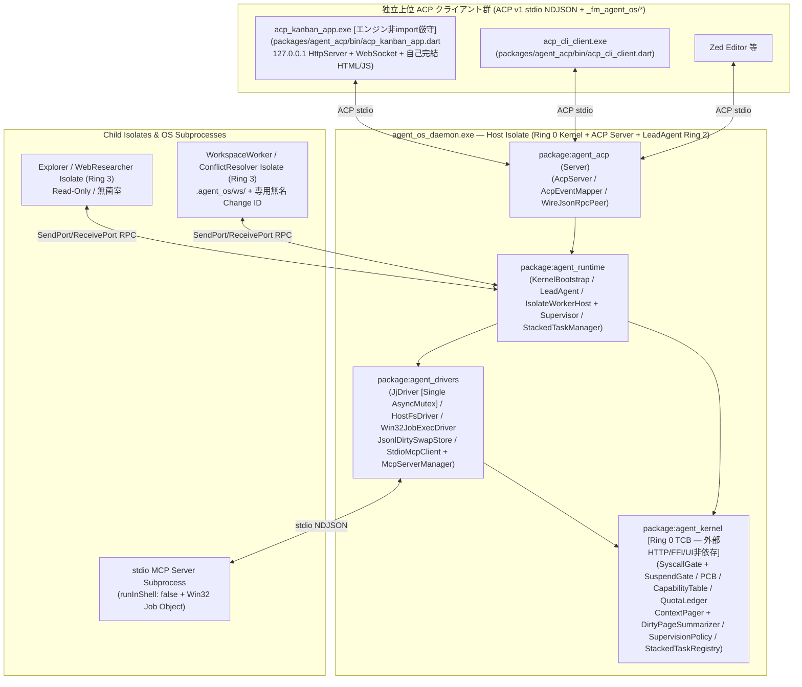

# 40_specification.md — Stage 3 全体アーキテクチャ・横断設計契約・仕様マップ

関連文書:
- 要望・背景・技術仮説: [10_claim.md](./10_claim.md)
- 利用場面・代表操作・範囲境界: [20_app_requirement.md](./20_app_requirement.md)
- 要求・受け入れ条件（版 `r1`）: [30_requirement.md](./30_requirement.md)
- 進捗正本・合意事項・おまかせ判断記録: [90_status.md](./90_status.md)
- 先行設計正本（既存設計 ID 参照・非破壊維持確認用）:
  - Stage 1（`[D-001]`〜`[D-022]`）: [plan_20261119_stage1_kernel_agent/40_specification.md](../plan_20261119_stage1_kernel_agent/40_specification.md)
  - Stage 2（`[D-201]`〜`[D-220]`）: [plan_20261119_stage2_multiprocess_memory/40_specification.md](../plan_20261119_stage2_multiprocess_memory/40_specification.md)
- Stage 3 技術実測リファレンス（`PT-01` 確定）:
  - [jj_workspace_merge_and_stacked.md](../cheatsheet/jj_workspace_merge_and_stacked.md)
  - [mcp_and_supervisor_signals.md](../cheatsheet/mcp_and_supervisor_signals.md)
- 分割詳細仕様（4 本）:
  - [42_spec_workspace_merge_and_stacked.md](./42_spec_workspace_merge_and_stacked.md)（Step 3-1・3-2・Stacked Changes: `REQ-01`〜`REQ-04`, `REQ-09`、`[D-306]`〜`[D-311]`）
  - [42_spec_signals_and_supervisor.md](./42_spec_signals_and_supervisor.md)（Step 3-3 シグナル・Supervisor: `REQ-05`, `REQ-06`、`[D-312]`〜`[D-315]`）
  - [42_spec_dirty_swap_and_mcp.md](./42_spec_dirty_swap_and_mcp.md)（Step 3-3 Dirty Page Swap・MCP ドライバ: `REQ-07`, `REQ-08`、`[D-316]`〜`[D-319]`）
  - [42_spec_acp_team_and_kanban_gui.md](./42_spec_acp_team_and_kanban_gui.md)（ACP チーム拡張・CLI・ローカル Web カンバン GUI: `REQ-05`, `REQ-08`〜`REQ-11`、`[D-320]`〜`[D-324]`）

---

## 1. Stage 2 到達構造から Stage 3 ターゲット構造への変更範囲

### 1.1 基準ソース版と後方互換維持方針
本設計は Stage 2 完了版（`jj` commit `a5e8e5d383c85f764bceb7f302d96735b025e813`、bookmark `main`）の 4 パッケージ構成（`[D-001]`, `[D-201]`）を継承し、既存自動テスト 32 ファイル・175 件を無修正で全件通過させる後方互換性を維持する：
- 既存の単体テストが直接呼び出す `KernelProcessTable()`（Stage 1 ロック）、`CapabilityTable.stage1LeadAgent()` / `stage2LeadAgent()`、`CapabilityTable.deriveForChild(..., enforceStage2ReadOnlyChildLock: true)`、`ProcessProfileId.explorer` / `webResearcher` に対する `STAGE2_READONLY_CHILD_LOCK`、`PageFreshnessChecker.checkFreshness(Iterable<ContextPage> cleanPages)`（プロセス対応はサブインターフェース `ProcessAwarePageFreshnessChecker` への `is` 分岐で拡張）、`const ContextPager()`（`dirtySwapBackend == null` 時の Stage 2 フレーム超過判定および同期 `prepareFrameForModel` 維持）、および `SyscallGate(jjAuditInfoProvider: ...)` の無引数コールバック互換を維持する。
- Stage 3 機能は新規プロファイル（`workspace_worker`, `conflict_resolver`）、`CapabilityTable.stage3LeadAgent()`、`JjProcessAuditInfoProvider`、`ProcessAwarePageFreshnessChecker`、`JsonlDirtySwapStore`、`StdioMcpClientManager`、`StackedTaskRegistry`、`KernelBootstrap` Stage 3 配線、および独立上位クライアント `acp_kanban_app.dart` で提供する。

### 1.2 4 パッケージの変更範囲・3 実行バイナリ構成・分離境界

D-301: Stage 3 パッケージ変更範囲・3 実行バイナリ構成・Ring 0 純粋性および上位 UI 完全分離境界

対応要求: `REQ-01`〜`REQ-11`（継承境界: `[D-001]`, `[D-022]`, `[D-201]`、関連判断: `B-01`〜`B-04`, `B-03b`, `OM-308`, `MF-PT03-06`）

| パッケージ / バイナリ | 新規外部依存 | Stage 3 で追加・拡張する主要モジュール | 厳守する禁止依存（構造検査 `E3` 対象） |
| :--- | :--- | :--- | :--- |
| `packages/agent_kernel` | **追加なし** | `supervision.dart`（`SupervisionPolicy`, `ProcessSignalKind`, `SupervisorAttemptRecord`, `ProcessSuspendController`）、`dirty_swap.dart`（`DirtySwapMeta`, `TurnGroupRange`, `DirtySwapBackend`, `DirtyPageSummarizer`, `DeterministicDirtyPageSummarizer`）、`mcp_contract.dart`（`McpServerSpec`, `McpToolDescriptor`, `McpCallOutcome`）、`stacked_task.dart`（`StackedTaskNode`, `StackedTaskRegistry`）、および `pcb.dart` / `capability.dart` / `process_profile.dart` / `quota.dart` / `context_memory.dart` / `context_pager.dart` / `syscall_gate.dart` / `audit_logger.dart` の拡張 | `package:http`, `dart:ffi`, `package:win32`, `dart:mirrors`, `package:yaml`, `package:html`, `package:agent_drivers`, `package:agent_runtime`, `package:agent_acp`, `stdout` 直接参照 |
| `packages/agent_drivers` | **追加なし**（既存 pure-Dart 依存のみ） | `jj/jj_workspace_ops.dart` & `jj/jj_driver.dart`（`workspace add/forget/update-stale`, `-R <ws_path>` スナップショット, `mergeChanges`, `inspectConflicts`, `integrateIntoWorkingChange`, `getAuditInfoForProcess`）、`memory/jsonl_dirty_swap_store.dart`（`.agent_os/swap/.../pages.jsonl` Write-back/Read）、`mcp/mcp_transport.dart` & `mcp/stdio_mcp_client.dart`（MCP `2025-11-25` 往復・Win32 Job 管理・`sys_mcp_*` ドライバ）、および `host_fs_driver.dart` / `win32_job_exec_driver.dart` / `sys_exec_classifier.dart` / `workspace_page_freshness_checker.dart` / `llm_router.dart` のプロセス別ワークスペース＆`maxContextTokens` 拡張 | `dart:mirrors`, Build Hooks 依存パッケージ、エージェント思考ループ、`stdout` 直接参照 |
| `packages/agent_runtime` | **追加なし** | `stacked_task_manager.dart`（Stacked Changes 積層・自動リベース後 `update-stale` 調停・`sys_task_stack`）、`isolate_worker_host.dart`（ワークスペース自動払い出し・`dart pub get --offline` 準備・Supervisor リトライ・シグナル配送・一括回収）、`process_syscalls.dart`（`sys_kill` 追加、`sys_spawn`/`sys_wait` 拡張）、`process_runner.dart`（`SIGSTOP`/`SIGCONT` 方針変更 `CanonicalUserTurn` 注入）、`kernel_bootstrap.dart` Stage 3 配線 | `process_runner.dart` 内への `dart:io` / `package:agent_drivers` / `package:http` 混入禁止、`stdout` 直接参照 |
| `packages/agent_acp` （3 バイナリ出力： `agent_os_daemon.exe`, `acp_cli_client.exe`, `acp_kanban_app.exe`） | **追加なし**（`dart:io` `HttpServer` / `WebSocketTransformer` で完結） | - **共通ワイヤ層**: `lib/src/wire/{wire_redactor.dart, wire_json_rpc_peer.dart, wire_command_splitter.dart}`（エンジンパッケージ非依存の pure-Dart JSON-RPC 2.0 NDJSON 通信基盤および `--mcp-server` 引用符対応コマンド分割ヘルパ） - **デーモン/CLI**: `acp_server.dart` / `acp_event_mapper.dart` / `agent_os_daemon.dart` / `acp_cli_runner.dart`（`_fm_agent_os/*` チーム・シグナル・積層メソッド、`session/prompt` `_meta["fm_agent_os/taskId"]`、`mcpServers`、`--max-context-tokens`、mid-turn `/pause`/`/resume`/`/kill`/`/stack`） - **ローカル Web カンバン GUI**: `bin/acp_kanban_app.dart` + `lib/src/kanban/{kanban_cli_runner.dart, kanban_server.dart, kanban_acp_bridge.dart, kanban_csrf.dart, kanban_ui_assets.dart}` | 1. デーモン経路での `JsonRpcPeer` 以外の `stdout` 直接参照禁止 2. **`bin/acp_kanban_app.dart` および `lib/src/kanban/**`（推移的 import 含む）からの `package:agent_kernel` / `package:agent_drivers` / `package:agent_runtime` / `package:agent_acp/agent_acp.dart` import 完全禁止**（`MF-PT03-06`） 3. カンバン埋め込みアセット内の外部 URL/CDN 参照禁止 |

---

## 2. Stage 3 全システムコール体系と `SyscallGate` 拡張契約

D-302: Stage 3 全システムコール体系（全 31 種：既存 24 種＋新規 7 種）と 5 プロセスプロファイル権限マトリクス

対応要求: `REQ-01`〜`REQ-10`（継承境界: `[D-002]`, `[D-202]`, `[D-213]`）

### 2.1 新規 `CapRight` と 5 プロセスプロファイルの権限境界
- `CapRight` 列挙（`packages/agent_kernel/lib/src/capability.dart`）に **`CapRight.mcpCall`** を追加する。
- Ring 2 `LeadAgent` 向けに `CapabilityTable.stage3LeadAgent()` を新設し、`stage2LeadAgent()` の権利集合に `CapRight.mcpCall`（`resourceScope: 'mcp:session'`）を追加する。
- Ring 3 子プロセスプロファイル（`ProcessProfileId`）に **`workspaceWorker('workspace_worker')`** と **`conflictResolver('conflict_resolver')`** を追加する。両プロファイルは割り当てられた専用ワークスペース `.agent_os/ws/<pid>` に対してのみ `read`, `writeCow`, `exec`, `vcsRead`, `llmInfer`, `memManage`, `ipc`, `procSelf` を持ち、**`vcsTx`・`procSpawn`・`netRead`・`mcpCall`・`admin` は一切保有しない**（TTY 独占と `Workspace ⊕ Net` 無菌原則を 100% 維持）。

### 2.2 全システムコール一覧（全 31 種）

略記: `Lead` = Ring 2 `LeadAgent`、`Exp` = Ring 3 `Explorer`、`Web` = Ring 3 `WebResearcher`、`WsW` = Ring 3 `WorkspaceWorker`、`CRes` = Ring 3 `ConflictResolver`。

| # | システムコール名 | 区分 | 必須 `CapRight` | `Lead` (R2) | `Exp` (R3) | `Web` (R3) | `WsW` / `CRes` (R3) | I/O Cap 対象 | Clean Page |
| :-: | :--- | :---: | :--- | :--- | :--- | :--- | :--- | :--- | :---: |
| 1 | `sys_read_lines` | S1 | `read` | `ALLOW` | `ALLOW` | 非公開/`EPERM` | `ALLOW` (専用 `ws/<pid>`, `/skills`) | `content` | **Yes** (`sha256`) |
| 2 | `sys_glob` | S1 | `read` | `ALLOW` | `ALLOW` | 非公開/`EPERM` | `ALLOW` (専用 `ws/<pid>`) | `matches` | **Yes** (`commit_id`) |
| 3 | `sys_grep` | S1 | `read` | `ALLOW` | `ALLOW` | 非公開/`EPERM` | `ALLOW` (専用 `ws/<pid>`) | `matches` | **Yes** (`commit_id`) |
| 4 | `sys_edit_block` | S1 | `writeCow` | `ALLOW` (`@`) | 非公開/`EPERM` | 非公開/`EPERM` | **`ALLOW`** (専用 `ws/<pid>` + `-R` snap) | No | No (Dirty) |
| 5 | `sys_write_file` | S1 | `writeCow` | `ALLOW` (`@`) | 非公開/`EPERM` | 非公開/`EPERM` | **`ALLOW`** (専用 `ws/<pid>` + `-R` snap) | No | No (Dirty) |
| 6 | `sys_jj_status` | S1 | `vcsRead` | `ALLOW` | `ALLOW` (`--ignore-wc`) | 非公開/`EPERM` | `ALLOW` (`-R ws/<pid> --ignore-wc`) | `summary` | **Yes** (`commit_id`) |
| 7 | `sys_jj_log` | S1 | `vcsRead` | `ALLOW` | `ALLOW` (`--ignore-wc`) | 非公開/`EPERM` | `ALLOW` (`-R ws/<pid> --ignore-wc`) | `commits` | **Yes** (`commit_id`) |
| 8 | `sys_jj_diff` | S1 | `vcsRead` | `ALLOW` | `ALLOW` (`--ignore-wc`) | 非公開/`EPERM` | `ALLOW` (`-R ws/<pid> --ignore-wc`) | `diff` | **Yes** (`commit_id`) |
| 9 | `sys_tx_begin` | S1 | `vcsTx` | `ALLOW` | 非公開/`EPERM` | 非公開/`EPERM` | 非公開/`EPERM` | No | No (Dirty) |
| 10 | `sys_tx_describe` | S1 | `vcsTx` | `ALLOW` | 非公開/`EPERM` | 非公開/`EPERM` | 非公開/`EPERM` | No | No (Dirty) |
| 11 | `sys_tx_squash` | S1+S3 | `vcsTx` | **`ASK_USER`** (競合時事前 `ECONFLICT`) | 非公開/`EPERM` | 非公開/`EPERM` | 非公開/**`EPERM` (TTY独占)** | No | No (Dirty) |
| 12 | `sys_tx_rollback` | S1 | `vcsTx` | `ALLOW` | 非公開/`EPERM` | 非公開/`EPERM` | 非公開/`EPERM` | No | No (Dirty) |
| 13 | `sys_exec` | S1+S3 | `exec` | 定型 `ALLOW` / 他 **`ASK_USER`** | 非公開/`EPERM` | 非公開/`EPERM` | 定型 `ALLOW` (専用 `ws/<pid>`) / 他 **`EPERM` (TTY独占)** | `stdout`, `stderr` | No (Dirty) |
| 14 | `sys_llm_chat` | S1 | `llmInfer` | `ALLOW` (内部) | `ALLOW` (内部) | `ALLOW` (内部) | `ALLOW` (内部) | No | N/A |
| 15 | `sys_mem_pagein` | S2+S3 | `memManage` | `ALLOW` (Clean + Dirty Swap) | `ALLOW` (Clean + Dirty Swap) | 非公開/`EPERM` | `ALLOW` (専用 `ws/<pid>` Clean + Dirty Swap) | `content` | No (応答展開) |
| 16 | `sys_spawn` | S2+S3 | `procSpawn` | `ALLOW` (4 種プロファイル + `supervision`) | 非公開/`EPERM` | 非公開/`EPERM` | 非公開/`EPERM` (深さ1固定) | No | No (Dirty) |
| 17 | `sys_wait` | S2+S3 | `procSpawn` | `ALLOW` (`attempts[]` / `ws` 帰属付き) | 非公開/`EPERM` | 非公開/`EPERM` | 非公開/`EPERM` | `summary` | No (Dirty) |
| 18 | `sys_exit` | S2 | `procSelf` | 非公開/`EPERM` | `ALLOW` | `ALLOW` | `ALLOW` | No | No (Dirty) |
| 19 | `sys_send` | S2 | `ipc` | `ALLOW` | `ALLOW` | `ALLOW` | `ALLOW` | No (64KiB) | No (Dirty) |
| 20 | `sys_recv` | S2 | `ipc` | `ALLOW` | `ALLOW` | `ALLOW` | `ALLOW` | No | No (Dirty) |
| 21 | `sys_web_search` | S2 | `netRead` | 非公開/`EPERM` (`W⊕N`) | 非公開/`EPERM` | **`ALLOW`** | 非公開/`EPERM` (`W⊕N`) | `results` | No (Dirty) |
| 22 | `sys_web_fetch` | S2 | `netRead` | 非公開/`EPERM` (`W⊕N`) | 非公開/`EPERM` | **`ALLOW`** | 非公開/`EPERM` (`W⊕N`) | `markdown` | No (Dirty) |
| 23 | `sys_skill_list` | S2 | `read` | `ALLOW` | `ALLOW` | 非公開/`EPERM` | `ALLOW` | No | No (Dirty) |
| 24 | `sys_skill_read` | S2 | `read` | `ALLOW` | `ALLOW` | 非公開/`EPERM` | `ALLOW` | `content` | **Yes** (`sha256`) |
| 25 | **`sys_jj_merge`** | **S3-2** | `vcsTx` | **`ALLOW`** (`[c1, c2, ...]` 多親合流) | 非公開/`EPERM` | 非公開/`EPERM` | 非公開/`EPERM` | No | No (Dirty) |
| 26 | **`sys_jj_conflicts`** | **S3-2** | `vcsRead` | **`ALLOW`** | **`ALLOW`** (`--ignore-wc`) | 非公開/`EPERM` | **`ALLOW`** (`-R ws/<pid>`) | No | **Yes** (`commit_id`) |
| 27 | **`sys_jj_integrate`** | **S3-2** | `vcsTx` | **`ALLOW`** (解消済みマージ平坦化) | 非公開/`EPERM` | 非公開/`EPERM` | 非公開/`EPERM` | No | No (Dirty) |
| 28 | **`sys_kill`** | **S3-3** | `procSpawn` | **`ALLOW`** (自己の子へ `SIGSTOP`/`CONT`/`KILL`) | 非公開/`EPERM` | 非公開/`EPERM` | 非公開/`EPERM` | No | No (Dirty) |
| 29 | **`sys_mcp_list_tools`** | **S3-3** | `mcpCall` | **`ALLOW`** (固定スキーマ・オンデマンド一覧) | 非公開/`EPERM` | 非公開/`EPERM` | 非公開/`EPERM` | `tools` | No (Dirty) |
| 30 | **`sys_mcp_call`** | **S3-3** | `mcpCall` | **`ASK_USER`** (Ring 2 承認連携・署名許可可) | 非公開/`EPERM` | 非公開/`EPERM` | 非公開/**`EPERM` (TTY独占)** | `content` | No (Dirty) |
| 31 | **`sys_task_stack`** | **S3-3** | `vcsTx` | **`ALLOW`** (Stacked タスク作成/一覧/同期/切替) | 非公開/`EPERM` | 非公開/`EPERM` | 非公開/`EPERM` | `diff` | No (Dirty) |

### 2.3 `SyscallGate` パイプラインの Stage 3 拡張点
`[D-002]` / `[D-202]` の Stage 1 → Stage 8 順序を厳守した上で、以下の 3 点を追加する：
1. **Stage 0.5（協調サスペンドゲート：`SIGSTOP` 凍結待機）**:
   - `pcb` 取得直後（ただしデッドロック防止のため `sys_exit` 以外の全システムコール入口）において、`pcb.suspendController.isSuspended` が `true` の間は `pcb.state = ProcessState.stopped` に遷移させ、`SIGCONT` 再開または `cancelToken` / `SIGKILL` 発火まで非同期 `Completer` で待機する（`[D-312]`）。待機中に `cancelToken` / `SIGKILL` が発火した場合はドライバを実行せず即座に `ECANCELLED` で抜ける。
2. **Stage 2（`sys_tx_squash` の未解消 First-Class Conflict 事前遮断ガード）**:
   - `sys_tx_squash` の `checkPreconditions` において、Stage 3.5 `TxHook` および Stage 4 `ApprovalGate` が呼ばれる**前**に現在の作業チェンジ `@` の競合状態を `--ignore-working-copy` で非破壊検査する。`hasConflicts == true` の場合は **`ApprovalHandler` を 1 回も呼び出さず、`op_id` 不変のまま `SyscallError(code: SyscallErrorCode.econflict, reason: 'UNRESOLVED_CONFLICTS', details: {'conflictedFiles': files})` で拒否**する（`[D-310]`, `SG-PT03-02`）。
3. **Stage 8（プロセス別 `jjChangeId` 帰属と軽量 `resultSummary` 記録）**:
   - `jjProcessAuditInfoProvider(pcb)` により、子 `WorkspaceWorker` / `ConflictResolver` のシステムコールにはその子自身の専用 `workingChangeId` と最新 `jjOpId` を記録し、あわせて検証用の軽量 `resultSummary` を付与する（`[D-305]`）。

---

## 3. 横断設計契約：優先順位（勝敗規則）と副作用・失効境界【一元正本】

テスト・作業分解・各 `42_spec_*.md` 間で解釈のズレが起きないよう、すべての優先順位規則と副作用・失効境界を本節に一元定義する。各 `42_spec_*.md` は本節を正本として参照する。

### 3.1 優先順位契約（競合時の勝敗規則）

D-303: 横断優先順位契約（モデル解決・--max-context-tokens 実効窓解決・MCP サーバー解決・シグナル/Supervisor 勝敗規則）

対応要求: `REQ-05`〜`REQ-11`（継承境界: `[D-002]`, `[D-203]`、関連判断: `B-01`〜`B-04`, `OM-304`〜`OM-308`, `MF-PT03-02`〜`05`）

#### (1) プロバイダ／モデル解決と Supervisor フォールバック優先順位
- **親 `LeadAgent`（Ring 2）**: `[D-203]` §3.1(1) を完全維持（① `session/prompt` `_meta["fm_agent_os/modelOverride"]` ＞ ② `/model`・`session/set_config_option`・カンバンカードモデル指定 ＞ ③ 起動時 `--model` ＞ ④ 既定 `local-ollama/gemma4:12b`）。
- **子プロセス（初回試行 `attemptIndex == 1`）**: ① `sys_spawn.model` 明示指定 ＞ ② `sys_spawn` 呼び出し時点の親の現在ターン確定モデル。
- **Supervisor 再試行（`attemptIndex >= 2`）**: `SupervisionPolicy.fallbackModel` が指定されていれば **`fallbackModel` が初回モデルに勝つ**（未指定時は初回確定モデルを維持）。各試行内での推論中はモデルを変更しない（`[D-315]`）。

#### (2) 実効コンテキスト窓上限解決の優先順位（`--max-context-tokens` キャップ統合：`MF-PT03-03`）
1. まず Stage 2 `[D-203]` §3.1(2) の優先順位（① `ContextWindowConfig.modelOverrides` ＞ ② プロバイダ動的プローブ `/api/ps`・`/api/show`・`/models` ＞ ③ 保守的既定値）により `providerResolvedWindow` を求める。
2. 次にセッション上限キャップ `maxContextTokens` を以下の優先順で解決する：
   - **優先度 A**: ACP `session/new` の `_meta["fm_agent_os/maxContextTokens"]`（明示正整数）
   - **優先度 B**: デーモン起動 CLI 引数 `--max-context-tokens <int>`（`acp_cli_client.exe` / `acp_kanban_app.exe` の同名フラグからデーモンへパススルー）
3. `maxContextTokens != null` の場合、**常に `effectiveWindowTokens = min(providerResolvedWindow, maxContextTokens)`** とする（プロバイダ側の窓が大きくてもキャップ値を超えることはない）。
4. **最小下限検証**: `minRequiredWindow = segment0Tokens + reservedOutputTokens + minWorkingHeadroomTokens`（`minWorkingHeadroomTokens = 512`）未満となる `maxContextTokens` 指定は、CLI 引数段階では終了コード `64`、ACP `session/new` / カーネル段階では `EINVAL: MAX_CONTEXT_TOKENS_TOO_SMALL`（JSON-RPC `-32602`）で即座に拒否する（`[D-316]`）。

#### (3) MCP サーバー定義マージと名称競合時の勝敗規則（`B-01`）
同一セッションに対して複数の経路から MCP サーバー定義が与えられた場合、`server.name`（前後空白除去後の完全一致）をキーとして以下の優先順で採用する（**高優先度側が勝ち、同名低優先度定義を上書き**）：
1. **優先度 1（最優先）**: ACP `session/new` の `mcpServers` 配列（同一配列内に同名がある場合は不正パラメータ `EINVAL: DUPLICATE_MCP_SERVER_NAME` / JSON-RPC `-32602` で拒否）
2. **優先度 2**: デーモン起動 CLI 引数 `--mcp-server`（複数指定可。CLI クライアント／カンバンアプリの `--mcp-server` は `session/new` の `mcpServers` へ変換して送信する）（`[D-318]`, `[D-320]`）

#### (4) シグナル・キャンセル・Supervisor 自動回復の競合勝敗規則
複数の制御イベントが同時または連続して到着した場合の勝敗順序を以下の通り固定する：
1. **`SIGKILL` / `session/cancel` / ホスト `dispose` が最優先（絶対勝者）**:
   - 対象が `running`・`waitingSyscall`・`waitingApproval`・`stopped`（`SIGSTOP` 凍結中）・Supervisor リトライ待機中のいずれであっても、`SIGKILL` または `session/cancel` が届いた瞬間に**サスペンド待機を即時解除し、Supervisor 再試行を一切発動させず**、プロセスツリー・Win32 Job Object・未統合一時 `jj workspace` を一括回収して `ECANCELLED` / `KILLED_BY_SIGNAL` で確定終了させる。
2. **`TOKEN_QUOTA_EXCEEDED` / `COST_QUOTA_EXCEEDED` ＞ `SupervisionPolicy` 再試行**:
   - トークンまたはコスト予算枯渇（および次回試行に必要な最小残余トークン `< minRetryTokenReserve = 512`）は**常に Supervisor 再試行より優先して即時停止**し、親へ構造化失敗ステータスを返す（無限課金・予算超過の絶対防止：`MF-PT03-04`）。
3. **`SupervisionPolicy` 再試行 ＞ 試行単位の一時障害（`WALL_TIME_QUOTA_EXCEEDED` / `WORKER_CRASHED` / フォーマット崩壊 / `EPROVIDER`）**:
   - 上記 1・2 に該当しない限り、`restart == on_failure` かつ `attemptIndex <= maxRetries` の間は Supervisor が障害を捕捉し、汚染ワークスペース破棄＋クリーン再試行（または `fallbackModel` 切替）を行う（`[D-315]`）。
4. **`SIGSTOP` 中の壁時計タイマーと連続 `SIGCONT` 合流規則**:
   - `ProcessState.stopped` で人間介入を待っている間、子ワーカーの `wallTimer`（`maxWallTimeMs`）は一時停止（残り時間を保持）し、`SIGCONT` 時に残り時間で再開する（人間が方針を入力している最中にタイムアウト暴発させない）。
   - `stopped` 中に複数回の追加制約付き `SIGCONT` または制約更新が届いた場合は改行連結で FIFO 保持し、再開直後の次の ReAct ステップ境界（全 `CanonicalToolResultTurn` 記録完了後）に 1 つの `CanonicalUserTurn` として Segment 1 末尾へ注入する（`[D-313]`）。

---

### 3.2 副作用許容境界・プロセス別安全ロック・失効（Invalidation）規則

D-304: 副作用許容境界・プロセス別ワークスペース安全ロック・キャッシュ／ワークスペース／Swap 失効規則

対応要求: `REQ-01`〜`REQ-11`（継承境界: `[D-003]`, `[D-204]`、関連判断: `OM-301`〜`OM-308`）

#### (1) 副作用許容境界とプロセス別安全ロック
1. **メインワークスペース `@` と人間の直前チェンジ `@-` の保護境界**:
   - 人間の直前チェンジ `@-`（`userParent`）への書き込みは、親 `LeadAgent`（Ring 2, `pid == 1`）が未解消競合ゼロを検証した上で Stage 4 ユーザー承認（`APPROVED_BY_USER`）を通過した `sys_tx_squash` の Stage 5 実行時**のみ**許容される。承認前・承認拒否時・未解消競合（`ECONFLICT`）時は `op_id` も `@-` も **1 バイトも変化してはならない**。
   - `WorkspaceWorker` / `ConflictResolver`（Ring 3）がファイル編集・`sys_exec` を行えるのは、カーネルが払い出した `.agent_os/ws/<pid>`（`VfsNamespace.workspaceHostRoot`）内部のみであり、メインワークスペースや他ワーカーの `.agent_os/ws/<other>`、`.jj` / `.git` / `.agent_os` / `.env*` への到達は `VfsNamespace` 実パス境界検査により `EACCES` で遮断される。
2. **`JjDriver` 単一ミューテックスと即時スナップショット境界（`OM-303`）**:
   - 子 `Isolate` 内では `jj` プロセスを直接起動せず、すべての `jj` 操作はホスト Isolate の単一 `JjDriver._mutex`（FIFO `AsyncMutex`）を通過する。
   - メインまたは任意子ワークスペースで `sys_write_file` / `sys_edit_block` / `sys_exec` が実行された直後、システムコールが応答を返す前に必ずミューテックス内で `jj -R <target_ws_root>` スナップショットを完了させる。これにより未スナップショット変更の放置による `(divergent)` 分裂を根絶する。
3. **MCP 外部副作用と承認・秘密境界（`B-01`）**:
   - `sys_mcp_list_tools`（ツール一覧取得）は副作用なしの読取として `RingDecision.allow` とするが、外部システムへの作用を伴いうる **`sys_mcp_call` は必ず Stage 4 Ring 2 承認ゲート（`RingDecision.askUser`）を通過した後でのみ `tools/call` RPC を送信**する（拒否時は MCP サブプロセスへ一切リクエストを送らない）。
   - `mcpServers` の `env[].value`（および将来の `headers[].value`）は `Process.start` の `environment` マップにのみ渡し、`SecretRedactor` へ即時登録してコンテキスト・監査ログ・Swap ファイル・ACP 通知への露出をゼロにする。
4. **Dirty Page Swap の永続化境界（`B-02`, `OM-306`）**:
   - Dirty Page の縮約置換は、`.agent_os/swap/<safeSessionId>/pid_<pid>/pages.jsonl` への `SecretRedactor` 適用済み JSONL 追記＋`flush: true` が成功した**後**でのみインメモリの `AppendOnlyHistorySegment` と `PageTable` を更新する。万一ディスク書込が失敗した場合はインメモリ履歴を一切書き換えず元の Dirty Page を保持する（データ消失ゼロ保証）。

#### (2) キャッシュ・ワークスペース・保持状態の失効条件と再取得／回収動作
Stage 2 `[D-204]` §3.2(2) の 6 項目を維持した上で、Stage 3 固有の保持状態に対する失効規則を以下の通り定める：

| 保持データ・状態 | 失効（Stale / Invalidate）する条件 | 失効後の再取得・再生成・回収動作 |
| :--- | :--- | :--- |
| **子 `WorkspaceWorker` / `ConflictResolver` の専用ワークスペース `.agent_os/ws/<pid>`** | ① 子が正常終了（`sys_exit(0)` / 最終応答）、② Supervisor が試行失敗を検知、③ `SIGKILL` / `session/cancel` / 親ターン終了 / ホスト `dispose` が発生。 | `JjDriver` 単一ミューテックス内で `jj workspace forget ws-<pid>` を実行し、失敗試行または `SIGKILL` による未統合ゴミチェンジは `jj abandon <workingChangeId>` で破棄（正常完了チェンジは保持！）した上で、`.agent_os/ws/<pid>` ディレクトリを再帰削除する（`[D-307]`, `[D-315]`）。 |
| **Stacked Changes 下流タスクのワーキングコピー（`ws_B` 等）** | 先行（親／先祖）タスク `c_A` が更新・スナップショットされ、`jj` 自動リベースにより下流 `c_B` の `commit_id` が更新された結果、`ws_B` が `stale` 状態になった。 | 親タスクのスナップショット直後（または下流ワークスペース操作前の `stale` 検知時）に、`JjDriver` 単一ミューテックス内で依存トポロジ順に `jj -R <ws_child> workspace update-stale` を自動実行し、実ファイルを最新リベース済みコミットへ追従させる（衝突時も `exit=0` でマーカー展開し `hasConflicts: true` として通知：`[D-311]`）。 |
| **子ワークスペース内の Clean Page 鮮度** | 当該子自身の `.agent_os/ws/<pid>` 上の対象ファイル `SHA-256` 変化、またはその子の専用 `@`（`jj -R <ws_pid> log -r @ --ignore-working-copy -T commit_id`）の `commit_id` 変化。 | プロセス別の `WorkspacePageFreshnessChecker` が当該子の `VfsNamespace` と専用 `@` `commit_id` を基準に `[STALE]` 判定を行い、`sys_mem_pagein` 時はその子自身のワークスペースから再取得する（メイン `@` と混同しない：`[D-308]`）。 |
| **Dirty Page Swap 後の実測トークンアンカー（`lastActualPromptTokens`）** | `ContextPager` が Turn Group を Swap Store へ退避し `SummaryPage` へ置換した。 | Clean Page 退避時と同様、`memory.invalidateTokenAnchor()` を呼び出して UTF-8 バイトヒューリスティック合計へ一旦リセットし、次回 `sys_llm_chat` 成功時の `usage.promptTokens` で再アンカーする（`[D-316]`）。 |
| **Swap Store（`.agent_os/swap/<safeSessionId>/pid_<pid>/pages.jsonl`）と退避済み Dirty Page** | ① `sys_tx_rollback` 実行時（VCS ロールバックはファイル状態のみを戻し、エージェントが「何を試してなぜロールバックしたか」の対話記憶は保持すべきであるため失効しない）、② セッション `dispose` 後も監査追跡用に保持可（テスト一時ディレクトリでは tearDown で削除）。 | 退避済み Dirty Page は不変スナップショットとして Swap Store に保持され、`sys_mem_pagein(pageId)` でいつでも Prefix 非破壊で再展開できる。Swap ファイルが外部削除・破損していた場合は `ENOENT: SWAP_RECORD_NOT_FOUND` または `EIO: SWAP_CORRUPTED` を構造化返却する（`[D-317]`）。 |
| **MCP ツールカタログキャッシュ（`McpServerSession.cachedTools`）** | ① 接続中 MCP サーバーから `notifications/tools/list_changed` 通知を受信した、② `sys_mcp_list_tools(refresh: true)` が呼ばれた、または ③ MCP サブプロセスが異常終了した。 | ①②では Segment 0 を一切書き換えずメモリ上の `cachedTools` のみを `tools/list` 再取得で更新する。③では当該サーバー状態を `disconnected` とし、以降の呼び出しに `EIO: MCP_SERVER_DISCONNECTED` を返す（`[D-318]`）。 |

---

## 4. 監査・テレメトリ拡張スキーマ契約

D-305: プロセス別 jjChangeId 監査帰属・軽量 resultSummary・ページング／リトライ拡張テレメトリ契約

対応要求: `REQ-01`〜`REQ-10`（継承境界: `[D-010]`, `[D-215]`、検証契約: `MF-PT03-01`〜`05`, `SG-PT03-01`）

1. **`SyscallGate.jjProcessAuditInfoProvider` と子専用 `jjChangeId` 帰属（`MF-PT03-01`）**:
   - `packages/agent_kernel/lib/src/syscall_gate.dart` に `typedef JjProcessAuditInfoProvider = Future<JjAuditInfo> Function(ProcessControlBlock? pcb);` を定義し、`SyscallGate` コンストラクタに `this.jjProcessAuditInfoProvider` を追加する（既存の無引数 `jjAuditInfoProvider` も後方互換維持）。
   - Stage 8 監査記録時は `jjProcessAuditInfoProvider != null ? await jjProcessAuditInfoProvider!(pcb) : await jjAuditInfoProvider?.call()` を呼び出す。
   - `JjDriver.getAuditInfoForProcess(ProcessControlBlock? pcb)` は、専用ワークスペースを持つ子プロセス（`pcb.jjWorkspaceRoot != null`）に対しては対象ワークスペースの `@` `Change ID`（ワークスペース cleanup 後は `pcb.jjContext.workingChangeId`）とリポジトリ最新 `opId` を返し、それ以外のプロセスに対してはメイン `@` `Change ID` と最新 `opId` を返す。これにより `syscalls.jsonl` 上で各 `WorkspaceWorker` / `ConflictResolver` の全操作がその子固有の `jjChangeId` に 1:1 帰属される。
2. **`SyscallAuditRecord.resultSummary` の追加（`SG-PT03-01`）**:
   - `SyscallAuditRecord` に任意フィールド `final Map<String, dynamic>? resultSummary;`（`null` 時は JSON 出力省略または `null` 許容）を追加し、`SecretRedactor` 適用の上で主要システムコールの結果要約を記録する：
     - `sys_spawn`: `{ "childPid", "logicalTaskId", "workspaceName", "baseChangeId", "workingChangeId" }`
     - `sys_wait`: `{ "childCount", "pids", "logicalTaskIds" }`
     - `sys_jj_merge`: `{ "mergeChangeId", "mergeCommitId", "hasConflicts", "conflictedFilesCount" }`
     - `sys_jj_conflicts`: `{ "rev", "hasConflicts", "filesCount" }`
     - `sys_jj_integrate`: `{ "targetChangeId", "abandonedChangeIds" }`
     - `sys_mem_pagein`: `{ "pageId", "source", "wasStale" }`（`source` は `"clean_workspace" | "clean_vcs" | "dirty_swap"`）
     - `sys_mcp_call`: `{ "server", "tool", "isToolError" }`
     - `sys_kill`: `{ "targetPid", "signal", "resultingState" }`
     - `sys_task_stack`: `{ "action", "taskId", "workingChangeId", "cascadedCount" }`
3. **Dirty Page Swap テレメトリ拡張（`MF-PT03-05`）**:
   - `ContextPagingReport`、`LlmIoAuditRecord`（`llm_io.jsonl`）、および ACP `turnSummary` / `_fm_agent_os/status` に **`swappedDirtyPagesInStep: int`**（当該ステップで Swap 退避された Dirty Page 数、既定 `0`）と **`swappedDirtyPagesTotal: int`**（累積退避 Dirty Page 数、既定 `0`）および `swappedTurnGroupsInStep: int` を追加する。

---

## 5. 主要な設計採用理由と代替案の見送り理由

| 論点 | 採用した設計 | 検討した代替案と見送り理由 | 根拠（実測・合意） |
| :--- | :--- | :--- | :--- |
| **子ワークスペース配置と Pub Workspaces 解決** | `jj workspace add --no-colocate .agent_os/ws/<pid> --name ws-<pid> -r <base>` ＋ ホスト側事前 `dart pub get --offline`（`[D-307]`, `OM-301`） | **代案 A**: `--no-colocate` なし → 不要な `.git/worktrees` 生成とロック競合リスク。 **代案 B**: `dart pub get --offline` 省略 → ネスト配置で親 `<root>/.dart_tool/package_config.json` へ誤解決し子追加シンボルが `undefined` で失敗することを実測確認。 | [jj_workspace_merge_and_stacked.md](../cheatsheet/jj_workspace_merge_and_stacked.md) §2.1〜2.2 |
| **多親マージ後の確定統合方式** | `conflicted_files` JSON テンプレート検査（未解消時 `ECONFLICT` 事前拒否）＋ 単一作業チェンジ `W_lead` への非対話平坦化統合（`[D-309]`, `[D-310]`, `OM-302`） | **代案 A**: `jj resolve --list` 利用 → 競合なし時に `exit=2` エラー終了する罠を実測確認。 **代案 B**: 多親マージ上で直接 `jj squash -u` → `Cannot squash merge commits without a specified destination` で失敗することを実測確認。 | 同 §3.1〜3.3、`SG-PT03-02` |
| **シグナル凍結と方針注入境界** | `SyscallGate` / ReAct ステップ境界の協調サスペンドゲート ＋ ステップ完了直後の `CanonicalUserTurn` 追記（`[D-312]`, `[D-313]`, `OM-304`） | **代案 A**: 生の `Isolate.pause()` → ミューテックスや IPC 応答待機中にデッドロックする。 **代案 B**: ツール結果の途中に `user` メッセージ挿入 → 孤立 `tool_call_id` で全 LLM API が `400 Bad Request` になる。 | [mcp_and_supervisor_signals.md](../cheatsheet/mcp_and_supervisor_signals.md) §2.1 |
| **Dirty Page Swap 単位と `SummaryPage` 生成** | Clean Page 優先退避後の Turn Group 原子退避 ＋ `.agent_os/swap/` マスク保存 ＋ 決定論的構造化 `SummaryPage` 標準（`[D-316]`, `[D-317]`, `B-02`, `OM-306`） | **代案 A**: 単一メッセージ単位退避 → `assistant(toolCalls)` と `tool` 結果のペアが壊れ `400` エラー。 **代案 B**: 毎回 LLM 要約を必須化 → クオータ逼迫時に要約自体が失敗・待機増加するため、`DirtyPageSummarizer` 抽象で任意差替にとどめ標準は決定論抽出を採用。 | 利用者合意 `B-02`、同 §2.3 |
| **MCP ツール公開とローカル Web カンバン分離** | 固定 `sys_mcp_list_tools` / `sys_mcp_call`（Ring 2 承認連携）＋ エンジン非 import の ACP `stdio` 接続型単一 `.exe` Web カンバン `acp_kanban_app.exe`（`[D-319]`, `[D-322]`, `B-01`, `B-03b`, `OM-307`, `OM-308`） | **代案 A**: MCP ツール発見ごとに Segment 0 スキーマ動的変更 → Prefix KV キャッシュ 100% 崩壊。 **代案 B**: カンバンサーバーから `KernelBootstrap` 直接呼び出し → `01_idea.md` の ACP 分離原則に反するため却下。 | 利用者合意 `B-01`, `B-03b`、同 §1.1〜1.4 |

---

## 6. 分割詳細仕様マップと `REQ-01`〜`REQ-11` トレーサビリティ表

### 6.1 分割仕様ファイル一覧

| ファイル | 対象 Step / REQ | 定義する設計 ID | 主な収録内容 |
| :--- | :--- | :--- | :--- |
| **本ファイル (`40_specification.md`)** | Stage 3 全体横断 | `[D-301]`〜`[D-305]` | パッケージ・3 バイナリ境界、全 31 システムコール体系、一元優先順位契約、副作用・失効境界、監査・テレメトリ拡張 |
| **[42_spec_workspace_merge_and_stacked.md](./42_spec_workspace_merge_and_stacked.md)** | Step 3-1・3-2・Stacked (`REQ-01`〜`04`, `09`) | `[D-306]`〜`[D-311]` | `WorkspaceWorker`/`ConflictResolver`、`.agent_os/ws/<pid>` 払い出し・`dart pub get --offline`、`JjDriver` 単一ミューテックス＆即時 `-R` スナップショット、`sys_jj_merge`、`sys_jj_conflicts`、`sys_jj_integrate`、`ECONFLICT` ガード、Stacked Changes と `update-stale` 自動追従 |
| **[42_spec_signals_and_supervisor.md](./42_spec_signals_and_supervisor.md)** | Step 3-3 シグナル・Supervisor (`REQ-05`, `06`) | `[D-312]`〜`[D-315]` | `sys_kill`（`SIGSTOP`/`SIGCONT`/`SIGKILL`）、協調サスペンドゲート、ペアリング保護方針注入、ツリー＆`jj workspace` 一括回収、`SupervisionPolicy`、リトライ対象分離・クオータ保存則・`logicalTaskId`/`attempts[]` 追跡 |
| **[42_spec_dirty_swap_and_mcp.md](./42_spec_dirty_swap_and_mcp.md)** | Step 3-3 Swap・MCP (`REQ-07`, `08`) | `[D-316]`〜`[D-319]` | `--max-context-tokens` 検証、Clean First/Dirty Second ＆ Turn Group 原子退避、`.agent_os/swap/` マスク保存、決定論的 `SummaryPage`＋`DirtyPageSummarizer`、`sys_mem_pagein` `dirty_swap`、`StdioMcpClient`、`sys_mcp_list_tools`/`sys_mcp_call` ＆ Ring 2 承認 |
| **[42_spec_acp_team_and_kanban_gui.md](./42_spec_acp_team_and_kanban_gui.md)** | ACP 拡張・CLI・カンバン GUI・非回帰 (`REQ-05`, `08`〜`11`) | `[D-320]`〜`[D-324]` | ACP `_fm_agent_os/*` 拡張、CLI mid-turn コマンド＆フラグ、`acp_kanban_app.exe`（エンジン非 import・`127.0.0.1`・`KANBAN_READY`・`<meta name="csrf-token">`・外部 CDN ゼロ・カンバン UI/WS API・連鎖終了）、全 3 `.exe` ビルド＆`stdout` 純度 |

### 6.2 `REQ-01` 〜 `REQ-11` 対応設計 ID・変更パッケージ・確認観点一覧（`90_status.md` 転記原票）

| REQ ID | 要求要約 | 対象設計 ID | 主な変更パッケージ | 確認方法・観測対象（`PT-03` 検証契約・合意 `B-01`〜`B-04`/`B-03b` 反映） | 証跡区分 |
| :--- | :--- | :--- | :--- | :--- | :--- |
| **`REQ-01`** | `WorkspaceWorker` への独立 `jj workspace`（`.agent_os/ws/<pid>`）＆無名 `Change ID` 自動払い出し・並列編集・同時 `dart test`・自動クリーンアップ | `[D-301]`, `[D-302]`, `[D-304]`, `[D-305]`, `[D-306]`, `[D-307]`, `[D-308]` | `agent_kernel`, `agent_drivers`, `agent_runtime` | 並列起動時の独立 `Change ID`・`syscalls.jsonl` 子専用 `jjChangeId` 1:1 帰属・`--no-colocate`・Pub Workspaces `dart pub get --offline` 独立 `dart test`・脱出 `EACCES`・Ring 3 要承認 `EPERM`・終了後 `forget`/ディレクトリ消滅/コミット残存の自動テスト（`E1`）、`local-ollama` 2〜3 並列 `WorkspaceWorker` 同時編集＆同時 `dart test` 実機完走（`E2`） | `E1 / E2` |
| **`REQ-02`** | ホスト単一 `JjDriver` ミューテックスによる全 `jj` 更新・`-R <ws_path>` 即時スナップショット直列化と `jj op log` 一本道維持 | `[D-304]`, `[D-305]`, `[D-308]` | `agent_drivers`, `agent_runtime` | ホスト単一 `JjDriver` 所有構造確認（`E3`）、3+ ワークスペース並行高頻度更新・読取ストレステストでの `jj op log` root 以外全親数 `1` 検証（`E1`）、並列実機稼働後の `jj op log` 無分岐＆`syscalls.jsonl` `jjOpId` 整合観測（`E2`） | `E1 / E2 / E3` |
| **`REQ-03`** | `sys_jj_merge([c1, c2, ...])` 多親マージ・非重複変更の 1 発統合・全体テスト通過・単一作業チェンジ平坦化統合＆承認 `squash` 連動 | `[D-302]`, `[D-304]`, `[D-305]`, `[D-309]` | `agent_drivers`, `agent_runtime` | 非重複チェンジ `sys_jj_merge`（`hasConflicts: false`）・単一作業チェンジ平坦化統合→承認 `sys_tx_squash`・`baseOpId` ロールバック・不正引数エラーの自動テスト（`E1`）、並列ワーカー成果の `sys_jj_merge`→全体 `dart test`→`squash` 実機完走（`E2`） | `E1 / E2` |
| **`REQ-04`** | `sys_jj_conflicts` 機械可読競合検査・未解消時の承認前非破壊 `ECONFLICT` 拒否・First-Class Conflict 非停止解消フロー（親＆`ConflictResolver` 対応） | `[D-302]`, `[D-304]`, `[D-306]`, `[D-309]`, `[D-310]` | `agent_kernel`, `agent_drivers`, `agent_runtime` | 同一行衝突 `sys_jj_merge` 非停止・競合有無両方の `sys_jj_conflicts` 正常応答・未解消 `sys_tx_squash` の `ApprovalHandler` 0 回＆`op_id` 不変 `ECONFLICT`・親および `ConflictResolver` 解消→統合成功の自動テスト（`E1`）、同一関数衝突 2 ワーカーからの実 LLM 非停止競合解消完走（`E2`） | `E1 / E2` |
| **`REQ-05`** | シグナル制御（`SIGSTOP` 一時凍結・`SIGCONT` 方針変更注入再開・`SIGKILL` プロセスツリー＆一時 `jj workspace` 一括強制回収） | `[D-302]`, `[D-303]`, `[D-304]`, `[D-312]`, `[D-313]`, `[D-314]`, `[D-320]`, `[D-321]` | `agent_kernel`, `agent_runtime`, `agent_acp` | `SIGSTOP` 凍結・ツール途中 `SIGCONT` での孤立 `tool_call_id` 0 件＆Prefix 不変・`SIGKILL` での Isolate/Win32 Job/一時 `jj workspace` 残留 0 件＆クオータ精算の自動テスト（`E1`）、ACP イベント駆動 `SIGSTOP`→一意タグ制約注入 `SIGCONT` 成果反映＆`SIGKILL` 回収の実機観測（`E2`） | `E1 / E2` |
| **`REQ-06`** | Supervisor 自動回復ポリシー（異常終了・タイムアウト時の汚染ワークスペース破棄＋クリーン再試行／`fallbackModel` 切替＋クオータ保存則維持） | `[D-303]`, `[D-304]`, `[D-305]`, `[D-315]` | `agent_kernel`, `agent_runtime`, `agent_acp` | DI 異常注入による例外/フォーマット崩壊/`WALL_TIME_QUOTA_EXCEEDED` からの旧 `ws` 破棄＆新 `ws` 再試行・`fallbackModel` 切替・`TOKEN/COST_QUOTA_EXCEEDED` 非リトライ停止・消費計上＆`attempts[]` 追跡の自動テスト（`E1`）、本番 `.exe` での不在モデル→実動 `fallbackModel` 自動切替＆短 `maxWallTimeMs` 回復と並列他ワーカー無停止完走観測（`E2`） | `E1 / E2` |
| **`REQ-07`** | 超長期プロセス向け Dirty Page Swap（`--max-context-tokens`・Turn Group 原子退避・`.agent_os/swap/` 秘密マスク保存・決定論的 `SummaryPage`・`sys_mem_pagein` `dirty_swap` 再展開） | `[D-302]`, `[D-303]`, `[D-304]`, `[D-305]`, `[D-316]`, `[D-317]`, `[D-320]`, `[D-321]` | `agent_kernel`, `agent_drivers`, `agent_runtime`, `agent_acp` | `--max-context-tokens` 上限反映＆下限未満 `EINVAL`・Clean 優先・Turn Group 退避＆`<REDACTED>` 保存＆決定論的 `SummaryPage`＆`swappedDirtyPagesInStep > 0`・`tool_call_id` 整合・`sys_mem_pagein` `dirty_swap` 復元の自動テスト（`E1`）、`local-ollama`＋`--max-context-tokens` での実機 Swap 発火と過去詳細 `pagein` 正答観測（`E2`） | `E1 / E2` |
| **`REQ-08`** | `stdio` MCP クライアントドライバ（`sys_mcp_list_tools` / `sys_mcp_call`、ACP `mcpServers` ＆ CLI `--mcp-server`・Segment 0 保護・Ring 2 承認・資格情報秘匿・終了回収） | `[D-301]`, `[D-302]`, `[D-303]`, `[D-304]`, `[D-305]`, `[D-318]`, `[D-319]`, `[D-320]`, `[D-321]` | `agent_kernel`, `agent_drivers`, `agent_runtime`, `agent_acp` | pure-Dart `stdio` MCP Fixture（CRLF/`stderr`/`nextCursor`/`isError`）往復・ACP/CLI 登録・`env[].value` `<REDACTED>` マスク・Ring 2 承認/拒否＆Ring 3 即 `EPERM`・Segment 0 不変・終了時サブプロセス 0 件の自動テスト（`E1`）、ビルド済み `.exe`＋pure-Dart MCP サーバーでの実 LLM 承認付き `sys_mcp_call` 正答＆残留 0 件実機観測（`E2`） | `E1 / E2` |
| **`REQ-09`** | カンバンタスク対応 Stacked Changes プロセスツリー管理（`c_A -> c_B` 積層・ACP/CLI 公開・親タスク修正時の自動リベース＆`update-stale` 自動追従） | `[D-302]`, `[D-304]`, `[D-308]`, `[D-311]`, `[D-320]`, `[D-321]`, `[D-323]` | `agent_kernel`, `agent_drivers`, `agent_runtime`, `agent_acp` | 2〜3 段 Stacked 構築＆一覧・`c_A` 更新後の自動リベース＋`update-stale` 実ファイル追従（`divergent` 0 件）・衝突時の非停止 First-Class Conflict 遷移の自動テスト（`E1`）、タスク A の上に積んだタスク B に対し人間が CLI/カンバン GUI からタスク A を修正して自動追従＆テスト通過する実機観測（`E2`） | `E1 / E2` |
| **`REQ-10`** | Stage 1・Stage 2 全機能非回帰・並列 `WorkspaceWorker` / MCP 下での Zed ACP `stdio` 100% NDJSON 純度＆TTY 独占維持・全 3 `.exe` 単一ファイル完結 | `[D-301]`, `[D-304]`, `[D-305]`, `[D-324]` | 全 4 パッケージ | `agent_kernel` 純粋性・単一 `JjDriver`・`stdout` 単一所有・SSRF/テストバックドア不在の構造検査（`E3`）、`dart analyze` 0 件＋全 3 `.exe` コンパイル＋既存 175 件＆新規全自動テスト＋並列ワーカー/MCP 下の `.exe` `stdout` 100% NDJSON 純度＆SDK 除外起動テスト（`E1`）、Stage 1/2 非回帰＋Stage 3 通し実機完走観測（`E2`） | `E1 / E2 / E3` |
| **`REQ-11`** | ACP 接続型・単一 `.exe` ローカル Web カンバン GUI アプリ（`acp_kanban_app.exe`：`127.0.0.1` 限定・`KANBAN_READY`・`<meta name="csrf-token">`・外部 CDN ゼロ・カンバン一連操作・連鎖終了） | `[D-301]`, `[D-320]`, `[D-322]`, `[D-323]`, `[D-324]` | `agent_acp` | エンジン 3 パッケージ非 import（直接＋推移的）・外部 CDN URL 0 件・`127.0.0.1` バインド固定の構造検査（`E3`）、`--port 0 --no-open-browser` `KANBAN_READY` 出力・CSRF 配布＆不正 `Origin`/トークン `403`・HTTP/WS カンバン全操作往復・連鎖シャットダウン生存 0 件の自動テスト（`E1`）、ビルド済み `acp_kanban_app.exe`＋ヘッドレス DOM 確認＋実 HTTP/WS 一連操作＆残留 0 件の実機観測（`E2`） | `E1 / E2 / E3` |

---

## 7. 未確認事項と実装工程での検証条件

先行実測（`PT-01`）、検証境界精査（`PT-03` `TA-01`〜`TA-03`）、および利用者合意（`B-01`〜`B-04` / `B-03b` ＋ `OM-301`〜`OM-308`）により、作業分解（`41_work_packages.md`）や実装開始を妨げる未決の設計判断・未確認技術候補は **0 件** である。実装・検証工程で観測すべき項目は以下の 2 点に整理される：
1. **複数 `WorkspaceWorker` 並列稼働時のローカル Ollama 推論キュー挙動（`REQ-01` `E2`）**: ローカル GPU 環境の `OLLAMA_NUM_PARALLEL` 設定によっては LLM 推論チャンク自体が Ollama サーバー内部で順次処理される場合があるが、子ワーカーの `maxWallTimeMs`（既定 `90,000ms`、最大 `300,000ms`）内で並列編集と同時 `dart test` が安定完走することを実機 `E2` で確認する（必要に応じて `sys_spawn.maxWallTimeMs` に余裕を持たせる）。
2. **ヘッドレスブラウザ DOM 確認コマンドの環境可用性（`REQ-11` `E2`）**: Windows 11 標準搭載の Microsoft Edge（`msedge.exe --headless --dump-dom`）等を用いて初期描画 DOM を観測し、あわせて pure-Dart HTTP + WebSocket クライアントによる全エンドポイント・イベントストリーム実機操作検証を実施する。
