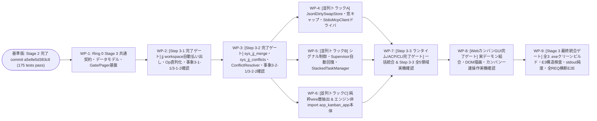

# 41_work_packages.md — Stage 3 作業パッケージ分解・依存関係・段階確認計画

関連文書:
- 進行原則（3 Stage × 3 Step）: [02_development_step.md](../02_development_step.md)
- 要望・背景・技術仮説: [10_claim.md](./10_claim.md)
- 利用場面・代表操作・対象環境・範囲境界: [20_app_requirement.md](./20_app_requirement.md)
- 要求・受け入れ条件・検証範囲（正本 / 版 `r1`）: [30_requirement.md](./30_requirement.md)
- 全体アーキテクチャ・優先順位・副作用/失効境界・監査拡張（一元正本）: [40_specification.md](./40_specification.md)（`[D-301]`〜`[D-305]`）
- 分割詳細仕様（4 本）:
  - [42_spec_workspace_merge_and_stacked.md](./42_spec_workspace_merge_and_stacked.md)（Step 3-1・3-2・Stacked Changes: `[D-306]`〜`[D-311]`）
  - [42_spec_signals_and_supervisor.md](./42_spec_signals_and_supervisor.md)（Step 3-3 シグナル・Supervisor: `[D-312]`〜`[D-315]`）
  - [42_spec_dirty_swap_and_mcp.md](./42_spec_dirty_swap_and_mcp.md)（Step 3-3 Dirty Page Swap・MCP ドライバ: `[D-316]`〜`[D-319]`）
  - [42_spec_acp_team_and_kanban_gui.md](./42_spec_acp_team_and_kanban_gui.md)（ACP チーム拡張・CLI・ローカル Web カンバン GUI・3 バイナリビルド: `[D-320]`〜`[D-324]`）
- 技術・環境実測リファレンス:
  - [jj_workspace_merge_and_stacked.md](../cheatsheet/jj_workspace_merge_and_stacked.md)
  - [mcp_and_supervisor_signals.md](../cheatsheet/mcp_and_supervisor_signals.md)
- 進捗正本: [90_status.md](./90_status.md)

---

## 1. 作業編成の基本方針と共通規律

1. **判断規則の一元正本参照（仕様の重複再定義禁止）**:
   - パッケージ変更範囲・3 バイナリ構成・Ring 0 純粋性・上位 UI 完全分離境界（`[D-301]`：`40_specification.md` §1.2）、全 31 システムコール体系と `SyscallGate` Stage 0.5/2/8 契約（`[D-302]`：同 §2）、横断優先順位（勝敗）契約（`[D-303]`：同 §3.1）、副作用許容境界・プロセス別安全ロック・キャッシュ／ワークスペース／Swap／MCP 失効規則（`[D-304]`：同 §3.2）、プロセス別 `jjChangeId` 監査帰属・`resultSummary`・Swap テレメトリ契約（`[D-305]`：同 §4）、および各詳細仕様（`[D-306]`〜`[D-324]`）は、`40_specification.md` と `42_spec_*.md` を唯一の正本とする。
   - 本書ではこれらの判断規則・優先順位・副作用境界を独自表現へ書き直さず、必ず安定 ID（`[D-3xx]`）と該当見出しを参照して各 WP の「入力・変更範囲・作る成果・開始条件・完了確認・統合と引き渡し」を規定する。
2. **`docs/02_development_step.md` の「1 ステップ・1 複雑さ・毎ステップ動作事象確認ゲート」厳守**:
   - 内部クラスだけをまとめて実装して最後に初めて動かす編成を禁止し、Stage 2 完了版（基準ソース版：`jj` commit `a5e8e5d383c85f764bceb7f302d96735b025e813`、既存自動テスト 32 ファイル・175 件 pass）の上に以下の段階確認ゲートを順に積み上げる：
     - **Ring 0 共通契約確立（`WP-1`）**: 基準ソース版から直ちに着手し、`packages/agent_kernel` 内の Stage 3 全共有型・契約 IF・パイプライン拡張（および `ProcessProfileId` 列挙拡張に伴う `isolate_worker_host.dart` `_buildChildInstruction` の最小スタブ分岐 1 箇所）と単体テストを先行確定させる（後続全 WP での Ring 0 競合をゼロにする）。
     - **Step 3-1 完了ゲート（`WP-2`）**: `WorkspaceWorker` への `.agent_os/ws/<pid>` 自動払い出し・`dart pub get --offline`・自動クリーンアップ・`JjDriver` 単一ミューテックス＆プロセス別ドライバ統合を完成させ、**事象 3-1-1**（並列 `WorkspaceWorker` 同時編集・同時 `dart test`・子専用 `jjChangeId` 帰属）および **事象 3-1-2**（`jj op log` 一本道維持）の `E1` / `E2` / `E3` を確認してから Step 3-2 へ進む。
     - **Step 3-2 完了ゲート（`WP-3`）**: 多親マージ `sys_jj_merge`・機械可読競合検査 `sys_jj_conflicts`・単一作業チェンジ平坦化統合 `sys_jj_integrate`・承認前非破壊 `ECONFLICT` 遮断ガード・親＆専任 `ConflictResolver` 解消フローを完成させ、**事象 3-2-1**（非重複変更 1 発統合＋全体 `dart test` 通過）および **事象 3-2-2**（同一関数衝突時の First-Class Conflict 非停止解消＋統合完了）の `E1` / `E2` を確認してから Step 3-3 へ進む。
     - **Step 3-3 非重複並列実装と統合確認ゲート（`WP-4` ∥ `WP-5` ∥ `WP-6` → `WP-7` → `WP-8`）**: Step 3-2 ゲート通過後、編集対象ファイル集合が完全に非重複な 3 つのモジュール群（`WP-4`: Dirty Page Swap Store ＆ `stdio` MCP ドライバ、`WP-5`: シグナル制御・Supervisor 自動回復・Stacked Changes 管理、`WP-6`: 純粋ワイヤ層抽出 ＆ エンジン非 import ローカル Web カンバン GUI `acp_kanban_app`）を実装し、明示的統合 WP である `WP-7` で `KernelBootstrap`・`AcpServer` `_fm_agent_os/*`・CLI へ一括配線して Step 3-3 全事象（事象 3-3-1, 3-3-2, Dirty Swap, MCP, 事象 3-3-3）の `E1` / `E2` を確認し、続いて `WP-8` で `acp_kanban_app.exe` × 実 `agent_os_daemon.exe` のヘッドレス DOM 描画＋実 HTTP/WS カンバン一連操作＋連鎖シャットダウン（`REQ-11`）の `E1` / `E2` / `E3` を確認する。
     - **Stage 3 最終 AOT 3 バイナリ E2E 統合ゲート（`WP-9`）**: 全 3 バイナリ（`agent_os_daemon.exe` / `acp_cli_client.exe` / `acp_kanban_app.exe`）のクリーン AOT 再ビルド・SHA-256 採取・SDK 除外単体起動・全パッケージ `E3` 構造検査・既存 175 件＋Stage 3 全テスト一括通過・並列ワーカー/MCP 下の `stdout` 100% NDJSON 純度検証・Stage 1/2 非回帰＋Stage 3 通し実機完走を行い、`env_manifest.md` 更新材料を確定して独立 `fm-dev-acceptance` へ引き渡す。
3. **隔離リポジトリ実機 `E2` における秘密環境変数注入・非露出・証跡記録規約**:
   - 実機 `E2`（`WP-2`, `WP-3`, `WP-7`, `WP-8`, `WP-9`）で `.planworks/<wp_id>_e2/` 等の隔離一時 `jj` リポジトリに対してデーモン／CLI／カンバン GUI を起動する際、**本リポジトリの `.agent_os/.env` を隔離ディレクトリへファイルコピーしてはならない**。検証ランナープロセス内でメモリ内のみに読み取り、子プロセス起動時の `environment` マップへ注入すること。また API キー・MCP `env[].value`・CSRF トークン等の秘密実値を `stdout` / `stderr` / 監査ログ / Swap ファイル / 証跡文書へ **1 文字たりとも露出させてはならない**。
   - 各 WP の実行・観測証跡は `docs/plan_20261120_stage3_workspace_team/evidence/` 配下の指定永続ファイル（および共通実行台帳 `docs/plan_20261120_stage3_workspace_team/evidence/run_records.md`）へ保存し、行番号ではなく「実在ファイルパス＋検索文字列アンカー」（例: `docs/plan_20261120_stage3_workspace_team/evidence/wp2_step3_1.md:"事象 3-1-1"`）で参照できる形にする。
4. **リポジトリ無汚染・一時物クリーンアップ・プロセス／ワークスペース非残留（全 WP 共通完了条件）**:
   - 検証用の一時 `jj` リポジトリ・一時子ワークスペース・Swap ファイル・検証用 MCP サーバービルド物・中間スクリプトはすべてリポジトリルートの `.planworks/` 配下（または単体テスト `tearDown` で即時削除する OS 一時ディレクトリ）に限定し、`docs/` や `packages/` 配下に一時ファイルを作らない。
   - 各 WP 完了時点で、①本リポジトリの意図しないワーキングコピー変更ゼロ・検証操作による本リポジトリ `jj workspace list` / `jj op log` 汚染ゼロ、②`.planworks/` 内の不要一時物の削除完了、③起動した `acp_kanban_app.exe`・`agent_os_daemon.exe`・子 `Isolate`・MCP サブプロセス・`dart test` 子孫プロセスの残留 **0 件** を確認してから報告を返す。
   - WP の完了確認は実装・試験担当による作業結果確認であり、各 REQ の最終 `Acceptance` 判定（`pass / fail / unverified / human-pending`）は独立した `fm-dev-acceptance` が行う。

---

## 2. WP 依存グラフと並列実行境界

### 2.1 依存関係 DAG と段階確認ゲート図



### 2.2 並列実装可能な WP 組と同時編集防止境界（`workflow-contract.md` 準拠）

特定の並列実行数を実行環境の必須条件とはしない（`WP-4 → WP-5 → WP-6` の直列実行でもそのまま完遂可能）。並列実行を選択する場合は、以下の先行確定境界・編集ファイル完全非重複条件・統合担当を厳守する。**少しでも編集対象ファイルが重なる作業を同時実行することは絶対禁止**とする。

| 並列可能組 | 先に確定している前提境界 | 各 WP の専用編集ファイル集合（相互に完全非重複） | 3 WP すべてで編集禁止とする共有ファイル | 作業場所宣言・基準 commit 固定・後続統合 WP |
| :--- | :--- | :--- | :--- | :--- |
| **`WP-4` ∥ `WP-5` ∥ `WP-6`**<br>（任意の 2 本並列または 3 本並列） | 1. 新規外部 pub 依存は 0 件（`[D-301]`）のため `pubspec.yaml` / `pubspec.lock` 更新は不要。<br>2. `WP-1` で `packages/agent_kernel/**` の全共有契約（`SupervisionPolicy`, `ProcessSignalKind`, `ProcessSuspendController`, `ProcessAwarePageFreshnessChecker`, `DirtySwapBackend`［`{pid, pcb}` 対応］, `DeterministicDirtyPageSummarizer`, `ContextPager`［`refreshAndPrepareFrame` `{pcb, pid, sessionId}` ＆ Turn Group 退避］, `McpServerSpec`, `CapRight.mcpCall`, `StackedTaskRegistry` 等）が確定済み。<br>3. `WP-2`・`WP-3` で Step 3-1・3-2 の `JjDriver` ミューテックス・ワークスペース・多親マージ・競合解消基盤が完了・実機ゲート通過済み。 | - **`WP-4` 専用範囲（`agent_drivers` Memory/LLM/MCP）**:<br>  `packages/agent_drivers/lib/src/memory/jsonl_dirty_swap_store.dart`（新規）、<br>  `packages/agent_drivers/lib/src/memory/workspace_page_freshness_checker.dart`、<br>  `packages/agent_drivers/lib/src/llm/context_window_resolver.dart`、<br>  `packages/agent_drivers/lib/src/llm/llm_router.dart`、<br>  `packages/agent_drivers/lib/src/mcp/mcp_transport.dart`（新規）、<br>  `packages/agent_drivers/lib/src/mcp/stdio_mcp_client.dart`（新規）、<br>  `packages/agent_drivers/lib/mcp_drivers.dart`（新規専用バレル）、<br>  `packages/agent_drivers/test/fixtures/mock_stdio_mcp_server.dart`（新規）、<br>  `packages/agent_drivers/test/dirty_swap_and_mcp_drivers_test.dart`（新規）<br>- **`WP-5` 専用範囲（`agent_drivers/jj` Stacked 補助 ＋ `agent_runtime` シグナル/Supervisor/Stacked）**:<br>  `packages/agent_drivers/lib/src/jj/jj_workspace_ops.dart`、<br>  `packages/agent_drivers/lib/src/jj/jj_driver.dart`、<br>  `packages/agent_drivers/test/jj_workspace_merge_stacked_test.dart`、<br>  `packages/agent_runtime/lib/src/stacked_task_manager.dart`（新規）、<br>  `packages/agent_runtime/lib/src/isolate_worker_host.dart`、<br>  `packages/agent_runtime/lib/src/process_syscalls.dart`、<br>  `packages/agent_runtime/lib/src/process_runner.dart`、<br>  `packages/agent_runtime/test/signals_and_supervisor_test.dart`（新規）<br>- **`WP-6` 専用範囲（`agent_acp` 純粋 `wire` ＆ `kanban` GUI 本体）**:<br>  `packages/agent_acp/lib/src/wire/wire_redactor.dart`（新規）、<br>  `packages/agent_acp/lib/src/wire/wire_json_rpc_peer.dart`（新規）、<br>  `packages/agent_acp/lib/src/wire/wire_command_splitter.dart`（新規）、<br>  `packages/agent_acp/lib/src/json_rpc_peer.dart`、<br>  `packages/agent_acp/bin/acp_kanban_app.dart`（新規）、<br>  `packages/agent_acp/lib/src/kanban/kanban_cli_runner.dart`（新規）、<br>  `packages/agent_acp/lib/src/kanban/kanban_server.dart`（新規）、<br>  `packages/agent_acp/lib/src/kanban/kanban_acp_bridge.dart`（新規）、<br>  `packages/agent_acp/lib/src/kanban/kanban_csrf.dart`（新規）、<br>  `packages/agent_acp/lib/src/kanban/kanban_ui_assets.dart`（新規）、<br>  `packages/agent_acp/test/kanban_unit_and_security_test.dart`（新規） | - ルートおよび全パッケージの `pubspec.yaml` / `pubspec.lock`<br>- `packages/agent_kernel/**`<br>- `packages/agent_drivers/lib/agent_drivers.dart`（統合バレル）<br>- `packages/agent_runtime/lib/agent_runtime.dart`（統合バレル）<br>- `packages/agent_runtime/lib/src/{kernel_bootstrap.dart, sub_agent_worker.dart, child_isolate_bootstrap.dart}`<br>- `packages/agent_acp/lib/agent_acp.dart`<br>- `packages/agent_acp/lib/src/{acp_server.dart, acp_event_mapper.dart, acp_approval_handler.dart, cli/acp_cli_runner.dart}`<br>- `packages/agent_acp/bin/{agent_os_daemon.dart, acp_cli_client.dart}` | - **作業場所と基準 commit の固定**: 並列起動前に Lv.2 implement leader が `90_status.md` に「共有作業ツリー」か「分離 `jj workspace`」かを明示宣言し、`WP-3` 完了時点の基準 `commit_id` を固定記録する。<br>- **共有作業ツリー利用時の規律**: 各 worker は自 WP の専用ファイル集合のみを作成・編集する。テスト一時領域は `.planworks/wp4_tmp/`・`.planworks/wp5_tmp/`・`.planworks/wp6_tmp/`（または OS 一時ディレクトリ）へ分離し、本リポジトリに対する `jj` コマンド更新を行わない。既存コンストラクタ・メソッドの後方互換（オプショナル引数化）を厳守し、未編集の `kernel_bootstrap.dart` / `acp_server.dart` のコンパイルを壊さないこと。<br>- **分離作業場所利用時の規律**: `WP-3` 完了 `commit_id` から各専用 `jj workspace` を分岐し、完了後に leader が編集ファイル集合の非重複と基準版を照合して合流させる。<br>- **明示的統合担当 WP**: **`WP-7`**（`agent_drivers.dart` / `agent_runtime.dart` / `kernel_bootstrap.dart` / `acp_server.dart` / `acp_event_mapper.dart` / CLI への一括公開・配線と統合確認を担当）。 |

- 上記以外の全区間（`WP-1 → WP-2 → WP-3` および `WP-7 → WP-8 → WP-9`）は、共有基盤確定・Step 完了ゲート通過確認・同一統合ファイル更新を伴うため **厳密な直列依存** とする。

---

## 3. Work Package 概要一覧と 100% トレーサビリティ

### 3.1 Work Package 概要テーブル

| WP | 目的・対応REQ・設計ID | 入力・変更範囲 | 成果・完了条件 | 依存・開始条件 | 統合・確認 |
| :--- | :--- | :--- | :--- | :--- | :--- |
| **`WP-1`** | Ring 0（`agent_kernel`）Stage 3 共通契約・データモデル・`SyscallGate` / `ContextPager` 基盤実装<br>`REQ-01`〜`REQ-10`<br>`[D-301]`〜`[D-306]`, `[D-308]`, `[D-310]`〜`[D-312]`, `[D-315]`〜`[D-319]` | 基準版 commit `a5e8e5d383c8`、`40` §1〜§4、各 `42_spec_*` の Ring 0 型仕様<br>変更: `packages/agent_kernel/**` ＋ `packages/agent_runtime/lib/src/isolate_worker_host.dart`（`_buildChildInstruction` 最小スタブ分岐 1 箇所のみ）（外部 pub 依存追加ゼロ） | `supervision.dart`, `dirty_swap.dart`, `mcp_contract.dart`, `stacked_task.dart` 新設、`ProcessAwarePageFreshnessChecker`, 5 プロファイル/CSpace/`SyscallGate` Stage 0.5&8/`ContextPager` `{pcb, pid, sessionId}` ＆ Turn Group Dirty Swap・下限検証・監査項目拡張、単体テスト緑 | 先行 WP 依存なし（**即時開始可能**） | `E1`/`E3`: 全 4 パッケージ `dart analyze` 0 件＋`agent_kernel` 新規＆全既存 32 ファイル 175 テスト無修正緑＋禁止依存ゼロ確認。後続全 WP へ固定 Ring 0 IF を引き渡す |
| **`WP-2`** | **【Step 3-1 完了ゲート】** `jj workspace` 自動払い出し・`dart pub get --offline`・`JjDriver` 単一ミューテックス＆プロセス別ドライバ統合と Step 3-1 実機確認<br>`REQ-01`, `REQ-02`, `REQ-10`<br>`[D-301]`, `[D-302]`, `[D-304]`〜`[D-308]` | `WP-1` 成果、`20` §3.1、`40` §2〜§4、`42_workspace` §1〜§3<br>変更: `packages/agent_drivers/lib/src/{jj,fs,exec,memory}/**`, `packages/agent_runtime/lib/src/{isolate_worker_host,process_syscalls,sub_agent_worker,kernel_bootstrap}.dart`, 対応 `test/` | `.agent_os/ws/<pid>` `--no-colocate` 払い出し＆`forget` 回収、`dart pub get --offline`、単一 `AsyncMutex`＆`-R` 即時スナップショット、`ProcessAwarePageFreshnessChecker` 実装、`workspaceWorker` 本格プロンプト、子専用 `jjChangeId` 帰属、事象 3-1-1 / 3-1-2 確認完了 | `WP-1` 完了後 | `E1`/`E2`/`E3`: 並列ワーカー独立 `dart test`・Op 親数全件 `1` 自動検証＋`local-ollama` 実機 3-1-1 / 3-1-2 完走（`evidence/wp2_step3_1.md`）。通過後に `WP-3` を解禁 |
| **`WP-3`** | **【Step 3-2 完了ゲート】** 多親マージ `sys_jj_merge`・`sys_jj_conflicts`・`sys_jj_integrate`・非破壊 `ECONFLICT` ガード・`ConflictResolver` と Step 3-2 実機確認<br>`REQ-03`, `REQ-04`, `REQ-10`<br>`[D-302]`, `[D-304]`, `[D-305]`, `[D-306]`, `[D-309]`, `[D-310]` | `WP-2` 成果、`20` §3.2、`40` §2〜§4、`42_workspace` §4〜§5<br>変更: `jj_workspace_ops.dart`, `jj_driver.dart`, `workspace_page_freshness_checker.dart`, `agent_runtime`（`isolate_worker_host.dart` 等 Syscall/Worker 配線）, 対応 `test/` | `sys_jj_merge`, `sys_jj_conflicts`（常時 `exit=0`）, `sys_jj_integrate`（`W_lead` 平坦化）, 多親 Squash プレビュー `parentChangeId` 統一, `sys_tx_squash` Stage 2 `ECONFLICT` 遮断, `conflictResolver` 本格プロンプト＆解消フロー、事象 3-2-1 / 3-2-2 確認完了 | `WP-2`（Step 3-1 ゲート）通過後 | `E1`/`E2`: 非重複統合・承認 0 回 `op_id` 不変 `ECONFLICT`・衝突解消自動テスト＋実機 3-2-1 / 3-2-2 完走（`evidence/wp3_step3_2.md`）。通過後に `WP-4`〜`WP-6` を解禁 |
| **`WP-4`** | **【Step 3-3 並列トラック A】** `JsonlDirtySwapStore`・`--max-context-tokens` 実効窓キャップ・`StdioMcpClient` ドライバ＆pure-Dart MCP Fixture<br>`REQ-07`, `REQ-08`, `REQ-10`<br>`[D-301]`〜`[D-305]`, `[D-316]`〜`[D-319]` | `WP-3` 成果、`40` §3/§4、`42_dirty_swap_and_mcp` §1〜§4<br>変更: `packages/agent_drivers/lib/src/{memory,llm,mcp}/**`, `lib/mcp_drivers.dart`, `test/fixtures/mock_stdio_mcp_server.dart`, `test/dirty_swap_and_mcp_drivers_test.dart` | `agent_kernel` 無変更での `LlmRouter` `{pcb, pid, sessionId}` 接続、`.agent_os/swap/` マスク保存、`sys_mem_pagein` `dirty_swap` 復元、`maxContextTokens` クランプ＆下限検証、`StdioMcpClient`（Win32 Job/CRLF/`stderr`/`nextCursor`/秘匿）、`sys_mcp_*`＆Ring 2 承認連携 | `WP-3`（Step 3-2 ゲート）通過後（**`WP-5`・`WP-6` と並列可**） | `E1`/`E3`: Dirty Swap Turn Group/マスク/`dirty_swap`・MCP 往復/秘匿/Ring 2 承認/Ring 3 `EPERM`/終了回収テスト緑（`evidence/wp4_swap_mcp_unit.md`）。`WP-7` へ引き渡す |
| **`WP-5`** | **【Step 3-3 並列トラック B】** シグナル制御（`SIGSTOP`/`SIGCONT`/`SIGKILL`）・Supervisor 自動回復・`StackedTaskManager` 実装<br>`REQ-02`, `REQ-05`, `REQ-06`, `REQ-09`<br>`[D-302]`〜`[D-305]`, `[D-307]`, `[D-308]`, `[D-311]`〜`[D-315]` | `WP-3` 成果、`40` §3/§4、`42_signals_and_supervisor` §1〜§4、`42_workspace` §6<br>変更: `jj_workspace_ops.dart`, `jj_driver.dart`, `jj_workspace_merge_stacked_test.dart`, `packages/agent_runtime/lib/src/{stacked_task_manager,isolate_worker_host,process_syscalls,process_runner}.dart`, `signals_and_supervisor_test.dart` | `sys_kill`、親子ステップ境界 `CanonicalUserTurn` 制約注入（初回ターン保持＆子ホスト入口フック）、`SIGKILL` 一括回収、Supervisor リトライ分離・`childQuota` 基準クオータ保存則・旧 `ws` 破棄＆`fallbackModel` 切替、`sys_task_stack` 7 アクション＆`update-stale` 追従 | `WP-3`（Step 3-2 ゲート）通過後（**`WP-4`・`WP-6` と並列可**） | `E1`/`E3`: DI 異常注入 Supervisor 全経路（親無制限×子有限保存則含む）・`tool_call_id` 整合＆Prefix 不変・`SIGKILL` 残留 0 件・Stacked 3 段追従（`divergent` 0 件）テスト緑（`evidence/wp5_signals_supervisor_stacked_unit.md`）。`WP-7` へ引き渡す |
| **`WP-6`** | **【Step 3-3 並列トラック C】** 純粋ワイヤ層 `wire/*` 抽出とエンジン非 import 単一 `.exe` ローカル Web カンバン GUI（`acp_kanban_app`）本体実装<br>`REQ-10`, `REQ-11`<br>`[D-301]`, `[D-320]`〜`[D-324]` | `WP-3` 成果、`20` §3.3 S3-3f、`40` §1.2、`42_acp_team_and_kanban_gui` §1.2/§2.1/§3〜§5<br>変更: `packages/agent_acp/lib/src/wire/**`, `json_rpc_peer.dart`, `bin/acp_kanban_app.dart`, `lib/src/kanban/**`, `test/kanban_unit_and_security_test.dart` | エンジン非依存 `wire/*`（`wire_command_splitter.dart` 含む）、`127.0.0.1` `HttpServer`、`--port 0 --no-open-browser`、`KANBAN_READY`、`<meta name="csrf-token">`＆`403` 防御、外部 CDN ゼロ 5 レーン UI、FIFO キュー＆`_meta["fm_agent_os/taskId"]` ACP ブリッジ、連鎖終了 | `WP-3`（Step 3-2 ゲート）通過後（**`WP-4`・`WP-5` と並列可**） | `E1`/`E3`: エンジン非 import 再帰検査・外部 CDN 0 件・`127.0.0.1` 固定構造検査＋モックデーモンでの CSRF/`403`/FIFO キュー/全 API/WS/連鎖終了単体テスト緑（`evidence/wp6_kanban_unit.md`）。`WP-7`・`WP-8` へ引き渡す |
| **`WP-7`** | **【Step 3-3 ランタイム・ACP/CLI 完了ゲート】** `KernelBootstrap`・`AcpServer` `_fm_agent_os/*`・CLI 一括統合と Step 3-3 全 5 領域実機確認<br>`REQ-05`〜`REQ-10`<br>`[D-301]`〜`[D-305]`, `[D-311]`〜`[D-321]` | `WP-4`・`WP-5`・`WP-6` 全成果、`20` §3.3 S3-3a〜e、`40` §3/§4、`42_acp_team_and_kanban_gui` §1〜§2<br>変更: `agent_drivers.dart`, `agent_runtime.dart`, `kernel_bootstrap.dart`, `{acp_server,acp_event_mapper}.dart`, `cli/acp_cli_runner.dart`, `bin/{agent_os_daemon,acp_cli_client}.dart`, `acp_stage3_team_and_cli_test.dart` | `KernelBootstrap`・`session/prompt` `taskId`/`executionMode` `c_A` バインド＆完了時下流カスケード・`_fm_agent_os/*`（全 9 メソッド）・`session/new` `mcpServers`/`maxContextTokens`・CLI（`wire_command_splitter` 共用＆mid-turn コマンド）統合、Step 3-3 全 5 領域実機確認完了 | `WP-4`, `WP-5`, `WP-6` の**全 3 件完了後** | `E1`/`E2`: ACP/CLI 統合テスト緑＋実機 3-3-1（Supervisor 2 シナリオ）、3-3-2（イベント駆動一意タグ注入＆`SIGKILL`）、Dirty Swap、MCP、3-3-3（Stacked 自動追従）完走（`evidence/wp7_step3_3_runtime_cli.md`）。通過後に `WP-8` を解禁 |
| **`WP-8`** | **【ローカル Web カンバン GUI 完了ゲート】** `acp_kanban_app.exe` × 実 `agent_os_daemon.exe` 結合検証・ブラウザ DOM 描画・カンバン一連操作実機確認<br>`REQ-05`, `REQ-09`, `REQ-10`, `REQ-11`<br>`[D-301]`, `[D-320]`, `[D-322]`, `[D-323]`, `[D-324]` | `WP-6`・`WP-7` 成果、`20` §3.3 S3-3f、`30` `REQ-11`、`42_acp_team_and_kanban_gui` §1.2/§3〜§5<br>変更: `packages/agent_acp/test/kanban_daemon_e2e_test.dart`（新規）および必要時のカンバン/ACP ブリッジ軽微調整 | 実デーモン接続 E2E 自動テスト通過、`acp_kanban_app.exe --port 0 --no-open-browser` ビルド、`msedge.exe --headless --dump-dom` 初期 DOM 描画確認、カード A→`c_A`→積層カード B 継承＆連続 `run` FIFO キュー完走を含む実 HTTP/WS 全操作①〜④＆連鎖回収実機確認完了 | `WP-7`（Step 3-3 ゲート）通過後 | `E1`/`E2`/`E3`: 実デーモン結合 E2E 緑＋`KANBAN_READY`・ヘッドレス DOM・`c_A`→`c_B` 積層継承・FIFO 排他（`-32000` 非発生）・シグナル/承認/親修正追従・残留 0 件実機確認（`evidence/wp8_kanban_gui.md`）。通過後に `WP-9` へ進む |
| **`WP-9`** | **【Stage 3 最終 AOT 3 バイナリ E2E 統合ゲート】** 全 3 `.exe` クリーン再ビルド・全 `E3` 構造検査・`stdout` 純度・Stage 1/2 非回帰＋Stage 3 通し完走・`env_manifest.md` 更新材料確定<br>`REQ-01`〜`REQ-11`（全 11 件最終統合）<br>`[D-301]`〜`[D-324]`（全 24 件） | `WP-8` 成果、`30` §2〜§4、`40` §1〜§7、`42_acp_team_and_kanban_gui` §5<br>変更: `packages/agent_acp/test/stage3_architecture_and_purity_test.dart`（または既存純度テスト拡張）・必要時の軽微な統合調整のみ（新機能追加なし） | 全 `E3` 構造検査合格、`dart analyze` 0 件、既存 175 件＋新規全テスト一括通過、全 3 `.exe` クリーンビルド＆SHA-256＆SDK 除外起動、並列ワーカー/MCP 下の `stdout` 100% NDJSON 純度、Stage 1/2 非回帰＋Stage 3 通し実機完走 | `WP-8`（Web カンバンゲート）通過後 | `E1`/`E2`/`E3`: 全自動テスト・3 `.exe` 純度/単体起動・通し実機ログ突合・残留 0 件確認（`evidence/wp9_final_integration.md`, `evidence/run_records.md`）。確定 `commit_id`/SHA-256 を揃え独立 `fm-dev-acceptance` へ引き渡す |

---

### 3.2 `REQ-01` 〜 `REQ-11` ↔ WP 対応マトリクス（`90_status.md` `WP` 列転記原票）

| REQ ID | 要求要約 | 対象設計 ID | 対応 WP（Ring 0 契約 → 実装/ドライバ → 段階確認ゲート → 最終統合ゲート） | `90_status.md` `WP` 列転記値 |
| :--- | :--- | :--- | :--- | :--- |
| **`REQ-01`** | `WorkspaceWorker` への `jj workspace`（`.agent_os/ws/<pid>`）＆無名 `Change ID` 自動払い出し・並列編集・同時 `dart test`・自動クリーンアップ | `D-301, D-302, D-304, D-305, D-306, D-307, D-308` | `WP-1`（Ring 0 プロファイル/PCB/監査契約）→ `WP-2`（Step 3-1 完了ゲート `E1`/`E2`：事象 3-1-1）→ `WP-9`（最終通し確認） | `WP-1, WP-2, WP-9` |
| **`REQ-02`** | ホスト単一 `JjDriver` ミューテックスによる全 `jj` 更新・`-R <ws_path>` 即時スナップショット直列化と `jj op log` 一本道維持 | `D-304, D-305, D-308` | `WP-1`（監査契約）→ `WP-2`（Step 3-1 完了ゲート `E1`/`E2`/`E3`：事象 3-1-2）→ `WP-5`（Stacked カスケード直列化）→ `WP-9`（最終 `E2`/`E3`） | `WP-1, WP-2, WP-5, WP-9` |
| **`REQ-03`** | `sys_jj_merge([c1, c2, ...])` 多親マージ・非重複変更の 1 発統合・全体テスト通過・単一作業チェンジ統合＆承認 `squash` 連動 | `D-302, D-304, D-305, D-309` | `WP-1`（CSpace/監査契約）→ `WP-3`（Step 3-2 完了ゲート `E1`/`E2`：事象 3-2-1）→ `WP-9`（最終通し確認） | `WP-1, WP-3, WP-9` |
| **`REQ-04`** | `sys_jj_conflicts` 機械可読競合検査・未解消誤 `squash` 防止・同一関数衝突時の First-Class Conflict 非停止解消フロー（親＆`ConflictResolver` 対応） | `D-302, D-304, D-306, D-309, D-310` | `WP-1`（`ConflictResolver`/`econflict` 契約）→ `WP-3`（Step 3-2 完了ゲート `E1`/`E2`：事象 3-2-2）→ `WP-9`（最終通し確認） | `WP-1, WP-3, WP-9` |
| **`REQ-05`** | シグナル制御（`SIGSTOP` 一時凍結・`SIGCONT` 方針変更注入再開・`SIGKILL` プロセスツリー＆一時 `jj workspace` 一括強制回収） | `D-302, D-303, D-304, D-312, D-313, D-314, D-320, D-321` | `WP-1`（`SuspendController`/Stage 0.5）→ `WP-5`（ランタイム実装 `E1`）→ `WP-6`（カンバン UI）→ `WP-7`（ACP/CLI 統合＆事象 3-3-2 実機 `E2`）→ `WP-8`（カンバン実機 `E2`）→ `WP-9`（最終通し確認） | `WP-1, WP-5, WP-6, WP-7, WP-8, WP-9` |
| **`REQ-06`** | Supervisor 自動回復ポリシー（異常終了・タイムアウト時の汚染ワークスペース破棄＋クリーン再試行／`fallbackModel` 切替＋クオータ保存則維持） | `D-303, D-304, D-305, D-315` | `WP-1`（`SupervisionPolicy`/`AttemptRecord`）→ `WP-5`（Supervisor ループ＆DI 異常注入 `E1`）→ `WP-7`（事象 3-3-1 本番 `.exe` 実機 `E2`）→ `WP-9`（最終 `E2`/`E3`） | `WP-1, WP-5, WP-7, WP-9` |
| **`REQ-07`** | 超長期プロセス向け Dirty Page Swap（Turn Group 原子退避・`.agent_os/swap/` 秘密マスク Write-back・決定論的構造化 `SummaryPage`・`sys_mem_pagein` 再展開） | `D-302, D-303, D-304, D-305, D-316, D-317, D-320, D-321` | `WP-1`（`ContextPager` Turn Group/`SummaryPage`/下限検証）→ `WP-4`（`JsonlDirtySwapStore`/窓キャップ/`dirty_swap` `E1`）→ `WP-7`（ACP/CLI `--max-context-tokens`＆実機 Swap `E2`）→ `WP-9`（最終通し確認） | `WP-1, WP-4, WP-7, WP-9` |
| **`REQ-08`** | `stdio` MCP クライアントドライバ（`sys_mcp_call` 等、ACP `mcpServers` ＆ CLI `--mcp-server` 対応・Ring 2 承認連携・資格情報秘匿・終了時回収） | `D-301, D-302, D-303, D-304, D-305, D-318, D-319, D-320, D-321` | `WP-1`（`CapRight.mcpCall`/契約型）→ `WP-4`（`StdioMcpClient`＆pure-Dart Fixture `E1`）→ `WP-7`（ACP/CLI 配線＆実 `.exe` MCP 実機 `E2`）→ `WP-9`（最終純度/回収確認） | `WP-1, WP-4, WP-7, WP-9` |
| **`REQ-09`** | カンバンタスク対応 Stacked Changes プロセスツリー管理（`c_A -> c_B` 積層・ACP/CLI 公開・親タスク修正時の自動リベース＆`update-stale` 自動追従） | `D-302, D-304, D-308, D-311, D-320, D-321, D-323` | `WP-1`（`StackedTaskRegistry`）→ `WP-5`（`StackedTaskManager`＆`update-stale` 追従 `E1`）→ `WP-6`（カンバン UI）→ `WP-7`（ACP/CLI 統合＆事象 3-3-3 実機 `E2`）→ `WP-8`（カンバン実機追従 `E2`）→ `WP-9`（最終通し確認） | `WP-1, WP-5, WP-6, WP-7, WP-8, WP-9` |
| **`REQ-10`** | Stage 1・Stage 2 全機能非回帰・並列ワーカー/MCP 下での Zed ACP `stdio` 100% NDJSON 純度＆TTY 独占維持・全 3 `.exe` 単一ファイル完結 | `D-301, D-304, D-305, D-324` | `WP-1`（後方互換基盤）→ `WP-2`/`WP-3`/`WP-4`/`WP-6`/`WP-7`（各層純度・互換維持）→ `WP-9`（全 `E3`・既存 175 件＋新規全テスト・全 3 `.exe` クリーンビルド＆SDK 除外起動・`stdout` 純度・通し非回帰 `E1`/`E2`/`E3`） | `WP-1, WP-2, WP-3, WP-4, WP-6, WP-7, WP-9` |
| **`REQ-11`** | ACP 接続型・単一 `.exe` ローカル Web カンバン GUI アプリ（`acp_kanban_app.exe`：`127.0.0.1` 限定・外部 CDN ゼロ・並列/Stacked/シグナル/承認操作） | `D-301, D-320, D-322, D-323, D-324` | `WP-6`（純粋 `wire/*`＆カンバン本体・単体/構造検査 `E1`/`E3`）→ `WP-7`（デーモン `_fm_agent_os/*` 拡張）→ `WP-8`（実デーモン結合・ヘッドレス DOM・一連操作・連鎖回収 `E1`/`E2`/`E3`）→ `WP-9`（クリーン AOT `.exe`・最終 `E3`） | `WP-6, WP-7, WP-8, WP-9` |

---

### 3.3 全設計項目（`[D-301]` 〜 `[D-324]` 全 24 件）カバレッジ照合表

| 設計 ID | 正本文書・見出し | 主実装 WP | 統合・確認 WP |
| :--- | :--- | :--- | :--- |
| `[D-301]` | `40_specification.md` §1.2 Stage 3 パッケージ変更範囲・3 実行バイナリ構成・Ring 0 純粋性・上位 UI 完全分離境界 | `WP-1`, `WP-6` | `WP-2`, `WP-7`, `WP-8`, `WP-9` (`E3`) |
| `[D-302]` | `40_specification.md` §2 全システムコール体系（全 31 種）と 5 プロセスプロファイル権限マトリクス・`SyscallGate` 拡張 | `WP-1`, `WP-2`, `WP-3`, `WP-4`, `WP-5` | `WP-2`, `WP-3`, `WP-7`, `WP-9` |
| `[D-303]` | `40_specification.md` §3.1 横断優先順位契約（モデル解決・`--max-context-tokens` 実効窓・MCP サーバー解決・シグナル/Supervisor 勝敗規則） | `WP-1`, `WP-4`, `WP-5`, `WP-7` | `WP-4`, `WP-5`, `WP-7`, `WP-8`, `WP-9` |
| `[D-304]` | `40_specification.md` §3.2 副作用許容境界・プロセス別ワークスペース安全ロック・キャッシュ／ワークスペース／Swap 失効規則 | `WP-1`, `WP-2`, `WP-3`, `WP-4`, `WP-5` | `WP-2`, `WP-3`, `WP-7`, `WP-9` |
| `[D-305]` | `40_specification.md` §4 プロセス別 `jjChangeId` 監査帰属・軽量 `resultSummary`・Dirty Swap テレメトリ拡張 | `WP-1`, `WP-2`, `WP-3`, `WP-4`, `WP-5`, `WP-7` | `WP-2`, `WP-3`, `WP-7`, `WP-9` |
| `[D-306]` | `42_spec_workspace_merge_and_stacked.md` §1 `WorkspaceWorker` ＆ `ConflictResolver`（Ring 3）プロファイル・CSpace 限定開放・TTY 独占 | `WP-1`, `WP-2`, `WP-3` | `WP-2`, `WP-3`, `WP-9` |
| `[D-307]` | `42_spec_workspace_merge_and_stacked.md` §2 専用 `jj workspace`（`.agent_os/ws/<pid>`, `--no-colocate`）自動払い出し・`dart pub get --offline`・自動回収 | `WP-2` | `WP-2`, `WP-5`, `WP-9` |
| `[D-308]` | `42_spec_workspace_merge_and_stacked.md` §3 `JjDriver` 単一 `AsyncMutex` 直列化・`-R <ws_path>` 即時スナップショット・プロセス別ドライバ拡張 | `WP-1`, `WP-2`, `WP-5` | `WP-2`, `WP-5`, `WP-7`, `WP-9` |
| `[D-309]` | `42_spec_workspace_merge_and_stacked.md` §4 多親マージ `sys_jj_merge` と単一作業チェンジ平坦化統合 `sys_jj_integrate` | `WP-3` | `WP-3`, `WP-9` |
| `[D-310]` | `42_spec_workspace_merge_and_stacked.md` §5 `sys_jj_conflicts`・`sys_tx_squash` 承認前非破壊 `ECONFLICT` ガード・親＆`ConflictResolver` 解消フロー | `WP-1`, `WP-3` | `WP-3`, `WP-9` |
| `[D-311]` | `42_spec_workspace_merge_and_stacked.md` §6 Stacked Changes タスクツリー管理（`StackedTaskRegistry` / `sys_task_stack`）と自動リベース＆`update-stale` 追従 | `WP-1`, `WP-5` | `WP-5`, `WP-7`, `WP-8`, `WP-9` |
| `[D-312]` | `42_spec_signals_and_supervisor.md` §1 シグナル制御モデル（`ProcessSignalKind`・`ProcessSuspendController`・`sys_kill`・協調サスペンドゲート） | `WP-1`, `WP-5` | `WP-5`, `WP-7`, `WP-8`, `WP-9` |
| `[D-313]` | `42_spec_signals_and_supervisor.md` §2 `SIGCONT` 方針変更注入と `tool_call_id` 1:1 ペアリング・Segment 1 Prefix 保護境界 | `WP-5` | `WP-5`, `WP-7`, `WP-8`, `WP-9` |
| `[D-314]` | `42_spec_signals_and_supervisor.md` §3 `SIGKILL` によるプロセスツリー・Win32 Job Object・未統合 `jj workspace` 一括強制回収とクオータ精算 | `WP-5` | `WP-5`, `WP-7`, `WP-8`, `WP-9` |
| `[D-315]` | `42_spec_signals_and_supervisor.md` §4 `SupervisionPolicy`・リトライ対象分離・クオータ保存則・旧 `ws` 破棄＆クリーン再試行／`fallbackModel` 切替・`attempts[]` 追跡 | `WP-1`, `WP-5` | `WP-5`, `WP-7`, `WP-9` |
| `[D-316]` | `42_spec_dirty_swap_and_mcp.md` §1 `--max-context-tokens` 実効窓上限キャップ検証・段階的介入（Clean First, Dirty Second）・Turn Group 原子退避 | `WP-1`, `WP-4` | `WP-4`, `WP-7`, `WP-9` |
| `[D-317]` | `42_spec_dirty_swap_and_mcp.md` §2 Swap Store（`.agent_os/swap/.../pages.jsonl`）秘密マスク Write-back・決定論的 `SummaryPage`・`sys_mem_pagein` `dirty_swap` 復元 | `WP-1`, `WP-4` | `WP-4`, `WP-7`, `WP-9` |
| `[D-318]` | `42_spec_dirty_swap_and_mcp.md` §3 `McpTransport` 抽象・`StdioMcpClient`・`McpServerManager`・テスト用 pure-Dart MCP Fixture | `WP-1`, `WP-4` | `WP-4`, `WP-7`, `WP-9` |
| `[D-319]` | `42_spec_dirty_swap_and_mcp.md` §4 固定 `sys_mcp_list_tools` / `sys_mcp_call` による Segment 0 Prefix 保護・`CapRight.mcpCall`・Ring 2 承認連携 | `WP-1`, `WP-4`, `WP-7` | `WP-4`, `WP-7`, `WP-9` |
| `[D-320]` | `42_spec_acp_team_and_kanban_gui.md` §1 ACP v1 互換の `_fm_agent_os/*` 拡張メソッド・`session/prompt` `taskId` バインド・`session/new` `mcpServers` / `maxContextTokens` 契約 | `WP-6`, `WP-7` | `WP-7`, `WP-8`, `WP-9` |
| `[D-321]` | `42_spec_acp_team_and_kanban_gui.md` §2 同梱 `acp_cli_client.exe` / `agent_os_daemon.exe` CLI 拡張（mid-turn `/pause`, `/resume`, `/kill`, `/stack`, `--mcp-server`, `--max-context-tokens`） | `WP-6`, `WP-7` | `WP-7`, `WP-9` |
| `[D-322]` | `42_spec_acp_team_and_kanban_gui.md` §3 `acp_kanban_app.exe` アーキテクチャ（エンジン非 import・`127.0.0.1`・`KANBAN_READY`・`<meta name="csrf-token">`・連鎖シャットダウン） | `WP-6` | `WP-6`, `WP-8`, `WP-9` |
| `[D-323]` | `42_spec_acp_team_and_kanban_gui.md` §4 外部 CDN ゼロの自己完結埋め込みカンバン UI・HTTP/WebSocket API・カード状態遷移 | `WP-6` | `WP-6`, `WP-8`, `WP-9` |
| `[D-324]` | `42_spec_acp_team_and_kanban_gui.md` §5 全 3 バイナリ（`agent_os_daemon.exe`, `acp_cli_client.exe`, `acp_kanban_app.exe`）単一 `.exe` 完結ビルドと `stdout` 純度契約 | `WP-6`, `WP-7`, `WP-9` | `WP-8`, `WP-9` (`E1`/`E2`/`E3`) |

---

## 4. 各 Work Package 詳細定義（`WP-1` 〜 `WP-9`）

### WP-1：Ring 0（`agent_kernel`）Stage 3 共通契約・データモデル・`SyscallGate` / `ContextPager` 基盤実装

```text
WP-ID / 目的 / 対応REQ:
  WP-1 / 外部非依存の packages/agent_kernel（Ring 0 TCB）に Stage 3 全領域が共有するデータモデル・抽象 IF・5 プロセスプロファイル権限境界・SyscallGate Stage 0.5/2/8 拡張・ContextPager 段階的 Turn Group Dirty Swap＆下限検証・監査拡張フィールドを一括実装（あわせて ProcessProfileId 列挙拡張に伴う isolate_worker_host.dart _buildChildInstruction の最小スタブ分岐 1 箇所を配置）し、後続 WP（特に Step 3-3 並列 WP）が Ring 0 を再編集せずに進められる基盤を確定する / REQ-01, REQ-02, REQ-03, REQ-04, REQ-05, REQ-06, REQ-07, REQ-08, REQ-09, REQ-10（対象設計ID: [D-301], [D-302], [D-303], [D-304], [D-305], [D-306], [D-308], [D-310], [D-311], [D-312], [D-315], [D-316], [D-317], [D-318], [D-319]）

必要な入力・参照版:
  - 基準ソース版: jj commit a5e8e5d383c85f764bceb7f302d96735b025e813 (main, Stage 2 完了版・既存テスト 32 ファイル 175 件)
  - 40_specification.md §1.1/§1.2 [D-301]（後方互換維持・Ring 0 禁止依存）, §2 [D-302]（CapRight.mcpCall, 5 プロファイル, SyscallGate Stage 0.5/2/8）, §3.1 [D-303]（優先順位・下限検証式・勝敗規則の正本）, §3.2 [D-304]（副作用・Swap ディスク確定後メモリ更新・失効規則の正本）, §4 [D-305]（jjProcessAuditInfoProvider, resultSummary, swappedDirtyPages*）
  - 42_spec_workspace_merge_and_stacked.md §1.1/§1.2 [D-306]（先行追加時の _buildChildInstruction 網羅 switch スタブ互換契約を含む）, §3.2-4 [D-308]（ProcessAwarePageFreshnessChecker）, §4.1（JjTxContext.anchorWorkingChangeId / pendingWorkerChangeIds）, §5.2 [D-310]（SyscallErrorCode.econflict 監査分類）, §6.1 [D-311]（StackedTaskState, StackedTaskNode, StackedTaskRegistry）
  - 42_spec_signals_and_supervisor.md §1.1/§1.2 [D-312]（ProcessSignalKind, ProcessSuspendController, ControlSignalKind 拡張）, §4.1 [D-315]（RestartStrategy, SupervisionPolicy, SupervisorAttemptRecord）
  - 42_spec_dirty_swap_and_mcp.md §1.1〜§1.3 [D-316]（validateMaxContextTokens, ProcessAwarePageFreshnessChecker, ContextPager プロセス対応シグネチャ, Clean First/Dirty Second 3 パス順序, TurnGroupRange）, §2.1/§2.2 [D-317]（DirtySwapRecord, DirtySwapMeta, DirtySwapBackend {Pid pid = 1, ProcessControlBlock? pcb} 契約, DirtyPageSummarizer, DeterministicDirtyPageSummarizer, CanonicalSummaryTurn, replaceTurnRangeWithSummary）, §3.1 [D-318]（McpEnvVar, McpServerSpec, McpToolDescriptor, McpCallOutcome）, §4.1 [D-319]

変更する範囲と維持する振る舞い:
  - 変更範囲（packages/agent_kernel/** に加え、ProcessProfileId 列挙拡張に伴う網羅 switch コンパイル維持のため packages/agent_runtime/lib/src/isolate_worker_host.dart の _buildChildInstruction に workspaceWorker / conflictResolver 最小スタブ分岐を追加する 1 箇所のみ［単独先行 WP のため並列競合なし］。ルートおよび全パッケージの pubspec.yaml / pubspec.lock は変更しない）:
    - packages/agent_kernel/lib/src/supervision.dart（新規: ProcessSignalKind, ProcessSuspendController, RestartStrategy, SupervisionPolicy, SupervisorAttemptRecord）
    - packages/agent_kernel/lib/src/dirty_swap.dart（新規: DirtySwapRecord, DirtySwapMeta, TurnGroupRange, DirtySwapBackend 抽象［writeBackTurnGroups / readSwappedPages に {Pid pid = 1, ProcessControlBlock? pcb} を保持: [D-317] §2.1］, DirtyPageSummarizer 抽象, DeterministicDirtyPageSummarizer）
    - packages/agent_kernel/lib/src/mcp_contract.dart（新規: McpEnvVar, McpServerSpec, McpToolDescriptor, McpCallOutcome）
    - packages/agent_kernel/lib/src/stacked_task.dart（新規: StackedTaskState, StackedTaskNode, StackedTaskRegistry［descendantsInTopologicalOrder・循環依存検証含む］）
    - packages/agent_kernel/lib/src/process_profile.dart（workspaceWorker, conflictResolver 追加、属性メソッド群、SpawnSpec への baseChangeId / logicalTaskId / supervision 追加、ChildExitStatus への logicalTaskId / workspaceName / baseChangeId / workingChangeId / finalCommitId / workspaceCleanedUp / attempts 追加）
    - packages/agent_kernel/lib/src/pcb.dart（ProcessControlBlock への jjWorkspaceName / jjWorkspaceRoot / logicalTaskId / hasIsolatedJjWorkspace / suspendController 追加、JjTxContext への anchorWorkingChangeId / pendingWorkerChangeIds 追加）
    - packages/agent_kernel/lib/src/capability.dart（CapRight.mcpCall, CapabilityTable.stage3LeadAgent(), stage3ForbiddenChildRights, deriveForProfile の [D-306] §1.2 プロファイル別ロック分岐）
    - packages/agent_kernel/lib/src/mailbox.dart（ControlSignalKind への sigstop, sigcont, sigkill 追加）
    - packages/agent_kernel/lib/src/context_memory.dart & context_pager.dart（PageFreshnessChecker.checkFreshness は無変更維持し ProcessAwarePageFreshnessChecker サブインターフェースを新設［[D-316] §1.2］、同期 prepareFrameForModel は無変更維持した上で refreshFreshness に {ProcessControlBlock? pcb}・prepareFrameForModelAsync / refreshAndPrepareFrame に {ProcessControlBlock? pcb, Pid pid = 1, String? sessionId} を追加、CanonicalSummaryTurn、replaceTurnRangeWithSummary、ContextPage.swapMeta、validateMaxContextTokens、[D-316]/[D-317] の Clean First/Dirty Second 3 パス非同期介入・Atomic Turn Group 分割・直近保護・Swap Write-back 成功後縮約・アンカー失効、ContextPagingReport の swappedDirtyPagesInStep / swappedDirtyPagesTotal / swappedTurnGroupsInStep）
    - packages/agent_kernel/lib/src/syscall_gate.dart（Stage 0.5 協調サスペンドゲート［sys_exit 除外・cancel 解除］、JjProcessAuditInfoProvider 導入、SyscallExecutionResult 等からの resultSummary 受け渡し、econflict -> AuditDecision.deniedByPolicy マップ）
    - packages/agent_kernel/lib/src/audit_logger.dart（SyscallAuditRecord.resultSummary、LlmIoAuditRecord の swappedDirtyPagesInStep / swappedDirtyPagesTotal / swappedTurnGroupsInStep 追加）
    - packages/agent_kernel/lib/agent_kernel.dart（新規公開エクスポート追加）
    - packages/agent_runtime/lib/src/isolate_worker_host.dart（[D-306] §1.1: _buildChildInstruction の switch (profile) に workspaceWorker / conflictResolver 用の最小スタブ分岐を追加する 1 箇所のみ。本格プロンプトは WP-2 / WP-3 で完成させる）
    - packages/agent_kernel/test/stage3_kernel_contracts_test.dart（新規）および既存単体テストの無修正通過確認
  - 維持する振る舞い:
    - 40_specification.md §1.1 の全後方互換契約（KernelProcessTable() 引数なし、stage1LeadAgent / stage2LeadAgent、explorer / webResearcher の STAGE2_READONLY_CHILD_LOCK、PageFreshnessChecker.checkFreshness 無引数シグネチャ、const ContextPager() での同期 prepareFrameForModel および dirtySwapBackend == null 時の既存動作、無引数 jjAuditInfoProvider 互換）を維持し、既存 32 ファイル 175 件のテストを 1 行も修正せず全件通過させること。
    - [D-301] の Ring 0 禁止依存（http, ffi, win32, mirrors, yaml, html, 上位パッケージ, stdout 直接参照）を 0 件に保つこと。

作る成果:
  1. [D-301]〜[D-306], [D-310]〜[D-312], [D-315]〜[D-319] の Ring 0 型・契約・ゲート・ページャ拡張一式。
  2. プロファイル別権限減衰、SuspendController 凍結/再開/キャンセル解除、Turn Group 分割（孤立 tool_call_id ゼロ保証）・Clean 優先・Dirty Swap Write-back 失敗時無変更保護・決定論的 SummaryPage 抽出・validateMaxContextTokens 下限検証、StackedTaskRegistry トポロジ順走査・循環検出、プロセス別監査帰属コールバックを検証する単体テスト（stage3_kernel_contracts_test.dart）。
  3. 実行確認記録（docs/plan_20261120_stage3_workspace_team/evidence/wp1_ring0_foundation.md）。

開始条件・依存:
  - 先行 WP 依存なし（未解決事項 0 件であり、基準ソース版 a5e8e5d383c85f764bceb7f302d96735b025e813 から直ちに着手可能）。

完了条件・確認方法:
  - [E3] packages/agent_kernel/pubspec.yaml および lib/** に [D-301] の禁止依存および stdout 直接参照が 0 件であることを確認し、証跡へ記録すること。
  - [E1] mise exec -- dart analyze が全 4 パッケージで警告・エラー 0 件で成功すること。
  - [E1] mise exec -- dart test（packages/agent_kernel の新規テスト stage3_kernel_contracts_test.dart および全 4 パッケージ既存 32 ファイル 175 件）が全件通過すること。
  - 証跡保存先: docs/plan_20261120_stage3_workspace_team/evidence/wp1_ring0_foundation.md（および run_records.md）。

統合先・後続への引き渡し:
  - 確定した packages/agent_kernel の全共有契約を WP-2（Step 3-1）および後続全 WP へ引き渡す（以降 WP-2〜WP-9 では原則として agent_kernel 公開契約を破壊変更しない）。

未実施・未解決: 実行前に決めること
  - なし。
```

---

### WP-2：【Step 3-1 完了ゲート】`jj workspace` 自動払い出し・`dart pub get --offline`・`JjDriver` 単一ミューテックス＆プロセス別ドライバ統合と Step 3-1 実機確認

```text
WP-ID / 目的 / 対応REQ:
  WP-2 / [D-306]〜[D-308] に従い、WorkspaceWorker への専用 .agent_os/ws/<pid>（--no-colocate）＆無名 Change ID 自動払い出し・Pub Workspaces オフライン解決（dart pub get --offline）・終了時自動クリーンアップ、JjDriver 単一 AsyncMutex による全 jj 更新と -R <ws_path> 即時スナップショット直列化、および既存 4 ドライバのプロセス別ワークスペース対応を実装・統合し、Step 3-1 の事象 3-1-1 / 3-1-2 を E1/E2/E3 で確認する完了ゲートを通過させる / REQ-01, REQ-02, REQ-10（対象設計ID: [D-301], [D-302], [D-304], [D-305], [D-306], [D-307], [D-308]）

必要な入力・参照版:
  - WP-1 の完了成果
  - 20_app_requirement.md §3.1（シナリオ S3-1a［事象 3-1-1］, S3-1b［事象 3-1-2］）
  - 30_requirement.md §2 REQ-01, REQ-02, REQ-10
  - 40_specification.md §2 [D-302], §3.2 [D-304]（メイン @/@- 保護境界・単一ミューテックスと即時スナップショット境界・ワークスペース/Clean Page 失効規則）, §4 [D-305]（子専用 jjChangeId 帰属・resultSummary）
  - 42_spec_workspace_merge_and_stacked.md §1 [D-306], §2 [D-307], §3 [D-308]
  - docs/cheatsheet/jj_workspace_merge_and_stacked.md §2, §5.2

変更する範囲と維持する振る舞い:
  - 変更範囲:
    - packages/agent_drivers/lib/src/jj/jj_workspace_ops.dart（新規: AllocatedWorkspace 型、workspace add --no-colocate / forget / update-stale コマンド構築・パース補助）
    - packages/agent_drivers/lib/src/jj/jj_driver.dart（[D-307]/[D-308]: _runJjRaw の -R <repositoryPath> 対応、_runJjWithAutoUpdateStale、allocateWorkerWorkspace、cleanupWorkerWorkspace［正常時 forget のみでコミット保持 / 異常時 forget + abandon + ディレクトリ削除］、ensureActiveTransactionForPcb、syncWorkingCopySnapshotForPcb、getCurrentCommitIdForPcb、getAuditInfoForProcess、status/log/diff ハンドラの repositoryPath: exec.pcb.jjWorkspaceRoot 対応）
    - packages/agent_drivers/lib/fs_jj_drivers.dart（jj_workspace_ops.dart 公開追加）
    - packages/agent_drivers/lib/src/fs/host_fs_driver.dart（[D-308] §3.2-2: PCB 対応コールバック 3 種と editBlock/writeFile/glob/grep の callerPcb 対応、既存無引数フォールバック維持）
    - packages/agent_drivers/lib/src/exec/sys_exec_classifier.dart & win32_job_exec_driver.dart（[D-308] §3.2-3: namespaceOverride / callerPcb 対応、子専用 ws/<pid> 上での定型検証実行と直後 -R スナップショット）
    - packages/agent_drivers/lib/src/memory/workspace_page_freshness_checker.dart（[D-308] §3.2-4, [D-316] §1.2: WorkspacePageFreshnessChecker implements ProcessAwarePageFreshnessChecker の実装［無引数 checkFreshness は checkFreshnessForProcess へ委譲］、および sys_mem_pagein の namespaceOverride / repositoryPath 対応・source: "clean_workspace" | "clean_vcs" 統一）
    - packages/agent_runtime/lib/src/isolate_worker_host.dart（[D-306] §1.1, [D-307]: _buildChildInstruction の workspaceWorker 本格システムプロンプト完成、requiresIsolatedJjWorkspace 時の allocateWorkerWorkspace・pubspec.yaml 存在時の dart pub get --offline 事前実行・失敗時即時ロールバック回収・終了時 cleanupWorkerWorkspace 完了保証）
    - packages/agent_runtime/lib/src/process_syscalls.dart & sub_agent_worker.dart & kernel_bootstrap.dart（sys_spawn での workspace_worker プロファイル・baseChangeId 受付、filterToolSchemasForPcb の [D-306] §1.2-3 拡張、jjProcessAuditInfoProvider 配線、sys_spawn/sys_wait resultSummary 記録）
    - packages/agent_drivers/test/jj_workspace_merge_stacked_test.dart（新規: Step 3-1 該当テスト群）
    - packages/agent_runtime/test/workspace_worker_and_conflict_resolver_test.dart（新規: Step 3-1 並列 WorkspaceWorker 統合テスト群）
  - 維持する振る舞い:
    - Explorer / WebResearcher の Read-Only・無菌室境界、TTY 独占原則（Ring 3 からの要承認 sys_exec や sys_tx_squash は ApprovalHandler 0 回のまま即 EPERM）、および process_runner.dart の純粋性を維持すること。
    - 子 Isolate 内に JjDriver を複製せず、全 jj 操作がホスト単一 JjDriver._mutex を通過する構造（[D-304], [D-308]）を厳守すること。

作る成果:
  1. 専用 jj workspace 自動払い出し・Pub Workspaces オフライン解決・自動クリーンアップ・単一ミューテックス Op 直列化・プロセス別ドライバ統合一式。
  2. Step 3-1 単体・統合自動テストおよび隔離 Pub Workspaces jj リポジトリ上での事象 3-1-1 / 3-1-2 実機観測証跡。

開始条件・依存:
  - WP-1 が完了していること。
  - 実機 E2 用に jj 0.46.0、Dart SDK、および local-ollama が利用可能であること。

完了条件・確認方法:
  - [E3] 子 Isolate エントリ（child_isolate_bootstrap.dart / sub_agent_worker.dart）が JjDriver を生成・保持せず、全 jj 更新・スナップショット要求がホスト単一 JjDriver._mutex を通過することをコード構造で確認すること（REQ-02）。
  - [E1] mise exec -- dart analyze が 0 件であり、以下を含む全自動テスト（既存 175 件＋新規）が通過すること:
    1. 2〜3 並列 WorkspaceWorker 起動時の独立無名 Change ID 払い出し、--no-colocate（.git/worktrees 非生成）、syscalls.jsonl への子専用 jjChangeId 1:1 帰属と sys_spawn/sys_wait ペイロード一致（REQ-01）。
    2. Pub Workspaces ネスト配置でのワーカー固有追加シンボルの独立 dart analyze / dart test 成功、他ワーカー・保護パスへの脱出拒否（EACCES）、Ring 3 要承認コマンド（dart pub get, git 等）の ApprovalHandler 0 回・即 EPERM、終了後の jj workspace list 消滅・.agent_os/ws/<pid> 削除・成果 Change ID 残存（REQ-01）。
    3. 3 つ以上のワークスペースから数十回の並行ファイル更新・workspace add/forget・読取クエリを同時発火させるストレステストでエラー 0 件かつ jj op log --no-graph -T 'json(self.parents().len())' が初期 root 以外すべて 1（分岐 0 件）であること（REQ-02）。
  - [E2] 本書 §1-3/§1-4 に従い、.planworks/wp2_e2/ 配下の隔離実 jj リポジトリ（Pub Workspaces 構成）上で local-ollama を主軸に以下の 2 事象を実機観測すること:
    1. 事象 3-1-1（REQ-01）: 親エージェントが 2〜3 個の WorkspaceWorker を並列起動し、別モジュールの同時編集と各自ワークスペースでの同時 dart test が干渉ゼロ・UI 承認混線ゼロで完走し、syscalls.jsonl で各子専用の pid / jjChangeId が記録され、メイン @ と人間の @- が無傷で終了後に一時ワークスペースが消滅・成果 Change ID が残存すること。
    2. 事象 3-1-2（REQ-02）: 上記並列実機稼働完了後の対象リポジトリで jj op log に分岐・マージが 0 件（root 以外の親数すべて 1）であり、syscalls.jsonl の全 jjOpId が一本道の履歴と整合すること。
  - 証跡保存先: docs/plan_20261120_stage3_workspace_team/evidence/wp2_step3_1.md（および run_records.md）。本リポジトリ無汚染・.planworks/wp2_e2/ 削除・残留プロセス 0 件を確認すること。
  - **ゲート条件**: 上記 E1/E2/E3 がすべて成立した場合のみ Step 3-1 ゲート通過とし、WP-3（Step 3-2）を開始可能とする。

統合先・後続への引き渡し:
  - 並列 WorkspaceWorker と単一ミューテックス JjDriver が稼働確認された基盤一式を WP-3（Step 3-2 多親マージ・競合解消）へ引き渡す。

未実施・未解決: 実行前に決めること
  - なし。
```

---

### WP-3：【Step 3-2 完了ゲート】多親マージ `sys_jj_merge`・`sys_jj_conflicts`・`sys_jj_integrate`・非破壊 `ECONFLICT` ガード・`ConflictResolver` と Step 3-2 実機確認

```text
WP-ID / 目的 / 対応REQ:
  WP-3 / [D-309]・[D-310] に従い、複数ワーカー完了チェンジを一括合流させる sys_jj_merge、常時正常終了する機械可読競合検査 sys_jj_conflicts、単一親作業チェンジへの非対話平坦化統合 sys_jj_integrate（および sys_tx_squash 自動連動）、未解消競合時の承認前・非破壊 ECONFLICT 遮断ガード、ならびに親 LeadAgent 直接解消と専任 ConflictResolver 子ワーカー委譲の双方による競合解消統合フローを実装し、Step 3-2 の事象 3-2-1 / 3-2-2 を E1/E2 で確認する完了ゲートを通過させる / REQ-03, REQ-04, REQ-10（対象設計ID: [D-302], [D-304], [D-305], [D-306], [D-309], [D-310]）

必要な入力・参照版:
  - WP-2（Step 3-1 完了ゲート）通過版
  - 20_app_requirement.md §3.2（シナリオ S3-2a［事象 3-2-1］, S3-2b［事象 3-2-2］）
  - 30_requirement.md §2 REQ-03, REQ-04
  - 40_specification.md §2.2/§2.3 [D-302]（#25〜#27, Stage 2 sys_tx_squash 事前遮断ガード）, §3.2 [D-304]（@- 保護境界: 承認前・拒否時・ECONFLICT 時の op_id 不変保証）, §4 [D-305]（resultSummary）
  - 42_spec_workspace_merge_and_stacked.md §1 [D-306]（ConflictResolver）, §4 [D-309], §5 [D-310]
  - docs/cheatsheet/jj_workspace_merge_and_stacked.md §3

変更する範囲と維持する振る舞い:
  - 変更範囲:
    - packages/agent_drivers/lib/src/jj/jj_workspace_ops.dart & jj_driver.dart（[D-309]/[D-310]: anchorWorkingChangeId / pendingWorkerChangeIds 管理、mergeChanges［sys_jj_merge］、inspectConflictsNonDestructive［sys_jj_conflicts: conflicted_files JSON テンプレート常時 exit=0・POSIX /workspace パス正規化］、integrateIntoWorkingChange［sys_jj_integrate: restore --from <M> --into <W_lead> + edit <W_lead> + 安全 abandon］、sys_tx_squash Stage 2 checkPreconditions での非破壊 ECONFLICT 遮断、buildSquashApprovalPreview の diff --git・diff --summary・_readTextFileAtRevIgnoreWc 基準リビジョンすべての txContext.parentChangeId ?? '@-' 統一［[D-309] §4.2-2: 多親コミット上の @- 解決失敗と Diff ブロック欠落防止］、Stage 5 多親自動平坦化フォールバック）
    - packages/agent_drivers/lib/src/memory/workspace_page_freshness_checker.dart（sys_jj_conflicts Clean Page の鮮度検査・再展開対応）
    - packages/agent_runtime/lib/src/{isolate_worker_host.dart, process_syscalls.dart, sub_agent_worker.dart, process_runner.dart, kernel_bootstrap.dart}（[D-306] §1.1: isolate_worker_host.dart _buildChildInstruction の conflictResolver 本格システムプロンプト完成、sys_jj_merge / sys_jj_conflicts / sys_jj_integrate 配線、conflict_resolver プロファイル起動と <M> ベース競合マーカー継承ワークスペース対応、Clean Page 登録対象への sys_jj_conflicts 追加、resultSummary 記録）
    - packages/agent_drivers/test/jj_workspace_merge_stacked_test.dart（Step 3-2 多親マージ・平坦化・多親 Squash Diff プレビュー・ECONFLICT テスト追加）
    - packages/agent_runtime/test/workspace_worker_and_conflict_resolver_test.dart（親直接解消＆ConflictResolver 子委譲解消統合テスト追加）
  - 維持する振る舞い:
    - Step 3-1 の並列 WorkspaceWorker 動作・Op 直列化および Stage 1/2 既存の単一チェンジ sys_tx_begin / describe / squash / rollback 動作を 100% 維持すること。
    - jj resolve --list（競合なし時 exit=2）を使用せず、[D-310] §5.1 のテンプレート検査で常に非破壊・正常終了させること。

作る成果:
  1. sys_jj_merge / sys_jj_conflicts / sys_jj_integrate ドライバ・システムコール一式と sys_tx_squash 非破壊 ECONFLICT ガード・多親平坦化統合。
  2. 親 LeadAgent 直接解消と ConflictResolver 子ワーカー委譲の双方に対応する競合解消フロー。
  3. Step 3-2 自動テスト群および隔離 jj リポジトリ上での事象 3-2-1 / 3-2-2 実機観測証跡。

開始条件・依存:
  - WP-2（Step 3-1 完了ゲート）が通過していること。

完了条件・確認方法:
  - [E1] mise exec -- dart analyze が 0 件であり、以下を含む全自動テストが通過すること:
    1. 2〜3 個の非重複ワーカーチェンジに対する sys_jj_merge（hasConflicts: false）→単一作業チェンジ平坦化統合（および多親マージ上からの直接 sys_tx_squash 呼び出し時の承認プレビュー ACP Diff ブロック完全生成）→承認 sys_tx_squash 成功（未整理一時チェンジ残留なし）、拒否時無変更、および sys_tx_rollback による baseOpId 完全復元、不正/未存在 Change ID 指定時の EINVAL / ENOENT（REQ-03, [D-309] §4.2-2）。
    2. 同一ファイル同一行衝突チェンジ群の sys_jj_merge が例外停止せず hasConflicts: true と正確な競合ファイル配列（空白入りパス含む）を返すこと、および競合なしリビジョンへの sys_jj_conflicts が hasConflicts: false, files: [] で正常終了すること（REQ-04）。
    3. 未解消 First-Class Conflict が残る状態での sys_tx_squash（および sys_jj_integrate）が ApprovalHandler 呼び出し 0 回かつ前後 op_id 完全一致のまま ECONFLICT（UNRESOLVED_CONFLICTS）で拒否されること（REQ-04, [D-310] §5.2）。
    4. 親自身による直接解消経路（経路 A）および専任 ConflictResolver 子ワーカー委譲経路（経路 B）の双方で、マーカー解消後に hasConflicts: false へ遷移し全体テスト・平坦化統合・squash が完走すること（REQ-04）。
  - [E2] .planworks/wp3_e2/ 配下の隔離実 jj リポジトリ上で local-ollama を主軸に以下の 2 事象を実機観測すること:
    1. 事象 3-2-1（REQ-03）: 並列 WorkspaceWorker が別モジュールに実装した非重複チェンジ群を親が sys_jj_merge 1 回で合流させ、全体 dart test 通過から sys_tx_squash 確定まで完走すること。
    2. 事象 3-2-2（REQ-04）: 2 つの WorkspaceWorker にあえて同一ファイルの同一関数を別仕様で書き換えさせた後、非停止 sys_jj_merge（hasConflicts: true）→ sys_jj_conflicts → 競合箇所解消編集（hasConflicts: false）→ 全体 dart test 通過 → 統合完了まで実 LLM で自律完走すること。
  - 証跡保存先: docs/plan_20261120_stage3_workspace_team/evidence/wp3_step3_2.md（および run_records.md）。本リポジトリ無汚染・.planworks/wp3_e2/ 削除・残留プロセス 0 件を確認すること。
  - **ゲート条件**: 上記 E1/E2 がすべて成立した場合のみ Step 3-2 ゲート通過とし、Step 3-3 の WP-4 / WP-5 / WP-6 を解禁する。

統合先・後続への引き渡し:
  - Step 3-1・3-2 が完了した基準 commit を固定し、Step 3-3 の並列実装可能トラック（WP-4, WP-5, WP-6）へ引き渡す。

未実施・未解決: 実行前に決めること
  - なし。
```

---

### WP-4：【Step 3-3 並列トラック A】`JsonlDirtySwapStore`・`--max-context-tokens` 実効窓キャップ・`StdioMcpClient` ドライバ＆pure-Dart MCP Fixture

```text
WP-ID / 目的 / 対応REQ:
  WP-4 / packages/agent_drivers の専用範囲にて、[D-316]・[D-317] の --max-context-tokens 実効窓上限クランプ＆最小下限検証・.agent_os/swap/ 秘密マスク付き JsonlDirtySwapStore・LlmRouter Dirty Swap 連携・sys_mem_pagein dirty_swap 復元、および [D-318]・[D-319] の McpTransport 抽象・StdioMcpClient / McpServerManager・固定 sys_mcp_list_tools / sys_mcp_call（Ring 2 承認連携・資格情報秘匿・Win32 Job 回収）・pure-Dart テスト用 MCP Fixture を実装する / REQ-07, REQ-08, REQ-10（対象設計ID: [D-301], [D-302], [D-303], [D-304], [D-305], [D-316], [D-317], [D-318], [D-319]）

必要な入力・参照版:
  - WP-3（Step 3-2 完了ゲート）通過時点の固定基準 commit
  - 30_requirement.md §2 REQ-07, REQ-08
  - 40_specification.md §2.2 [D-302]（#15 sys_mem_pagein, #29 sys_mcp_list_tools, #30 sys_mcp_call）, §3.1(2)(3) [D-303]（maxContextTokens 実効窓優先順位と最小下限検証・MCP サーバー解決優先順位）, §3.2 [D-304]（MCP 承認/秘密境界・Swap 永続化境界・アンカー/Swap/MCP カタログ失効規則）, §4 [D-305]（resultSummary・Dirty Swap テレメトリ）
  - 42_spec_dirty_swap_and_mcp.md §1 [D-316], §2 [D-317], §3 [D-318], §4 [D-319]
  - docs/cheatsheet/mcp_and_supervisor_signals.md §1, §2.3

変更する範囲と維持する振る舞い:
  - 専用変更範囲（本書 §2.2 厳守: WP-5・WP-6 とファイル完全非重複）:
    - packages/agent_drivers/lib/src/memory/jsonl_dirty_swap_store.dart（新規: JsonlDirtySwapStore implements DirtySwapBackend — [D-317] §2.1 の {Pid pid = 1, ProcessControlBlock? pcb} 契約に基づき effectivePid = pcb?.pid ?? pid で .agent_os/swap/<safeSessionId>/pid_<effectivePid>/pages.jsonl へ SecretRedactor 適用済み JSONL flush 書込と個別/バッチ読出を行い、破損/不在時は EIO / ENOENT を返却）
    - packages/agent_drivers/lib/src/memory/workspace_page_freshness_checker.dart（buildMemPageinSyscallDefinition への DirtySwapBackend? dirtySwapBackend 注入［pcb: execContext.pcb, pid: execContext.pcb.pid 伝搬］と [D-317] §2.3 の Clean / dirty_swap / NOT_CLEAN_PAGE 3 分岐・resultSummary 付与）
    - packages/agent_drivers/lib/src/llm/context_window_resolver.dart（ContextWindowConfig.maxContextTokens、[D-316] §1.1 の effectiveWindowTokens クランプと validateMaxContextTokens 検査）
    - packages/agent_drivers/lib/src/llm/llm_router.dart（packages/agent_kernel/** を一切変更せず、WP-1 確定の contextPager.refreshAndPrepareFrame(..., pcb: execContext.pcb, pid: execContext.pcb.pid, sessionId: execContext.sessionId) および JsonlDirtySwapStore へ接続して Clean First / Dirty Second を実行し、LlmIoAuditRecord へ swappedDirtyPagesInStep / swappedDirtyPagesTotal / swappedTurnGroupsInStep を出力: [D-316] §1.2）
    - packages/agent_drivers/lib/src/mcp/mcp_transport.dart（新規: McpTransport 抽象インターフェース）
    - packages/agent_drivers/lib/src/mcp/stdio_mcp_client.dart（新規: StdioMcpTransport, StdioMcpClient, McpServerManager, buildMcpSyscallDefinitions［sys_mcp_list_tools, sys_mcp_call］ — SecretRedactor 即時登録、buildSanitizedEnvironment + spec.env、runInShell: false + Win32 Job Object 割当、CRLF/LF 吸収＆stderr 分離、MCP 2025-11-25 initialize -> notifications/initialized -> tools/list nextCursor ループ、tools/list_changed 失効、cancel 連動、Ring 2 ASK_USER 署名 'mcp:<server>:<tool>'、isError: true 構造化返却、dispose 時の stdin close -> Job 強制終了）
    - packages/agent_drivers/lib/mcp_drivers.dart（新規専用バレル: jsonl_dirty_swap_store.dart, mcp_transport.dart, stdio_mcp_client.dart を公開）
    - packages/agent_drivers/test/fixtures/mock_stdio_mcp_server.dart（新規: [D-318] §3.3 の CRLF/LF 混在・stderr 出力・2 ページ tools/list・正常/isError:true/秘密環境変数エコー・EOF 終了を備える pure-Dart MCP サーバー）
    - packages/agent_drivers/test/dirty_swap_and_mcp_drivers_test.dart（新規）
  - 編集禁止共有ファイル（並列安全性保証）:
    - pubspec.yaml / pubspec.lock、packages/agent_kernel/**、packages/agent_drivers/lib/agent_drivers.dart、packages/agent_drivers/lib/src/jj/**、packages/agent_runtime/**、packages/agent_acp/**。
  - 維持する振る舞い:
    - ContextWindowConfig / LlmRouter / buildMemPageinSyscallDefinition の新規引数はすべてオプショナルとし、未編集の kernel_bootstrap.dart および既存 page_freshness_and_window_test.dart / llm_drivers_test.dart を無修正で通過させること。
    - MCP サブプロセスの stdout/stderr をホスト OS FD 1（デーモン stdout）へ 1 バイトも流さないこと。

作る成果:
  1. JsonlDirtySwapStore・maxContextTokens 窓クランプ＆下限検証・sys_mem_pagein dirty_swap 対応一式。
  2. McpTransport / StdioMcpClient / McpServerManager / sys_mcp_list_tools / sys_mcp_call と同梱 pure-Dart テスト用 MCP サーバー Fixture。
  3. dirty_swap_and_mcp_drivers_test.dart による全正常系・異常系・秘匿・承認・プロセス回収検証と証跡。

開始条件・依存:
  - WP-3（Step 3-2 完了ゲート）が通過していること（本書 §2.2 の境界宣言の下で WP-5・WP-6 と並列実行可能）。

完了条件・確認方法:
  - [E3] 本書 §2.2 の編集禁止共有ファイルに差分が 0 件であること、および stdio_mcp_client.dart 等にホスト stdout 直接参照が存在しないことを確認すること。
  - [E1] mise exec -- dart analyze が全パッケージ 0 件であり、dirty_swap_and_mcp_drivers_test.dart（①maxContextTokens クランプ反映と minRequiredWindow 未満時の EINVAL: MAX_CONTEXT_TOKENS_TOO_SMALL、②Clean Page のみで収まる間の swappedDirtyPagesInStep == 0、③Dirty Page 超過時の Turn Group 退避・.agent_os/swap/.../pages.jsonl への <REDACTED> マスク保存・決定論的 SummaryPage 置換・swappedDirtyPagesInStep > 0・CanonicalIrProjector での孤立 tool_call_id 0 件、④sys_mem_pagein での個別 pageId ＆ summaryPageId からの source: "dirty_swap" 復元と常駐 Dirty Page の NOT_CLEAN_PAGE 維持、⑤mock_stdio_mcp_server.dart に対する CRLF/stderr 耐性・2 ページ tools/list・sys_mcp_call 正常/isError:true/未知サーバー・ツール ENOENT、⑥env[].value の <REDACTED> マスク、⑦Ring 2 承認 allow_once/allow_always・拒否 EACCES［サブプロセス未送信］・Ring 3 子からの ApprovalHandler 0 回即 EPERM、⑧Segment 0 定義不変、⑨dispose 後の MCP サブプロセス生存 0 件）および既存 agent_drivers 全テストが通過すること。
  - 証跡保存先: docs/plan_20261120_stage3_workspace_team/evidence/wp4_swap_mcp_unit.md（および run_records.md）。

統合先・後続への引き渡し:
  - mcp_drivers.dart バレルおよび拡張済み memory/llm ドライバ・pure-Dart MCP Fixture を WP-7（Step 3-3 一括統合ゲート）へ引き渡す。

未実施・未解決: 実行前に決めること
  - なし。
```

---

### WP-5：【Step 3-3 並列トラック B】シグナル制御（`SIGSTOP`/`SIGCONT`/`SIGKILL`）・Supervisor 自動回復・`StackedTaskManager` 実装

```text
WP-ID / 目的 / 対応REQ:
  WP-5 / 専用範囲（agent_drivers/jj の Stacked カスケード補助および agent_runtime のランタイムコア）にて、[D-312]〜[D-314] の sys_kill・ReAct ステップ境界 SIGSTOP 凍結とペアリング/Prefix 保護 SIGCONT 方針変更注入・SIGKILL プロセスツリー＆一時 jj workspace 一括回収、[D-315] の SupervisionPolicy 自動回復ループ（リトライ対象分離・クオータ保存則・汚染 ws 破棄＆クリーン再試行/fallbackModel 切替・attempts[] 追跡）、および [D-311] の StackedTaskManager / sys_task_stack と親修正時の自動リベース＆workspace update-stale 自動追従を実装する / REQ-02, REQ-05, REQ-06, REQ-09（対象設計ID: [D-302], [D-303], [D-304], [D-305], [D-307], [D-308], [D-311], [D-312], [D-313], [D-314], [D-315]）

必要な入力・参照版:
  - WP-3（Step 3-2 完了ゲート）通過時点の固定基準 commit
  - 30_requirement.md §2 REQ-02, REQ-05, REQ-06, REQ-09
  - 40_specification.md §2.2 [D-302]（#28 sys_kill, #31 sys_task_stack）, §3.1(1)(4) [D-303]（fallbackModel 優先順位、SIGKILL/cancel 最優先・TOKEN/COST_QUOTA_EXCEEDED 非リトライ優先・SIGSTOP 中壁時計タイマー一時停止・連続 SIGCONT FIFO 合流規則の正本）, §3.2 [D-304]（ワークスペース破棄/abandon 境界・Stacked 下流 update-stale 失効追従規則の正本）, §4 [D-305]（resultSummary）
  - 42_spec_signals_and_supervisor.md §1 [D-312], §2 [D-313], §3 [D-314], §4 [D-315]（本番 CLI バックドアゼロの DI 異常注入試験設計 §4.4 含む）
  - 42_spec_workspace_merge_and_stacked.md §3.2 [D-308], §6 [D-311]
  - docs/cheatsheet/jj_workspace_merge_and_stacked.md §4〜§5, docs/cheatsheet/mcp_and_supervisor_signals.md §2.1〜§2.2

変更する範囲と維持する振る舞い:
  - 専用変更範囲（本書 §2.2 厳守: WP-4・WP-6 とファイル完全非重複）:
    - packages/agent_drivers/lib/src/jj/jj_workspace_ops.dart & jj_driver.dart（[D-308]/[D-311]: タスク専用ワークスペース ws-task-<taskId> 払い出し/forget・直接編集スナップショット・子チェンジ群からタスクチェンジ c_A への squash/restore/merge 統合・親タスク更新時の同一ミューテックス内トポロジ順 update-stale カスケード連携）
    - packages/agent_runtime/lib/src/stacked_task_manager.dart（新規: StackedTaskManager および sys_task_stack SyscallDefinition / SyscallToolSchema — [D-311] §6.2 確定の全 7 アクション create / list / focus / edit［_fm_agent_os/stack_edit 対応］ / integrate_worker / sync / remove、dart pub get --offline 準備、自動リベース後の update-stale 追従と非停止 conflict 状態遷移、dispose 一括回収）
    - packages/agent_runtime/lib/src/isolate_worker_host.dart（[D-312]/[D-313]/[D-314]/[D-315]: _LogicalSupervisedTask 監督ループ、リトライ対象/非リトライ即時停止エラーの厳密分離、[D-315] §4.3 の initialDonation.childQuota.maxTotalTokens / maxCostMicroUsd 基準による失敗試行消費確定計上と残枠再予約、旧 ws forget + abandon + ディレクトリ削除と新 PID/新 ws/fallbackModel クリーン再試行、attempts[] 構築、SIGSTOP 時の残り wallTimer 保存・停止と SIGCONT 再開、sub_agent_worker.dart 非編集のままホスト側 _executeChildSyscall の name == 'sys_llm_chat' 入口で行う子ワーカーのステップ先頭サスペンド待機＆保留制約注入および初回ターン確定時の currentUserInput ?? child.taskPrompt 保持、killProcessTree 一括強制回収）
    - packages/agent_runtime/lib/src/process_syscalls.dart（sys_kill SyscallDefinition / SyscallToolSchema 追加、sys_spawn の supervision 引数解析・fallbackModel 事前検証、sys_wait の logicalTaskId / attempts[] 返却、Ring 3 Schema からの sys_kill / sys_task_stack 除外）
    - packages/agent_runtime/lib/src/process_runner.dart（[D-312]/[D-313]: ReAct ステップ境界サスペンド待機、ケース A［初回前: 初回ユーザーターン確定時に currentUserInput ?? userInput を appendUserTurn へ渡して制約消失を防止］＆ケース B［全 CanonicalToolResultTurn 記録完了直後・次 sys_llm_chat 直前］限定の "[Runtime Policy Update / SIGCONT]\n..." CanonicalUserTurn Segment 1 末尾追記、および killActiveTurnAndTree）
    - packages/agent_drivers/test/jj_workspace_merge_stacked_test.dart（Stacked Changes 2〜3 段積層・自動リベース＋update-stale 追従・divergent 0 件・衝突時非停止マーカー展開テスト追記）
    - packages/agent_runtime/test/signals_and_supervisor_test.dart（新規: DI 異常注入 Supervisor 全経路・SIGSTOP/SIGCONT ペアリング＆Prefix 保護・SIGKILL ツリー/Job/ws 一括回収・StackedTaskManager 7 アクション統合テスト）
  - 編集禁止共有ファイル（並列安全性保証）:
    - pubspec.yaml / pubspec.lock、packages/agent_kernel/**、packages/agent_drivers/lib/agent_drivers.dart、packages/agent_drivers/lib/src/{memory,llm,mcp}/**、packages/agent_runtime/lib/agent_runtime.dart、packages/agent_runtime/lib/src/{kernel_bootstrap.dart, sub_agent_worker.dart, child_isolate_bootstrap.dart}、packages/agent_acp/**。
  - 維持する振る舞い:
    - IsolateWorkerHost / ProcessRunner / buildProcessSyscallDefinitions の新規引数はすべてオプショナルとし、未編集の kernel_bootstrap.dart / sub_agent_worker.dart および既存 agent_runtime 全テストを無修正で通過させること。
    - process_runner.dart に dart:io / package:agent_drivers / package:http を import しない純粋性（[D-301]）、および本番コードにテスト用クラッシュフラグを入れない原則（[D-315] §4.4）を厳守すること。

作る成果:
  1. sys_kill・親子ステップ境界サスペンド＆ペアリング/Prefix/初回ターン保護 SIGCONT 方針注入・SIGKILL 一括強制回収機構。
  2. SupervisionPolicy 自動回復ループ（childQuota 基準クオータ保存則・汚染 ws 完全破棄・fallbackModel 切替・attempts[] 1:1 追跡）。
  3. StackedTaskManager / sys_task_stack（全 7 アクション）と親タスク修正時の自動リベース＋workspace update-stale 自動追従機構。
  4. signals_and_supervisor_test.dart および jj_workspace_merge_stacked_test.dart による網羅検証と証跡。

開始条件・依存:
  - WP-3（Step 3-2 完了ゲート）が通過していること（本書 §2.2 の境界宣言の下で WP-4・WP-6 と並列実行可能）。

完了条件・確認方法:
  - [E3] 本書 §2.2 の編集禁止共有ファイル（sub_agent_worker.dart 含む）に差分が 0 件であること、process_runner.dart の禁止依存が 0 件であること、およびテスト用バックドアフラグが一切含まれないことを確認すること。
  - [E1] mise exec -- dart analyze が全パッケージ 0 件であり、以下を含む自動テスト群が既存テストと合わせて全件通過すること:
    1. SIGSTOP で新規 syscall / 推論進行が ProcessState.stopped で停止し wallTimer が凍結保持されること、初回 sys_llm_chat 前（ケース A）に注入された制約が Step 2 以降の Segment 1 履歴でも消失せず保持されること、複数 tool_call 実行途中での SIGCONT（ケース B 追加制約付き）でも親・子（ホスト sys_llm_chat 入口フック経由）双方で CanonicalIrProjector 射影の孤立 tool_call_id が 0 件かつ過去ターン Prefix 完全一致のまま再開し制約が反映されること（REQ-05, [D-312], [D-313]）。
    2. 親子ツリー＋Win32 Job 子孫プロセス生成中コマンド＋複数一時 jj workspace 稼働中（および SIGSTOP 凍結中・Supervisor 待機中）への SIGKILL で、リトライが発動せず Isolate・子孫 OS プロセス・一時 jj workspace がすべて残留 0 件となりクオータが 1 回精算されること（REQ-05, [D-303]）。
    3. Dart DI 異常注入により、①WORKER_CRASHED、②MALFORMED_TOOL_CALL、③WALL_TIME_QUOTA_EXCEEDED、④EPROVIDER からの旧 ws forget+abandon+削除＆新 ws 再試行成功、⑤fallbackModel への自動切替、⑥maxRetries 超過時の構造化エラー報告、⑦TOKEN_QUOTA_EXCEEDED / COST_QUOTA_EXCEEDED（および最小残枠未満）時のリトライ 0 回即時停止、⑧親 maxTotalTokens == null（既定無制限セッション）かつ子 maxTotalTokens / maxCostMicroUsd 指定時のリトライ予算上限維持（[D-315] §4.3）を含む失敗試行トークン計上維持と attempts[]（failedPid/failedChangeId -> nextPid/nextChangeId/nextModel）1:1 追跡（REQ-06）。
    4. sys_task_stack 全 7 アクション（create / list / focus / edit / integrate_worker / sync / remove）の動作、base -> c_A -> c_B -> c_C の Stacked 構築と c_A 編集・ワーカー統合時の自動リベース＋ミューテックス内トポロジ順 workspace update-stale による ws_B / ws_C 実ファイル自動追従（固有編集保持・divergent 発生 0 件・jj op log 一本道維持）、および同一行衝突時の非停止 StackedTaskState.conflict 遷移（REQ-02, REQ-09, [D-311] §6.2）。
  - 証跡保存先: docs/plan_20261120_stage3_workspace_team/evidence/wp5_signals_supervisor_stacked_unit.md（および run_records.md）。

統合先・後続への引き渡し:
  - シグナル制御・Supervisor・StackedTaskManager 一式を WP-7（Step 3-3 一括統合ゲート）へ引き渡す。

未実施・未解決: 実行前に決めること
  - なし。
```

---

### WP-6：【Step 3-3 並列トラック C】純粋ワイヤ層 `wire/*` 抽出とエンジン非 import 単一 `.exe` ローカル Web カンバン GUI（`acp_kanban_app`）本体実装

```text
WP-ID / 目的 / 対応REQ:
  WP-6 / [D-301]・[D-320]〜[D-324] に従い、packages/agent_acp 内にエンジンパッケージ非依存の純粋 JSON-RPC 2.0 NDJSON ワイヤ層およびコマンド分割ヘルパ（lib/src/wire/*）を抽出した上で、agent_kernel / agent_drivers / agent_runtime を一切 import せず ACP stdio 越しにデーモンを駆動するローカルループバック限定（127.0.0.1）・外部 CDN ゼロ・CSRF 二重保護・単一セッション FIFO 実行キュー付きの単一 .exe Web カンバン GUI アプリ（bin/acp_kanban_app.dart & lib/src/kanban/*）を実装し、構造検査 E3 とモック ACP デーモン単体検証 E1 を完了させる / REQ-10, REQ-11（対象設計ID: [D-301], [D-320], [D-321], [D-322], [D-323], [D-324]）

必要な入力・参照版:
  - WP-3（Step 3-2 完了ゲート）通過時点の固定基準 commit
  - 20_app_requirement.md §1-2, §3.3 S3-3f
  - 30_requirement.md §2 REQ-10, REQ-11, §4.1-2（ローカルセキュリティ・CSRF・外部 CDN 禁止）
  - 40_specification.md §1.2 [D-301]（上位 UI 完全分離境界・禁止 import）
  - 42_spec_acp_team_and_kanban_gui.md §1.2/§1.3 [D-320]（session/prompt _meta["fm_agent_os/taskId"] / executionMode バインド契約＆_fm_agent_os/* メソッド仕様）, §2.1 [D-321]（wire_command_splitter.dart 共用）, §3 [D-322], §4.1〜§4.3 [D-323]（FIFO キュー＆ターン内並列モデル）, §5 [D-324]

変更する範囲と維持する振る舞い:
  - 専用変更範囲（本書 §2.2 厳守: WP-4・WP-5 とファイル完全非重複）:
    - packages/agent_acp/lib/src/wire/wire_redactor.dart（新規: dart:convert のみに依存する WireSecretRedactor）
    - packages/agent_acp/lib/src/wire/wire_json_rpc_peer.dart（新規: dart:async / dart:convert / wire_redactor.dart のみに依存する純粋 NDJSON JSON-RPC 2.0 双方向ピア）
    - packages/agent_acp/lib/src/wire/wire_command_splitter.dart（新規: [D-321] §2.1 / [D-322] §3.1 の Dart 標準ライブラリのみに依存する --mcp-server 引用符対応コマンド分割・mcpServers ペイロード構築ヘルパ splitWireCommandArgs / parseWireMcpServerSpec）
    - packages/agent_acp/lib/src/json_rpc_peer.dart（既存の JsonRpcPeer / JsonRpcException / JsonRpcErrorCodes 公開シグネチャを 100% 維持したまま wire_json_rpc_peer.dart を基盤に利用する後方互換アダプタ化）
    - packages/agent_acp/bin/acp_kanban_app.dart（新規: カンバン GUI エントリポイント）
    - packages/agent_acp/lib/src/kanban/kanban_cli_runner.dart（新規: [D-322] §3.2 CLI オプション --cwd, --daemon, --port［0 エフェメラル対応］, --no-open-browser, --model, --ollama-url, --max-steps, --skills-dir, --mcp-server［wire_command_splitter.dart 使用］, --max-context-tokens, --permission-policy, --help 解析）
    - packages/agent_acp/lib/src/kanban/kanban_csrf.dart（新規: [D-322] §3.3 Random.secure 64-char hex トークン生成、Origin 完全一致検証、定数時間 X-CSRF-Token / WS token 検証、CSP/X-Frame-Options/Cache-Control ヘッダ付与）
    - packages/agent_acp/lib/src/kanban/kanban_acp_bridge.dart（新規: Process.start(runInShell: false) によるデーモン起動、initialize / session/new 接続、[D-320] §1.2 & [D-323] §4.2〜§4.3 に従う単一セッション -32000 排他対応 FIFO プロンプト実行キュー［queuedRuns、待機中カードの SIGKILL キュー即時除去含む］と session/prompt _meta: { "fm_agent_os/taskId", "fm_agent_os/modelOverride", "fm_agent_os/executionMode" } 送信、_fm_agent_os/* メソッド・session/set_config_option・session/request_permission 保留＆応答キュー・session/update ストリーム中継、連鎖シャットダウン）
    - packages/agent_acp/lib/src/kanban/kanban_server.dart（新規: HttpServer.bind(InternetAddress.loopbackIPv4, port) 固定、"KANBAN_READY url=http://127.0.0.1:<actualPort>/" 出力＆CSRF 非露出、[D-323] §4.2 全 HTTP REST ＆ GET /ws エンドポイント、stdin EOF / SIGINT / POST /api/shutdown / デーモン終了時の連鎖クリーンシャットダウン）
    - packages/agent_acp/lib/src/kanban/kanban_ui_assets.dart（新規: [D-323] §4.1 外部 CDN/外部 URL 参照 0 件の自己完結 HTML/CSS/Vanilla ES2022 JS — トップバー、Todo / Running / Paused / Conflict・Review / Done の 5 レーン、単発/並列チーム［parallel_team］/Stacked カード作成＆モデル選択モーダル、キュー待機表示、SIGSTOP / 制約注入 SIGCONT / SIGKILL 操作、Diff/競合表示＆Ring 2 承認/拒否モーダル、親カード修正＆自動リベース追従 UI）
    - packages/agent_acp/test/kanban_unit_and_security_test.dart（新規: E3 構造検査テスト＋軽量モック ACP stdio スクリプトを用いたカンバンサーバー全機能・FIFO キュー・セキュリティ自動テスト）
  - 編集禁止共有ファイル（並列安全性保証）:
    - pubspec.yaml / pubspec.lock、packages/agent_kernel/**、packages/agent_drivers/**、packages/agent_runtime/**、packages/agent_acp/lib/agent_acp.dart、packages/agent_acp/lib/src/{acp_server.dart, acp_event_mapper.dart, acp_approval_handler.dart, cli/acp_cli_runner.dart}、packages/agent_acp/bin/{agent_os_daemon.dart, acp_cli_client.dart}。
  - 維持する振る舞い:
    - json_rpc_peer.dart の後方互換を 100% 維持し、既存の acp_server_test.dart / acp_cli_and_purity_test.dart / multiprocess_stdout_purity_test.dart を無修正で通過させること。

作る成果:
  1. エンジン非依存ワイヤ層 wire/*（wire_command_splitter.dart 含む）と単一 .exe コンパイル可能な acp_kanban_app 一式。
  2. エンジン非 import 再帰検査・外部 CDN ゼロ・127.0.0.1 固定構造検査テストと、CSRF/FIFO キュー/HTTP/WS/連鎖シャットダウン単体検証テスト（kanban_unit_and_security_test.dart）。

開始条件・依存:
  - WP-3（Step 3-2 完了ゲート）が通過していること（本書 §2.2 の境界宣言の下で WP-4・WP-5 と並列実行可能）。

完了条件・確認方法:
  - [E3/E1] kanban_unit_and_security_test.dart 内に以下の構造検査アサーションを実装し全件合格すること:
    1. bin/acp_kanban_app.dart を起点とする直接＋推移的 import グラフ全到達ファイルに package:agent_kernel / package:agent_drivers / package:agent_runtime / package:agent_acp/agent_acp.dart が 1 件も含まれないこと（[D-322] §3.1）。
    2. kanban_ui_assets.dart の埋め込み HTML/CSS/JS 内に外部スクリプト・スタイルシート・フォント・CDN 等の http:// / https:// 外部リソース参照が 0 件であること（[D-323] §4.1）。
    3. kanban_server.dart のソケットバインドが InternetAddress.loopbackIPv4（127.0.0.1）固定であり anyIPv4 / 0.0.0.0 が存在しないこと（[D-322] §3.2）。
  - [E1] mise exec -- dart analyze が 0 件、dart compile exe packages/agent_acp/bin/acp_kanban_app.dart -o .planworks/wp6_tmp/acp_kanban_app.exe が成功し、モック ACP デーモン相手の自動テスト（--port 0 --no-open-browser での KANBAN_READY 出力と CSRF 非露出、GET / HTML <meta name="csrf-token"> 取得、不正 Origin / トークン欠落・不一致 POST および WS の 403 拒否、複数カード連続 POST /api/cards/run 時の FIFO キュー順次送信［同時 session/prompt -32000 非発生］と _meta: { "fm_agent_os/taskId", "fm_agent_os/modelOverride", "fm_agent_os/executionMode" } 付与および待機中カード SIGKILL キュー除去、全 REST/WS エンドポイント往復、シャットダウン時の子モックデーモン生存 0 件）および既存 agent_acp テスト全件が通過すること（完了後に .planworks/wp6_tmp/ は削除）。
  - 証跡保存先: docs/plan_20261120_stage3_workspace_team/evidence/wp6_kanban_unit.md（および run_records.md）。

統合先・後続への引き渡し:
  - 純粋 wire/* 層と acp_kanban_app 本体を WP-7（デーモン側 _fm_agent_os/* 統合）および WP-8（実デーモン×カンバン GUI 結合・実機検証ゲート）へ引き渡す。

未実施・未解決: 実行前に決めること
  - なし。
```

---

### WP-7：【Step 3-3 ランタイム・ACP/CLI 完了ゲート】`KernelBootstrap`・`AcpServer` `_fm_agent_os/*`・CLI 一括統合と Step 3-3 全 5 領域実機確認

```text
WP-ID / 目的 / 対応REQ:
  WP-7 / WP-4・WP-5・WP-6 の成果を合流・照合した上で、KernelBootstrap Stage 3 一括配線、[D-320] の AcpServer session/new（mcpServers & maxContextTokens）・session/prompt（_meta["fm_agent_os/taskId"] / executionMode による c_A バインド＆完了時下流カスケード）および全 9 種 _fm_agent_os/* 拡張メソッド、[D-321] の agent_os_daemon.exe / acp_cli_client.exe CLI フラグ（wire_command_splitter 共用）・mid-turn スラッシュコマンドを統合し、Step 3-3 の全 5 機能領域（事象 3-3-1 Supervisor 2 層検証、事象 3-3-2 イベント駆動 SIGSTOP->一意タグ注入 SIGCONT＆SIGKILL 回収、Dirty Page Swap --max-context-tokens 発火＆dirty_swap 復元、pure-Dart stdio MCP 往復＆秘匿、事象 3-3-3 Stacked Changes 親修正->子自動リベース追従）を E1/E2 で確認する完了ゲートを通過させる / REQ-05, REQ-06, REQ-07, REQ-08, REQ-09, REQ-10（対象設計ID: [D-301]〜[D-305], [D-311]〜[D-321]）

必要な入力・参照版:
  - WP-4, WP-5, WP-6 の全完了成果（並列実行時は leader による差分・基準 commit 照合済み状態）
  - 20_app_requirement.md §3.3（シナリオ S3-3a［事象 3-3-1］, S3-3b［事象 3-3-2］, S3-3c［Dirty Swap］, S3-3d［MCP］, S3-3e［事象 3-3-3］）
  - 30_requirement.md §2 REQ-05〜REQ-10
  - 40_specification.md §3.1 [D-303]（優先順位・勝敗規則一元正本）, §3.2 [D-304]（副作用・失効規則一元正本）, §4 [D-305]
  - 42_spec_acp_team_and_kanban_gui.md §1.1〜§1.4 [D-320], §2.1〜§2.2 [D-321]

変更する範囲と維持する振る舞い:
  - 変更範囲（WP-4〜WP-6 で編集保留していた共有統合ファイルの明示的統合担当）:
    - packages/agent_drivers/lib/agent_drivers.dart（mcp_drivers.dart エクスポート統合）
    - packages/agent_runtime/lib/agent_runtime.dart（stacked_task_manager.dart エクスポート統合）
    - packages/agent_runtime/lib/src/kernel_bootstrap.dart（enableStage3Team・CapabilityTable.stage3LeadAgent()、JsonlDirtySwapStore・ContextPager dirtySwapBackend、maxContextTokens 下限検証＆ContextWindowConfig 配線、McpServerManager 初期化・SecretRedactor 登録・sys_mcp_list_tools / sys_mcp_call 登録・LeadAgent Segment 2 MCP 軽量案内、StackedTaskManager / sys_task_stack・sys_kill 配線、dispose での MCP/Stacked/Worker 一括回収）
    - packages/agent_acp/lib/src/acp_server.dart & acp_event_mapper.dart（[D-320]: session/new の mcpServers パース・[D-303] §3.1(3) マージ・未対応トランスポート/重複名 -32602 拒否、_meta["fm_agent_os/maxContextTokens"] パース・下限未満 -32602 拒否、_onSessionPrompt における _meta["fm_agent_os/taskId"] / executionMode［"single" | "parallel_team"］による StackedTaskNode（c_A / ws-task-<taskId>）バインド・integrate_worker 統合・ターン完了時 syncTaskAndCascadeDescendants 下流 update-stale カスケード＆状態確定［同一セッション同時 prompt -32000 排他維持］、_fm_agent_os/signal, processes, stack_list, stack_create, stack_update, stack_edit, stack_sync, jj_diff, tx_squash の mid-turn 対応実装、session/update ルート直下標準キー厳守＆_meta 内チーム/Swap テレメトリ格納）
    - packages/agent_acp/bin/agent_os_daemon.dart & bin/acp_cli_client.dart & lib/src/cli/acp_cli_runner.dart（[D-321]: --max-context-tokens <int>, --mcp-server <spec>［JSON 記法＆wire_command_splitter.dart 共用による name=cmd 記法］、_StdinLineRouter の mid-turn /pause, /resume, /kill, /ps 即時 RPC 送信、および /stack list|create|edit|sync, /diff コマンド対応）
    - packages/agent_acp/test/acp_stage3_team_and_cli_test.dart（新規: ACP Stage 3 全メソッド・taskId c_A バインド・エラー境界・CLI フラグ/mid-turn 統合テスト）
  - 維持する振る舞い:
    - ACP v1 Extensibility 規約（既存 acp_server_test.dart の標準キー検査および同時 session/prompt -32000 検査）ならびに Stage 1/2 全既存 CLI コマンド互換を 100% 維持すること。

作る成果:
  1. Stage 3 全機能が結合された KernelBootstrap・AcpServer・agent_os_daemon・acp_cli_client。
  2. ACP/CLI Stage 3 自動統合テスト（acp_stage3_team_and_cli_test.dart）および隔離 jj リポジトリ＋ビルド済み .exe 上での Step 3-3 全 5 領域実機観測証跡。

開始条件・依存:
  - WP-4, WP-5, WP-6 の全 3 件が完了していること。

完了条件・確認方法:
  - [E1] mise exec -- dart analyze が全パッケージ 0 件であり、acp_stage3_team_and_cli_test.dart（mcpServers stdio 接続＆http/重複名 -32602、maxContextTokens 下限未満 -32602、session/prompt _meta["fm_agent_os/taskId"] / executionMode 指定時の c_A 帰属＆完了時下流カード自動追従と未知 taskId -32602、全 9 種 _fm_agent_os/* メソッド往復、mid-turn /pause->/resume->/kill、--mcp-server 両記法パース、session/update 標準キー純度）および全パッケージ既存＋WP-1〜WP-6 自動テストがすべて通過すること。
  - [E2] .planworks/wp7_e2/ に agent_os_daemon.exe / acp_cli_client.exe（および必要時 pure-Dart MCP サーバー）をビルドし、隔離実 jj リポジトリ上で以下の Step 3-3 全 5 領域を実機観測すること:
    1. 事象 3-3-1（REQ-06 Supervisor 回復）: ①不在初回モデル指定＋fallbackModel（異モデル／クラウド連携含む）による旧 ws 破棄＆自動モデル切替完走、②短 maxWallTimeMs 指定ワーカーのタイムアウト破棄・再試行／構造化報告と並行稼働中の他ワーカー無停止完走、および attempts[]・クオータ保存則整合。
    2. 事象 3-3-2（REQ-05 シグナル制御）: 固定 sleep ではなく ACP ストリーム通知（初回 syscall / 思考到達）をトリガーとしたイベント駆動で SIGSTOP を送り、事前知識では出せない一意タグ制約を注入して SIGCONT 再開させ、当該一意タグを満たす成果が生成されること。また別実行で SIGKILL を送り Isolate・Win32 Job・一時 jj workspace が残留 0 件で回収されること。
    3. Dirty Page Swap（REQ-07）: local-ollama に --max-context-tokens を併用して数ターン内に Dirty Page Swap を実発火させ、llm_io.jsonl の swappedDirtyPagesInStep > 0・.agent_os/swap/ 生成（秘密非露出）・退避済み初期詳細の sys_mem_pagein（source: "dirty_swap"）再展開による正答を確認すること。
    4. stdio MCP 連携（REQ-08）: 同梱 pure-Dart stdio MCP サーバーへ ACP session/new mcpServers および acp_cli_client.exe --mcp-server で接続し、実 LLM が Ring 2 承認を経て sys_mcp_call でツールを呼び出して正答し、env[].value 非露出・デーモン stdout 100% NDJSON・終了後 MCP サブプロセス残留 0 件を確認すること。
    5. 事象 3-3-3（REQ-09 Stacked Changes 自動追従）: タスク A（基盤実装 c_A）の上に依存タスク B（利用機能・テスト c_B）を Stacked 積層して進行後、人間操作（CLI /stack edit 等）でタスク A を修正し、自動リベース＋workspace update-stale により (divergent) 0 件でタスク B の実ファイルへ変更が自動追従してテストが通過すること。
  - 証跡保存先: docs/plan_20261120_stage3_workspace_team/evidence/wp7_step3_3_runtime_cli.md（および run_records.md）。本リポジトリ無汚染・.planworks/wp7_e2/ 削除・全プロセス残留 0 件を確認すること。
  - **ゲート条件**: 上記 E1/E2 がすべて成立した場合のみ Step 3-3 ランタイム/CLI ゲート通過とし、WP-8（Web カンバン GUI 完了ゲート）を開始可能とする。

統合先・後続への引き渡し:
  - 全 _fm_agent_os/* 拡張が実動確認された agent_os_daemon と CLI 一式を WP-8（実デーモン×ローカル Web カンバン GUI 結合・実機検証）へ引き渡す。

未実施・未解決: 実行前に決めること
  - なし。
```

---

### WP-8：【ローカル Web カンバン GUI 完了ゲート】`acp_kanban_app.exe` × 実 `agent_os_daemon.exe` 結合検証・ブラウザ DOM 描画・カンバン一連操作実機確認

```text
WP-ID / 目的 / 対応REQ:
  WP-8 / WP-6 の acp_kanban_app と WP-7 の実 agent_os_daemon を ACP v1 stdio（＋_fm_agent_os/*）越しに結合し、自動 E2E テスト（E1）およびビルド済み単一 acp_kanban_app.exe --port 0 --no-open-browser を用いたヘッドレスブラウザ初期 DOM 描画確認（msedge.exe --headless --dump-dom 等）＋実 HTTP/WebSocket セッションによるカンバン一連操作①〜④＋連鎖クリーンシャットダウン残留 0 件の実機観測（E2）を完了させる / REQ-05, REQ-09, REQ-10, REQ-11（対象設計ID: [D-301], [D-320], [D-322], [D-323], [D-324]）

必要な入力・参照版:
  - WP-6 および WP-7 の完了成果
  - 20_app_requirement.md §1-2, §3.3 S3-3f
  - 30_requirement.md §2 REQ-11（受け入れ条件 1〜3 および E1/E2/E3 確認方法）, §5.1 TA-03
  - 42_spec_acp_team_and_kanban_gui.md §1.2 [D-320], §3 [D-322], §4.1〜§4.3 [D-323], §5 [D-324]

変更する範囲と維持する振る舞い:
  - 変更範囲:
    - packages/agent_acp/test/kanban_daemon_e2e_test.dart（新規: 実 agent_os_daemon プロセスを背後に起動した KanbanServer / acp_kanban_app の結合 E2E 自動テスト）
    - 結合検証で見つかった場合の packages/agent_acp/lib/src/kanban/** または acp_server.dart の軽微なプロトコル整合調整のみ
  - 維持する振る舞い:
    - [D-322] §3.1 の「bin/acp_kanban_app.dart および lib/src/kanban/** からエンジン 3 パッケージ・agent_acp.dart を一切 import しない」分離境界、127.0.0.1 限定バインド、外部 CDN ゼロ、および CSRF トークン非露出を 100% 維持すること。

作る成果:
  1. 実 agent_os_daemon 接続のカンバン GUI E2E 自動テスト（kanban_daemon_e2e_test.dart）。
  2. ビルド済み acp_kanban_app.exe + agent_os_daemon.exe + local-ollama + 実 jj リポジトリによるブラウザ DOM 描画＆カンバン一連操作①〜④＆連鎖シャットダウン実機観測証跡。

開始条件・依存:
  - WP-7（Step 3-3 ランタイム・ACP/CLI 完了ゲート）が通過していること。

完了条件・確認方法:
  - [E3/E1] mise exec -- dart analyze が 0 件であり、kanban_unit_and_security_test.dart（E3 構造検査含む）および新規 kanban_daemon_e2e_test.dart（実デーモン接続での KANBAN_READY 出力、CSRF 403 防御、カード A 作成・実行結果の c_A 記録と依存積層カード B［parentTaskId: task_a］への変更継承、複数カード連続 POST /api/cards/run 投入時の KanbanAcpBridge FIFO キュー順次完走［-32000 非発生］、モデル切替、SIGSTOP/SIGCONT/SIGKILL、Diff/競合取得、Ring 2 request_permission 承認/拒否往復、親カード編集による子カード自動リベース追従、終了時の子 agent_os_daemon 生存 0 件）が通過すること。
  - [E2] .planworks/wp8_e2/ にビルドした acp_kanban_app.exe と agent_os_daemon.exe を配置し、隔離実 jj リポジトリ＋local-ollama に対して acp_kanban_app.exe --cwd <repo> --port 0 --no-open-browser を起動して以下をすべて実機観測すること:
    1. 標準出力への "KANBAN_READY url=http://127.0.0.1:<port>/" 出力（stdout/stderr に API キー・CSRF トークン等の秘密実値露出 0 件）。
    2. Windows 標準 Microsoft Edge ヘッドレス（msedge.exe --headless --dump-dom http://127.0.0.1:<port>/ 等）による実ブラウザ初期 DOM レンダリング確認（5 レーン構成・トップバー・外部 CDN 0 件確認）。
    3. 同一オリジン GET / HTML から取得した <meta name="csrf-token"> を用いた実 HTTP REST + WebSocket セッションでのカンバン一連操作完走（不正 Origin / トークンなし要求の 403 拒否確認を含む）：
       - ① カード作成（単発・並列チーム［parallel_team］および先行カード A を親チェンジに指定した Stacked Changes 依存積層カード B）、カード/セッション別モデル選択、カード A 実行結果が c_A に記録されて積層カード B へ引き継がれることの確認、および複数カード連続 run 要求時の FIFO キュー順次完走（-32000 エラー非発生）
       - ② WebSocket ストリームでの状態レーン遷移（Todo / Running / Paused / Conflict・Review / Done）と思考・syscall・子ワーカー進捗リアルタイム受信
       - ③ 実行中カードへの一時停止（SIGSTOP）→ 追加制約メッセージ注入再開（SIGCONT）→ 制約反映確認、および強制回収（SIGKILL）
       - ④ First-Class Conflicts / jj diff の取得確認と Ring 2 最終確定（squash）承認／拒否操作、ならびに親カード（タスク A）への POST /api/cards/edit 修正に伴う子カード（タスク B）自動リベース追従確認
    4. シャットダウン時の配下 agent_os_daemon.exe・MCP サブプロセス・子プロセス・一時ワークスペースの連鎖回収（残留プロセス・ゴミワークスペース 0 件）。
  - 証跡保存先: docs/plan_20261120_stage3_workspace_team/evidence/wp8_kanban_gui.md（および run_records.md）。本リポジトリ無汚染・.planworks/wp8_e2/ 削除・残留プロセス 0 件を確認すること。
  - **ゲート条件**: 上記 E1/E2/E3 がすべて成立した場合のみ WP-9（最終統合ゲート）へ進む。

統合先・後続への引き渡し:
  - カンバン GUI を含む全 3 クライアント経路が確認された実装一式を WP-9（Stage 3 最終 AOT 3 バイナリ統合ゲート）へ引き渡す。

未実施・未解決: 実行前に決めること
  - なし。
```

---

### WP-9：【Stage 3 最終 AOT 3 バイナリ E2E 統合ゲート】全 3 `.exe` クリーン再ビルド・全 `E3` 構造検査・`stdout` 純度・Stage 1/2 非回帰＋Stage 3 通し完走・`env_manifest.md` 更新材料確定

```text
WP-ID / 目的 / 対応REQ:
  WP-9 / Stage 3 最終ソースに対して全パッケージ横断 E3 構造検査・dart analyze・Stage 1/2 既存 175 件＋Stage 3 全新規自動テスト一括通過を確認した上で、[D-324] に従い全 3 バイナリ（build/agent_os_daemon.exe, build/acp_cli_client.exe, build/acp_kanban_app.exe）をクリーン AOT 再ビルドして SHA-256 を確定し、SDK 除外単体起動・並列 WorkspaceWorker＋MCP サブプロセス稼働下のデーモン stdout 100% NDJSON 純度・Stage 1/2 非回帰＋Stage 3 通し実機 E2E 完走を確認して、env_manifest.md 更新材料一式とともに独立 fm-dev-acceptance へ引き渡す / REQ-01〜REQ-11 全 11 件（対象設計ID: [D-301]〜[D-324] 全 24 件）

必要な入力・参照版:
  - WP-8 までの全完了成果
  - 30_requirement.md §2 REQ-01〜REQ-11, §4（非機能制約・検証範囲・クリーンアップ規則）
  - 40_specification.md §1〜§7（[D-301]〜[D-305] 全横断契約）
  - 42_spec_acp_team_and_kanban_gui.md §5 [D-324]（全 3 バイナリビルドコマンド・stdout 純度・構造検査項目）
  - docs/plan_20261120_stage3_workspace_team/env_manifest.md

変更する範囲と維持する振る舞い:
  - 変更範囲:
    - packages/agent_acp/test/multiprocess_stdout_purity_test.dart（または新規 packages/agent_acp/test/stage3_architecture_and_purity_test.dart：全パッケージ E3 構造検査一括自動アサーションおよび並列 WorkspaceWorker＋stdio MCP サブプロセス＋意図的 print()/例外発火下の AOT agent_os_daemon.exe stdout 100% NDJSON 純度・SDK 除外全 3 .exe 単体起動テスト）
    - 通し検証で軽微な不具合が見つかった場合の局所修正のみ（新規機能の追加は行わない。万一製品コードに 1 行でも修正が入った場合は、修正後に必ず全テスト再実行と全 3 .exe のクリーン再ビルド・SHA-256 再採取を行うこと）
  - 維持する振る舞い:
    - Stage 1 REQ-01〜11、Stage 2 REQ-01〜10、Stage 3 REQ-01〜11 の全仕様・安全境界を 100% 維持すること。

作る成果:
  1. 全パッケージ E3 構造検査＆3 バイナリ単体起動＆並列ワーカー/MCP 下の AOT stdout 純度自動検証テスト。
  2. 最終ソースからクリーンビルドされた build/agent_os_daemon.exe・build/acp_cli_client.exe・build/acp_kanban_app.exe とその SHA-256 ハッシュ値。
  3. Stage 1/2 非回帰＋Stage 3 通し実機 E2E 完走証跡（wp9_final_integration.md, run_records.md）および env_manifest.md 最終更新用データ一式。

開始条件・依存:
  - WP-8（ローカル Web カンバン GUI 完了ゲート）が通過していること。

完了条件・確認方法:
  - [E3] 自動構造検査およびコード照合により以下の 5 項目すべてが合格すること:
    1. packages/agent_kernel の外部 HTTP/FFI/win32/mirrors/yaml/html/上位パッケージ依存ゼロおよび stdout 直接参照ゼロ（[D-301]）。
    2. 子 Isolate コードでの JjDriver 非複製・ホスト単一 JjDriver._mutex 所有（[D-308]）。
    3. デーモン／エンジン経路での JsonRpcPeer（WireJsonRpcPeer）以外の直接 stdout 参照ゼロ（[D-324]）。
    4. bin/acp_kanban_app.dart ＆ lib/src/kanban/**（直接＋推移的 import 全到達グラフ）からの agent_kernel / agent_drivers / agent_runtime / agent_acp.dart import 0 件・外部 CDN URL 0 件・InternetAddress.loopbackIPv4 固定（[D-322], [D-323]）。
    5. 本番全 3 バイナリ CLI における SSRF 緩和フラグ・クラッシュ注入テストバックドア不在（[D-315], [D-324]）。
  - [E1] mise exec -- dart analyze が全 4 パッケージで警告・エラー 0 件であり、mise exec -- dart test で Stage 1・Stage 2 既存 32 ファイル 175 件＋Stage 3 全新規自動テストが一括で 100% 通過すること。
  - [E1] [D-324] §5-1 の 3 コマンドで build/agent_os_daemon.exe, build/acp_cli_client.exe, build/acp_kanban_app.exe をクリーン AOT ビルドし、① dart / mise を PATH から除外した環境での全 3 .exe 単体起動（--help およびデーモン initialize / カンバン KANBAN_READY 往復）成功、② 並列 WorkspaceWorker（dart test 実行含む）＋pure-Dart stdio MCP サブプロセス（stderr/CRLF 出力含む）＋子 Isolate 内 print()/例外同時発火下での agent_os_daemon.exe stdout 全行 100% 有効 JSON-RPC NDJSON（非 JSON 混入 0 バイト）を確認すること。
  - [E2] 上記で確定した同一 SHA-256 の build/*.exe 3 本と .planworks/wp9_e2/ 隔離実 jj リポジトリを用い、① Stage 1/2 主要非回帰確認（人間の @- 無傷保護、Anti-Git-Habit Guard、Clean Page 退避、Explorer 並列調査、無菌 WebResearcher 本番 SSRF 遮断、--skills-dir 動的マウント、sys_exec 子孫環境からの秘密キー除去）と、② Stage 3 通し統合シナリオ（並列 WorkspaceWorker 実装 -> 多親マージ/競合解消 -> MCP ツール活用 -> Stacked/カンバン操作 -> Ring 2 承認 squash）を完走し、デーモン全 stdout 行 100% NDJSON パース成功・jj op log 一本道・全監査ログ整合・秘密露出 0 件を確認すること。
  - [衛生確認] 本リポジトリの意図しない変更ゼロ（jj status クリーン・jj workspace list が default のみ・本リポジトリ jj op log 汚染ゼロ）、.planworks/ 一時物削除完了、および全起動プロセス残留 0 件を確認すること。
  - 証跡保存先: docs/plan_20261120_stage3_workspace_team/evidence/wp9_final_integration.md および docs/plan_20261120_stage3_workspace_team/evidence/run_records.md。

統合先・後続への引き渡し:
  - 確定した最終 jj commit_id、全 3 .exe の SHA-256、テストファイル総数・テスト件数、Fixture 一覧、および全証跡アンカーを Lv.2 implement leader へ報告し、env_manifest.md 更新後に独立した fm-dev-acceptance（全 REQ-01〜REQ-11 受け入れ判定）へ引き渡す。

未実施・未解決: 実行前に決めること
  - なし。
```

---

## 5. 現在の着手可能状態と割り当て区分

| WP | 現在の状態 | 着手可否 | 開始条件・備考 |
| :--- | :---: | :---: | :--- |
| **`WP-1`** | `todo` | **今すぐ開始可能** | 未解決事項 0 件。基準ソース版 `a5e8e5d383c85f764bceb7f302d96735b025e813` から直ちに割り当て可能。 |
| **`WP-2`** | `todo` | 条件付き待機 | `WP-1` 完了後に開始（Step 3-1 完了ゲート）。 |
| **`WP-3`** | `todo` | 条件付き待機 | `WP-2` で Step 3-1 ゲート（事象 3-1-1 / 3-1-2 の `E1`/`E2`/`E3`）通過後に開始（Step 3-2 完了ゲート）。 |
| **`WP-4`** | `todo` | 条件付き待機 | `WP-3` で Step 3-2 ゲート通過後に開始。本書 §2.2 の境界宣言の下で **`WP-5`・`WP-6` と並列実行可能**。 |
| **`WP-5`** | `todo` | 条件付き待機 | `WP-3` で Step 3-2 ゲート通過後に開始。本書 §2.2 の境界宣言の下で **`WP-4`・`WP-6` と並列実行可能**。 |
| **`WP-6`** | `todo` | 条件付き待機 | `WP-3` で Step 3-2 ゲート通過後に開始。本書 §2.2 の境界宣言の下で **`WP-4`・`WP-5` と並列実行可能**。 |
| **`WP-7`** | `todo` | 条件付き待機 | `WP-4`, `WP-5`, `WP-6` の**全 3 件完了・差分照合後**に開始（Step 3-3 ランタイム・ACP/CLI 完了ゲート）。 |
| **`WP-8`** | `todo` | 条件付き待機 | `WP-7` 通過後に開始（ローカル Web カンバン GUI 完了ゲート）。 |
| **`WP-9`** | `todo` | 条件付き待機 | `WP-8` 通過後に開始（Stage 3 最終 AOT 3 バイナリ E2E 統合ゲート）。 |
