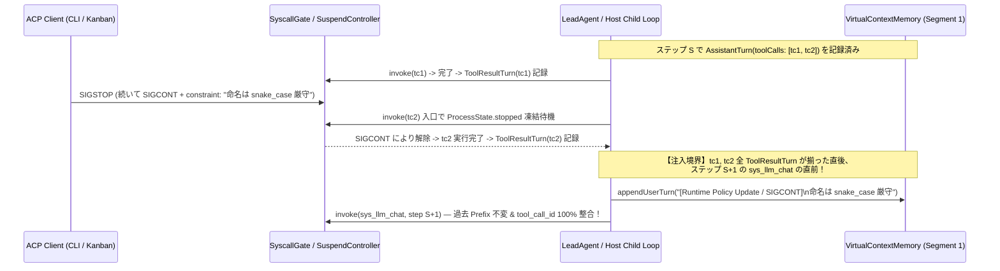

# 42_spec_signals_and_supervisor.md — シグナル制御（`SIGSTOP` / `SIGCONT` / `SIGKILL`）と Supervisor 自動回復ポリシー詳細仕様

関連文書:
- 全体横断契約・勝敗規則・副作用/失効境界の正本: [40_specification.md](./40_specification.md)（`[D-301]`〜`[D-305]`）
- ワークスペース払い出し・破棄契約: [42_spec_workspace_merge_and_stacked.md](./42_spec_workspace_merge_and_stacked.md)（`[D-307]`）
- ACP / CLI / カンバン GUI からのシグナル公開: [42_spec_acp_team_and_kanban_gui.md](./42_spec_acp_team_and_kanban_gui.md)（`[D-320]`, `[D-321]`, `[D-323]`）
- 要求・受け入れ条件: [30_requirement.md](./30_requirement.md)（`REQ-05`, `REQ-06`, `REQ-10`）
- 技術実測・精査リファレンス: [mcp_and_supervisor_signals.md](../cheatsheet/mcp_and_supervisor_signals.md)（§2.1〜§2.2）、[90_status.md](./90_status.md)（`OM-304`, `OM-305`, `MF-PT03-02`, `MF-PT03-04`）

---

## 1. シグナル制御モデルと協調サスペンドゲート（Step 3-3）

D-312: シグナル制御モデル（ProcessSignalKind: SIGSTOP, SIGCONT, SIGKILL）・sys_kill システムコール・協調サスペンドゲート契約

対応要求: `REQ-05`（横断勝敗規則: `[D-303]` §3.1(4)、判断記録: `OM-304`）

### 1.1 `ProcessSignalKind` と `ProcessSuspendController`（`packages/agent_kernel/lib/src/supervision.dart`）
生の `Isolate.pause()` はホスト側 `AsyncMutex` や IPC 応答待機を中途半端に握ったまま凍結するデッドロック危険があるため採用しない（`OM-304`）。代わりに `ProcessControlBlock` ごとに純粋 Dart の **`ProcessSuspendController`** を持たせ、親 `LeadAgent`（ホスト GreenTask）と全子 `Isolate` を単一メカニズムで安全に制御する：

```dart
enum ProcessSignalKind {
  sigstop('SIGSTOP'),
  sigcont('SIGCONT'),
  sigkill('SIGKILL');

  const ProcessSignalKind(this.wireValue);
  final String wireValue;

  static ProcessSignalKind? tryParse(String raw);
}

class ProcessSuspendController {
  bool _isSuspended = false;
  Completer<void>? _resumeCompleter;
  final List<String> _pendingConstraints = <String>[];

  bool get isSuspended => _isSuspended;
  bool get hasPendingConstraints => _pendingConstraints.isNotEmpty;

  /// Transitions into suspended state (idempotent if already suspended).
  void requestStop({String? reason});

  /// Queues an optional human/parent policy constraint and unblocks any suspended waiter.
  void requestContinue({String? constraintMessage});

  /// Immediately aborts any suspended wait on SIGKILL / cancellation without losing invariants.
  void releaseForTermination();

  /// Drains queued constraint messages in FIFO order, joining multiple messages with '\n'.
  String? drainPendingConstraintText();

  /// Awaits resume or [cancelToken] cancellation when [_isSuspended] is true.
  Future<void> waitIfSuspended({
    required ProcessControlBlock pcb,
    CancellationToken? cancelToken,
  });
}
```
- `ControlSignalKind`（`packages/agent_kernel/lib/src/mailbox.dart`）にも `sigstop('sigstop')`, `sigcont('sigcont')`, `sigkill('sigkill')` を追加し、予約済み制御レーンへ監査・通知記録を残せるようにする。

### 1.2 協調サスペンドゲートの配置箇所と状態遷移
1. **`SyscallGate.invoke` Stage 0.5 入口ゲート**:
   - `pcb != null && request.name != 'sys_exit'` の場合、Stage 1 検証に入る前に `await pcb.suspendController.waitIfSuspended(pcb: pcb, cancelToken: context.cancelToken)` を実行する。
   - 待機に入った時点で `pcb.state = ProcessState.stopped` へ遷移し、再開時に `ProcessState.running` へ戻る。待機中に `cancelToken` または `SIGKILL` が発火した場合はドライバを実行せず即座に `SyscallError(code: ecancelled, reason: 'CANCELLED')` を返して終了する。
2. **ReAct ステップ境界ゲート（`LeadAgent` ＆ `IsolateWorkerHost` ホスト側入口）**:
   - 各 ReAct ステップ先頭（次の `sys_llm_chat` を呼ぶ直前）でサスペンド待機と保留中追加制約のコミット（`[D-313]`）を行う。
   - **子ワーカーのホスト側境界フック（`sub_agent_worker.dart` 無変更維持）**: Ring 3 子ワーカーについては `packages/agent_runtime/lib/src/sub_agent_worker.dart` を編集せず、ホスト側 `IsolateWorkerHost._executeChildSyscall` の `name == 'sys_llm_chat'` 入口（前ステップの全 `CanonicalToolResultTurn` 記録完了後・`syscallGate.invoke` 呼び出し直前）でサスペンド待機と保留制約の注入を実行する。これにより子 Isolate コードを一切変更せず親子同一のステップ境界保証を得る。
   - これにより、実行中の 1 推論チャンクまたは 1 外部コマンドが完了した直後の安全な境界で確実に `ProcessState.stopped` に入り、凍結中は新規システムコールも新規 LLM 推論も **0 件** となる（即座に強制中断したい場合は `SIGKILL` / `cancel` が使われる）。
3. **`stopped` 中の子ワーカー壁時計タイマー一時停止**:
   - `[D-303]` §3.1(4) に従い、子ワーカーへ `SIGSTOP` が送られた際は `_ManagedChild` の残り許容壁時計時間 `remainingWallTimeMs = max(1, remainingWallTimeMs - activeStopwatch.elapsedMilliseconds)` を保存して `wallTimer?.cancel()` し、`SIGCONT` 時に残り時間で `wallTimer` を再設定する。

### 1.3 `sys_kill` システムコールと ACP シグナル経路
1. **カーネルシステムコール `sys_kill`（親エージェント → 自己の子プロセス）**:
   - **権限**: `CapRight.procSpawn`（Ring 2 `LeadAgent` 専用 `ALLOW`、Ring 3 子からは非公開 / `EPERM`）。
   - **入力引数**:
     - `pid` (`int?`): 対象の子プロセス PID（`pid == 1` 自己指定は `EINVAL: CANNOT_SIGNAL_SELF`、他プロセスや未知 PID は `EPERM` / `ENOENT`）。
     - `logicalTaskId` (`String?`): Supervisor 再試行で PID が交代しても同一論理子タスクを指定できる識別子（`pid` と排他または併用可）。
     - `signal` (`String`, 必須): `"SIGSTOP" | "SIGCONT" | "SIGKILL"`（大文字小文字非依存で正規化）。
     - `constraintMessage` (`String?`, 任意): `SIGCONT` 時に子プロセスへ注入する追加方針・制約テキスト（`SIGSTOP` 時にも事前添付可）。
   - **応答**: `{ "targetPid": <int>, "logicalTaskId": <String?>, "signal": "SIGSTOP"|"SIGCONT"|"SIGKILL", "state": "<resulting ProcessState>" }`。
2. **ACP 上位クライアント → セッション／任意プロセス（`_fm_agent_os/signal`）**:
   - 人間が CLI（`/pause`, `/resume <msg>`, `/kill [pid]`）またはカンバン GUI から送る `_fm_agent_os/signal`（詳細は `[D-320]`）は、**`pid == 1`（親 `LeadAgent` 自身＋オプションで配下アクティブ子全員への一括伝播 `cascadeChildren: true`［既定 `true`］）または特定の子 `pid` / `taskId`** を対象にできる。

---

## 2. `SIGCONT` 方針変更注入と `tool_call_id` ペアリング・Prefix 保護（Step 3-3）

D-313: SIGCONT 方針変更（追加制約）注入と tool_call_id 1:1 ペアリング・Segment 1 Prefix 保護境界

対応要求: `REQ-05`（横断勝敗規則: `[D-303]` §3.1(4)、判断記録: `OM-304`）

### 2.1 `400 Bad Request` と Prefix 崩壊を防ぐ注入位置不変条件
OpenAI / OpenRouter / Ollama の全プロバイダにおいて、`ProjectedRole.assistant(toolCalls: [id1, id2])` の直後には対応するすべての `ProjectedRole.tool(toolCallId: id1)`, `tool(toolCallId: id2)` が連続して並ばなければならず、その途中に `ProjectedRole.user` を挿入すると `400 Bad Request` となる（[mcp_and_supervisor_signals.md](../cheatsheet/mcp_and_supervisor_signals.md) §2.1）。

この不変条件と過去ターンの Prefix KV キャッシュを 100% 守るため、保留中の制約テキスト（`suspendController.drainPendingConstraintText()`）の注入タイミングを以下の **2 ケースのみ** に厳密限定する：



1. **ケース A（初回 `sys_llm_chat` の結果がまだ Segment 1 にコミットされる前：`!userTurnCommitted`）**:
   - `ephemeralSegment.currentUserInput` の末尾に `\n\n[Runtime Policy Update / SIGCONT]\n<constraint>` を連結する。
   - **初回ユーザーターン確定時の消失防止契約**: 初回 `sys_llm_chat` 成功直後に Segment 1 へ最初の `CanonicalUserTurn` をコミットする際、`LeadAgent.runTurn`（`process_runner.dart`）では元の引数 `userInput` ではなく `pcb.memory.ephemeralSegment.currentUserInput ?? userInput` を、`IsolateWorkerHost._executeChildSyscall`（`isolate_worker_host.dart`）では `child.pcb.memory.ephemeralSegment.currentUserInput ?? child.taskPrompt` を `appendUserTurn(...)` に渡してから `currentUserInput = null` へクリアする。これにより Step 1 推論前に注入された制約が Step 2 以降の Segment 1 履歴からも消失しないことを保証する。
2. **ケース B（1 ステップ以上進行済み：`userTurnCommitted == true`）**:
   - 進行中ステップで発行された `canonicalCalls` のループ（`for (var i = 0; i < canonicalCalls.length; i++)`）の**途中では絶対に `appendUserTurn` を呼ばない**。
   - 当該ステップの全 `CanonicalToolResultTurn` が `memory.appendToolResultTurn(...)` で記録し終わった直後（＝次ステップ先頭、`LeadAgent.runTurn` またはホスト側 `IsolateWorkerHost._executeChildSyscall` の `name == 'sys_llm_chat'` 入口で `syscallGate.invoke` を呼ぶ直前）において、`final injected = pcb.suspendController.drainPendingConstraintText();` を取り出し、非空であれば `pcb.memory.appendUserTurn('[Runtime Policy Update / SIGCONT]\n$injected')` として **Segment 1 末尾にのみ append** する。
   - 既存の過去ターン（`turns[0..N-1]`）は 1 バイトも書き換えないため、それまでの全 Prefix KV キャッシュがそのままヒットし、かつ `CanonicalIrProjector.project(...)` が生成する `assistant.toolCalls` と `tool.toolCallId` の 1:1 隣接関係も 100% 維持される。
3. **監査と ACP 通知**:
   - シグナル受信・状態遷移・制約注入時には ACP `session/update`（`_meta["fm_agent_os/signal"]` 付きステータスメッセージ、詳細は `[D-320]`）を通知し、`SecretRedactor` を通して秘密混入を防止する。

---

## 3. `SIGKILL` プロセスツリー・Win32 Job・一時ワークスペース一括回収（Step 3-3）

D-314: SIGKILL によるプロセスツリー・Win32 Job Object・未統合 jj workspace 一括強制回収とクオータ精算

対応要求: `REQ-05`（横断契約: `[D-303]` §3.1(4), `[D-304]` §3.2(2)）

### 3.1 `SIGKILL` 実行時の原子的回収シーケンス
`IsolateWorkerHost.killProcessTree(Pid targetPid, {String reason = 'KILLED_BY_SIGNAL'})`（および親 `pid == 1` 指定時の `processRunner.killActiveTurnAndTree`）は、以下の順序で漏れなく全資源を回収する：

1. **Supervisor 再試行フラグの即時無効化**:
   - 対象 `_ManagedChild`（親 `pid == 1` 指定時は配下の全アクティブ `_ManagedChild`）に `killedBySignal = true` を立て、Supervisor の自動リトライ判定を完全に抑止する（`[D-303]` §3.1(4) 規則 1）。
2. **サスペンド待機の強制解除と `CancellationToken` 発火**:
   - `pcb.suspendController.releaseForTermination()` を呼んで `stopped` 待機中の `Completer` を即時解放する。
   - `child.cancelSource.cancel(reason)` および `child.handle?.sendCancel(reason)` を発火する。これにより、そのプロセスが `Win32JobExecDriver.execute` で外部コマンド（`dart test` や孫プロセス群）を実行中であれば、`cancelToken.onCancel` リスナーが即座に **`Win32Kernel32.terminateJobObject(hJob, 137)`** を呼び出し、OS レベルで子孫プロセスツリーを一括強制終了させる。
3. **Dart `Isolate` の即時強制終了**:
   - `wallTimer?.cancel()` の後、`await child.handle?.killImmediate()`（内部 `isolate.kill(priority: Isolate.immediate)` ＋ `onExit` 確認）を実行する。
4. **未統合の一時 `jj workspace` と途中チェンジのクリーンアップ**:
   - 対象 PCB が専用ワークスペース（`pcb.hasIsolatedJjWorkspace`）を持ち未クリーンアップの場合、`JjDriver` 単一ミューテックス内で `jj workspace forget ws-<pid>` ＋ `jj abandon <workingChangeId>` を実行し、ミューテックス外で `.agent_os/ws/<pid>` ディレクトリを削除する（`[D-307]` §2.2）。
5. **階層クオータの一意精算**:
   - `QuotaLedger.settleChildExit(parent: parent, child: child.pcb)`（冪等 1 回保証）により、殺された時点までに実消費したトークン・コストのみを親へ計上し、未使用予約枠を親へ返還して `activeChildProcesses` を減算する。
   - `pcb.state = ProcessState.terminated` とし、`ChildExitStatus(ok: false, exitCode: 137, reason: 'KILLED_BY_SIGNAL', errorCode: 'ECANCELLED', workspaceCleanedUp: true, ...)` で `sys_wait` 待機者を解除する。

---

## 4. Supervisor 自動回復ポリシー・クオータ保存則・追跡契約（Step 3-3）

D-315: SupervisionPolicy・リトライ対象エラー分離・クオータ保存則・旧ワークスペース破棄＆クリーン再試行／fallbackModel 切替・logicalTaskId/attempts[] 1:1 追跡契約

対応要求: `REQ-06`（横断契約: `[D-303]`, `[D-304]`, `[D-305]`、判断・検証契約: `OM-305`, `MF-PT03-02`, `MF-PT03-04`）

### 4.1 `SupervisionPolicy` と `SupervisorAttemptRecord`（`packages/agent_kernel/lib/src/supervision.dart`）

```dart
enum RestartStrategy {
  never('never'),
  onFailure('on_failure');

  const RestartStrategy(this.wireValue);
  final String wireValue;
}

class SupervisionPolicy {
  const SupervisionPolicy({
    this.restart = RestartStrategy.never,
    this.maxRetries = 0,
    this.fallbackModel,
  }) : assert(maxRetries >= 0 && maxRetries <= maxAllowedRetries);

  static const int maxAllowedRetries = 3;
  static const int minRetryTokenReserve = 512;
  static const SupervisionPolicy none = SupervisionPolicy();

  final RestartStrategy restart;

  /// Maximum retry attempts AFTER the initial attempt (`0` = 1 attempt total; `2` = up to 3 attempts total).
  final int maxRetries;

  /// Optional canonical `<providerId>/<modelName>` switched in on `attemptIndex >= 2`.
  final String? fallbackModel;

  Map<String, dynamic> toJson();
}

class SupervisorAttemptRecord {
  const SupervisorAttemptRecord({
    required this.attemptIndex,
    required this.pid,
    required this.model,
    this.workspaceName,
    this.baseChangeId,
    this.workingChangeId,
    this.finalCommitId,
    required this.ok,
    required this.exitCode,
    required this.reason,
    this.errorCode,
    required this.attemptConsumedTokens,
    required this.cumulativeConsumedTokens,
    required this.attemptConsumedCostMicroUsd,
    required this.cumulativeConsumedCostMicroUsd,
    required this.durationMs,
    required this.workspaceCleanedUp,
  });

  final int attemptIndex; // 1-based (1 = initial attempt, 2 = retry #1, ...)
  final Pid pid;
  final String model;
  final String? workspaceName;
  final String? baseChangeId;
  final String? workingChangeId;
  final String? finalCommitId;
  final bool ok;
  final int exitCode;
  final String reason;
  final String? errorCode;
  final int attemptConsumedTokens;
  final int cumulativeConsumedTokens;
  final int attemptConsumedCostMicroUsd;
  final int cumulativeConsumedCostMicroUsd;
  final int durationMs;
  final bool workspaceCleanedUp;

  Map<String, dynamic> toJson();
}
```
- `SpawnSpec` および `sys_spawn` スキーマに任意オブジェクト `supervision: { "restart": "never" | "on_failure", "maxRetries": 0..3, "fallbackModel": "<provider>/<model>" }` を追加する。
- `fallbackModel` が指定されている場合は `sys_spawn` の Stage 1 `validateArgs` 時点で `ModelIdentifier.parse(fallbackModel)` により構文・プロバイダ検証を行い、不正な場合は起動前に `EINVAL` で拒否する。省略時（`supervision == null`）は既存動作と同一の `SupervisionPolicy.none`（`restart: never, maxRetries: 0`）となる（Stage 2 既存テスト完全互換）。

### 4.2 リトライ対象エラーと非リトライ即時停止エラーの厳密分離（`MF-PT03-04`）
試行 `attemptIndex` が失敗終了した際、Supervisor（`IsolateWorkerHost` 内の論理タスク監督ループ）は以下の判定表に従って再試行可否を決定する：

| 終了理由 (`reason`) / エラー種別 | Supervisor 判定 | 理由 |
| :--- | :---: | :--- |
| `EXITED_NORMALLY` (`ok == true`, `exitCode == 0`) | **完了（再試行不要）** | 正常完遂。 |
| `KILLED_BY_SIGNAL` / `CANCELLED` / `PARENT_TURN_ENDED` / `HOST_DISPOSED` | **非リトライ即時停止** | 明示的キャンセル・強制終了に逆らって再起動してはならない（`[D-303]`）。 |
| **`TOKEN_QUOTA_EXCEEDED`** / **`COST_QUOTA_EXCEEDED`** | **非リトライ即時停止** | トークン・金額予算の枯渇であり、再試行しても予算保存則に反するため即時停止する。 |
| 次回試行の残余トークン予算 `< SupervisionPolicy.minRetryTokenReserve` (`512`)（トークン上限設定時） | **非リトライ即時停止** | 1 ステップの推論すら完遂できない残枠での無意味な起動を防ぐ（`reason: 'RETRY_BUDGET_EXHAUSTED'` を付記）。 |
| **`WALL_TIME_QUOTA_EXCEEDED`**（試行ごとの `maxWallTimeMs` タイムアウト／ハング検知） | **リトライ対象** | ハング・応答停滞したワーカーを強制終了してクリーン再試行／別モデル切替で回復させる中核事象（事象 3-3-1）であるため。 |
| **`WORKER_CRASHED`**（未捕捉例外・Isolate 異常終了） | **リトライ対象** | 一時的なランタイム異常からの自己修復対象。 |
| **`TOOL_FORMAT_COLLAPSE` / `MALFORMED_TOOL_CALL`**（LLM 出力／ツールコール JSON 崩壊） | **リトライ対象** | 小型ローカルモデル等で起きる出力崩壊に対し、クリーン状態または `fallbackModel` で回復可能なため。 |
| **`EPROVIDER` / モデル呼び出し失敗**（不在モデル `404`、上流 `5xx`、ストリーム切断、タイムアウト） | **リトライ対象** | 初回モデル障害から `fallbackModel` へ自動切替する代表ケースであるため。 |
| `MAX_STEPS_EXCEEDED` / `EXITED_WITH_ERROR` (`sys_exit(exitCode != 0)`) | **リトライ対象** | 袋小路に陥った試行を破棄してクリーン再試行可能とするため。 |

### 4.3 クオータ保存則とクリーン再試行シーケンス（`MF-PT03-02`）
論理タスク `_LogicalSupervisedTask`（一意な `logicalTaskId = 'task_${++_taskSeq}'` を保持）におけるクオータ会計と状態リセットは以下の通り動作し、**1 トークン・1 マイクロ USD の消費隠蔽も二重計上も発生させない**：

1. **初回起動時の論理タスク予算基準確定と親からの予約**:
   - `sys_spawn` 初回の `initialDonation = quotaLedger.donateToChild(...)` 成功時、論理タスク全体の初期上限基準として **`final int? initialTaskMaxTokens = initialDonation.childQuota.maxTotalTokens;`** および **`final int? initialTaskMaxCostMicroUsd = initialDonation.childQuota.maxCostMicroUsd;`** を保存する。
   - ※ 現行 `QuotaLedger.donateToChild` では、親の `maxTotalTokens == null`（`ResourceQuota.stage2Default` の既定無制限状態）のとき `donation.donatedTokens` / `donatedCostMicroUsd` は `0` となり、子に指定した明示上限は `donation.childQuota.maxTotalTokens` / `maxCostMicroUsd` に設定される。したがって `donatedTokens` ではなく `initialDonation.childQuota` 側を基準とすることで、親上限あり・親無制限（`null`）の双方で論理タスクの予算保存則が 100% 成立する。
2. **失敗試行の精算と汚染ワークスペース完全破棄**:
   - 試行 `k`（`pid = pid_k`, `workingChangeId = chg_k`）が失敗した際：
     1. 試行 `k` の Isolate を完全停止させる。
     2. 試行 `k` が専用ワークスペースを持っていた場合、`jj workspace forget ws-<pid_k>` ＋ `jj abandon <chg_k>` ＋ `.agent_os/ws/<pid_k>` 削除を完了させ、汚染ファイル・未完コミットを 100% 消去する。
     3. `QuotaLedger.settleChildExit(parent: parent, child: pcb_k)` を実行する。これにより、**試行 `k` が実際に消費した `attemptTokens_k` と `attemptCost_k` が即座に親の `totalTokensUsed` / `costMicroUsdUsed` へ確定加算**され、親有限枠からの未使用予約分も一旦親の手元に戻る！
     4. `cumulativeConsumedTokens += attemptTokens_k`、`cumulativeConsumedCost += attemptCost_k` を記録し、`attempts` リストへ `SupervisorAttemptRecord(attemptIndex: k, pid: pid_k, workingChangeId: chg_k, ...)` を追加する。
3. **残枠内での次回試行の再予約と新規クリーン払い出し**:
   - `attemptIndex < 1 + policy.maxRetries` かつリトライ対象エラーである場合：
     1. 論理タスク初期上限に対する残枠を **`final int? remainingTokens = initialTaskMaxTokens != null ? (initialTaskMaxTokens - cumulativeConsumedTokens) : null;`**、**`final int? remainingCost = initialTaskMaxCostMicroUsd != null ? (initialTaskMaxCostMicroUsd - cumulativeConsumedCost) : null;`** として算出する。
     2. 以下のいずれかに該当する場合は非リトライ即時停止とし、失敗ステータスで完了する：
        - `remainingTokens != null && remainingTokens < SupervisionPolicy.minRetryTokenReserve`（`reason: 'RETRY_BUDGET_EXHAUSTED'`）
        - `remainingCost != null && (remainingCost < 0 || (initialTaskMaxCostMicroUsd! > 0 && remainingCost == 0))`（`reason: 'COST_QUOTA_EXCEEDED'`）
        - 親プロセス自身の残余利用可能枠（`parent.quotaUsage.availableTokens(parent.quota)` / `availableCostMicroUsd(parent.quota)`）が `minRetryTokenReserve` 未満または枯渇している場合
     3. **新しい単調増加 PID `nextPid = processTable.allocateNextPid()`** を採番し、`quotaLedger.donateToChild(parent: parent, childPid: nextPid, requestedTokens: remainingTokens, requestedCostMicroUsd: remainingCost, maxWallTimeMs: spec.maxWallTimeMs, ...)` で残枠のみを上限設定・再予約する（したがって親 `maxTotalTokens` の有無を問わず、全試行の合計消費は絶対に `initialTaskMaxTokens` / `initialTaskMaxCostMicroUsd` を超えない！）。
     4. モデルを `policy.fallbackModel ?? initialModel` に決定し、元のクリーンな `<baseChangeId>` から新しいワークスペース `.agent_os/ws/<nextPid>`（新しい `nextChangeId`）と空の初期 `VirtualContextMemory` を払い出して起動する。
     5. 監査ログ（または制御イベント）として再試行遷移 `{ logicalTaskId, attemptIndex: k + 1, failedPid: pid_k, failedChangeId: chg_k, nextPid, nextChangeId, nextModel, attemptConsumedTokens: attemptTokens_k, cumulativeConsumedTokens }` を記録する。
4. **`sys_wait` への透過的結合**:
   - 親エージェントが `sys_spawn` で受け取った初回 `childPid`（または `logicalTaskId`）を `sys_wait(pids: [initialChildPid])` に渡すと、`_LogicalSupervisedTask` が完了（リトライ成功または上限到達失敗）するまで透過的に待機できる。
   - 完了時の `ChildExitStatus` には最終試行の `pid`・`workingChangeId`・`finalCommitId` とともに、**全試行の合計 `consumedTokens`（`= cumulativeConsumedTokens`）** および全履歴 **`attempts[]`** が格納される。

### 4.4 本番バックドアゼロの 2 層試験設計（`TA-01` 解決）
- **禁止事項**: `agent_os_daemon.exe` 等に `--inject-worker-crash` のようなテスト用 CLI バックドアフラグは一切追加しない。
- **`E1`（Dart DI 異常注入テスト）**:
  - `packages/agent_runtime/test/signals_and_supervisor_test.dart` において、カスタム `ChildWorkerBackend` / モック `LlmDriver` を DI 注入し、①未捕捉例外（`WORKER_CRASHED`）、②不正 JSON ツールコール崩壊（`MALFORMED_TOOL_CALL`）、③`maxWallTimeMs` 超過（`WALL_TIME_QUOTA_EXCEEDED`）、④初回モデルエラーからの `fallbackModel` 自動切替、⑤上限超過時の構造化エラー報告、⑥`TOKEN_QUOTA_EXCEEDED` / `COST_QUOTA_EXCEEDED` 時の**リトライ 0 回即時停止**、⑦失敗試行トークンの確定計上と `attempts[]` 1:1 追跡、⑧旧ワークスペース `.agent_os/ws/<oldPid>` 消滅＆未完チェンジ `abandon` を全網羅検証する。
- **`E2`（本番 `.exe` 実機観測）**:
  - 本番公開パラメータのみを用い、①初回 `model: "local-ollama/nonexistent-stage3-test:0b"` ＋ `supervision: { "restart": "on_failure", "maxRetries": 1, "fallbackModel": "local-ollama/gemma4:12b" }`（およびクラウド異モデル連携）による自動モデル切替完走、②意図的に極短 `maxWallTimeMs` を指定したワーカーのタイムアウト破棄・再試行／構造化報告と並行稼働中の健全ワーカーの無停止完走を実機観測する。
