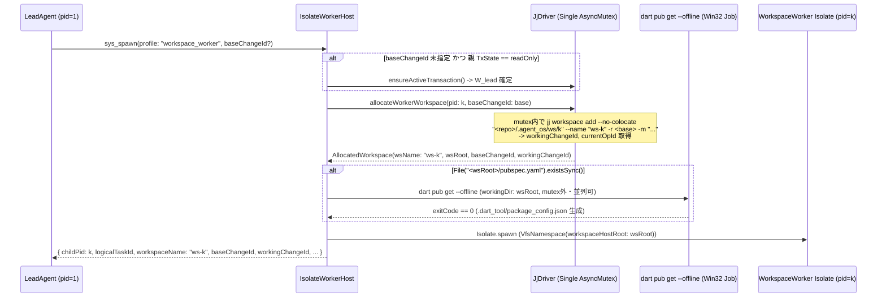
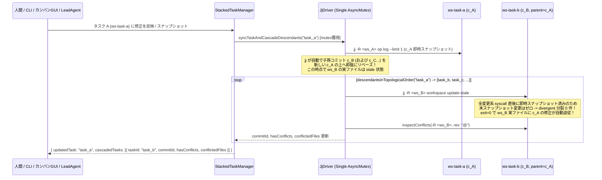

# 42_spec_workspace_merge_and_stacked.md — 並列 `jj workspace`・Op 直列化・多親マージ・First-Class Conflicts・Stacked Changes 詳細仕様

関連文書:
- 全体横断契約・優先順位・副作用/失効境界の正本: [40_specification.md](./40_specification.md)（`[D-301]`〜`[D-305]`）
- 要求・受け入れ条件: [30_requirement.md](./30_requirement.md)（`REQ-01`, `REQ-02`, `REQ-03`, `REQ-04`, `REQ-09`, `REQ-10`）
- 技術実測リファレンス: [jj_workspace_merge_and_stacked.md](../cheatsheet/jj_workspace_merge_and_stacked.md)（§2〜§5）
- おまかせ判断記録: [90_status.md](./90_status.md)（`OM-301`, `OM-302`, `OM-303`）

---

## 1. `WorkspaceWorker` ＆ `ConflictResolver` プロファイルと CSpace 限定開放（Step 3-1 / 3-2）

D-306: WorkspaceWorker ＆ ConflictResolver（Ring 3）プロファイル定義・CSpace 限定開放・TTY 独占維持

対応要求: `REQ-01`, `REQ-04`, `REQ-10`（横断契約: `[D-302]`, `[D-304]`、後方互換: `[D-211]`, `[D-213]`）

### 1.1 `ProcessProfileId` と `ProcessControlBlock` の拡張
1. **`packages/agent_kernel/lib/src/process_profile.dart` の `ProcessProfileId` 拡張**:
   - 既存の `explorer('explorer')`, `webResearcher('web_researcher')` に加え、以下の 2 列挙値を追加する：
     - **`workspaceWorker('workspace_worker')`**: 独立 `.agent_os/ws/<pid>` ワークスペースで実装編集と定型検証テスト（`dart test` / `dart analyze` / `dart format --output=none`）を並列遂行する Ring 3 サブエージェント。
     - **`conflictResolver('conflict_resolver')`**: First-Class Conflict を含むマージチェンジ（または競合発生チェンジ）をベースに独立 `.agent_os/ws/<pid>` を払い出し、競合マーカー箇所の解消編集と検証テストに特化して実行する Ring 3 サブエージェント（合意 `B-03` 対応）。
   - 各プロファイルの属性メソッドを以下の通り定義する：
     - `defaultRights`: `workspaceWorker` / `conflictResolver` ともに `{ CapRight.read, CapRight.writeCow, CapRight.exec, CapRight.vcsRead, CapRight.llmInfer, CapRight.memManage, CapRight.ipc, CapRight.procSelf }`。
     - `mountsWorkspace`: `explorer`, `workspaceWorker`, `conflictResolver` で `true`（`webResearcher` のみ `false`）。
     - `mountsSkills`: `explorer`, `workspaceWorker`, `conflictResolver` で `true`（`webResearcher` のみ `false`）。
     - `requiresIsolatedJjWorkspace`: `workspaceWorker`, `conflictResolver` で **`true`**（`explorer`, `webResearcher` は `false`）。
     - `allowsIsolatedWorkspaceMutation`: `workspaceWorker`, `conflictResolver` で **`true`**（`explorer`, `webResearcher` は `false`）。
     - `forcesVcsIgnoreWorkingCopy`: `explorer`, `workspaceWorker`, `conflictResolver` すべてで `true`（子ワークスペースは書き込み直後にホスト側で明示 `-R` スナップショットを取るため、読取系 `sys_jj_*` は常に `--ignore-working-copy` で非破壊実行する）。
   - **先行 Ring 0 追加時の網羅 `switch` コンパイル互換契約**: `ProcessProfileId` に `workspaceWorker` / `conflictResolver` を先行追加する時点（`WP-1`）では、`packages/agent_runtime/lib/src/isolate_worker_host.dart` 内の網羅 `switch (profile)`（`_buildChildInstruction`）に最小スタブ分岐を同時配置して全 4 パッケージの `dart analyze` 0 件と既存 32 テスト無修正通過を保証し、`WorkspaceWorker` / `ConflictResolver` の本格システムプロンプト文面は Step 3-1 / Step 3-2（`WP-2` / `WP-3`）で完成させる。
2. **`packages/agent_kernel/lib/src/pcb.dart` の `ProcessControlBlock` 拡張**:
   - 任意フィールド `final String? jjWorkspaceName;`（例: `'ws-2'`）、`final String? jjWorkspaceRoot;`（例: `'<repo>/.agent_os/ws/2'` 正規化絶対パス）、`final String? logicalTaskId;`（例: `'task_0001'`）を追加する（省略時 `null` により既存コンストラクタ呼び出しは 100% 互換）。
   - ゲッター `bool get hasIsolatedJjWorkspace => jjWorkspaceRoot != null && jjWorkspaceName != null;` を提供する。

### 1.2 Stage 2 既存テストを壊さない `CapabilityTable` 減衰規則
1. **`CapabilityTable.stage3ForbiddenChildRights`**:
   - Stage 3 においても全 Ring 3 子プロセスで無条件禁止とする特権を `static const Set<CapRight> stage3ForbiddenChildRights = { CapRight.vcsTx, CapRight.procSpawn, CapRight.mcpCall, CapRight.admin };` として定義する。
2. **プロファイル別ロック分岐（既存 175 テスト完全互換）**:
   - `CapabilityTable.deriveForChild` のデフォルト引数 `enforceStage2ReadOnlyChildLock = true` は変更しない。
   - `CapabilityTable.deriveForProfile(profile, ...)` において：
     - `profile.allowsIsolatedWorkspaceMutation == false`（`explorer` / `webResearcher`）の場合：従来通り `stage2ForbiddenChildRights`（`writeCow`, `exec` を含む）を検査し、違反時は **`EPERM: STAGE2_READONLY_CHILD_LOCK`** を返す（既存 `pcb_capability_quota_test.dart` / `capability_tty_and_quota_test.dart` 完全維持）。
     - `profile.allowsIsolatedWorkspaceMutation == true`（`workspaceWorker` / `conflictResolver`）の場合：`stage3ForbiddenChildRights` を検査（違反時は `EPERM: STAGE3_FORBIDDEN_CHILD_RIGHT`）した上で、`profile.defaultRights` 範囲内検証と親 CSpace 単調減少検証を行い、`deriveForChild(..., enforceStage2ReadOnlyChildLock: false)` で派生させる。
3. **TTY 独占原則と CSpace 連動 Tool Schema フィルタ**:
   - `packages/agent_runtime/lib/src/process_syscalls.dart` の `filterToolSchemasForPcb` を拡張し、`pcb.ring == ProtectionRing.ring3` の場合は `sys_spawn`, `sys_wait`, `sys_kill`, `sys_tx_*`, `sys_jj_merge`, `sys_jj_integrate`, `sys_task_stack`, `sys_mcp_list_tools`, `sys_mcp_call` をすべて Tool Schema から除外する。
   - `WorkspaceWorker` / `ConflictResolver` が `sys_exec` で許可リスト外コマンド（例: `dart pub get`, `powershell`, `git`, `jj` 等）を呼んだ場合、`SysExecClassifier` が `RingDecision.askUser` を返し、`SyscallGate` Stage 4 の TTY 独占ガードが **`ApprovalHandler` を 1 回も呼ばずに即座に `EPERM: TTY_MONOPOLY_DENIED`** で拒否する（`[D-304]`）。

---

## 2. 専用 `jj workspace` 自動払い出し・オフライン依存解決・自動回収（Step 3-1）

D-307: 専用 jj workspace（.agent_os/ws/<pid>, --no-colocate）自動払い出し・Pub Workspaces オフライン解決・自動クリーンアップ契約

対応要求: `REQ-01`（横断契約: `[D-304]`, `[D-305]`、判断・検証契約: `OM-301`, `MF-PT03-01`）

### 2.1 `sys_spawn` 時のワークスペース払い出しシーケンス
`IsolateWorkerHost.spawnChild` において、`spec.profile.requiresIsolatedJjWorkspace == true` の場合はワーカー Isolate を起動する**前**に以下の手順を実行する：



1. **ベースチェンジ `baseChangeId` の決定**:
   - `SpawnSpec.baseChangeId` が明示指定されていればそのリビジョン存在を `jj log -r <base> --ignore-working-copy` で検証する（不在時は `ENOENT: JJ_TARGET_NOT_FOUND`）。
   - 省略時は、親 `LeadAgent` が `TxState.readOnly` であれば先に `jjDriver.ensureActiveTransaction()` を実行して人間の直前チェンジ `@-` から親作業チェンジ `W_lead` を分離し、`W_lead`（`parent.jjContext.workingChangeId`）を `baseChangeId` とする。これにより子ワーカーの親コミットも必ずセッション保護境界内に収まる。
2. **`jj workspace add --no-colocate` による払い出し（ミューテックス内）**:
   - `wsName = 'ws-$childPid'`、`wsRoot = p.normalize(p.join(mainWorkspaceRoot, '.agent_os', 'ws', '$childPid'))`。
   - 既存残骸があれば事前削除した親ディレクトリ `.agent_os/ws` を用意し、`JjDriver` 単一ミューテックス内で `workingDirectory: mainWorkspaceRoot` 固定で以下を実行する：
     ```text
     jj --no-pager workspace add --no-colocate <wsRoot> --name ws-<childPid> -r <baseChangeId> -m "agent-os: <childName>"
     ```
   - 直後に `jj --no-pager -R <wsRoot> log --no-graph -r @ --ignore-working-copy -T commitJsonTemplate` と `op log --limit 1 --ignore-working-copy -T "self.id()"` を実行し、払い出された無名 `workingChangeId`（12 文字短縮 ID）・初期 `commitId`・`currentOpId` を子 PCB の `JjTxContext(state: TxState.active, ...)` に記録する。
3. **Dart Pub Workspaces オフライン依存解決（`OM-301`、ミューテックス外・並列可）**:
   - `File(p.join(wsRoot, 'pubspec.yaml')).existsSync()` が `true` の場合、ホスト側で `Win32JobExecDriver`（または共通 Job Object ランナー、`timeoutMs: 60000`, `runInShell: false`）を用いて `dart pub get --offline`（`workingDirectory: wsRoot`）を実行する。
   - これにより `.agent_os/ws/<pid>/.dart_tool/package_config.json` が通信ゼロ（約 `0.8s`）で生成され、ネスト配置時に親 `<repo>/.dart_tool/package_config.json` へ遡って誤解決する問題（`PT-01` 実測）を完全に防ぐ。
   - 万一 `dart pub get --offline` または `Isolate.spawn` が失敗した場合は、即座に §2.2 のクリーンアップ（`abandonChange: true`）を実行してクオータ予約も返還し、ゴミを残さず構造化エラーを返す。
4. **VFS 名前空間隔離**:
   - 子 PCB の `namespace` は `VfsNamespace(workspaceHostRoot: wsRoot, allowedWorkspaceSubpaths: spec.allowedSubpaths, skillsMount: parent.namespace.skillsMount)` とする。子からは自身の `wsRoot` が `/workspace` に見えるため、メインワークスペースや他子の `.agent_os/ws/<other>` へは一切到達できない。

### 2.2 終了・破棄時の自動クリーンアップ契約
ワーカー終了時にホストの `IsolateWorkerHost` が必ず `await jjDriver.cleanupWorkerWorkspace(...)` を完了させてから `exitCompleter` を解決する（`sys_wait` 復帰時点で 100% クリーンアップ完了保証）：
1. **正常終了時（`ok == true`）**:
   - ミューテックス内でまず最終スナップショット（`jj -R <wsRoot> log -r @ -T commitJsonTemplate`）を実行し、`finalChangeId` と `finalCommitId` を確定する。
   - 続いて `jj --no-pager workspace forget ws-<pid>` を実行してワークスペース追跡を解除する（作成したコミット `<workingChangeId>` はリポジトリ内に無傷で残存する）。
   - ミューテックス外で `Directory(wsRoot)` を再帰削除（Windows ファイルハンドル解放遅延に備え最大 3 回の短いリトライ付き）する。
2. **異常終了・タイムアウト・キャンセル・`SIGKILL` 時（`ok == false`）**:
   - ミューテックス内で `jj --no-pager workspace forget ws-<pid>` に加え、汚染された未完チェンジ `<workingChangeId>` が `baseChangeId` と異なる場合は `jj --no-pager abandon <workingChangeId>` を実行してコミットグラフからもゴミを除去する。その後 `Directory(wsRoot)` を再帰削除する。

### 2.3 `sys_spawn` / `sys_wait` の入出力スキーマ拡張（`MF-PT03-01`）
- **`sys_spawn` 成功応答ペイロード**:
  ```json
  {
    "childPid": 2,
    "logicalTaskId": "task_0001",
    "name": "workspace_worker-2",
    "profile": "workspace_worker",
    "model": "local-ollama/gemma4:12b",
    "workspaceName": "ws-2",
    "baseChangeId": "xpyopqwu1234",
    "workingChangeId": "lwtztkqtrrwz",
    "supervision": { "restart": "on_failure", "maxRetries": 1, "fallbackModel": null },
    "donatedQuota": { ... }
  }
  ```
  （※ `explorer` / `web_researcher` では `workspaceName`, `baseChangeId`, `workingChangeId` は `null`。）
- **`sys_wait` の各 `ChildExitStatus.toJson()`**:
  既存フィールド（`pid`, `name`, `profile`, `ok`, `exitCode`, `reason`, `errorCode`, `summary`, `consumedTokens`, `consumedCostMicroUsd`, `durationMs`）をすべて維持した上で、以下を追加する：
  - `logicalTaskId` (`String`)
  - `workspaceName` (`String?`)
  - `baseChangeId` (`String?`)
  - `workingChangeId` (`String?`: 最終試行の専用 `Change ID`)
  - `finalCommitId` (`String?`: 正常完了時の最終 `commit_id`、破棄時は `null`)
  - `workspaceCleanedUp` (`bool`: 専用ワークスペース不使用時は `true`、使用時は `forget`＋ディレクトリ削除完了で `true`)
  - `attempts` (`List<Map<String, dynamic>>`: Supervisor 試行履歴配列。初回 1 発成功時も要素数 1 で記録。詳細は [42_spec_signals_and_supervisor.md](./42_spec_signals_and_supervisor.md) `[D-315]`）

---

## 3. `JjDriver` 単一ミューテックス直列化とプロセス別ドライバ拡張（Step 3-1）

D-308: JjDriver 単一 AsyncMutex 直列化・編集/実行直後の -R <ws_path> 即時スナップショット鉄則・プロセス別ドライバ拡張

対応要求: `REQ-01`, `REQ-02`, `REQ-09`（横断契約: `[D-304]`, `[D-305]`、判断記録: `OM-303`）

### 3.1 操作区分別の直列化・並列化境界
ホスト Isolate 上に **1 セッション 1 インスタンスのみ** 存在する `JjDriver` の FIFO `AsyncMutex`（`_mutex`）により、リポジトリ操作を以下の通り制御する：

| 操作カテゴリ | 具体的な処理 | `JjDriver._mutex` | 並列性と `jj op log` への影響 |
| :--- | :--- | :---: | :--- |
| **通常ファイル I/O** | `HostFsDriver.readLines` / `glob` / `grep`、CAS 検査・一時ファイル書込・原子 rename | **不要（ロック外）** | 全ワークスペース間で完全並列。 |
| **外部テストプロセス実行** | `Win32JobExecDriver.execute`（`dart test` / `dart analyze` 等）および事前 `dart pub get --offline` | **不要（ロック外）** | 各 `.agent_os/ws/<pid>` で数秒〜数十秒かかるテストが互いを待たず完全並列実行。 |
| **ワークスペース個別スナップショット** | `sys_write_file` / `sys_edit_block` / `sys_exec` 直後の `syncWorkspaceSnapshotForPcb(pcb)`（内部 `jj -R <targetRoot> op log --limit 1 -T "self.id()"`） | **必須（FIFO 直列）** | ミリ秒単位で完了し、対象ワークスペースの変更のみを単一親 Operation として記録。 |
| **`jj` 更新系コマンド全般** | `workspace add/forget/update-stale`, `new`（`txBegin` / `merge`）, `describe`, `restore`, `abandon`, `squash`, `op restore` | **必須（FIFO 直列）** | Concurrent Operation Heads（`jj op log` の分岐）が物理的に **0 件** となる。 |
| **`jj` 非破壊読取コマンド** | `status`, `log`, `diff`, `conflicts`, `getAuditInfoForProcess`, `getCurrentCommitIdForPcb`（すべて `--ignore-working-copy` 付き） | `_mutex` 内（高速・非スナップショット） | `--ignore-working-copy` 強制により `op_id` を一切進めず、更新中の不整合読取も防止。 |

### 3.2 既存 4 ドライバのプロセス別ワークスペース対応拡張
Stage 2 実装でメインワークスペース固定となっていた以下の箇所を、既存コンストラクタ互換を保ったまま `ProcessControlBlock` 単位へ拡張する：

1. **`JjDriver` (`packages/agent_drivers/lib/src/jj/jj_driver.dart`)**:
   - `_runJjRaw(List<String> args, {String? repositoryPath})` に任意 `-R <repositoryPath>` 指定を追加する（`workingDirectory` は常に `workspaceHostRoot`［メインルート］に固定し、`repositoryPath != null` のときは `['--no-pager', '-R', p.normalize(p.absolute(repositoryPath)), ...args]` で実行する）。
   - `_runJjWithAutoUpdateStale(...)`: 子または Stacked ワークスペースに対して `-R <wsRoot>` コマンドを実行した際、`stderr` に `The working copy is stale` が含まれていた場合は同一ミューテックス内で即座に `jj --no-pager -R <wsRoot> workspace update-stale` を実行してから元コマンドを 1 回リトライする（`OM-303`）。
   - プロセス対応メソッドを追加する：
     - `Future<SyscallResult<JjTxContext>> ensureActiveTransactionForPcb(ProcessControlBlock pcb)`: `pcb.hasIsolatedJjWorkspace` の場合は既に専用ワークスペースの `@` 上にいるため何もしない（成功返却）。親 `pid == 1` の場合は既存の `ensureActiveTransaction()` を実行する。
     - `Future<SyscallResult<JjAuditInfo>> syncWorkingCopySnapshotForPcb(ProcessControlBlock pcb)`: `targetRoot = pcb.jjWorkspaceRoot ?? workspaceHostRoot` に対して `-R <targetRoot>` スナップショットを実行し、`pcb.jjContext` の `currentOpId` と `workingChangeId` を更新する。さらに `pcb` の `workingChangeId` が Stacked Changes の親タスクに登録されている場合は、下流ワークスペースへの `update-stale` 連鎖（`[D-311]`）を同一ミューテックス内で実行する。
     - `Future<String?> getCurrentCommitIdForPcb(ProcessControlBlock pcb)`: `targetRoot = pcb.jjWorkspaceRoot ?? workspaceHostRoot` の `@` `commit_id` を `--ignore-working-copy` で返す。
     - `Future<JjAuditInfo> getAuditInfoForProcess(ProcessControlBlock? pcb)`（`[D-305]`）。
   - `status` / `log` / `diff` ハンドラに `repositoryPath: exec.pcb.jjWorkspaceRoot` を渡し、子 `WorkspaceWorker` が `sys_jj_status` / `sys_jj_diff` を呼んだ際にメイン `@` ではなく **自分自身のワークスペース `@` の差分・状態** が返るようにする。
2. **`HostFsDriver` (`packages/agent_drivers/lib/src/fs/host_fs_driver.dart`)**:
   - 既存の無引数コールバックに加え、PCB 受け取り版オプショナルコールバックを追加する：
     - `EnsureActiveTransactionForPcbCallback = Future<SyscallResult<Object?>> Function(ProcessControlBlock pcb)`
     - `SyncWorkingCopySnapshotForPcbCallback = Future<SyscallResult<Object?>> Function(ProcessControlBlock pcb)`
     - `CurrentCommitIdForPcbProvider = Future<String?> Function(ProcessControlBlock pcb)`
   - `editBlock` / `writeFile` / `glob` / `grep` に任意 `ProcessControlBlock? callerPcb` を追加し、`buildReadSyscallDefinitions()` / `buildWriteSyscallDefinitions()` の `handler` から `callerPcb: exec.pcb` を渡す（単体テストで直接 `hostFsDriver.editBlock(...)` を `callerPcb` なしで呼んだ場合は従来通り無引数コールバックへフォールバック）。
3. **`Win32JobExecDriver` ＆ `SysExecClassifier` (`packages/agent_drivers/lib/src/exec/`)**:
   - `SysExecClassifier.classify` に `VfsNamespace? namespaceOverride` を追加し、`effectiveNs = namespaceOverride ?? namespace` でパス検証を行う。
   - `Win32JobExecDriver.execute` に `VfsNamespace? namespaceOverride` および `ProcessControlBlock? callerPcb` を追加し、`buildSyscallDefinition()` の `checkPreconditions` / `evaluatePolicy` / `handler` すべてで `exec.pcb.namespace` と `callerPcb: exec.pcb` を使用する。これにより `WorkspaceWorker` の `sys_exec("dart", ["test", ...])` は `.agent_os/ws/<pid>` をカレントディレクトリとして走り、完了直後に `.agent_os/ws/<pid>` が `-R` スナップショットされる。
4. **`WorkspacePageFreshnessChecker` ＆ `buildMemPageinSyscallDefinition` (`packages/agent_drivers/lib/src/memory/workspace_page_freshness_checker.dart`)**:
   - 既存の `PageFreshnessChecker.checkFreshness(Iterable<ContextPage> cleanPages)`（`packages/agent_kernel/lib/src/context_pager.dart`）は無変更で維持し（既存 `context_pager_test.dart` の `_FakeFreshnessChecker` 等を 100% 無修正維持）、Ring 0 にサブインターフェース `abstract interface class ProcessAwarePageFreshnessChecker implements PageFreshnessChecker { Future<Map<String, PageFreshnessStatus>> checkFreshnessForProcess(Iterable<ContextPage> cleanPages, {ProcessControlBlock? pcb}); }` を新設する（`[D-316]`）。
   - `ContextPager.refreshFreshness(VirtualContextMemory memory, {PageFreshnessChecker? freshnessChecker, ProcessControlBlock? pcb})` 側で `freshnessChecker is ProcessAwarePageFreshnessChecker` 分岐を行い、`WorkspacePageFreshnessChecker` は `ProcessAwarePageFreshnessChecker` を実装して `pcb?.namespace ?? namespace` および `getCurrentCommitIdForPcb(pcb)` で鮮度を検査する（無引数 `checkFreshness(cleanPages)` は `checkFreshnessForProcess(cleanPages)` へ委譲）。
   - `sys_mem_pagein` ハンドラ内で `hostFsDriver.readLines` / `glob` / `grep` および `jjDriver.status` / `log` / `diff` を再実行する際、必ず `namespaceOverride: execContext.pcb.namespace`・`cspace: execContext.pcb.cspace`・`repositoryPath: execContext.pcb.jjWorkspaceRoot` を渡す。また Clean Page 再展開時の応答フィールド `source` を `meta.sourceKind == CleanSourceKind.vcsSnapshot ? 'clean_vcs' : 'clean_workspace'`（元の仮想パスまたは syscall 名は `sourceTarget` にも保持）に統一する（`MF-PT03-05`）。

---

## 4. 多親マージ（`sys_jj_merge`）と単一作業チェンジ平坦化統合（Step 3-2）

D-309: 多親マージシステムコール sys_jj_merge と単一作業チェンジ平坦化統合（sys_jj_integrate / OM-302）

対応要求: `REQ-03`, `REQ-04`（横断契約: `[D-302]`, `[D-304]`、判断記録: `OM-302`）

### 4.1 `sys_jj_merge` のインターフェースと動作
- **権限**: `CapRight.vcsTx`（Ring 2 `LeadAgent` 専用、`RingDecision.allow`）。
- **入力スキーマ**:
  - `changeIds` (`List<String>`, 必須): 合流させる 2 件以上（最大 16 件）の `Change ID` またはリビジョン文字列配列。各要素は非空かつ先頭 `-` 不可（フラグインジェクション防止）。1 件以下または重複のみの場合は副作用ゼロで `EINVAL: INVALID_MERGE_PARENTS` を返す。
  - `message` (`String?`, 任意): マージチェンジの説明文（既定 `'agent-os: merge worker changes'`）。
- **ミューテックス内処理手順**:
  1. 親 `LeadAgent` が `TxState.readOnly` の場合は先に `_ensureActiveTransactionInternal` を実行し、`baseOpId`・`parentChangeId` (`userParent`)・初期単一親作業チェンジ `anchorWorkingChangeId` (`W_lead`) を `JjTxContext` に確定記録する（`JjTxContext` に `String? anchorWorkingChangeId;` と `Set<String> pendingWorkerChangeIds` を追加して平坦化統合先を追跡する）。
  2. 各 `changeId` がリポジトリ内に実在することを `jj log --no-graph -r <id> --ignore-working-copy -T "change_id.short(12)"` で事前検証し、1 件でも不在ならリポジトリ無変更のまま `ENOENT: JJ_TARGET_NOT_FOUND` を返す。
  3. `jj --no-pager new <c1> <c2> ... -m <message>` を実行する。`jj` の First-Class Conflicts により、変更が非重複でも同一行衝突でも **`exit=0` でマージコミット `<M>` が生成される**。
  4. 生成された `@` (`<M>`) に対して `[D-310]` の `conflicted_files` JSON テンプレートクエリと `op log --limit 1` を実行し、`pcb.jjContext.updateSnapshot(currentOpId: opId, workingChangeId: mergeChangeId)` および `pendingWorkerChangeIds.addAll(resolvedChangeIds)` を記録する。
- **成功応答ペイロード**:
  ```json
  {
    "mergeChangeId": "kmpqrstu1234",
    "mergeCommitId": "89abcdef01234567...",
    "parentChangeIds": ["lwtztkqtrrwz", "pzlotztkzyxu"],
    "anchorWorkingChangeId": "xpyopqwu1234",
    "hasConflicts": false,
    "conflictedFiles": [],
    "jjOpId": "445566778899..."
  }
  ```

### 4.2 単一作業チェンジへの非対話平坦化統合（`sys_jj_integrate` ＆ `sys_tx_squash` 自動連動）
`jj 0.46.0` では 2 親以上を持つマージコミット `<M>` 上で素の `jj squash -u` を呼ぶと `Cannot squash merge commits without a specified destination`（`exit=1`）で失敗する（`PT-01` 実測）。これを解決し既存の Ring 2 承認 `sys_tx_squash` とシームレスに結合するため、以下の 2 段構えを実装する（`OM-302`）：

1. **明示システムコール `sys_jj_integrate`**:
   - **権限**: `CapRight.vcsTx`（Ring 2 `LeadAgent` 専用、`RingDecision.allow`）。
   - **入力スキーマ**:
     - `sourceRev` (`String?`, 任意, 既定 `'@'`): 統合元の完了マージチェンジ（または競合解消済みワーカーチェンジ）。
     - `abandonChangeIds` (`List<String>?`, 任意): 平坦化完了後に整理破棄する一時ワーカーチェンジ ID 群（省略時は `jjContext.pendingWorkerChangeIds` を自動対象化）。
   - **実行手順（ミューテックス内）**:
     1. まずメインワーキングコピーをスナップショットし、`sourceRev` の競合状態を検査する。**`hasConflicts == true` の場合は一切ツリーを変更せず `ECONFLICT: UNRESOLVED_CONFLICTS`（`details: {'conflictedFiles': files}`）で拒否**する。
     2. 単一親の統合先 `W_lead`（`jjContext.anchorWorkingChangeId`、親が `userParent` である単一親作業チェンジ）が存在することを確認する。
     3. [jj_workspace_merge_and_stacked.md](../cheatsheet/jj_workspace_merge_and_stacked.md) §3.3 実測済みの**方式 A（ツリー転写＋一時チェンジ破棄）**を実行する：
        - `jj --no-pager restore --from <sourceChangeId> --into <W_lead>`（`W_lead` の先行編集と `<M>` のマージ・競合解消結果を 100% バイト一致で単一親 `W_lead` へ転写）
        - `jj --no-pager edit <W_lead>`（メイン `@` を単一親 `W_lead` へ戻す）
        - `<sourceChangeId>`（`W_lead` と異なる場合）および `abandonChangeIds`（`userParent` と `W_lead` 自身、および Stacked タスク登録中チェンジを除外した安全集合）を `jj --no-pager abandon <ids...>` で整理破棄する。
     4. `jjContext.workingChangeId = W_lead`、`pendingWorkerChangeIds.clear()`、`currentOpId` を更新し、`{ "integratedChangeId": W_lead, "abandonedChangeIds": [...], "jjOpId": newOpId }` を返す。
2. **`sys_tx_squash` 呼び出し時の自動平坦化フォールバックと承認プレビュー整合**:
   - 親 `LeadAgent` が `sys_jj_merge`（および競合解消・`dart test`）の後に `sys_jj_integrate` を挟まず直接 `sys_tx_squash` を呼んだ場合にも対応する：
     - **Stage 4 承認プレビュー（`buildSquashApprovalPreview`）**: 多親マージコミット上では `@-` が複数親に解決されて `jj file show -r @-` 等が `exit=1` になるため、`final baseRev = txContext.parentChangeId ?? '@-';`（`parentChangeId` は人間の直前チェンジ `userParent`）を基準リビジョンとして統一し、`--ignore-working-copy` のまま `jj diff --git --from <baseRev> --to @`、`jj diff --summary --from <baseRev> --to @`、および変更前ファイル読取 `_readTextFileAtRevIgnoreWc(baseRev, oldRel)` のすべてに `baseRev` を用いることで、単一親・多親を問わず「人間の `@-` に対して最終的に入る全変更差分」を欠落なく ACP Diff ブロックとして生成する（`op_id` 不変）。
     - **Stage 5 承認通過後の `txSquash`**: 現在の `@` が多親コミット（`parents.length >= 2`）かつ `anchorWorkingChangeId != null` の場合、同一ミューテックス内で上記 `integrate` 手順を実行して単一親 `W_lead` へ平坦化してから `jj squash -u`（または `-m`）を実行する。承認拒否時は Stage 5 に入らないためマージコミットも `op_id` も 1 バイトも動かない。
     - **ロールバック互換**: `sys_tx_rollback` は `jj op restore <baseOpId>` を実行するため、マージ後・平坦化後・競合中のいずれの時点からでもセッション開始前の状態へ 1 発で完全復元される。

---

## 5. First-Class Conflicts 検査（`sys_jj_conflicts`）と非停止競合解消フロー（Step 3-2）

D-310: First-Class Conflicts 機械可読検査 sys_jj_conflicts・sys_tx_squash 承認前非破壊 ECONFLICT ガード・親＆ConflictResolver 解消フロー

対応要求: `REQ-04`（横断契約: `[D-302]`, `[D-304]`、判断・検証契約: `B-03`, `SG-PT03-02`）

### 5.1 `sys_jj_conflicts` のインターフェースと `jj resolve --list` 罠の回避
- **権限**: `CapRight.vcsRead`（Ring 2 `LeadAgent`、Ring 3 `Explorer` / `WorkspaceWorker` / `ConflictResolver` で `RingDecision.allow`）。
- **入力スキーマ**: `rev` (`String?`, 任意, 既定 `'@'`)。
- **実装方式**:
  - 競合なし時に `exit=2` エラー終了し Windows バックスラッシュ整形文字列を返す `jj resolve --list` は**使用しない**。
  - 代わりに `JjDriver` 単一ミューテックス内で対象ワークスペース（`-R <pcb.jjWorkspaceRoot>`、読取は `--ignore-working-copy`）に対して以下の構造化 JSON テンプレートを実行する（常に `exit=0`）：
    ```text
    jj --no-pager log --no-graph -r <rev> --ignore-working-copy -T '"{\"change_id\":" ++ json(change_id.short(12)) ++ ",\"commit_id\":" ++ json(commit_id) ++ ",\"conflict\":" ++ json(conflict) ++ ",\"files\":" ++ json(conflicted_files.map(|e| e.path())) ++ "}\n"'
    ```
  - 取得した `files` 配列の各パスを POSIX `/` 区切りかつ `/workspace/<relPath>` 仮想パス（および `relativePath`）へ正規化し、`VfsNamespace` の `allowedWorkspaceSubpaths` 外や保護パスはフィルタする。
- **成功応答ペイロード**:
  ```json
  {
    "rev": "@",
    "changeId": "kmpqrstu1234",
    "commitId": "89abcdef0123...",
    "hasConflicts": true,
    "files": ["/workspace/lib/calc.dart", "/workspace/sub dir/spaced file.txt"]
  }
  ```

### 5.2 `sys_tx_squash` の承認前・非破壊 `ECONFLICT` 遮断ガード（`SG-PT03-02`）
- `JjDriver.buildTxSyscallDefinitions()` の `sys_tx_squash.checkPreconditions`（`SyscallGate` Stage 2 で実行され、Stage 4 `ApprovalGate` より**前**に評価される）において：
  1. `_requireActiveTx(pcb)` を確認する。
  2. `jjDriver.inspectConflictsNonDestructive(rev: '@')`（`--ignore-working-copy` 強制・`op_id` 完全不変）を呼び出す。
  3. `hasConflicts == true` の場合、即座に以下の `SyscallError` を返して遮断する：
     - `code`: `SyscallErrorCode.econflict` (`"ECONFLICT"`)
     - `reason`: `'UNRESOLVED_CONFLICTS'`
     - `recoverable`: `true`
     - `hint`: `'Unresolved First-Class Conflicts remain in @. Inspect conflicted files via sys_jj_conflicts / sys_read_lines, resolve all <<<<<<< ... >>>>>>> markers with sys_edit_block or a conflict_resolver worker, verify tests, then retry sys_tx_squash.'`
     - `details`: `{'conflictedFiles': files, 'workingChangeId': changeId}`
  4. `SyscallGate._decisionForPreconditionError` で `SyscallErrorCode.econflict` は `AuditDecision.deniedByPolicy` として記録され、**`ApprovalHandler` 呼び出し回数は厳密に `0` 回、前後の `jj op log` 先頭 `op_id` は完全一致** となる。

### 5.3 競合解消の 2 経路（親 `LeadAgent` 直接解消 ＆ 専任 `ConflictResolver` 子ワーカー委譲：`B-03`）
同一関数を 2 ワーカーが別々に書き換えて `sys_jj_merge([c1, c2])` が `hasConflicts: true` を返した場合、以下の双方の経路が同一カーネル上で動作する：
1. **経路 A（親 `LeadAgent` 自身による直接解消）**:
   - `sys_jj_merge` によりメイン `@` に First-Class Conflict コミット `<M>` がチェックアウトされ、競合対象ファイルのみに `<<<<<<< conflict 1 of N` ... `>>>>>>> conflict 1 of N ends` マーカーが展開されている。
   - 親が `sys_jj_conflicts()` で対象ファイルを特定し、`sys_read_lines` でマーカー前後の両ワーカーの意図と `sha256` を取得 → `sys_edit_block`（CAS 検証＋即時スナップショット）でマーカーを統合コードに置換 → `sys_jj_conflicts()` が `hasConflicts: false` へ自動遷移 → `sys_exec("dart", ["test", ...])` → `sys_jj_integrate` / `sys_tx_squash`。
2. **経路 B（専任 `ConflictResolver` 子ワーカーへの委譲解消）**:
   - 親コンテキストを競合マーカー全文や試行錯誤ログで汚したくない場合、親は `sys_spawn(profile: "conflict_resolver", baseChangeId: mergeChangeId, taskPrompt: "Resolve conflicts in ...")` を呼び出す。
   - カーネルは `<M>`（`conflict: true`）を親とする専用ワークスペース `.agent_os/ws/<pid>`（チェンジ `<c_res>`）を払い出す。`jj` の First-Class Conflicts 仕様により、`<M>` の子である `<c_res>` のワーキングコピーにも同じ競合マーカーがそのまま継承展開される！
   - `ConflictResolver` 子ワーカーが自身の `.agent_os/ws/<pid>` 内で `sys_jj_conflicts` → `sys_read_lines` → `sys_edit_block` → `sys_jj_conflicts` (`hasConflicts: false`) → `sys_exec("dart", ["test", ...])` → `sys_exit(0, summary)` を実行して終了すると、競合解消済みチェンジ `<c_res>` が残存する。
   - 親は `sys_wait` で `workingChangeId: <c_res>` を受け取り、`sys_jj_integrate(sourceRev: <c_res>, abandonChangeIds: [c1, c2, mergeChangeId, <c_res>])` を呼ぶことで解消済みツリーを単一親 `W_lead` へ一発反映し、Ring 2 承認 `sys_tx_squash` へ進む。

---

## 6. カンバン対応 Stacked Changes プロセスツリー管理と自動追従（Step 3-3）

D-311: カンバン対応 Stacked Changes タスクツリー管理（StackedTaskRegistry / sys_task_stack）と親更新時の自動リベース＆workspace update-stale 自動追従

対応要求: `REQ-09`, `REQ-11`（横断契約: `[D-302]`, `[D-304]`, `[D-308]`、判断記録: `B-03`, `OM-303`）

### 6.1 データ構造（`packages/agent_kernel/lib/src/stacked_task.dart`）
カンバン上のカード（タスク）間の依存積層関係をカーネル内で一貫管理するため、以下の純粋データモデルを定義する：

```dart
enum StackedTaskState {
  todo('todo'),
  running('running'),
  paused('paused'),
  conflict('conflict'),
  review('review'),
  done('done'),
  failed('failed');

  const StackedTaskState(this.wireValue);
  final String wireValue;
}

class StackedTaskNode {
  StackedTaskNode({
    required this.taskId,
    required this.title,
    this.description = '',
    this.parentTaskId,
    required this.baseChangeId,
    required this.workingChangeId,
    required this.commitId,
    required this.workspaceName,
    required this.workspaceRoot,
    this.assignedModel,
    this.activePid,
    this.state = StackedTaskState.todo,
    this.hasConflicts = false,
    List<String> conflictedFiles = const <String>[],
    this.lastSyncedOpId,
  }) : conflictedFiles = List<String>.from(conflictedFiles);

  final String taskId;          // 例: "task_a", "card_01" ([a-zA-Z0-9_-]{1,48})
  String title;
  String description;
  final String? parentTaskId;   // 先行タスクID（null の場合はセッション基準 baseChangeId 直下）
  String baseChangeId;          // 親タスクの workingChangeId（または初期 baseChangeId）
  String workingChangeId;       // このタスク固有の jj Change ID (c_A, c_B, ...)
  String commitId;              // 最新リベース・スナップショット後の commit_id
  final String workspaceName;   // "ws-task-<taskId>"
  final String workspaceRoot;   // "<repo>/.agent_os/ws/task_<taskId>"
  String? assignedModel;
  Pid? activePid;
  StackedTaskState state;
  bool hasConflicts;
  List<String> conflictedFiles;
  String? lastSyncedOpId;

  Map<String, dynamic> toJson();
}
```
- `StackedTaskRegistry` は `Map<String, StackedTaskNode>` と親子隣接リストを保持し、任意の `taskId`（または `workingChangeId`）からその**全子孫タスク列をトポロジカル順序（親→子→孫の BFS 順）で返す `descendantsInTopologicalOrder(String rootTaskId)`** と循環依存検出を提供する。

### 6.2 `StackedTaskManager` と `sys_task_stack` システムコール
`packages/agent_runtime/lib/src/stacked_task_manager.dart` に `StackedTaskManager` を実装し、カーネルシステムコール `sys_task_stack`（Ring 2 `LeadAgent` 専用、`CapRight.vcsTx`、`RingDecision.allow`）および ACP 拡張メソッド `_fm_agent_os/stack_*`（`[D-320]`）の共通バックエンドとする。

#### `sys_task_stack` アクション列挙値と入出力 JSON スキーマ契約
`sys_task_stack` の必須引数 `action` は `"create" | "list" | "focus" | "edit" | "integrate_worker" | "sync" | "remove"` の 7 列挙値で確定する（未知の `action` は `EINVAL: INVALID_STACK_ACTION`）：

| `action` | 必須入力キー | 任意入力キー | 成功応答 JSON キー（`SyscallResult.value`） |
| :--- | :--- | :--- | :--- |
| **`"create"`** | `title` (`String`) | `taskId` (`String?`), `description` (`String?`), `parentTaskId` (`String?`), `baseChangeId` (`String?`), `model` (`String?`) | `{ "action": "create", "task": StackedTaskNode.toJson(), "jjOpId": String }` |
| **`"list"`** | なし | なし | `{ "action": "list", "tasks": List<StackedTaskNode.toJson()> }` |
| **`"focus"`** | `taskId` (`String`) | `state` (`String?`), `model` (`String?`) | `{ "action": "focus", "task": StackedTaskNode.toJson(), "diff": String }` |
| **`"edit"`** | `taskId` (`String`), `relativePath` (`String`), `content` (`String`) | `expectedSha256` (`String?`) | `{ "action": "edit", "task": StackedTaskNode.toJson(), "cascadedTasks": List<Map<String, dynamic>>, "jjOpId": String }` |
| **`"integrate_worker"`** | `taskId` (`String`), `workerChangeIds` (`List<String>`) | `abandonWorkerChanges` (`bool?`, 既定 `true`) | `{ "action": "integrate_worker", "task": StackedTaskNode.toJson(), "cascadedTasks": List<Map<String, dynamic>>, "hasConflicts": bool, "conflictedFiles": List<String>, "jjOpId": String }` |
| **`"sync"`** | なし | `taskId` (`String?`: 省略時は全ルートタスクから同期) | `{ "action": "sync", "updatedTask": String?, "tasks": List<StackedTaskNode.toJson()>, "cascadedTasks": List<Map<String, dynamic>>, "jjOpId": String }` |
| **`"remove"`** | `taskId` (`String`) | `abandonChange` (`bool?`, 既定 `false`) | `{ "action": "remove", "removedTaskId": String, "workspaceCleanedUp": true, "jjOpId": String }` |

1. **`create`（タスク／積層タスクの作成）**:
   - 引数: `taskId`（省略時自動採番 `task_01`...）、`title`、`description`（任意）、`parentTaskId`（任意：指定時は先行タスク `c_A` の上に積む）、`baseChangeId`（任意）、`model`（任意）。
   - `parentTaskId` が指定された場合、`baseChange = registry[parentTaskId].workingChangeId` とする（不在時は `ENOENT: TASK_NOT_FOUND`）。未指定時は明示 `baseChangeId` または親 `LeadAgent` の基準チェンジとする。
   - `JjDriver` ミューテックス内で `jj workspace add --no-colocate <repo>/.agent_os/ws/task_<taskId> --name ws-task-<taskId> -r <baseChange> -m "task(<taskId>): <title>"` を実行し、`pubspec.yaml` があれば `dart pub get --offline` を完了させて `StackedTaskNode` を登録する。
   - これにより `base -> c_A (ws-task-a) -> c_B (ws-task-b)`（さらに `-> c_C` 等の多段積層）が構成される。
2. **`list`（積層グラフ・競合・状態一覧取得）**:
   - 登録済み全 `StackedTaskNode` について、最新 `commit_id` と `conflicted_files` を非破壊同期した JSON 配列 `tasks` を返す。
3. **`focus` / `edit` / `integrate_worker`（タスク上でのフォーカス・編集・ワーカー成果統合）**:
   - **`focus`**: 指定 `taskId` の最新状態と `--ignore-working-copy` `diff` を返し、必要に応じて `state` / `assignedModel` を更新する（カンバンカード指定ターン実行時のバインド手順は `[D-320]` §1.2 参照）。
   - **`edit`（ACP `_fm_agent_os/stack_edit` と 1:1 対応）**: 対象カードの `ws-task-<taskId>` 内ファイル `relativePath` を `VfsNamespace` 境界・任意 CAS 検証付きで更新し、即座に下記の `sync`（`-R <ws_task>` スナップショット＋全子孫タスクへの自動リベース＆`workspace update-stale` カスケード）を実行する。
   - **`integrate_worker`**: タスク `c_A` を `baseChangeId` として起動した 1 件または複数の `WorkspaceWorker` / `ConflictResolver` の完了チェンジ `workerChangeIds` を対象タスクの `c_A`（`ws-task-<taskId>`）へ統合する（単一ワーカーかつ競合なし時は `jj squash --from <c_w> --into <c_A> -u` または `restore --from <c_w> --into <c_A>`、複数ワーカー時は `c_A` 上への多親マージ／ツリー統合＋`jj -R <ws_task> workspace update-stale` を実行し、`abandonWorkerChanges == true` なら統合済み一時ワーカーチェンジを `abandon` した上で子孫タスクへ `sync` カスケードする）。
4. **`sync`（親タスク A 修正時の自動リベース ＆ 全下流 `workspace update-stale` 自動追従：`OM-303`）および `remove`**:



   - **Divergent 分裂ゼロの不変保証**: `[D-308]` の即時スナップショット鉄則により、`ws_B` 側で過去に行われたすべての編集はすでに `c_B` へスナップショット済みであり、未スナップショットの dirty ファイルは存在しない。したがって親 `c_A` 更新直後にミューテックス内で `jj -R <ws_B> workspace update-stale` を実行しても `(divergent)` 分裂は **0 件** であり、`c_B` 固有の変更を 100% 保ったまま `c_A` の追加修正が `ws_B` のディスク実ファイルへ自動反映される。
   - **衝突時の非停止遷移**: 万一タスク A の修正がタスク B の編集行と同一箇所に当たった場合も、`update-stale` は `exit=0` で成功して `ws_B` 上にコンフリクトマーカーを展開し、`node.hasConflicts = true`・`node.state = StackedTaskState.conflict`・`node.conflictedFiles = [...]` へ安全に遷移する（システム停止ゼロ）。
   - **クリーンアップ**: セッション `dispose` 時（またはタスク明示削除 `action: "remove"` 時）は全タスクワークスペースに対して `jj workspace forget` と `.agent_os/ws/task_*` ディレクトリ削除を実行し、ディスクゴミを残さない。

---

## 7. 確認方法とテスト対応（`REQ-01`〜`04`, `REQ-09`）

1. **単体・統合自動テスト（`E1`）**:
   - `packages/agent_drivers/test/jj_workspace_merge_stacked_test.dart`:
     - `--no-colocate` での `.git/worktrees` 非生成、Pub Workspaces ネスト構成での `dart pub get --offline` 有無による子専用シンボル解決・並列 `dart test` 成功検証（`REQ-01`）。
     - 3+ ワークスペースからの高頻度並行書込・`workspace add/forget`・読取ストレス実行後の `jj op log --no-graph -T 'json(self.parents().len())'` 全件 `1`（root 除く）検証（`REQ-02`）。
     - 非重複変更の `sys_jj_merge`（`hasConflicts: false`）→ 平坦化統合 → `sys_tx_squash` / `sys_tx_rollback` 検証（`REQ-03`）。
     - 同一行衝突 `sys_jj_merge` 非停止（`hasConflicts: true`、空白入りパス含む）＋ 競合なし時 `sys_jj_conflicts` 正常応答 ＋ 未解消時 `sys_tx_squash` の **`ApprovalHandler` 呼び出し 0 回・前後 `op_id` 完全一致 `ECONFLICT`** 検証（`REQ-04`, `SG-PT03-02`）。
     - `base -> c_A -> c_B -> c_C` Stacked 構築、`c_A` 更新時の自動リベース＋`update-stale` 実ファイル追従（`divergent` 0 件）、および衝突時の非停止 `conflict` 状態遷移検証（`REQ-09`）。
   - `packages/agent_runtime/test/workspace_worker_and_conflict_resolver_test.dart`:
     - 並列 `WorkspaceWorker` の `syscalls.jsonl` における子専用 `jjChangeId` 帰属と `sys_spawn`/`sys_wait` ペイロードとの 1:1 一致、他ワーカー脱出 `EACCES`、Ring 3 要承認コマンド即 `EPERM`、終了後 `jj workspace list` 消滅＆コミット残存、および親直接解消と `ConflictResolver` 子委譲解消の双方の統合検証（`REQ-01`, `REQ-04`, `MF-PT03-01`）。
2. **構造検査（`E3`）**: 子 Isolate 側コードが `JjDriver` を生成・保持せずホスト単一 `JjDriver` を通過することを確認（`REQ-02`）。
3. **実機観測（`E2`）**: `local-ollama` を主軸に事象 3-1-1 / 3-1-2 / 3-2-1 / 3-2-2 / 3-3-3 を実 `jj` リポジトリ上で観測する。
