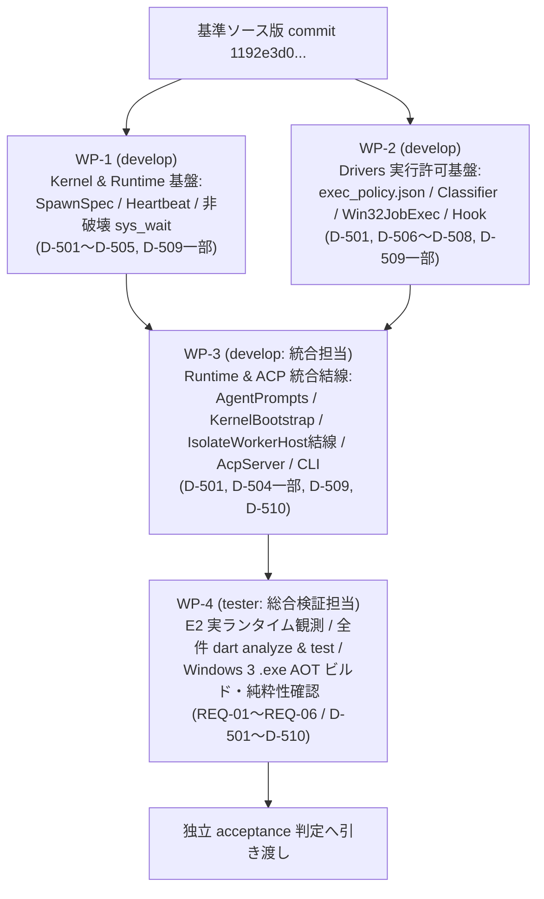

# 41_work_packages.md — 作業パッケージ（WP）分解・依存関係・並列編集境界・確認計画

関連文書:
- 確定要求・受け入れ条件（正本）: [30_requirement.md](./30_requirement.md)（`REQ-01`〜`REQ-06`）
- 全体仕様・優先順位契約（正本）: [40_specification.md](./40_specification.md)（`D-501`〜`D-510`、§3 横断優先順位契約・副作用許容境界）
- サブプロセス上限・Heartbeat・非破壊 `sys_wait` 詳細設計: [42_spec_subprocess_heartbeat.md](./42_spec_subprocess_heartbeat.md)（`D-502`〜`D-505`）
- `.agent_os/exec_policy.json`・`SysExecClassifier`・`Win32JobExecDriver`・プロンプト結線詳細設計: [42_spec_exec_policy.md](./42_spec_exec_policy.md)（`D-506`〜`D-510`）
- 進捗正本: [90_status.md](./90_status.md)

基準ソース版: `main` bookmark / Git commit `1192e3d02f301eef94d8e1c008dd20d439f5c796`

---

## 1. 全体構成・依存関係・並列編集境界

### 1.1 WP 一覧と実行依存グラフ

本計画は未解決の技術調査・利用者判断が 0 件（[30_requirement.md](./30_requirement.md) §3、[40_specification.md](./40_specification.md) §6）であるため、調査 WP を置かず以下の 4 作業パッケージ（`WP-1`〜`WP-4`）で構成する。

- **`WP-1`（カーネル＆ランタイム Heartbeat・非破壊 `sys_wait` 基盤）** と **`WP-2`（ドライバ層 `exec_policy.json`・`SysExecClassifier`・`Win32JobExecDriver`）** は、編集対象パッケージ自体が完全に分離されているため、**即時開始かつ同時並列実行が可能** である（直列実行でも可）。
- **`WP-3`（プロンプト・`KernelBootstrap`・`IsolateWorkerHost` プロンプト結線・`AcpServer`・CLI 統合）** は、`WP-1` と `WP-2` の**両方が完了した後**に直列で実行する。
- **`WP-4`（実ランタイム `E2` 観測・全パッケージ回帰・純粋性検査・Windows 3 バイナリ AOT ビルド総合確認）** は、`WP-3` 完了後に独立検証担当（`tester`）が実行し、独立 `acceptance` 判定への引き渡し材料を揃える。

### 1.2 パッケージ・ファイル編集境界マトリクス（同時編集ゼロ保証）

共有作業ツリーまたは分離作業場所のいずれで実行する場合も、下表の編集境界を厳守し、並列実行可能な `WP-1` と `WP-2` の間で同一ファイルを同時編集してはならない。

| パッケージ | `WP-1` 専有（並列可） | `WP-2` 専有（並列可） | `WP-3` 専有（`WP-1` & `WP-2` 完了後に直列実行） | `WP-4`（検証専用） |
| :--- | :--- | :--- | :--- | :--- |
| `packages/agent_kernel` | - `lib/src/process_profile.dart` - `test/subprocess_limits_and_heartbeat_snapshot_test.dart`（新規） | **編集禁止**（VFS 保護確認テストは `agent_drivers/test/` から実施） | **編集禁止** | コード編集なし |
| `packages/agent_drivers` | **編集禁止** | - `lib/src/exec/exec_policy_config.dart`（新規） - `lib/src/exec/sys_exec_classifier.dart` - `lib/src/exec/win32_job_exec_driver.dart` - `lib/src/hooks/anti_git_habit_guard_hook.dart` - `lib/agent_drivers.dart` - `test/exec_policy_and_classifier_test.dart`（新規） | **編集禁止** | コード編集なし |
| `packages/agent_runtime` | - `lib/src/process_syscalls.dart` - `lib/src/isolate_worker_host.dart`（**第1段階**: `[D-502]`〜`[D-505]` の Heartbeat・Stall kill・`SIGSTOP` 連動・非破壊 `waitForChildren`・`snapshotProcesses` のみ） - `test/subprocess_heartbeat_and_wait_test.dart`（新規） | **編集禁止** | - `lib/src/prompts/agent_prompts.dart` - `lib/src/isolate_worker_host.dart`（**第2段階**: `WP-1` 完了後に `[D-510]` §5.1(7) の `additionalExecRuleSummaries` コンストラクタ引数追加と `_launchAttempt` 内 `buildChildInstruction` 2箇所への引き渡しのみ） - `lib/src/kernel_bootstrap.dart` - `test/agent_prompts_test.dart` - `test/exec_policy_runtime_integration_test.dart`（新規） | コード編集なし（必要に応じ `.planworks/` 下の一時ワークスペースのみ使用し完了後削除） |
| `packages/agent_acp` | **編集禁止** | **編集禁止** | - `lib/src/acp_server.dart` - `lib/src/cli/acp_cli_runner.dart` - `test/acp_heartbeat_and_exec_policy_test.dart`（新規） | コード編集なし（`build/*.exe` への AOT コンパイル出力確認のみ） |

#### `isolate_worker_host.dart` の直列編集ルール（競合防止の明示）
- `packages/agent_runtime/lib/src/isolate_worker_host.dart` は Heartbeat / 非破壊 `sys_wait`（`[D-502]`〜`[D-505]`）と子プロンプトへの許可コマンド引き渡し（`[D-510]`）の双方が関わる。
- 境界の曖昧さと途中ビルド破損を防ぐため、以下の 2 段階直列ルールを強制する：
  1. **`WP-1`** では `agent_prompts.dart` を編集せず、`isolate_worker_host.dart` 内の `AgentPrompts.buildChildInstruction` 呼び出し（2 箇所）の引数シグネチャは既存のままとし、`[D-502]`〜`[D-505]` のロジック実装・単体検証を完結させる。
  2. **`WP-3`** は必ず `WP-1` の完了・回収・照合が終わった後にのみ開始し、`agent_prompts.dart` の拡張と同時に `isolate_worker_host.dart` へ `this.additionalExecRuleSummaries = const <String>[]` コンストラクタ引数と `buildChildInstruction` 2 箇所への引き渡し（[42_spec_exec_policy.md](./42_spec_exec_policy.md) §5.1(7)）のみを追加する。

---

## 2. REQ・設計 ID・WP 対応マップ（`90_status.md` 転記正本）

### 2.1 受け入れ判定に関する前提
- 各 WP の完了条件は作業結果および統合・観測の成立を確認するものであり、**WP の完了報告だけで REQ の `Acceptance: pass` にはならない**。
- 最終的な受け入れ合否は、実装・テスト担当から独立した `acceptance` 担当が [30_requirement.md](./30_requirement.md) §1 の受け入れ条件・確認方法および対象ソース版との照合に基づいて判定する。

### 2.2 `REQ-01` 〜 `REQ-06` 対応マップ

| REQ ID | 要求要約 | 対象設計 ID | 担当 WP（`90_status.md` `WP` 列転記値） | 検証区分 | 各 WP の役割分担 |
| :--- | :--- | :--- | :--- | :--- | :--- |
| **`REQ-01`** | 子プロセスの実行時間・ステップ上限の拡張（既定10分/最大60分、既定32/最大128ステップ） | `D-501`, `D-502`, `D-505` | `WP-1, WP-4` | `E1` / `E3` | `WP-1`: 定数・バリデーション・寄付クオータ連動実装＋境界値/40ステップ完走/壁時計超過 `E1` テスト `WP-4`: 全体回帰 `E1` ＋ 実装境界 `E3` 照合 |
| **`REQ-02`** | 子プロセスの Heartbeat 計測・ループ兆候記録と無進行（Stall）タイムアウト強制終了 | `D-501`, `D-502`, `D-503`, `D-505` | `WP-1, WP-4` | `E1` / `E3` | `WP-1`: ホスト側 Heartbeat・`consecutiveErrors`・`HEARTBEAT_TIMEOUT`・`SIGSTOP` 一時停止実装＋`E1` テスト `WP-4`: 全体回帰 `E1` ＋ 状態遷移・終了処理 `E3` 照合 |
| **`REQ-03`** | `sys_wait` タイムアウト時の非破壊スナップショット返却と親プロセス・ACP からの監視・再待機 | `D-501`, `D-504`, `D-505`, `D-509`, `D-510` | `WP-1, WP-3, WP-4` | `E1` / `E2` | `WP-1`: 非破壊 `waitForChildren`・`snapshotProcesses`・`sys_wait` スキーマ実装＋再待機/`sys_kill`/ターン終了回収 `E1` テスト `WP-3`: プロンプト反映・ACP `_fm_agent_os/processes`・CLI `/ps` 統合 `E1` テスト `WP-4`: 実ランタイム/ACP セッション上での非破壊 `sys_wait` → 再待機回収 `E2` 実観測 |
| **`REQ-04`** | `.agent_os/exec_policy.json` のロード機構と直接実行コマンド許可・共通ハードガード強制 | `D-501`, `D-506`, `D-507`, `D-508` | `WP-2, WP-4` | `E1` / `E3` | `WP-2`: `ExecPolicyConfigLoader`・`SysExecClassifier`・`Win32JobExecDriver`・`AntiGitHabitGuardHook` 実装＋優先順位/Fail-Closed/ハードガード/VFS 保護 `E1` テスト `WP-4`: 全体回帰 `E1` ＋ ローダ・分類器・ドライバ `E3` 照合 |
| **`REQ-05`** | Ring 3 子プロセスおよび Ring 2 での設定コマンド即時実行とシステムプロンプト・ツール説明への反映 | `D-501`, `D-507`, `D-508`, `D-509`, `D-510` | `WP-2, WP-3, WP-4` | `E1` / `E2` | `WP-2`: `toPromptRuleSummaries`・`Win32JobExecDriver.toolSchemas(policy:)`・仮想パス引数解決実装 `WP-3`: `AgentPrompts`・`KernelBootstrap`・`IsolateWorkerHost`・`AcpServer` 結線＋Ring 3/Ring 2 実行・未許可遮断・プロンプト反映 `E1` テスト `WP-4`: `.agent_os/exec_policy.json` 配置リポジトリでの実 Isolate `workspace_worker` 実行・回収 `E2` 実観測 |
| **`REQ-06`** | 既存機能・セキュリティ境界の回帰維持および Windows 3 実行ファイル AOT ビルド維持 | `D-501`, `D-505`, `D-508`, `D-509`, `D-510` | `WP-1, WP-2, WP-3, WP-4` | `E1` | `WP-1`〜`WP-3`: 各パッケージの純粋性・既存契約維持とパッケージ単体回帰 `WP-4`: 全 4 パッケージ `dart analyze`・全テスト（`stage3_architecture_and_purity_test.dart` 含む）・3 `.exe` `dart compile exe` `E1` 検証 |

### 2.3 設計項目 ID（`D-501` 〜 `D-510`）の実装・検証カバー表

| 設計 ID | 主実装 WP | 統合・総合検証 WP |
| :--- | :--- | :--- |
| `D-501` | `WP-1`, `WP-2`, `WP-3`（各パッケージ境界遵守） | `WP-4`（`stage3_architecture_and_purity_test.dart` 含む全体検証） |
| `D-502` | `WP-1` | `WP-4` |
| `D-503` | `WP-1` | `WP-4` |
| `D-504` | `WP-1`（ホスト・syscall 層）, `WP-3`（ACP・CLI `/ps` 層） | `WP-4`（`E2` 実観測） |
| `D-505` | `WP-1` | `WP-4` |
| `D-506` | `WP-2` | `WP-4` |
| `D-507` | `WP-2` | `WP-3`, `WP-4` |
| `D-508` | `WP-2` | `WP-3`, `WP-4` |
| `D-509` | `WP-1`（`process_syscalls.dart`）, `WP-2`（`exec_policy_config.dart`, `win32_job_exec_driver.dart`）, `WP-3`（`agent_prompts.dart`） | `WP-4` |
| `D-510` | `WP-3` | `WP-4` |

---

## 3. 作業パッケージ詳細（WP-1 〜 WP-4）

> **判断規則の参照原則**: 優先順位・Fail-Closed 条件・状態遷移・副作用許容境界などの判断規則は、[40_specification.md](./40_specification.md) および各 `42_spec_*.md` の該当設計 ID を正本として参照する。実装時に正本と異なる独自解釈を行ってはならない。

### WP-1: サブプロセス実行上限拡張・ホスト側 Heartbeat 監視・非破壊 `sys_wait` 基盤

- **WP-ID / 担当役 / 目的 / 対応 REQ・設計 ID**:
  - `WP-1` / 担当役: `develop`
  - 目的: `SpawnSpec` と `sys_spawn` の時間・ステップ・Heartbeat 上限拡張、ホスト側 Heartbeat・ループ兆候計測と `HEARTBEAT_TIMEOUT` 強制終了、`SIGSTOP` 一時停止連動、および非破壊 `sys_wait`（`children` + `running` + `timedOut`）と `snapshotProcesses` 拡充を実装し単体・ランタイム自動テストで確認する。
  - 対応 REQ: `REQ-01`, `REQ-02`, `REQ-03`, `REQ-06`（カーネル・ランタイム基盤部）
  - 対応設計 ID: `D-501`, `D-502`, `D-503`, `D-504`（§3.1〜§3.4 のホスト・syscall 部分）, `D-505`, `D-509`（[42_spec_exec_policy.md](./42_spec_exec_policy.md) §4.3(2) の `buildProcessToolSchemas()` 更新のみ）
- **必要な入力・参照版**:
  - 基準ソース版: Git commit `1192e3d02f301eef94d8e1c008dd20d439f5c796`
  - 仕様正本: [40_specification.md](./40_specification.md) §1 (`D-501`), §3.3, §3.4 / [42_spec_subprocess_heartbeat.md](./42_spec_subprocess_heartbeat.md) §1 (`D-502`), §2 (`D-503`), §3 (`D-504`), §4 (`D-505`), §5 / [42_spec_exec_policy.md](./42_spec_exec_policy.md) §4.3(2) (`D-509`)
  - 既存参照ファイル: `packages/agent_kernel/lib/src/process_profile.dart`, `packages/agent_kernel/lib/src/quota.dart`, `packages/agent_runtime/lib/src/process_syscalls.dart`, `packages/agent_runtime/lib/src/isolate_worker_host.dart`
- **変更する範囲と維持する振る舞い**:
  - 編集対象ファイル:
    - `packages/agent_kernel/lib/src/process_profile.dart`
    - `packages/agent_runtime/lib/src/process_syscalls.dart`
    - `packages/agent_runtime/lib/src/isolate_worker_host.dart`（§1.2 の第1段階範囲のみ。`AgentPrompts.buildChildInstruction` の呼び出し引数は変更しない）
    - `packages/agent_kernel/test/subprocess_limits_and_heartbeat_snapshot_test.dart`（新規）
    - `packages/agent_runtime/test/subprocess_heartbeat_and_wait_test.dart`（新規）
  - 編集禁止境界:
    - `packages/agent_drivers/` 配下すべて（`WP-2` 専有）、`packages/agent_runtime/lib/src/prompts/agent_prompts.dart`・`kernel_bootstrap.dart`、および `packages/agent_acp/` 配下すべて（`WP-3` 専有）。
  - 維持する振る舞い:
    - `agent_kernel` の Ring 0 純粋性・外部非依存・`stdout` 非参照（`[D-501]`）。
    - 子 Isolate（`sub_agent_worker.dart`, `child_isolate_bootstrap.dart`）への `JjDriver` 非混入および `stdout` 非参照（`[D-501]`）。
    - 総壁時計超過 `WALL_TIME_QUOTA_EXCEEDED`、キャンセル時 `CANCELLED`、親ターン終了時 `PARENT_TURN_ENDED`、二重精算防止、および全完了時の `sys_wait.children` 後方互換（`[D-502]`, `[D-504]`, `[D-505]`、[40_specification.md](./40_specification.md) §3.3・§3.4）。
- **作る成果**:
  1. `process_profile.dart`: `[D-502]` §1.1 の `SpawnSpec` 定数・`heartbeatTimeoutMs` フィールド・`toJson()` 更新、および `[D-503]` §2.1 の `ChildHeartbeatSnapshot` クラス実装。
  2. `process_syscalls.dart`: `[D-502]` §1.2 の `_validateSpawnArgs` / `_parseSpawnSpec` 更新、`[D-504]` §3.1・§3.3 の `sys_wait` 引数検証（`timeoutMs: 1..600000`）と監査要約（`timedOut`, `runningCount`, `runningPids`）更新、および `[D-509]`（[42_spec_exec_policy.md](./42_spec_exec_policy.md) §4.3(2)）の `buildProcessToolSchemas()` 説明文更新。
  3. `isolate_worker_host.dart`: `[D-502]` §1.2(3) のクオータ連動確認、`[D-503]` §2.2〜§2.4 のイベント境界 Heartbeat・`consecutiveErrors`/`lastErrorReason` 更新・`SIGSTOP`/`SIGCONT` タイマー一時停止/再開・`HEARTBEAT_TIMEOUT` 強制終了と旧 `WAIT_TIMEOUT` フィールド整理、`[D-504]` §3.2〜§3.4 の非破壊 `waitForChildren` と `snapshotProcesses()` への Heartbeat 等の付与。
  4. 新規自動テスト 2 本（[42_spec_subprocess_heartbeat.md](./42_spec_subprocess_heartbeat.md) §5 の `REQ-01`・`REQ-02`・`REQ-03` テストケース一式。ACP サーバー経由ケース (d) のみ `WP-3` で実施し、`WP-1` では `workerHost.snapshotProcesses()` 直接検証までを実施）。
- **開始条件・依存**: なし（即時開始可能。`WP-2` と同時並列実行可）。
- **完了条件・確認方法（`E1`）**:
  - `dart analyze packages/agent_kernel packages/agent_runtime` がエラーゼロで終了すること。
  - `dart test packages/agent_kernel/test/subprocess_limits_and_heartbeat_snapshot_test.dart packages/agent_runtime/test/subprocess_heartbeat_and_wait_test.dart` が全件パスすること（境界値、40 ステップ超完走、壁時計超過、短時間 `HEARTBEAT_TIMEOUT` 発火とワークスペース・クオータ精算、進行継続時の完走、`consecutiveErrors` 追跡とリセット、`SIGSTOP` 中の非誤発火、非破壊 `sys_wait` → 再 `sys_wait` 回収、一部完了＋一部 `running` 分離、`sys_kill` 介入、`snapshotProcesses()` Heartbeat 含有、`PARENT_TURN_ENDED` 自動回収を確認）。
  - 既存回帰: `dart test packages/agent_kernel/test packages/agent_runtime/test` が全件パスすること。
- **統合先・後続への引き渡し**:
  - `WP-3`（統合担当 `develop`）へ引き渡す（`WP-3` で `isolate_worker_host.dart` の子プロンプト引数結線および ACP `_fm_agent_os/processes`・CLI `/ps` 統合を行う）。
- **未実施・未解決**: 実行前に決めることなし。ACP サーバー経由 `_fm_agent_os/processes` 検証は `WP-3`、実ランタイム `E2` 観測は `WP-4` で実施する。

---

### WP-2: `.agent_os/exec_policy.json` ローダ・`SysExecClassifier`・`Win32JobExecDriver`・`AntiGitHabitGuardHook` 実装

- **WP-ID / 担当役 / 目的 / 対応 REQ・設計 ID**:
  - `WP-2` / 担当役: `develop`
  - 目的: `.agent_os/exec_policy.json` の Fail-Closed ローダ、`SysExecClassifier` のカスタム直接実行ルール評価と共通ハードガード、`AntiGitHabitGuardHook` の `--` 経由ラッパー生 `git`/`jj` 遮断、および `Win32JobExecDriver` のタイムアウト上限整合・`/workspace/...` 仮想パス引数解決・ツールスキーマ拡張を `packages/agent_drivers` 内に実装し単体テストで確認する。
  - 対応 REQ: `REQ-04`, `REQ-05`（ドライバ・スキーマ生成部）, `REQ-06`（ドライバ境界・回帰部）
  - 対応設計 ID: `D-501`, `D-506`, `D-507`, `D-508`, `D-509`（[42_spec_exec_policy.md](./42_spec_exec_policy.md) §4.1 `toPromptRuleSummaries()` および §4.3(1) `Win32JobExecDriver.toolSchemas({ExecPolicyConfig? policy})`）
- **必要な入力・参照版**:
  - 基準ソース版: Git commit `1192e3d02f301eef94d8e1c008dd20d439f5c796`
  - 仕様正本: [40_specification.md](./40_specification.md) §1 (`D-501`), §3.1, §3.2, §3.4 / [42_spec_exec_policy.md](./42_spec_exec_policy.md) §1 (`D-506`), §2 (`D-507`), §3 (`D-508`), §4.1 & §4.3(1) (`D-509`), §6.1
  - 既存参照ファイル: `packages/agent_drivers/lib/src/llm/models_config.dart`（ローダ構造参考）, `packages/agent_drivers/lib/src/exec/sys_exec_classifier.dart`, `packages/agent_drivers/lib/src/exec/win32_job_exec_driver.dart`, `packages/agent_drivers/lib/src/hooks/anti_git_habit_guard_hook.dart`, `packages/agent_drivers/lib/agent_drivers.dart`, `packages/agent_kernel/lib/src/vfs_namespace.dart`（参照のみ）
- **変更する範囲と維持する振る舞い**:
  - 編集対象ファイル（`packages/agent_drivers/` 配下のみに完全限定）:
    - `packages/agent_drivers/lib/src/exec/exec_policy_config.dart`（新規）
    - `packages/agent_drivers/lib/src/exec/sys_exec_classifier.dart`
    - `packages/agent_drivers/lib/src/exec/win32_job_exec_driver.dart`
    - `packages/agent_drivers/lib/src/hooks/anti_git_habit_guard_hook.dart`
    - `packages/agent_drivers/lib/agent_drivers.dart`
    - `packages/agent_drivers/test/exec_policy_and_classifier_test.dart`（新規）
  - 編集禁止境界:
    - `packages/agent_kernel/`, `packages/agent_runtime/`, `packages/agent_acp/` 配下すべて。
    - 公開 API（`SysExecClassifier`, `Win32JobExecDriver.forWorkspace`, `Win32JobExecDriver.toolSchemas`）への `policy` / `execPolicy` 追加はすべて省略可能な名前付き引数とし、`WP-2` 単体時点で未変更の `agent_runtime` / `agent_acp` との後方互換を 100% 保つこと。
  - 維持する振る舞い:
    - `agent_drivers` 内での直接 `stdout` 出力ゼロ（警告は `ExecPolicyLoadResult.warnings` で返却、`[D-501]`）。
    - [40_specification.md](./40_specification.md) §3.1 の `sys_exec` 優先順位契約、`Win32JobExecDriver` の `runInShell: false`・Win32 Job Object（`KILL_ON_JOB_CLOSE`）・環境変数サニタイズ、ビルトイン `dart` 3 ルールの `maxAutoAllowTimeoutMs = 120000` と既存拒否理由コード、および `VfsNamespace` の `.agent_os` 保護（`[D-506]`〜`[D-508]`）。
- **作る成果**:
  1. `exec_policy_config.dart` & `agent_drivers.dart`: `[D-506]` §1.1〜§1.2 の `ExecAllowRule`, `ExecPolicyConfig`（`[D-509]` §4.1 `toPromptRuleSummaries()` 含む）, `ExecPolicyLoadResult`, `ExecPolicyConfigLoader` 実装とバレルエクスポート追加。
  2. `sys_exec_classifier.dart`: `[D-507]` §2.1〜§2.2 の `policy` 統合（`namespaceOverride` 生成時の `policy` 伝播必須）、共通ハードガード・カスタムコマンド引数検証・ルール照合、および `[D-508]` §3.2(1) の `resolveHostCommandArg` 拡張（`--key=/workspace/...` 対応）。
  3. `anti_git_habit_guard_hook.dart`: `[D-501]` / `[D-507]` §2.2(3) の `--` トークン直後における生 `git` / `jj` 呼び出し検知補強（Stage 3 `HOOK_BLOCKED` 遮断）。
  4. `win32_job_exec_driver.dart`: `[D-508]` §3.1〜§3.3 の `maxTimeoutMs = 600000` 拡張、全直接実行コマンドへの `resolveHostCommandArg` 適用、`forWorkspace` への任意 `execPolicy` 引数追加、および `[D-509]` §4.3(1) の `toolSchemas({ExecPolicyConfig? policy})` 更新。
  5. `exec_policy_and_classifier_test.dart`: [42_spec_exec_policy.md](./42_spec_exec_policy.md) §6.1 の `REQ-04` テストケース一式（探索優先順位、構文不正・未知キー・空配列・禁止コマンド記載時の警告＋Fail-Closed、有効カスタムルールの `allow` 判定、シェル 10 種・生 `git`/`jj`・`--` 経由 `git`/`jj`・メタ文字・ネットワーク 6 種・パス区切り・`/workspace` 外・保護パス・`allowedWorkspaceSubpaths` 外・タイムアウト超過の遮断、`resolveHostCommandArg` 変換、`HostFsDriver` 経由 `.agent_os/exec_policy.json` への `EACCES: PROTECTED_INTERNAL_PATH` 拒否）。
- **開始条件・依存**: なし（即時開始可能。`WP-1` と同時並列実行可）。
- **完了条件・確認方法（`E1`）**:
  - `dart analyze packages/agent_drivers` がエラーゼロで終了すること。
  - `dart test packages/agent_drivers/test/exec_policy_and_classifier_test.dart` が全件パスすること。
  - 既存回帰: `dart test packages/agent_drivers/test/win32_job_exec_test.dart packages/agent_drivers/test/anti_git_habit_hook_test.dart packages/agent_drivers/test` が全件パスすること。
- **統合先・後続への引き渡し**:
  - `WP-3`（統合担当 `develop`）へ引き渡す（`WP-3` で `KernelBootstrap`, `IsolateWorkerHost`, `AgentPrompts`, `AcpServer` へ結線する）。
- **未実施・未解決**: 実行前に決めることなし。Ring 3 / Ring 2 ランタイム結線テストは `WP-3`、実サブプロセス `E2` 観測は `WP-4` で実施する。

---

### WP-3: `AgentPrompts`・`KernelBootstrap`・`IsolateWorkerHost` プロンプト結線・`AcpServer`・CLI 統合

- **WP-ID / 担当役 / 目的 / 対応 REQ・設計 ID**:
  - `WP-3` / 担当役: `develop`（統合担当）
  - 目的: `WP-1` と `WP-2` の成果を `AgentPrompts`、`KernelBootstrap`、`IsolateWorkerHost`（子プロンプト引数結線）、`AcpServer`、および `acp_cli_runner.dart`（`/ps` 表示）へ統合結線し、Ring 3 / Ring 2 での設定コマンド実行・プロンプト/ツールスキーマ反映・ACP Heartbeat 監視の自動統合テスト（`E1`）を完了する。
  - 対応 REQ: `REQ-03`（プロンプト・ACP `_fm_agent_os/processes`・CLI `/ps` 統合）, `REQ-05`（Ring 3 / Ring 2 結線・プロンプト＆スキーマ反映）, `REQ-06`（純粋性・統合回帰）
  - 対応設計 ID: `D-501`, `D-504`（§3.4 ACP・CLI `/ps` 連携）, `D-509`（§4.2 `AgentPrompts`）, `D-510`（§5.1〜§5.3）
- **必要な入力・参照版**:
  - `WP-1` および `WP-2` の完了・照合済み作業ツリー
  - 仕様正本: [40_specification.md](./40_specification.md) §1 (`D-501`), §3.1〜§3.4 / [42_spec_subprocess_heartbeat.md](./42_spec_subprocess_heartbeat.md) §3.4 (`D-504`), §5.3(d) / [42_spec_exec_policy.md](./42_spec_exec_policy.md) §4.2 (`D-509`), §5 (`D-510`), §6.2
  - 既存参照ファイル: `packages/agent_runtime/lib/src/prompts/agent_prompts.dart`, `packages/agent_runtime/lib/src/kernel_bootstrap.dart`, `packages/agent_runtime/lib/src/isolate_worker_host.dart`, `packages/agent_acp/lib/src/acp_server.dart`, `packages/agent_acp/lib/src/cli/acp_cli_runner.dart`, `packages/agent_runtime/test/agent_prompts_test.dart`
- **変更する範囲と維持する振る舞い**:
  - 編集対象ファイル:
    - `packages/agent_runtime/lib/src/prompts/agent_prompts.dart`
    - `packages/agent_runtime/lib/src/isolate_worker_host.dart`（`[D-510]` §5.1(7) の `additionalExecRuleSummaries` コンストラクタフィールド追加と `_launchAttempt` 内 `AgentPrompts.buildChildInstruction` 2 箇所への引き渡しのみ。`WP-1` 実装部分は維持）
    - `packages/agent_runtime/lib/src/kernel_bootstrap.dart`
    - `packages/agent_acp/lib/src/acp_server.dart`
    - `packages/agent_acp/lib/src/cli/acp_cli_runner.dart`
    - `packages/agent_runtime/test/agent_prompts_test.dart`
    - `packages/agent_runtime/test/exec_policy_runtime_integration_test.dart`（新規）
    - `packages/agent_acp/test/acp_heartbeat_and_exec_policy_test.dart`（新規）
  - 維持する振る舞い:
    - `agent_prompts.dart` および `process_runner.dart` の Pure Dart + `package:agent_kernel` のみ（`dart:io`・`agent_drivers`・`http` 非依存、`[D-501]`, `[D-509]`）。
    - `additionalExecRuleSummaries` が空のときの `leadStep1Instruction` および `buildChildInstruction` 全 4 プロファイル文字列の完全一致維持、ならびに `explorer` / `web_researcher` への追加許可文言非付与（`[D-509]` §4.2）。
    - 警告出力時の `SecretRedactor` 適用と `stderr` 出力（`stdout` 直接出力ゼロ、`[D-501]`, `[D-510]` §5.1(2)）。
    - セッション寿命での `ExecPolicyConfig` 不変保持と新規 `session/new` 時の `<sessionCwd>/.agent_os/exec_policy.json` 取得（[40_specification.md](./40_specification.md) §3.4(2)）。
- **作る成果**:
  1. `agent_prompts.dart`: `[D-509]` §4.2 の `leadStage2Instruction`（および `leadStage3Instruction`）更新、`buildLeadInstruction` 新設、`buildChildInstruction` への `additionalExecRuleSummaries` 引数追加。
  2. `isolate_worker_host.dart`: `[D-510]` §5.1(7) の `additionalExecRuleSummaries` 結線。
  3. `kernel_bootstrap.dart`: `[D-510]` §5.1(1)〜(8) の `KernelBootstrapConfig.execPolicy` / `onExecPolicyWarning` 追加、ロード＆赤塗り警告出力、`Win32JobExecDriver.toolSchemas(policy:)`・`AgentPrompts.buildLeadInstruction`・`SysExecClassifier(namespace:, policy:)`・`IsolateWorkerHost(additionalExecRuleSummaries:)` 結線、および `KernelBootstrap.execPolicy` 公開。
  4. `acp_server.dart` & `acp_cli_runner.dart`: `[D-510]` §5.2 の `AcpServerConfig.execPolicy` DI と `_onSessionNew` 結線、および `[D-504]` §3.4(3) の CLI `/ps` 表示への `step=... idle=...ms` 付記。
  5. テスト更新・新設:
     - `agent_prompts_test.dart`: `[D-510]` §5.3 に従う `expectedStage2` / `expectedStage3` 更新、および `buildLeadInstruction` / `buildChildInstruction` の `additionalExecRuleSummaries` 有無（`explorer`/`web_researcher` 非付与含む）検証。
     - `exec_policy_runtime_integration_test.dart`: [42_spec_exec_policy.md](./42_spec_exec_policy.md) §6.2(a)〜(d)（隔離 Jujutsu リポジトリでの `workspace_worker` / `conflict_resolver` 承認なし `sys_exec` 実行と `/workspace/...` 引数解決、Ring 2 即時実行、未許可コマンドの `TTY_MONOPOLY_DENIED` / `askUser`、`explorer` / `web_researcher` の `CAPABILITY_DENIED`、構築済みプロンプト・ツールスキーマ反映）。
     - `acp_heartbeat_and_exec_policy_test.dart`: [42_spec_subprocess_heartbeat.md](./42_spec_subprocess_heartbeat.md) §5.3(d) の ACP `_fm_agent_os/processes` における `processes[].heartbeat` 取得、CLI `/ps` Heartbeat 表示、および `AcpServer` セッション単位 `.agent_os/exec_policy.json` ロード検証。
- **開始条件・依存**: **`WP-1` および `WP-2` の両方が完了・回収済みであること**。
- **完了条件・確認方法（`E1`）**:
  - ワークスペース全体の `dart analyze` がエラーゼロで終了すること。
  - `dart test packages/agent_runtime/test/agent_prompts_test.dart packages/agent_runtime/test/exec_policy_runtime_integration_test.dart packages/agent_acp/test/acp_heartbeat_and_exec_policy_test.dart` が全件パスすること。
  - `dart test packages/agent_acp/test/acp_server_test.dart packages/agent_acp/test/acp_cli_and_purity_test.dart packages/agent_acp/test/multiprocess_stdout_purity_test.dart` が全件パスすること。
- **統合先・後続への引き渡し**:
  - `WP-4`（総合検証担当 `tester`）へ引き渡す。
- **未実施・未解決**: 実行前に決めることなし。実ランタイム `E2` 観測および 3 バイナリ AOT コンパイルを含む全件検証は `WP-4` で実施する。

---

### WP-4: 実ランタイム `E2` 観測・全パッケージ回帰・純粋性検査・Windows 3 バイナリ AOT ビルド総合確認

- **WP-ID / 担当役 / 目的 / 対応 REQ・設計 ID**:
  - `WP-4` / 担当役: `tester`（独立検証担当）
  - 目的: `WP-3` 完了時点の成果版に対し、Windows 3 バイナリ AOT コンパイル・全 4 パッケージ静的解析・アーキテクチャ純粋性検査を含む全テストスイート（`E1`）、実ランタイム／実 Isolate サブプロセスを用いた `REQ-03`・`REQ-05` の一連実行観測（`E2`）、および主要実装境界照合（`E3`）を独立セッションで実施し、受け入れ判定（`acceptance`）用の証跡を揃える。
  - 対応 REQ: `REQ-01`, `REQ-02`, `REQ-03`, `REQ-04`, `REQ-05`, `REQ-06`
  - 対応設計 ID: `D-501`〜`D-510`
- **必要な入力・参照版**:
  - `WP-3` 完了時点の作業ツリー（検証開始時に `jj status` / `jj log -r @` 等で対象版参照を特定・記録すること）
  - 仕様・要求正本: [30_requirement.md](./30_requirement.md) §1, §2 / [40_specification.md](./40_specification.md) §5 / [42_spec_subprocess_heartbeat.md](./42_spec_subprocess_heartbeat.md) §5 / [42_spec_exec_policy.md](./42_spec_exec_policy.md) §6
- **変更する範囲と維持する振る舞い**:
  - ソースコードおよびテストコードの編集は行わない（検証専用 WP。不具合や回帰失敗が検出された場合は自分で修正せず `implement` leader へ報告して該当 `develop` WP へ差し戻す）。
  - 一時検証用リポジトリやスクリプトを作成する場合は必ず `.planworks/` 配下に限定し、`docs/` 配下に一時ファイルを作らず、検証完了後に不要な一時物を清掃する。AOT ビルド成果物は `stage3_architecture_and_purity_test.dart` が参照する `build/` 配下へ出力する。
- **作る成果（検証報告と証跡）**:
  1. **`E1` 静的解析・AOT ビルド・全パッケージ自動テスト実行結果**:
     - Windows ネイティブ AOT 3 実行ファイルのビルド成功確認（`build/agent_os_daemon.exe`, `build/acp_cli_client.exe`, `build/acp_kanban_app.exe`）。
     - ワークスペース全体 `dart analyze` エラーゼロ確認。
     - 全 4 パッケージ `dart test`（`stage3_architecture_and_purity_test.dart` の E3-1〜E3-5 検査を含む）全件パス確認。
  2. **`E2` 実ランタイム実行観測記録**:
     - **`REQ-03` 実観測**: 実ランタイム（`KernelBootstrap` または ACP デーモンセッション＋実 `IsolateChildWorkerBackend`）上で `sys_spawn` → 短時間 `sys_wait`（子が kill されず `timedOut: true` と `running` の Heartbeat 項目一式が返ること、および `_fm_agent_os/processes` で観測できること）→ 再 `sys_wait`（`children` に完走ステータス・`workingChangeId` が回収されること）を実行し観測結果を記録する。
     - **`REQ-05` 実観測**: `.agent_os/exec_policy.json` を配置した隔離 Jujutsu リポジトリに対し、実 Isolate ワーカー（`workspace_worker`）を `sys_spawn` して設定済み直接実行コマンドの `sys_exec` 承認なし実行（隔離 `jj workspace` 内）と `sys_wait` 完了回収が成功することを実行・観測し記録する。
  3. **`E3` 実装境界照合確認**:
     - `REQ-01`（`process_profile.dart`, `process_syscalls.dart`, `isolate_worker_host.dart`）、`REQ-02`（`isolate_worker_host.dart`）、`REQ-04`（`exec_policy_config.dart`, `sys_exec_classifier.dart`, `win32_job_exec_driver.dart`, `anti_git_habit_guard_hook.dart`）の実装箇所と `40` / `42` の設計契約との一致を確認し参照アンカーを整理する。
- **開始条件・依存**: `WP-3` 完了後に開始。
- **完了条件・確認方法（実行順序）**:
  1. `dart analyze`（リポジトリルート）
  2. 3 バイナリの AOT コンパイル（`stage3_architecture_and_purity_test.dart` 実行前に `build/` を最新化）：
     - `dart compile exe packages/agent_acp/bin/agent_os_daemon.dart -o build/agent_os_daemon.exe`
     - `dart compile exe packages/agent_acp/bin/acp_cli_client.dart -o build/acp_cli_client.exe`
     - `dart compile exe packages/agent_acp/bin/acp_kanban_app.dart -o build/acp_kanban_app.exe`
  3. `dart test`（全 4 パッケージ：`agent_kernel`, `agent_drivers`, `agent_runtime`, `agent_acp`）
  4. 上記 `REQ-03`・`REQ-05` の実ランタイム `E2` シナリオ実行と観測結果確認、および `E3` 実装箇所確認。
- **統合先・後続への引き渡し**:
  - 独立 `acceptance` 担当へ、対象版参照および `REQ-01`〜`REQ-06` の `E1` / `E2` / `E3` 証跡一式を引き渡す。
- **未実施・未解決**: 実行前に決めることなし（本環境は Windows 11 + Dart SDK + `jj` 実機環境のため、`EX` 代替を要する項目は存在しない）。

---

## 4. 差し戻し・例外発生時の運用規則

- `WP-1`〜`WP-3` の実装中に設計正本（`40_specification.md` / `42_spec_*.md`）の契約では解決できない外的制約や既存コードとの矛盾が判明した場合は、独自の判断規則で仕様を書き換えず、`workflow-contract.md` の help 形式（4 行＋再現コマンド）に従って `implement` leader へ報告し、フロー後退（設計／仕様見直し）の判断を仰ぐ。
- `WP-4` でテスト失敗・純粋性違反・AOT ビルドエラー・`E2` 不一致が観測された場合は、`tester` 自身でコードを修正せず、失敗コマンドと観測事実を `implement` leader へ返却し、該当する担当 WP（`WP-1`〜`WP-3`）へ差し戻す。
