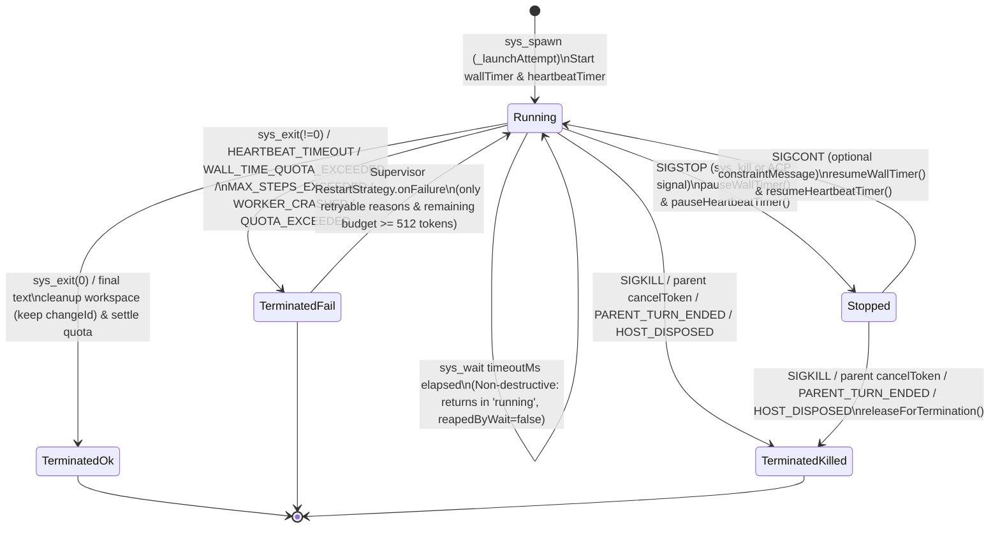

# 42_spec_subprocess_heartbeat.md — サブプロセス実行時間拡張・Heartbeat 監視・非破壊 `sys_wait` 詳細設計

関連文書:
- 全体仕様・優先順位契約: [40_specification.md](./40_specification.md)
- 要求・受け入れ条件（正本）: [30_requirement.md](./30_requirement.md)（`REQ-01`, `REQ-02`, `REQ-03`, `REQ-06`）
- 実行許可ポリシー詳細: [42_spec_exec_policy.md](./42_spec_exec_policy.md)

---

## 1. `SpawnSpec` および `sys_spawn` の実行時間・ステップ・Heartbeat 上限拡張

D-502: `SpawnSpec`・`sys_spawn` の実行時間・ステップ・Heartbeat 上限拡張とクオータ連動（[REQ-01], [REQ-02]）

### 1.1 `SpawnSpec`（`packages/agent_kernel/lib/src/process_profile.dart`）

定数・コンストラクタ・JSON シリアライズを以下の通り更新する。

| 定数 / フィールド | 変更前 | 変更後 | 根拠・説明 |
| :--- | :--- | :--- | :--- |
| `defaultMaxWallTimeMs` | `90000` (90 秒) | **`600000`** (10 分) | `OM-01`: 省略時でも通常の実装＋ビルド検証が完走可能な既定値。 |
| `maxAllowedWallTimeMs` | `300000` (5 分) | **`3600000`** (60 分) | `B-03`: 1 時間規模のサブプロセスタスクを許容。 |
| `defaultMaxSteps` | `16` | **`32`** | `OM-02`: 編集・テスト・修正サイクルを省略時でも完走可能にする。 |
| `maxAllowedSteps` | `32` | **`128`** | `B-03`: 大規模マルチステップ作業の上限。 |
| `defaultHeartbeatTimeoutMs`（新規） | — | **`300000`** (5 分) | `B-03` / `OM-03`: 無進行（Stall）検知の既定タイムアウト。 |
| `maxAllowedHeartbeatTimeoutMs`（新規） | — | **`600000`** (10 分) | `OM-03`: 重い単発ビルド・推論向けの最大許容値。 |
| `final int heartbeatTimeoutMs`（新規） | — | 既定 `defaultHeartbeatTimeoutMs` | `assert(heartbeatTimeoutMs > 0 && heartbeatTimeoutMs <= maxAllowedHeartbeatTimeoutMs)` を強制し、`toJson()` に `'heartbeatTimeoutMs': heartbeatTimeoutMs` を出力する。 |

### 1.2 `sys_spawn` バリデーションとクオータ連動（`packages/agent_runtime/lib/src/process_syscalls.dart`, `isolate_worker_host.dart`）

1. **`_validateSpawnArgs` の検証規則**:
   - `maxWallTimeMs`: 省略可。指定時は `int` かつ `1 <= maxWallTimeMs <= 3600000`。範囲外・型不正は `SyscallError(code: SyscallErrorCode.einval, reason: 'INVALID_QUOTA_ARG', message: 'Argument "maxWallTimeMs" must be an integer between 1 and 3600000.', recoverable: true)`。
   - `maxSteps`: 省略可。指定時は `int` かつ `1 <= maxSteps <= 128`。範囲外・型不正は `SyscallError(code: SyscallErrorCode.einval, reason: 'INVALID_ARGS', message: 'Argument "maxSteps" must be an integer between 1 and 128.', recoverable: true)`。
   - `heartbeatTimeoutMs`（新規引数）: 省略可。指定時は `int` かつ `1 <= heartbeatTimeoutMs <= 600000`。範囲外・型不正は `SyscallError(code: SyscallErrorCode.einval, reason: 'INVALID_QUOTA_ARG', message: 'Argument "heartbeatTimeoutMs" must be an integer between 1 and 600000.', recoverable: true)`。
2. **`_parseSpawnSpec` の既定値適用**:
   - `maxWallTimeMs: (args['maxWallTimeMs'] as int?) ?? SpawnSpec.defaultMaxWallTimeMs`（`600000`）
   - `maxSteps: (args['maxSteps'] as int?) ?? SpawnSpec.defaultMaxSteps`（`32`）
   - `heartbeatTimeoutMs: (args['heartbeatTimeoutMs'] as int?) ?? SpawnSpec.defaultHeartbeatTimeoutMs`（`300000`）
3. **寄付クオータおよびターン内 syscall 上限との連動**:
   - `IsolateWorkerHost.spawnChild` および `_completeChildAndEvaluateSupervision` の `quotaLedger.donateToChild` 呼び出しにおいて、`maxSyscallCountPerTurn: spec.maxSteps * 8`（既定 `32 * 8 = 256`、最大 `128 * 8 = 1024`）と `maxWallTimeMs: spec.maxWallTimeMs` をそのまま引き継ぐ。これにより `maxSteps > 32` 指定時に `SYSCALL_QUOTA_EXCEEDED` が早期発火しないことを保証する。
   - `QuotaConsumption.checkBeforeSyscall`（`quota.dart`）および `_ManagedChild.startWallTimer` / `pauseWallTimer` / `resumeWallTimer` による総壁時計上限（`WALL_TIME_QUOTA_EXCEEDED`, `EDQUOT`, `exitCode: 77`）と `SIGSTOP` 中の経過時間除外（`startedAtUtc` シフト）は従来通り維持する。

---

## 2. ホスト側 Heartbeat・ループ兆候追跡と Stall 強制終了

D-503: ホスト側 Heartbeat・ループ兆候追跡と `HEARTBEAT_TIMEOUT` 強制終了・`SIGSTOP` 連動（[REQ-02]）

### 2.1 `ChildHeartbeatSnapshot` 値オブジェクト（`packages/agent_kernel/lib/src/process_profile.dart`）

Ring 0 `agent_kernel` に JSON シリアライズ可能な不変スナップショット型 `ChildHeartbeatSnapshot` を定義し、`sys_wait` の `running` 要素および `snapshotProcesses()`（ACP `_fm_agent_os/processes`）で共通利用する。

```dart
class ChildHeartbeatSnapshot {
  const ChildHeartbeatSnapshot({
    required this.currentStep,
    required this.maxSteps,
    required this.totalSyscalls,
    required this.elapsedMs,
    required this.idleMs,
    required this.heartbeatTimeoutMs,
    required this.lastHeartbeatAt,
    required this.isPaused,
    this.activeSyscall,
    this.lastSyscall,
    required this.consecutiveErrors,
    this.lastErrorReason,
  });

  final int currentStep;
  final int maxSteps;
  final int totalSyscalls;
  final int elapsedMs;
  final int idleMs;
  final int heartbeatTimeoutMs;
  final String lastHeartbeatAt; // ISO-8601 UTC string
  final bool isPaused;
  final String? activeSyscall;
  final String? lastSyscall;
  final int consecutiveErrors;
  final String? lastErrorReason;

  Map<String, dynamic> toJson() => <String, dynamic>{
        'currentStep': currentStep,
        'maxSteps': maxSteps,
        'totalSyscalls': totalSyscalls,
        'elapsedMs': elapsedMs,
        'idleMs': idleMs,
        'heartbeatTimeoutMs': heartbeatTimeoutMs,
        'lastHeartbeatAt': lastHeartbeatAt,
        'isPaused': isPaused,
        'activeSyscall': activeSyscall,
        'lastSyscall': lastSyscall,
        'consecutiveErrors': consecutiveErrors,
        'lastErrorReason': lastErrorReason,
      };
}
```

### 2.2 `_ManagedChild` における Heartbeat・ループ兆候の状態更新規則（`isolate_worker_host.dart`）

子 Isolate からの定期 ping には依存せず、ホスト側 `IsolateWorkerHost` が通過する確定イベント境界で単調時計（`Stopwatch`）と UTC 時刻を更新する。

| イベント境界 | 更新するフィールドとタイマー動作 |
| :--- | :--- |
| **1. 試行起動時**（`_launchAttempt` で `_ManagedChild` 生成直後） | `currentStep = 0`, `maxSteps = spec.maxSteps`, `heartbeatTimeoutMs = spec.heartbeatTimeoutMs`, `totalSyscalls = 0`, `activeSyscall = null`, `lastSyscall = null`, `consecutiveErrors = 0`, `lastErrorReason = null`, `lastHeartbeatAtUtc = DateTime.now().toUtc()`。`startHeartbeatTimer` で `remainingHeartbeatMs = heartbeatTimeoutMs` のタイマーと `idleStopwatch` を開始する。 |
| **2. Isolate ハンドシェイク完了時**（`_onIsolateMessage` の `'worker_ready'`） | `recordHeartbeat` を呼び出し、`lastHeartbeatAtUtc` 更新・`idleStopwatch` リセット・`heartbeatTimer` を `heartbeatTimeoutMs` で再設定する。 |
| **3. `sys_llm_chat` 開始時**（`_executeChildSyscall`、サスペンド解除後・`syscallGate.invoke` 直前） | `currentStep = (args['turnIndex'] as num?)?.toInt() ?? (currentStep + 1)`、`activeSyscall = 'sys_llm_chat'` とし、`recordHeartbeat` で `heartbeatTimer` を `heartbeatTimeoutMs` にリセットする（推論自体が `heartbeatTimeoutMs` を超えてハングした場合はタイマーが発火する）。 |
| **4. `sys_llm_chat` 完了時**（`syscallGate.invoke` 返却直後） | `totalSyscalls += 1`, `activeSyscall = null`, `lastSyscall = 'sys_llm_chat'`、`recordHeartbeat` を実行。`!res.ok` の場合は `consecutiveErrors += 1`, `lastErrorReason = res.error!.reason` を記録する。**重要**: `res.ok == true` の場合でも `sys_llm_chat` は推論呼び出しに過ぎないため **`consecutiveErrors` はリセットしない**（ステップを跨ぐツール連続失敗ループを消さないため）。 |
| **5. ツール syscall（`name != 'sys_llm_chat'`）開始時** | `activeSyscall = name` とし、`recordHeartbeat` で `heartbeatTimer` を `heartbeatTimeoutMs` にリセットする（単発 `sys_exec` 等が `heartbeatTimeoutMs` 内であれば打ち切られず、超えて無応答なら発火する）。 |
| **6. ツール syscall（`name != 'sys_llm_chat'`）完了時** | `totalSyscalls += 1`, `activeSyscall = null`, `lastSyscall = name`、`recordHeartbeat` を実行。<br>- **`res.ok == true`**: ツール実行成功とみなし **`consecutiveErrors = 0`、`lastErrorReason = null` にリセット**する。<br>- **`!res.ok`**: **`consecutiveErrors += 1`、`lastErrorReason = res.error!.reason` を記録**する。 |
| **7. 子プロセス終了確定時**（`_cleanupChildWorkspaceAndComplete` / `_completeChildAndEvaluateSupervision`） | `heartbeatTimer?.cancel()`, `idleStopwatch.stop()`, `activeSyscall = null` とし、終了時点のスナップショット値を保持する。 |

### 2.3 `SIGSTOP` / `SIGCONT` サスペンド連動規則

`pauseWallTimer` / `resumeWallTimer` と完全に同じ境界（`sendSignal` の `sigstop` / `sigcont`、および `_executeChildSyscall` の `waitIfSuspended` 前後）で `pauseHeartbeatTimer()` / `resumeHeartbeatTimer(onHeartbeatTimeout)` を呼び出す。

1. **`pauseHeartbeatTimer()`**:
   - すでに `isHeartbeatPaused == true` または `isCompleted == true` なら何もしない（冪等）。
   - `heartbeatTimer?.cancel(); heartbeatTimer = null;`
   - `idleStopwatch.stop();`
   - `final rem = heartbeatTimeoutMs - idleStopwatch.elapsedMilliseconds;`（※`idleStopwatch` は直近の `recordHeartbeat` 以降の累積稼働無進行時間を保持し `resumeHeartbeatTimer` ではリセットしないため、複数回 `SIGSTOP` / `SIGCONT` を往復しても二重減算が起きないよう `remainingHeartbeatMs` ではなく常に `heartbeatTimeoutMs` から減算する）
   - `remainingHeartbeatMs = rem < 1 ? 1 : rem;`
   - `isHeartbeatPaused = true;`
   - ※`recordHeartbeat` 実行時は `lastHeartbeatAtUtc` を更新した上で `idleStopwatch.reset()` を行い、`!isHeartbeatPaused && !isCompleted` なら `idleStopwatch.start()` かつ `remainingHeartbeatMs = heartbeatTimeoutMs` で `heartbeatTimer` を再設定する。サスペンド中（`isHeartbeatPaused == true`）に完了間際の in-flight syscall が `recordHeartbeat` を呼んだ場合は、`idleStopwatch` を停止状態のまま `0` にリセットし `remainingHeartbeatMs = heartbeatTimeoutMs` に戻すが、`Timer` は起動しない。
2. **`resumeHeartbeatTimer(void Function() onTimeout)`**:
   - `isHeartbeatPaused == false` または `isCompleted == true` なら何もしない（冪等）。
   - `isHeartbeatPaused = false;`
   - `idleStopwatch.start();`（リセットせず累積再開することで `ChildHeartbeatSnapshot.idleMs == idleStopwatch.elapsedMilliseconds` の単調増加性を保つ）
   - `heartbeatTimer = Timer(Duration(milliseconds: remainingHeartbeatMs), onTimeout);`
3. これにより、`SIGSTOP` 中は `idleMs`（`idleStopwatch.elapsedMilliseconds`）の増加が停止し、単発または同一待機区間内での複数回連続 `SIGSTOP` → `SIGCONT` 往復で `heartbeatTimeoutMs` を超えてサスペンド待機しても `HEARTBEAT_TIMEOUT` は決して誤発火しない。

### 2.4 `HEARTBEAT_TIMEOUT` 発火時の終了ステータス・クリーンアップ・Supervisor 連携

`heartbeatTimer` が満了した際（`!managed.isCompleted && !managed.isHeartbeatPaused`）の動作を以下の通り定める（[30_requirement.md](./30_requirement.md) §4 引き継ぎ事項 3）：

1. **強制終了呼び出し**:
   ```dart
   _killAndCompleteChild(
     managed,
     reason: 'HEARTBEAT_TIMEOUT',
     errorCode: SyscallErrorCode.etimedout.codeName, // 'ETIMEDOUT'
     exitCode: 124,
     summary:
         'Child process made no progress for ${managed.heartbeatTimeoutMs}ms (heartbeat stall timeout) and was terminated.',
   );
   ```
2. **リソース解放保証**:
   - `_killAndCompleteChild` が `managed.cancelSource.cancel('HEARTBEAT_TIMEOUT')` を発行するため、実行中の `sys_exec`（Win32 Job Object）や `sys_llm_chat` HTTP ストリームは即座に中断・ツリー強制終了され、続けて `Isolate.kill(priority: Isolate.immediate)`、隔離 `jj workspace` の破棄（`abandonChange: true`）、および `QuotaLedger.settleChildExit` が単一アトミックに実行される。
3. **Supervisor `RestartStrategy.onFailure` における扱い**:
   - `_isNonRetryableFailure` には `'HEARTBEAT_TIMEOUT'` を含めない（既存の `'WALL_TIME_QUOTA_EXCEEDED'` と同扱い）。
   - すなわち、既定の `supervision: {restart: "never"}` では 1 回目の `HEARTBEAT_TIMEOUT` で即座にタスク終了（`ok: false`, `reason: 'HEARTBEAT_TIMEOUT'`, `errorCode: 'ETIMEDOUT'`, `exitCode: 124`）となり、親が明示的に `supervision: {restart: "on_failure", maxRetries: N, fallbackModel: ...}` を指定していた場合のみ、残余トークン／コスト予算（`minRetryTokenReserve`）の範囲内で `fallbackModel` 等による自動再試行を行える。
   - なお `WAIT_TIMEOUT` kill の廃止に伴い、`_LogicalSupervisedTask.abortedByWaitTimeout` フィールドおよび `_isNonRetryableFailure` 内の `'WAIT_TIMEOUT'` は削除する。

---

## 3. `sys_wait` 非破壊タイムアウト・返却 JSON 契約・ACP プロセス監視

D-504: `sys_wait` 非破壊タイムアウト・返却 JSON 契約・再待機回収・ACP `_fm_agent_os/processes` 連携（[REQ-03]）

### 3.1 `sys_wait` の入力バリデーションと待機上限（[30_requirement.md](./30_requirement.md) §4 引き継ぎ事項 2）

- `pids`: 省略可（省略時は呼び出し元 `parentPid` が起動した `reapedByWait == false` の全タスクを対象とする）。明示時は正整数リスト（自己 PID は `EINVAL: CANNOT_WAIT_SELF`、未知 PID は `EINVAL: UNKNOWN_CHILD_PID`、他プロセスの子は `EPERM: NOT_YOUR_CHILD`）。
- `timeoutMs`: 省略時既定 **`120000`**（2 分）を維持し、指定可能範囲を **`1..600000`**（最大 10 分、従来の `300000` から拡張）とする。範囲外は `EINVAL: INVALID_ARGS`（`'Argument "timeoutMs" must be an integer between 1 and 600000.'`）。

### 3.2 非破壊タイムアウト時の `waitForChildren` アルゴリズム

`IsolateWorkerHost.waitForChildren`（`packages/agent_runtime/lib/src/isolate_worker_host.dart`）から従来の `timedOut` 時 `_killAndCompleteChild(..., reason: 'WAIT_TIMEOUT')` を完全に削除し、以下の手順で結果を構築する：

1. `targets` が空の場合：
   `SyscallResult.success({'children': <Map<String, dynamic>>[], 'running': <Map<String, dynamic>>[], 'timedOut': false})` を即座に返す。
2. 全 `targets` の `taskCompleter.future` 完了、`timeoutMs` タイマー満了、または `cancelToken.onCancel` のいずれか最初に到達するまで待機する。
3. **`cancelToken` がキャンセルされた場合**（従来維持）：
   未完了の全 `targets` を `reason: 'CANCELLED'` (`ECANCELLED`, `exitCode: 130`) で `_killAndCompleteChild` し、`SyscallResult.failure(SyscallError(code: SyscallErrorCode.ecancelled, reason: 'CANCELLED', ...))` を返す。
4. **正常完了または `timeoutMs` 到達時**：
   `targets` を走査し、`task.taskCompleter.isCompleted` の真偽で確定的に分岐する（`await task.taskCompleter.future` を未完了タスクに対して決して呼ばない）：
   - `task.taskCompleter.isCompleted == true` のタスク：
     `final status = await task.taskCompleter.future;`
     `task.reapedByWait = true;`
     `children.add(status.toJson());`
   - `task.taskCompleter.isCompleted == false` のタスク：
     **子プロセスを kill せず、`task.reapedByWait` も `false` のまま維持** し、`_buildRunningTaskSnapshot(task)` を `running` に追加する。
5. `final effectiveTimedOut = running.isNotEmpty;`（マイクロタスク競合でタイマー発火と同時に全タスクが完了していた場合は `running` が空のため `timedOut: false` とし、`timedOut == running.isNotEmpty` の不変条件を保証する）。
6. `SyscallResult.success({'children': children, 'running': running, 'timedOut': effectiveTimedOut})` を返す。

### 3.3 `sys_wait` 返却 JSON スキーマと `ChildRunningSnapshot`

```json
{
  "children": [
    {
      "pid": 2,
      "name": "explorer-2",
      "profile": "explorer",
      "ok": true,
      "exitCode": 0,
      "reason": "EXITED_NORMALLY",
      "summary": "...",
      "consumedTokens": 1240,
      "consumedCostMicroUsd": 0,
      "durationMs": 4520,
      "logicalTaskId": "task_0001",
      "workspaceCleanedUp": true,
      "attempts": [ ... ]
    }
  ],
  "running": [
    {
      "pid": 3,
      "logicalTaskId": "task_0002",
      "name": "workspace_worker-3",
      "profile": "workspace_worker",
      "state": "running",
      "model": "local-ollama/gemma4:12b",
      "attemptIndex": 1,
      "maxWallTimeMs": 3600000,
      "workspaceName": "ws-3",
      "baseChangeId": "qpvuntsm...",
      "workingChangeId": "kkmpptxz...",
      "consumedTokens": 6800,
      "consumedCostMicroUsd": 0,
      "heartbeat": {
        "currentStep": 9,
        "maxSteps": 64,
        "totalSyscalls": 23,
        "elapsedMs": 120014,
        "idleMs": 4120,
        "heartbeatTimeoutMs": 300000,
        "lastHeartbeatAt": "2026-11-27T14:46:55.890Z",
        "isPaused": false,
        "activeSyscall": "sys_exec",
        "lastSyscall": "sys_edit_block",
        "consecutiveErrors": 0,
        "lastErrorReason": null
      }
    }
  ],
  "timedOut": true,
  "truncated": false
}
```

- **Supervisor 再試行遷移中の `state` 表記**: タスク自体は未完了（`!task.taskCompleter.isCompleted`）だが直前の試行が終了し次試行を起動中の瞬間（`child == null || child.isCompleted`）は、`state: 'retrying'` として `running` に含める。
- **監査ログ要約（`process_syscalls.dart` の `sys_wait.resultSummaryBuilder`）**:
  `childCount`, `pids`, `logicalTaskIds` に加え、`timedOut`（`bool`）、`runningCount`（`int`）、`runningPids`（`List<Object?>`）を記録する。
- **I/O キャップ互換**: `IoPayloadCapper` の `cappedTextFields: const ['summary']` 設定は維持し、全完了時の既存テスト（`(waitRes.value!['children'] as List)` 参照）と 100% 後方互換を保つ。

### 3.4 ACP `_fm_agent_os/processes`（`snapshotProcesses()`）および CLI `/ps` 連携

1. `IsolateWorkerHost.snapshotProcesses()` の各エントリに、既存キー（`pid`, `logicalTaskId`, `name`, `profile`, `state`, `model`, `workspaceName`, `baseChangeId`, `workingChangeId`, `finalCommitId`, `attempts`）を維持したまま以下のフィールドを追加する：
   - `'maxWallTimeMs': task.spec.maxWallTimeMs`
   - `'consumedTokens': task.cumulativeConsumedTokens + ((child != null && !child.isCompleted) ? child.pcb.quotaUsage.totalTokensUsed : 0)`
   - `'consumedCostMicroUsd': task.cumulativeConsumedCostMicroUsd + ((child != null && !child.isCompleted) ? child.pcb.quotaUsage.costMicroUsdUsed : 0)`
   - `'heartbeat': child?.buildHeartbeatSnapshot().toJson()`（`child` が存在する場合。完了済み子では終了時点で停止した最終スナップショット、稼働中／停止中子では現在値）
2. `AcpServer._onProcesses`（`packages/agent_acp/lib/src/acp_server.dart`）は `workerHost.snapshotProcesses()` をそのまま `'processes'` に返却しているため、ACP クライアントおよび `KanbanAcpBridge` から追加変更なしで Heartbeat 情報を取得できる。
3. `acp_cli_runner.dart` の `/ps` 表示では、既存フォーマットの末尾に `heartbeat` が存在する場合のみ `step=${hb['currentStep']}/${hb['maxSteps']} idle=${hb['idleMs']}ms` を付記する。

---

## 4. 状態遷移と孤児プロセスゼロ保証

D-505: キャンセル・`SIGKILL`・親ターン終了時の孤児プロセス回収と状態遷移不変条件（[REQ-01]〜[REQ-03], [REQ-06]）



### 4.1 ライフサイクル不変条件

1. **`sys_wait` 非破壊継続と親ターン終了回収の両立**:
   - `LeadAgent` の 1 ターン中、`sys_wait` がタイムアウトしても子は `Running`（または `Stopped`）のまま継続し、`LeadAgent` は次のステップで再 `sys_wait`・`sys_send`・`sys_kill` を発行できる。
   - もし `LeadAgent` が未完了の子を残したままターンを終了した場合（テキスト応答返却、ターン上限超過、キャンセル等）、`LeadAgent.runTurn` の `finally` で必ず呼ばれる `onTurnExitCleanup` → `workerHost.terminateActiveChildrenForParent(1)` が全アクティブ子を `reason: 'PARENT_TURN_ENDED'`（`ECANCELLED`, `exitCode: 130`）で強制終了し、隔離 `jj workspace` の削除と `QuotaLedger` 精算を完了させる。したがってターン終了後の孤児 Isolate・孤児 OS プロセス・クオータリークは常にゼロとなる。
2. **二重終了・二重精算の防止**:
   - `wallTimer` と `heartbeatTimer` と `sys_exit` と `SIGKILL` が同時競合しても、`_ManagedChild.isCompleting` / `isCompleted` ガードと `QuotaLedger._settledChildren` により、ワークスペースクリーンアップとクオータ精算は厳密に 1 回だけ実行される。

---

## 5. 確認手順（REQ-01 〜 REQ-03 向け）

1. **`REQ-01` 単体・統合テスト（`E1`）および実装照合（`E3`）**:
   - `packages/agent_kernel/test/` および `packages/agent_runtime/test/` にて：
     - `SpawnSpec` 既定値が `maxWallTimeMs == 600000`, `maxSteps == 32`, `heartbeatTimeoutMs == 300000` であり、上限が `3600000`, `128`, `600000` であることを検証する。
     - `sys_spawn` で `maxWallTimeMs: 0`, `-1`, `3600001` および `maxSteps: 0`, `129`、`heartbeatTimeoutMs: 0`, `600001` がすべて `EINVAL` で拒否され、`maxWallTimeMs: 3600000`、`maxSteps: 128`、`heartbeatTimeoutMs: 600000` が受理されることを検証する。
     - モック LLM で 40 ステップ（従来の 32 ステップ上限超）ツール呼び出しを継続する子プロセスを起動し、`SYSCALL_QUOTA_EXCEEDED` や `MAX_STEPS_EXCEEDED` にならず `maxSteps: 45` で正常完走（`exitCode == 0`）することを検証する。
     - 短い `maxWallTimeMs`（例: `120ms`）指定時に `WALL_TIME_QUOTA_EXCEEDED` (`EDQUOT`, `exitCode: 77`) で終了し、`SIGSTOP` 中は壁時計が減算されないことを検証する。
2. **`REQ-02` Heartbeat・ループ兆候・`SIGSTOP` 連動テスト（`E1` / `E3`）**:
   - (a) **Stall 強制終了**: `heartbeatTimeoutMs: 150`, `maxWallTimeMs: 10000` で子プロセスを起動し、モック LLM またはツールハンドラを無応答ブロックさせた際、約 150ms〜500ms で `ok: false`, `reason: 'HEARTBEAT_TIMEOUT'`, `errorCode: 'ETIMEDOUT'`, `exitCode: 124` で終了し、隔離 `jj workspace` が削除され `activeChildProcesses == 0` に精算されることを検証する。
   - (b) **進行継続時の完走**: `heartbeatTimeoutMs: 200`, `maxWallTimeMs: 10000` で各ステップが `80ms` かかる 5 ステップ（合計約 `400ms > heartbeatTimeoutMs`）の子プロセスを起動し、毎ステップ Heartbeat が更新されて打ち切られず完走することを検証する。
   - (c) **連続エラー追跡とリセット**: 子が失敗するツール呼び出しを 2 回連続実行した時点で `consecutiveErrors == 2` かつ `lastErrorReason`（次ステップの `sys_llm_chat` 通過後も保持）が観測され、続く成功ツール呼び出し完了後に `consecutiveErrors == 0`, `lastErrorReason == null` にリセットされることを検証する。
   - (d) **`SIGSTOP` サスペンド中の一時停止**: `heartbeatTimeoutMs: 150` の子に対し `SIGSTOP` を送り `350ms` 待機した後に `SIGCONT` で再開させ、`HEARTBEAT_TIMEOUT` が誤発火せず正常完走すること、ならびに同一の無進行待機区間内で 2 回連続 `SIGSTOP` → `SIGCONT` 往復を行っても `remainingHeartbeatMs` の二重減算による `HEARTBEAT_TIMEOUT` 誤発火が起きないことを検証する。
3. **`REQ-03` 非破壊 `sys_wait`・再待機・介入・ACP 監視テスト（`E1` / `E2`）**:
   - `E1` 自動テスト：
     - (a) 実行に `300ms` かかる子に対し 1 回目の `sys_wait(timeoutMs: 80)` を呼ぶと、子が kill されず `ok: true`, `timedOut: true`, `children: []`, `running: [1件]`（`pid`, `logicalTaskId`, `state`, `consumedTokens`, `heartbeat.currentStep`, `heartbeat.idleMs`, `heartbeat.activeSyscall`, `heartbeat.consecutiveErrors` 含有）が返り、続く 2 回目の `sys_wait(timeoutMs: 5000)` で `timedOut: false`, `running: []`, `children: [完走ステータス（workingChangeId 含む）]` が回収できることを検証する。
     - (b) 高速に完了する子 A と長時間実行する子 B を同時起動し短時間 `sys_wait` を呼んだ際、A のみが `children` に入って reap 済みとなり、B は `running` に残って次回の `sys_wait()`（`pids` 省略）で B のみが `children` として回収されることを検証する。
     - (c) 1 回目の `sys_wait` で `running` を確認した親が `sys_kill(pid: ..., signal: "SIGKILL")` を送り停止させられることを検証する。
     - (d) ACP サーバーに対して実行中に `_fm_agent_os/processes` を呼び出し、`processes[].heartbeat` が取得できることを検証する。
     - (e) 1 回目の `sys_wait` がタイムアウトした後、親が再 `sys_wait` せずにターンを終了した際、`onTurnExitCleanup` により子が `PARENT_TURN_ENDED` で自動強制終了され `activeChildProcesses == 0` になることを検証する。
   - `E2` 実ランタイム観測：
     - `KernelBootstrap` / ACP セッション上で `LeadAgent` が `sys_spawn` → 短時間 `sys_wait`（`timedOut: true`, `running` 観測）→ 再 `sys_wait`（`children` 完走回収）を行う一連の実行を観測し記録する。
