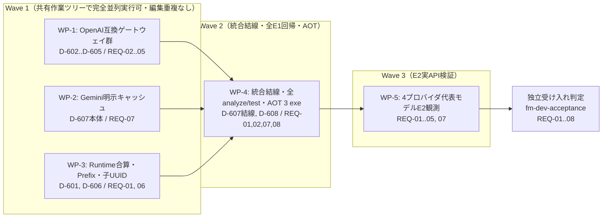

# 作業計画・WP 分解（41_work_packages.md）— プロンプトキャッシュ改善（P0〜P3）

- **プラン**: `docs/plan_20261128_prompt_cache_improve/`（区分: `Full`、判断モード: `おまかせ`）
- **基準ソース版**: Git commit `26d16e15ccc9b6625684baf16d39be9716dfbf0c` ＋現行作業コピー（`plan_20261127_subprocess_heartbeat_and_exec_policy` の未コミット成果を維持）
- **対象要求正本**: [30_requirement.md](30_requirement.md)（`REQ-01`〜`REQ-08`、全件 `今回実装`）
- **対象設計正本**:
  - [40_specification.md](40_specification.md)（全体構造・設定優先順位 §3.1・副作用境界 §3.2）
  - [42_spec_telemetry_and_runtime.md](42_spec_telemetry_and_runtime.md)（`[D-601]`, `[D-606]`）
  - [42_spec_openai_gateways.md](42_spec_openai_gateways.md)（`[D-602]`, `[D-603]`, `[D-604]`, `[D-605]`）
  - [42_spec_gemini_explicit_cache.md](42_spec_gemini_explicit_cache.md)（`[D-607]`, `[D-608]`）
- **技術検証根拠**: [llm_providers_and_cache.md](../cheatsheet/llm_providers_and_cache.md)（§6, §7）

> **注意（権限と完了の区別）**: 各 WP の完了条件は「作業結果と内部確認が揃ったこと（`Implementer state: implemented`）」の確認であり、`REQ-01`〜`REQ-08` の受け入れ判定（`pass / fail`）を代行するものではない。最終的な受け入れ判定は、全 WP 完了後に独立した `fm-dev-acceptance` が行う。

---

## 1. WP 一覧と実行 Wave 構成

本計画は共有作業ツリーでの安全な並列実装を可能にするため、**編集ファイル境界が一切重複せず、かつコンパイル依存も分離された 3 本の実装 WP（Wave 1）** と、**統合結線・全 E1 回帰・AOT ビルド（Wave 2）**、**実 API E2 検証（Wave 3）** の 5 WP で構成する。並列数や特定モデルに依存せず、Wave 1 を 3 並列・2 並列・逐次のいずれで実行しても同一の依存整合を保つ。

| WP | Wave | 担当役 | 目的 | 対応設計 ID | 対応 REQ | 開始条件 |
| :---: | :---: | --- | --- | --- | --- | --- |
| **WP-1** | Wave 1（並列可） | `fm-dev-develop` | OpenAI 互換ゲートウェイ / ドライバ群のキャッシュ制御・SSE 正規化マージ・`prompt_cache_key` 実装 | `[D-602]`, `[D-603]`, `[D-604]`, `[D-605]` | `REQ-02`, `REQ-03`, `REQ-04`, `REQ-05` | 計画 `ready` 承認後、即時開始可 |
| **WP-2** | Wave 1（並列可） | `fm-dev-develop` | `GeminiDriver` ネイティブ明示的 Context Caching (`v1beta/cachedContents`) 実装と専用モック HTTP テスト | `[D-607]`（ドライバ本体） | `REQ-07` | 計画 `ready` 承認後、即時開始可 |
| **WP-3** | Wave 1（並列可） | `fm-dev-develop` | Runtime テレメトリ全ステップ合算・`dynamicContextSummary` Prefix 維持・`SubAgentWorker` 子固有 `sessionUuid` 実装 | `[D-601]`, `[D-606]` | `REQ-01`, `REQ-06` | 計画 `ready` 承認後、即時開始可 |
| **WP-4** | Wave 2（統合） | `fm-dev-develop` | `KernelBootstrap.dispose()` 結線・`step1_1_integration_test.dart` 更新・全パッケージ `dart analyze` / `dart test`・AOT 3 `.exe` ビルド | `[D-601]`, `[D-602]`, `[D-607]`（結線）, `[D-608]` | `REQ-01`, `REQ-02`, `REQ-07`, `REQ-08` | `WP-1`・`WP-2`・`WP-3` 全完了 |
| **WP-5** | Wave 3（実 API 検証） | `fm-dev-tester` | 設定済み 4 クラウドプロバイダ（OpenRouter / Nous Portal / OpenAI / Gemini）代表モデルによる E2 実 API 観測 | `[D-601]`〜`[D-605]`, `[D-607]` | `REQ-01`, `REQ-02`, `REQ-03`, `REQ-04`, `REQ-05`, `REQ-07` | `WP-4` 完了（全 E1・AOT 緑） |



---

## 2. 共有作業ツリーでのファイル編集境界マトリクス（排他保証）

Wave 1 で並列実行する `WP-1`・`WP-2`・`WP-3` は、実装ファイル・テストファイルともに**同一ファイルを一切共有しない**。

| ファイルパス | WP-1 | WP-2 | WP-3 | WP-4 | WP-5 |
| --- | :---: | :---: | :---: | :---: | :---: |
| `packages/agent_drivers/lib/src/llm/gateway_cache_policy.dart`（新規） | **編集** | - | - | 参照のみ | 参照のみ |
| `packages/agent_drivers/lib/src/llm/openrouter_driver.dart` | **編集** | - | - | 参照のみ | 参照のみ |
| `packages/agent_drivers/lib/src/llm/nous_portal_driver.dart` | **編集** | - | - | 参照のみ | 参照のみ |
| `packages/agent_drivers/lib/src/llm/open_ai_compat_driver.dart` | **編集** | - | - | 参照のみ | 参照のみ |
| `packages/agent_drivers/lib/src/llm/openai_driver.dart` | **編集** | - | - | 参照のみ | 参照のみ |
| `packages/agent_drivers/lib/llm_drivers.dart` | **編集** | - | - | 参照のみ | 参照のみ |
| `packages/agent_drivers/test/llm_drivers_test.dart` | **編集** | - | - | 実行のみ | - |
| `packages/agent_drivers/test/open_ai_compat_base_test.dart` | **編集** | - | - | 実行のみ | - |
| `packages/agent_drivers/test/new_providers_driver_test.dart` | **編集** | - | - | 実行のみ | - |
| `packages/agent_drivers/lib/src/llm/gemini_driver.dart` | - | **編集** | - | 参照のみ | 参照のみ |
| `packages/agent_drivers/test/gemini_explicit_cache_test.dart`（**新規**） | - | **編集** | - | 実行のみ | - |
| `packages/agent_runtime/lib/src/process_runner.dart` | - | - | **編集** | 参照のみ | 参照のみ |
| `packages/agent_runtime/lib/src/sub_agent_worker.dart` | - | - | **編集** | 参照のみ | 参照のみ |
| `packages/agent_runtime/lib/src/isolate_worker_host.dart` | - | - | **編集** | 参照のみ | 参照のみ |
| `packages/agent_runtime/test/lead_agent_loop_test.dart` | - | - | **編集** | 実行のみ | - |
| `packages/agent_runtime/test/isolate_multiprocess_ipc_test.dart` | - | - | **編集** | 実行のみ | - |
| `packages/agent_runtime/lib/src/kernel_bootstrap.dart` | - | - | - | **編集** | 参照のみ |
| `packages/agent_runtime/test/step1_1_integration_test.dart` | - | - | - | **編集** | - |
| `packages/agent_kernel/**`・`packages/agent_acp/**`・既存未コミット成果 | 編集禁止 | 編集禁止 | 編集禁止 | 編集禁止（検証のみ） | 編集禁止 |

> **テストファイル配置の補足**: [40_specification.md](40_specification.md) §4.2 では Gemini 明示キャッシュテストを `new_providers_driver_test.dart` と併記しているが、共有作業ツリーで `WP-1`（Nous Portal / OpenAI テスト追記）と `WP-2`（Gemini 明示キャッシュテスト追加）を編集衝突なく並列実行するため、`WP-2` の新規テストは独立ファイル `packages/agent_drivers/test/gemini_explicit_cache_test.dart` に配置する。既存の `new_providers_driver_test.dart` 内 Gemini 既存テストは変更せず `WP-4` の全テスト回帰で検証する。

---

## 3. REQ ↔ 設計 ID ↔ WP ↔ 確認・証跡対応マップ（抜け漏れ検証）

| REQ | 対象設計 ID | 実装 WP | 統合 / E1 WP | E2 検証 WP | 必要な証跡区分 | 抜け漏れ確認 |
| :---: | :---: | :---: | :---: | :---: | :---: | --- |
| **REQ-01** | `[D-601]` | `WP-3` | `WP-4` | `WP-5` | `E1`, `E2` | 複数ステップ・一部 `null`・全 `null` ユニットテスト＋統合テスト＋実 API 合算一致 |
| **REQ-02** | `[D-602]` | `WP-1` | `WP-4` | `WP-5` | `E1`, `E2` | モデル別トップレベル `cache_control` / `content` 非配列化＋統合テスト更新＋OpenRouter 実 API |
| **REQ-03** | `[D-602]`, `[D-603]` | `WP-1` | `WP-4` | `WP-5` | `E1`, `E2` | Nous Portal `x-session-id`/`session_id`/`cache_control` テスト＋Nous 実 API |
| **REQ-04** | `[D-604]` | `WP-1` | `WP-4` | `WP-5` | `E1`, `E2` | SSE 断片マージ（`summary`/`text`/`encrypted`/未知キー）テスト＋推論モデル実 API |
| **REQ-05** | `[D-605]` | `WP-1` | `WP-4` | `WP-5` | `E1`, `E2` | 通常/推論/空 `sessionUuid` 境界テスト＋OpenAI 直接実 API |
| **REQ-06** | `[D-606]` | `WP-3` | `WP-4` | 対象外（`E1` のみ） | `E1` | `dynamicContextSummary` Prefix 一致・`pageDirectorySummary` 非混入・両バックエンド子 `sessionUuid` テスト |
| **REQ-07** | `[D-607]` | `WP-2` | `WP-4`（`dispose` 結線） | `WP-5` | `E1`, `E2` | モック HTTP 9 観点（作成/再利用/閾値/無効化/TTL/フォールバック/競合/`?key=` 禁止）＋`KernelBootstrap.dispose()` 結線＋Gemini 実 API |
| **REQ-08** | `[D-608]` | 全 WP 維持 | `WP-4` | 対象外（`E1` のみ） | `E1` | 全 4 パッケージ `dart analyze`・全 `dart test`・未コミット成果テスト・AOT 3 `.exe` ビルド |

---

## 4. 各 WP の詳細仕様

### WP-1: OpenAI 互換ゲートウェイ / ドライバ群のキャッシュ制御・SSE 正規化・`prompt_cache_key`

- **WP-ID / 目的 / 対応 REQ**:
  - `WP-1` / OpenRouter・Nous Portal 共通明示キャッシュポリシー導入とトップレベル `cache_control` 化、`NousPortalDriver` Sticky Session 対応、`OpenAiCompatDriver` SSE `delta.reasoning_details` 正規化マージ、`OpenAiDriver` `prompt_cache_key` 付与を実装する / `REQ-02`, `REQ-03`, `REQ-04`, `REQ-05`（設計項目 `[D-602]`, `[D-603]`, `[D-604]`, `[D-605]`）
- **必要な入力・参照版**:
  - 基準ソース版: Git commit `26d16e15ccc9b6625684baf16d39be9716dfbf0c` ＋現行作業コピー
  - 要求正本: [30_requirement.md](30_requirement.md)（`REQ-02`〜`REQ-05`）
  - 設計正本: [40_specification.md](40_specification.md)（§1.1, §3.2）、[42_spec_openai_gateways.md](42_spec_openai_gateways.md)（`[D-602]`〜`[D-605]` の全規定）
- **変更する範囲と維持する振る舞い**:
  - **変更対象（実装）**:
    1. `packages/agent_drivers/lib/src/llm/gateway_cache_policy.dart`（新規: `GatewayExplicitCachePolicy`）
    2. `packages/agent_drivers/lib/src/llm/openrouter_driver.dart`（`[D-602]` §1.3）
    3. `packages/agent_drivers/lib/src/llm/nous_portal_driver.dart`（`[D-603]` §2.2）
    4. `packages/agent_drivers/lib/src/llm/open_ai_compat_driver.dart`（`[D-604]` §3.2）
    5. `packages/agent_drivers/lib/src/llm/openai_driver.dart`（`[D-605]` §4.1）
    6. `packages/agent_drivers/lib/llm_drivers.dart`（`gateway_cache_policy.dart` の export 追加）
  - **変更対象（テスト）**:
    1. `packages/agent_drivers/test/llm_drivers_test.dart`（`[D-602]` §1.4）
    2. `packages/agent_drivers/test/new_providers_driver_test.dart`（`[D-603]` §2.3, `[D-605]` §4.2。Gemini 既存テストは変更しない）
    3. `packages/agent_drivers/test/open_ai_compat_base_test.dart`（`[D-604]` §3.4）
  - **編集禁止**: `gemini_driver.dart`, `packages/agent_runtime/**`, `packages/agent_kernel/**`, `packages/agent_acp/**`
  - **維持する振る舞い**:
    - 副作用境界（[40_specification.md §3.2](40_specification.md)）: Canonical IR・`ProjectedPrompt` を汚染しない。
    - `OpenRouterDriver`: `HTTP-Referer`, `X-Title`, `costMicroUsd` / `cacheDiscountUsd` / `cachedTokens` / `cacheWriteTokens` 抽出、`reasoning_details` エコーバック。
    - `NousPortalDriver`: `NOUS_API_KEY` Bearer 認証、`reasoning_content` + `reasoning_details` 併用エコーバック、`usage.cost` 変換。
    - `OpenAiCompatDriver`: 非ストリーミング応答、単一オブジェクト `reasoning_details`、モデル切替時の `CanonicalIrProjector` クリア動作。
    - `OpenAiDriver`: 推論モデル（`o1`/`o3`/`o4`/`gpt-5` 系）の `temperature` 除去・`max_tokens` → `max_completion_tokens` 変換。
    - 未改修ドライバ（`local-ollama`, `ollama-cloud`, `openai-compat`）および `SecretRedactor` 保護。
- **作る成果**:
  - `GatewayExplicitCachePolicy` と上記 4 ドライバの実装、`llm_drivers.dart` の export。
  - `[D-602]`〜`[D-605]` の確認手順（[42_spec_openai_gateways.md](42_spec_openai_gateways.md) §1.4, §2.3, §3.4, §4.2）を満たす自動テスト一式。
- **開始条件・依存**:
  - 計画 `ready` 承認後、他 WP を待たずに即時開始可能（`WP-2`・`WP-3` と並列実行可）。
- **完了条件・確認方法**:
  - 以下のコマンドがすべてエラー 0・全件 pass すること（`E1` 内部確認）:
    ```pwsh
    dart analyze packages/agent_drivers/lib/src/llm/gateway_cache_policy.dart packages/agent_drivers/lib/src/llm/openrouter_driver.dart packages/agent_drivers/lib/src/llm/nous_portal_driver.dart packages/agent_drivers/lib/src/llm/open_ai_compat_driver.dart packages/agent_drivers/lib/src/llm/openai_driver.dart packages/agent_drivers/lib/llm_drivers.dart packages/agent_drivers/test/llm_drivers_test.dart packages/agent_drivers/test/open_ai_compat_base_test.dart packages/agent_drivers/test/new_providers_driver_test.dart
    dart test packages/agent_drivers/test/llm_drivers_test.dart packages/agent_drivers/test/open_ai_compat_base_test.dart packages/agent_drivers/test/new_providers_driver_test.dart
    ```
  - 変更ファイル一覧が本 WP の編集範囲内のみであることを `git status` / `git diff --name-only` で確認すること。
- **統合先・後続への引き渡し**:
  - `WP-4` へ引き渡し（`step1_1_integration_test.dart` の OpenRouter トップレベル `cache_control` アサーション更新および全パッケージ回帰）。
  - `WP-5` へ引き渡し（OpenRouter / Nous Portal / OpenAI 代表モデルの E2 実 API 検証）。
- **未実施・未解決**:
  - なし（ホワイトリスト対象・SSE 構造は `PT-02` 実機確認済み）。

---

### WP-2: `GeminiDriver` ネイティブ明示的 Context Caching（`v1beta/cachedContents`）

- **WP-ID / 目的 / 対応 REQ**:
  - `WP-2` / `GeminiDriver` に Google AI Studio `v1beta/cachedContents` API による Segment 0 明示的 Context Caching、TTL 更新、LRU 制御、並列競合抑止、ネガティブキャッシュ、透過フォールバック、および `dispose()` クリーンアップを実装し、独立したモック HTTP テストで全経路を確認する / `REQ-07`（設計項目 `[D-607]` ドライバ本体）
- **必要な入力・参照版**:
  - 基準ソース版: Git commit `26d16e15ccc9b6625684baf16d39be9716dfbf0c` ＋現行作業コピー
  - 要求正本: [30_requirement.md](30_requirement.md)（`REQ-07`）
  - 設計正本: [40_specification.md](40_specification.md)（§3.1 設定優先順位, §3.2 副作用境界）、[42_spec_gemini_explicit_cache.md](42_spec_gemini_explicit_cache.md)（`[D-607]` §1.1〜§1.6）
  - 技術根拠: [llm_providers_and_cache.md §6](../cheatsheet/llm_providers_and_cache.md)
- **変更する範囲と維持する振る舞い**:
  - **変更対象（実装）**:
    1. `packages/agent_drivers/lib/src/llm/gemini_driver.dart`（`[D-607]` §1.2〜§1.5）
  - **変更対象（テスト）**:
    1. `packages/agent_drivers/test/gemini_explicit_cache_test.dart`（**新規**: `[D-607]` §1.6 の 9 観点を網羅するモック HTTP テスト）
  - **編集禁止**: `packages/agent_drivers/test/new_providers_driver_test.dart`（`WP-1` と衝突回避）、`packages/agent_runtime/lib/src/kernel_bootstrap.dart`（`WP-4` 担当）、その他全ファイル
  - **維持する振る舞い**:
    - 設定優先順位（[40_specification.md §3.1](40_specification.md)）と副作用境界（[40_specification.md §3.2](40_specification.md)）。
    - コンストラクタ・`buildRequestBody(request)`・`void close()` の既存呼び出し互換性 100% 維持。
    - 全 HTTP 通信での `x-goog-api-key` ヘッダ強制および `?key=` クエリパラメータ絶対禁止、`SecretRedactor` によるエラー本文保護。
    - 既存の `thoughtSignature` 保持・エコーバック、`functionResponse` 処理、`usageMetadata.cachedContentTokenCount` 抽出、モデル切替整合性。
- **作る成果**:
  - `GeminiDriver` の明示的 Context Caching 実装および公開メソッド `Future<void> dispose()`・拡張 `buildRequestBody(LlmChatRequest request, {String? cachedContentName})`・`resolveMinCacheTokens`・`resolveCachedContentsEndpoint` / `resolveCachedContentResourceEndpoint`。
  - `packages/agent_drivers/test/gemini_explicit_cache_test.dart`（[42_spec_gemini_explicit_cache.md §1.6](42_spec_gemini_explicit_cache.md) の E1 9 項目すべてを検証）。
- **開始条件・依存**:
  - 計画 `ready` 承認後、他 WP を待たずに即時開始可能（`WP-1`・`WP-3` と並列実行可）。
  - 注: `crypto: ^3.0.6` は `packages/agent_drivers/pubspec.yaml` に導入済みのため `pubspec.yaml` の変更は不要。
- **完了条件・確認方法**:
  - 以下のコマンドがすべてエラー 0・全件 pass すること（`E1` 内部確認）:
    ```pwsh
    dart analyze packages/agent_drivers/lib/src/llm/gemini_driver.dart packages/agent_drivers/test/gemini_explicit_cache_test.dart
    dart test packages/agent_drivers/test/gemini_explicit_cache_test.dart
    ```
  - 変更ファイルが `gemini_driver.dart` と `gemini_explicit_cache_test.dart` のみであることを確認すること。
- **統合先・後続への引き渡し**:
  - `WP-4` へ公開 IF `Future<void> dispose()` を引き渡し、`KernelBootstrap.dispose()` 結線および `new_providers_driver_test.dart` 内の既存 Gemini テスト回帰を確認する。
  - `WP-5` へ引き渡し（`gemini/gemini-2.5-flash` または `gemini/gemini-2.5-pro` 実 API による作成→連続ステップ `cachedContentTokenCount > 0`→`dispose()` クリーンアップの E2 観測）。
- **未実施・未解決**:
  - なし（API 挙動は `PT-02` 実機確認済み）。

---

### WP-3: Runtime テレメトリ全ステップ合算・Prefix 維持・`SubAgentWorker` 子固有 `sessionUuid`

- **WP-ID / 目的 / 対応 REQ**:
  - `WP-3` / `LeadAgent.runTurn` のキャッシュテレメトリ全ステップ合算（`[D-601]`）、`dynamicContextSummary` の Step 1→Step 2 Prefix 維持コミット（`[D-606]` Part A）、および `SubAgentWorker` / `IsolateWorkerHost` の子固有 `sessionUuid` 決定論的導出・引き回し（`[D-606]` Part B）を実装する / `REQ-01`, `REQ-06`（設計項目 `[D-601]`, `[D-606]`）
- **必要な入力・参照版**:
  - 基準ソース版: Git commit `26d16e15ccc9b6625684baf16d39be9716dfbf0c` ＋現行作業コピー
  - 要求正本: [30_requirement.md](30_requirement.md)（`REQ-01`, `REQ-06`）
  - 設計正本: [40_specification.md](40_specification.md)（§1.1）、[42_spec_telemetry_and_runtime.md](42_spec_telemetry_and_runtime.md)（`[D-601]` §1.1〜§1.5, `[D-606]` §2.1〜§2.5）
- **変更する範囲と維持する振る舞い**:
  - **変更対象（実装）**:
    1. `packages/agent_runtime/lib/src/process_runner.dart`（`[D-601]` §1.2, `[D-606]` §2.2）
    2. `packages/agent_runtime/lib/src/sub_agent_worker.dart`（`[D-606]` §2.3）
    3. `packages/agent_runtime/lib/src/isolate_worker_host.dart`（`[D-606]` §2.3 ホスト側防衛線）
  - **変更対象（テスト）**:
    1. `packages/agent_runtime/test/lead_agent_loop_test.dart`（`[D-601]` §1.3・§1.5 の 5 ケース、`[D-606]` §2.5 Part A）
    2. `packages/agent_runtime/test/isolate_multiprocess_ipc_test.dart`（`[D-606]` §2.5 Part B、`GreenTask` / `Isolate` 両バックエンド）
  - **編集禁止**: `packages/agent_runtime/lib/src/kernel_bootstrap.dart`（`WP-4` 担当）、`packages/agent_runtime/test/step1_1_integration_test.dart`（`WP-4` 担当）、`packages/agent_drivers/**`、`packages/agent_kernel/**`、`packages/agent_acp/**`
  - **維持する振る舞い**:
    - `pageDirectorySummary` の Segment 1 混入禁止（`renderTailContent()` をそのままコミットしない）。
    - `dynamicContextSummary == null` / 空の既存動作、Step 1 前 `SIGCONT` 制約注入、Step 2 以降の 85% 予算警告 ephemeral 注入、Step 1 失敗時の未コミット維持。
    - `SubAgentWorker` コンストラクタ後方互換性、Ring 3 隔離、および既存未コミット成果（`plan_20261127_subprocess_heartbeat_and_exec_policy` の heartbeat / exec policy 実装）。
- **作る成果**:
  - `process_runner.dart`・`sub_agent_worker.dart`・`isolate_worker_host.dart` の改修。
  - `lead_agent_loop_test.dart`・`isolate_multiprocess_ipc_test.dart` への新規テスト追加。
- **開始条件・依存**:
  - 計画 `ready` 承認後、他 WP を待たずに即時開始可能（`WP-1`・`WP-2` と並列実行可。ドライバ側変更へのコンパイル依存なし）。
- **完了条件・確認方法**:
  - 以下のコマンドがすべてエラー 0・全件 pass すること（`E1` 内部確認）:
    ```pwsh
    dart analyze packages/agent_runtime/lib/src/process_runner.dart packages/agent_runtime/lib/src/sub_agent_worker.dart packages/agent_runtime/lib/src/isolate_worker_host.dart packages/agent_runtime/test/lead_agent_loop_test.dart packages/agent_runtime/test/isolate_multiprocess_ipc_test.dart
    dart test packages/agent_runtime/test/lead_agent_loop_test.dart packages/agent_runtime/test/isolate_multiprocess_ipc_test.dart
    ```
  - 既存未コミット成果の直接関連テスト（`subprocess_heartbeat_and_wait_test.dart`, `exec_policy_and_classifier_test.dart`, `exec_policy_runtime_integration_test.dart`）に回帰がないことも併せて確認可能。
- **統合先・後続への引き渡し**:
  - `WP-4` へ引き渡し（`step1_1_integration_test.dart` での `turnSummary.usage` 合算確認および全パッケージ回帰）。
  - `WP-5` へ引き渡し（実 API マルチステップ実行での `AgentTurnResult.usage` と `llm_io.jsonl` 合算一致の E2 確認）。
- **未実施・未解決**:
  - なし。

---

### WP-4: 統合結線（`KernelBootstrap` / 統合テスト）・全パッケージ無回帰（E1）・AOT 3 `.exe` ビルド

- **WP-ID / 目的 / 対応 REQ**:
  - `WP-4` / Wave 1（`WP-1`〜`WP-3`）の全成果を統合し、`KernelBootstrap.dispose()` へ `GeminiDriver.dispose()` を結線、`step1_1_integration_test.dart` を新仕様へ適合させたうえで、全 4 パッケージの `dart analyze`・全 `dart test`・未コミット成果テスト・AOT 3 `.exe` ビルドの無回帰を検証する / `REQ-01`, `REQ-02`, `REQ-07`, `REQ-08`（設計項目 `[D-601]`, `[D-602]`, `[D-607]` 結線, `[D-608]`）
- **担当役**: `fm-dev-develop`（統合実装および E1 回帰・ビルド確認担当）
- **必要な入力・参照版**:
  - `WP-1`・`WP-2`・`WP-3` の完了成果および差分
  - 設計正本: [42_spec_gemini_explicit_cache.md](42_spec_gemini_explicit_cache.md)（`[D-607]` §1.5(5) `KernelBootstrap` 連携、`[D-608]` §2.1〜§2.2）、[42_spec_openai_gateways.md](42_spec_openai_gateways.md)（`[D-602]` §1.4）、[42_spec_telemetry_and_runtime.md](42_spec_telemetry_and_runtime.md)（`[D-601]` §1.4）
- **変更する範囲と維持する振る舞い**:
  - **変更対象（実装）**:
    1. `packages/agent_runtime/lib/src/kernel_bootstrap.dart`（`ownedClosers` の `FutureOr<void> Function()` 化、`GeminiDriver` 登録時の `created.dispose` 登録、`dispose()` 内の `await closer()`）
  - **変更対象（テスト）**:
    1. `packages/agent_runtime/test/step1_1_integration_test.dart`（OpenRouter `anthropic/` 検証をトップレベル `cache_control: {'type': 'ephemeral'}` 期待値へ更新、`turnSummary.usage` 合算確認）
  - **維持する振る舞い**:
    - 他の同期 `close()` 登録（`LocalOllamaDriver`, `OpenRouterDriver`, `OllamaSearch` 等）は既存動作を維持。
    - 既存未コミット成果（`plan_20261127_subprocess_heartbeat_and_exec_policy`）、セキュリティ境界（`SecretRedactor`, Gemini `?key=` 禁止, VFS, Ring 隔離, Capability/Policy）、未改修プロバイダに回帰なし。
- **作る成果**:
  - `kernel_bootstrap.dart` 結線・`step1_1_integration_test.dart` 更新。
  - 全 4 パッケージ（`agent_kernel`, `agent_drivers`, `agent_runtime`, `agent_acp`）の `dart analyze` エラー 0 件および `dart test` 全件 pass の実行結果（`E1`）。
  - AOT 3 `.exe`（`build/acp_cli_client.exe`, `build/acp_kanban_app.exe`, `build/agent_os_daemon.exe`）の正常ビルド結果（`E1`）。
- **開始条件・依存**:
  - `WP-1`（`OpenRouterDriver` トップレベル `cache_control` 確定）、`WP-2`（`GeminiDriver.dispose()` 確定）、`WP-3`（`process_runner.dart` 合算・Prefix 維持確定）のすべてが完了していること。
- **完了条件・確認方法**:
  - 統合変更後の作業コピーに対し、以下すべてがエラー 0・全件 pass すること（`E1`）:
    1. **全パッケージ静的解析**:
       ```pwsh
       dart analyze packages/agent_kernel packages/agent_drivers packages/agent_runtime packages/agent_acp
       ```
    2. **全パッケージ全テスト回帰**（既存未コミット成果の関連テスト `subprocess_heartbeat_and_wait_test.dart`, `exec_policy_and_classifier_test.dart`, `exec_policy_runtime_integration_test.dart` を含む）:
       ```pwsh
       dart test packages/agent_kernel packages/agent_drivers packages/agent_runtime packages/agent_acp
       ```
    3. **AOT 3 `.exe` ビルド**:
       ```pwsh
       dart compile exe packages/agent_acp/bin/acp_cli_client.dart -o build/acp_cli_client.exe
       dart compile exe packages/agent_acp/bin/acp_kanban_app.dart -o build/acp_kanban_app.exe
       dart compile exe packages/agent_acp/bin/agent_os_daemon.dart -o build/agent_os_daemon.exe
       ```
    4. **基準作業コピーとの差分照合**: 意図しないファイル破壊や `plan_20261127_subprocess_heartbeat_and_exec_policy` 成果の欠損がないことを `git status` / `git diff --stat` で確認する。
- **統合先・後続への引き渡し**:
  - 確定した統合済みソース版を `WP-5`（`fm-dev-tester` による E2 実 API 検証）へ引き渡す。
- **未実施・未解決**:
  - 本 WP 完了時点では `E2` 実 API 観測（`REQ-01`〜`REQ-05`, `REQ-07`）が未実施であるため、必ず `WP-5` へ進む。

---

### WP-5: 実 API（E2）検証 — 設定済み 4 クラウドプロバイダ代表モデル観測

- **WP-ID / 目的 / 対応 REQ**:
  - `WP-5` / 統合済み実装に対し、利用許可済みの設定済み 4 クラウドプロバイダ（OpenRouter / Nous Portal / OpenAI / Gemini）の代表モデルで実 API 連続ステップ実行を行い、`30_requirement.md` で `E2` 証跡が求められている項目を独立に実観測する / `REQ-01`, `REQ-02`, `REQ-03`, `REQ-04`, `REQ-05`, `REQ-07`
- **担当役**: `fm-dev-tester`（独立検証・実 API 観測担当。プロダクトコードの編集は禁止）
- **必要な入力・参照版**:
  - `WP-4` 完了後の統合済みソース版（commit / 差分参照を特定して記録）
  - 要求正本: [30_requirement.md](30_requirement.md)（§1 `REQ-01`〜`REQ-05`, `REQ-07` の E2 条件、§3 検証範囲・対象外）
  - 設計正本: 各 `42_spec_*.md` の E2 確認手順
  - 環境: `.agent_os/.env` またはプロセス環境変数に設定済みの各 API キー（OpenRouter クレジット枠 \$10 相当以内。秘密情報はログ・報告へ一切出力しない）
- **変更する範囲と維持する振る舞い**:
  - **プロダクトコード・正式テスト**: 編集禁止。
  - **一時検証スクリプト**: 必要な場合はプロジェクトトップの `.planworks/` 配下にのみ作成し、観測完了後に削除するか証跡参照だけを残す（`docs/` 配下に一時ファイルを作らない）。
- **作る成果**:
  - 各観測シナリオのコマンド・対象モデル・期待値 vs 実測値（`promptTokens`, `cachedTokens`, `cacheWriteTokens`, `cacheHitRate`, `cachedContentTokenCount`, `reasoning_details` 要素数・構造、クリーンアップ結果）をまとめた E2 検証報告（`SecretRedactor` 適用済み、生キーなし）。
- **開始条件・依存**:
  - `WP-4` が完了し、全パッケージ `dart analyze` / `dart test` / AOT 3 `.exe` ビルドが緑であること。
- **完了条件・確認方法**:
  - 以下の 6 観測シナリオをすべて実行し、期待結果との照合結果を報告すること（外部一時障害 503 等が発生した場合は `30_requirement.md` §3 に従い同等カテゴリの代替モデルまたは切り分け事実を記録し、未観測を成功扱いしない）:
    1. **`REQ-01`（多ステップ合算一致）**: OpenRouter または OpenAI で Tool Call を含む 2 ステップ以上のターンを実行し、`AgentTurnResult.usage`（および ACP `turnSummary.usage`）の `cachedTokens`・`cacheWriteTokens`・`cacheHitRate` が同一ターンの `llm_io.jsonl` 全ステップ合算値と一致すること。
    2. **`REQ-02`（OpenRouter トップレベル `cache_control`）**: `openrouter/anthropic/claude-haiku-4.5` および非 Anthropic 明示キャッシュ代表モデル（`openrouter/qwen/qwen3-coder-flash`）で最小閾値超プロンプトを連続実行し、エラーなく応答し Step 2 以降で `cachedTokens > 0` が観測されること。
    3. **`REQ-03`（Nous Portal Sticky Session & `cache_control`）**: `nous-portal/anthropic/claude-haiku-4.5`（4,096 tokens 超プロンプト）で連続実行し、Step 1 で `cacheWriteTokens > 0`、Step 2 以降で `cachedTokens > 0` が観測されること。
    4. **`REQ-04`（SSE `delta.reasoning_details` 正規化）**: `openrouter/openai/gpt-5-mini` 等の推論モデルで複数ステップ実行し、次ステップへエコーバックされる `reasoning_details` が正規化済み（細切れ配列増殖なし）でエラーなく応答・キャッシュヒットすること。
    5. **`REQ-05`（OpenAI `prompt_cache_key`）**: `openai/gpt-4o-mini` 等で `prompt_cache_key` 付き連続ステップを実行し、HTTP 200 正常受理および Step 2 以降の `cachedTokens > 0` が観測されること。
    6. **`REQ-07`（Gemini `v1beta/cachedContents`）**: `gemini/gemini-2.5-flash`（1,024 tokens 超）または `gemini/gemini-2.5-pro`（2,048 tokens 超）の Segment 0 で 2 ステップ連続実行し、`cachedContents` 作成→連続ステップでの `cachedContentTokenCount > 0` 観測→`dispose()` でのクリーンアップ完了が確認できること。
- **統合先・後続への引き渡し**:
  - `WP-4`（`E1` 証跡）および `WP-5`（`E2` 証跡）の結果と対象版参照を、独立した `fm-dev-acceptance` へ引き渡し、`REQ-01`〜`REQ-08` の受け入れ判定を行う。
- **未実施・未解決**:
  - 実行前に API キーの疎通・クレジット残高（OpenRouter \$10 枠内）を確認する。外部プロバイダの一時障害（503 等）が起きた場合は代替モデルまたは切り分け記録を leader へ返す。

---

## 5. 実装フェーズ着手時の実行順序とチェックポイント

1. **今開始できる作業（Wave 1 — 計画 `ready` 承認後）**: `WP-1`, `WP-2`, `WP-3`（3 並列または任意の順序で開始可能）。
2. **開始できない作業と解除条件**:
   - `WP-4`: `WP-1`・`WP-2`・`WP-3` の全完了と差分確認が解除条件。
   - `WP-5`: `WP-4` の全パッケージ `dart analyze` / `dart test` / AOT 3 `.exe` 緑が解除条件。
   - 最終受け入れ（`fm-dev-acceptance`）: `WP-4`・`WP-5` の証跡回収と環境宣言（`env_manifest.md`）更新が解除条件。
3. **改訂・手戻り発生時の扱い**:
   - Wave 1 のいずれかで失敗・仕様疑義が発生した場合は、共有作業ツリーの他 WP の編集範囲へ波及しないため、該当 WP のみを停止・協議し、無関係な WP の成果は保持候補として切り分ける。
