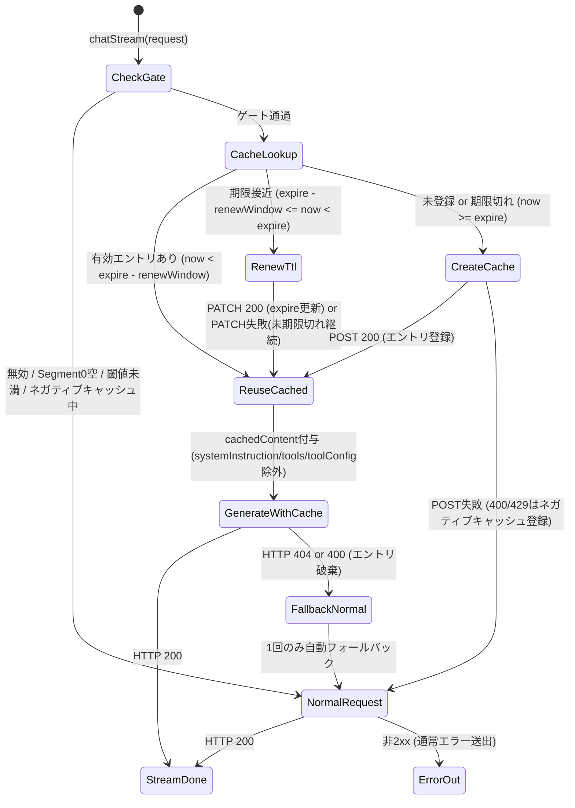

# 詳細仕様書 — Gemini ネイティブ明示的 Context Caching & 無回帰確認（42_spec_gemini_explicit_cache.md）

- **親仕様書**: [40_specification.md](40_specification.md)
- **対応 REQ**: `REQ-07`（P3）, `REQ-08`（共通）
- **収録設計項目**: `[D-607]`, `[D-608]`
- **実機調査根拠**: [llm_providers_and_cache.md §6](../cheatsheet/llm_providers_and_cache.md)

---

D-607: `GeminiDriver` ネイティブ明示的 Context Caching (`v1beta/cachedContents`)

### 1.1 対象 REQ と前提事実（`PT-02` 実機確認済み）
- **対応 REQ**: `REQ-07`（[30_requirement.md](30_requirement.md)）
- **対象ファイル**:
  - `packages/agent_drivers/lib/src/llm/gemini_driver.dart`
  - `packages/agent_runtime/lib/src/kernel_bootstrap.dart`（`dispose()` 時の `GeminiDriver.dispose()` 呼び出し）
- **`PT-02` 実機確認済みの制約・事実**:
  1. `POST /v1beta/cachedContents` は `contents` フィールドを完全省略して `systemInstruction` + `tools`（`functionDeclarations`）のみで HTTP 200 作成可能（ダミー `contents` 不要）。
  2. 実測最小トークン閾値: `gemini-2.5-flash` / `gemini-3-flash-preview` は **`1,024` tokens**、`gemini-2.5-pro` は **`2,048` tokens**。
  3. 生成リクエスト（`:streamGenerateContent?alt=sse` / `:generateContent`）に `cachedContent` を指定する場合、**`systemInstruction`・`tools`・`toolConfig` の 3 項目を必ず除外**しなければならない（同時指定は `HTTP 400 INVALID_ARGUMENT`）。
  4. `PATCH /v1beta/{name}` に `{"ttl": "300s"}`（`updateMask` 省略可）で有効期限延長が可能（HTTP 200）。
  5. `DELETE /v1beta/{name}` で不要キャッシュを削除可能（HTTP 200）。
  6. 全通信で `x-goog-api-key` ヘッダのみ使用し `?key=` クエリパラメータは一切使用しない。

### 1.2 コンストラクタ・設定オプション・優先順位
`GeminiDriver` コンストラクタに以下の任意パラメータを追加する（すべてデフォルト値または `null` を持ち、既存呼び出し元と 100% 後方互換）。

```dart
GeminiDriver({
  String? baseUrl,
  String? apiKey,
  LlmEnvLoader? envLoader,
  SecretRedactor? redactor,
  http.Client? httpClient,
  this.requestTimeout = const Duration(seconds: 120),
  bool? enableExplicitCaching,
  Duration? explicitCacheTtl,
  Duration explicitCacheRenewWindow = const Duration(seconds: 60),
  int? explicitCacheMinTokensOverride,
  int maxCachedEntries = 4,
  DateTime Function()? clock,
})
```

- **有効/無効判定（優先順位: [40_specification.md §3.1](40_specification.md) 準拠）**:
  1. コンストラクタ引数 `enableExplicitCaching != null` → その値を使用。
  2. 環境変数 `GEMINI_EXPLICIT_CACHE`（`envLoader` → `Platform.environment`）:
     - 小文字・trim 後に `'0'`, `'false'`, `'off'`, `'no'` のいずれかなら **`false`**。
     - それ以外の非空値なら `true`。
  3. 未設定時の既定値 → **`true`（デフォルト有効）**（おまかせ合意 #3 準拠）。
- **TTL 解決**:
  1. コンストラクタ引数 `explicitCacheTtl != null` → その値を使用。
  2. 環境変数 `GEMINI_EXPLICIT_CACHE_TTL_SECONDS` が正の整数としてパース可能なら `Duration(seconds: value.clamp(60, 3600))`。
  3. 未設定時の既定値 → **`Duration(seconds: 300)`**（`"300s"` = 5 分）。
- **更新ウィンドウ**: 既定 `60s`（ただし `ttl <= renewWindow` の場合は `Duration(seconds: ttl.inSeconds ~/ 3)` へ自動調整）。

### 1.3 エンドポイント構築とセキュリティ規約
- `resolveCachedContentsEndpoint()` → `{base}/v1beta/cachedContents`（ベース URL に既に `/v1beta` がある場合は重複させない）。`uri.queryParameters` に `key` が含まれていても必ず除去する。
- `resolveCachedContentResourceEndpoint(String resourceName)`:
  - `resourceName` の先頭 `/` を除去（例: `cachedContents/abc123` → `{base}/v1beta/cachedContents/abc123`）。
  - `uri.queryParameters` から `key` を必ず除去する。
- 全 HTTP リクエスト（`POST`, `PATCH`, `DELETE`, `:streamGenerateContent`, `:generateContent`）のヘッダは以下のみ：
  - `'Content-Type': 'application/json'`（`DELETE` 時は任意）
  - `'x-goog-api-key': apiKey`
- すべてのエラーメッセージおよびデバッグ文字列に `_redactor.redactString(...)` を適用する。

### 1.4 Segment 0 キャッシュキー計算と事前推定ゲート
1. **モデル名正規化**:
   - `cleanModel = request.model.modelName.trim()`、先頭 `'models/'` を除去。
   - API リソース形式: `modelResourceName = 'models/$cleanModel'`。
2. **Segment 0 抽出**:
   - `systemInstruction`（全 `ProjectedRole.system` メッセージの非空結合。現行 `buildRequestBody` と同一ロジック）。
   - `tools`（`request.prompt.tools` を `sanitizeSchemaForGemini` 適用した `functionDeclarations` リスト。現行 `buildRequestBody` と同一ロジック）。
   - `systemInstruction` と `tools` が**両方とも空**の場合は明示キャッシュ対象外（通常経路へ）。
3. **モデル別最小トークン閾値（`static int resolveMinCacheTokens(String modelName)`）**:
   - `explicitCacheMinTokensOverride != null` → その値（テスト・調整用）。
   - `cleanModel.toLowerCase().contains('flash')` → **`1024`**
   - `cleanModel.toLowerCase().contains('pro')` → **`2048`**
   - その他未知モデル → **`2048`**（保守的既定値）
4. **事前推定トークンゲート**:
   - Segment 0 ペイロード（`systemInstruction` と `tools` のみを含む Map）を `jsonEncode` し、UTF-8 バイト長から `estimatedTokens = (utf8.encode(segment0Json).length + 3) ~/ 4`（切り上げ）を算出する。
   - `estimatedTokens < minTokens` の場合は `cachedContents` API を一切呼ばず、通常経路（暗黙キャッシュ）でリクエストを送信する。
5. **キャッシュキー（SHA-256）**:
   - 決定的 JSON 文字列 `jsonEncode(<String, dynamic>{'model': modelResourceName, if (systemInstruction != null) 'systemInstruction': systemInstruction, if (tools != null) 'tools': tools})` に対して `sha256.convert(utf8.encode(...)).toString()`（`package:crypto`）を算出し `cacheKey` とする。
   - `contents`（会話履歴）は一切含めない。

### 1.5 状態管理・状態遷移・並行制御・失効後動作



#### 内部状態構造
- `final Map<String, _GeminiCachedContentEntry> _cacheEntries = <String, _GeminiCachedContentEntry>{};`
  - `_GeminiCachedContentEntry`: `cacheKey`, `resourceName`（例: `cachedContents/xyz`）, `expireTime`（`DateTime` UTC）, `totalTokenCount`（`int?`）, `lastUsedAt`（`DateTime` UTC）。
  - 挿入・参照時に `lastUsedAt` を更新し、`_cacheEntries.length > maxCachedEntries`（既定 4）となった場合は最古エントリをローカルマップから除去し、ベストエフォートで `DELETE /v1beta/{name}` を非同期実行する。
- `final Map<String, Future<_GeminiCachedContentEntry?>> _inFlightCreates = <String, Future<_GeminiCachedContentEntry?>>{};`
  - **非同期競合（並列リクエスト）対策**: 同一 `cacheKey` で作成が進行中の場合、後続リクエストは新規 `POST` を発行せず `_inFlightCreates[cacheKey]!` を `await` して同じ作成結果を共有する。`finally` で必ず `_inFlightCreates.remove(cacheKey)` する。
- `final Map<String, DateTime> _rejectedKeys = <String, DateTime>{};`
  - **ネガティブキャッシュ**: 作成リクエストが `HTTP 400`（実トークン数が最小閾値未満等）を返した場合は `now + 5分`、`HTTP 429`（クォータ超過）を返した場合は `now + 60秒` まで同一 `cacheKey` の再作成を抑止し、無駄な HTTP 往復を防ぐ。期限経過後は自動的に再試行可能に戻る。

#### 各操作の詳細仕様
1. **作成（`POST /v1beta/cachedContents`）**:
   - リクエストボディ:
     ```json
     {
       "model": "models/gemini-2.5-flash",
       "systemInstruction": { ... },
       "tools": [ ... ],
       "ttl": "300s"
     }
     ```
     （`systemInstruction` または `tools` が空のものは省略。`contents` は常に省略。）
   - レスポンス解析: `name`（非空 `String`）と `expireTime`（RFC 3339 `DateTime.tryParse`、欠落時は `now.add(ttl)`）、`usageMetadata.totalTokenCount` を抽出。
   - **失敗時**: `cancelToken?.isCancelled == true` のみ `ECANCELLED` を送出。それ以外の全エラー（`400`, `403`, `404`, `429`, `5xx`, `TimeoutException`, ネットワーク例外、JSON パース失敗）は例外を外へ投げず、`400`/`429` のみ `_rejectedKeys` に記録して `null` を返し通常経路へフォールバックする。
2. **TTL 延長（`PATCH /v1beta/{name}`）**:
   - 条件: `now >= entry.expireTime - renewWindow` かつ `now < entry.expireTime`。
   - ボディ: `{"ttl": "${ttl.inSeconds}s"}`（短いタイムアウト、例: `min(requestTimeout, 10s)`）。
   - 成功（HTTP 200）: レスポンスの `expireTime`（欠落時は `now.add(ttl)`）で `entry.expireTime` を更新。
   - 失敗: 警告として握りつぶし、現在の `entry` で生成を試みる（もし実際に期限切れであれば次の 404/400 フォールバックで確実に救済される）。
3. **生成リクエスト構築（`buildRequestBody` の拡張）**:
   - シグネチャ: `Map<String, dynamic> buildRequestBody(LlmChatRequest request, {String? cachedContentName})`（既存呼び出し `buildRequestBody(request)` と 100% 後方互換）。
   - `cachedContentName != null && cachedContentName.isNotEmpty` の場合:
     - `body['cachedContent'] = cachedContentName;`
     - **`body` に `'systemInstruction'`、`'tools'`、`'toolConfig'` を一切含めない**。
     - `'contents'` と `'generationConfig'` は通常通り含める。
4. **参照時の失効フォールバック（1 回自動リトライ）**:
   - `cachedContentName != null` で送信した生成リクエストが **`HTTP 404` または `HTTP 400`** を返した場合：
     - HTTP ステータス確認時点では `yield` 前のためストリーム破壊は一切ない。
     - レスポンスボディを安全にドレイン／破棄し、`_cacheEntries.remove(cacheKey)` を実行する。
     - **`cachedContentName: null`（`systemInstruction` + `tools` 付き）の通常リクエストを 1 回だけ再送信**する。
     - 再送信も失敗した場合は通常の `_mapHttpError` で `LlmDriverException` を送出する。
   - `HTTP 401` / `403`（認証エラー）や `429` / `5xx` はキャッシュ失効ではないため通常エラー処理へ流す（ただし `cachedContents` 作成段階の 429/5xx は上記 1 の通り通常経路へフォールバック済み）。
5. **破棄時クリーンアップ（`dispose()` と `close()`）**:
   - 新規メソッド `Future<void> dispose()`:
     - `_cacheEntries` の全エントリをスナップショットしローカルマップをクリア。
     - `apiKey != null` であれば各エントリへ `DELETE /v1beta/{name}`（ヘッダ `x-goog-api-key` のみ、各 3 秒タイムアウト、例外は無視）を `Future.wait` でベストエフォート並列実行する。
     - その後、`_ownsClient` なら `_httpClient.close()` を呼ぶ。
   - 既存メソッド `void close()`:
     - 後方互換維持のため残す。`_cacheEntries.clear();` の後、`_ownsClient` なら `_httpClient.close()`。
   - `KernelBootstrap` 連携（`packages/agent_runtime/lib/src/kernel_bootstrap.dart`）:
     - `ownedClosers` の型を `List<void Function()>` から `List<FutureOr<void> Function()>` へ拡張し、`GeminiDriver` 登録時は `ownedClosers.add(created.dispose)` を登録、`KernelBootstrap.dispose()` で `await closer();` を実行する（他の同期 `close()` 登録は変更不要でそのまま動作）。

### 1.6 確認手順（`REQ-07` 対応）
- **E1（モック HTTP テスト — `packages/agent_drivers/test/new_providers_driver_test.dart`）**:
  1. **作成→再利用**: 閾値超の Segment 0 で 2 連続リクエストを送り、1 回目で `POST /v1beta/cachedContents`（`contents` なし、`systemInstruction` + `tools` あり、`ttl: "300s"`）→ `:streamGenerateContent?alt=sse`（`cachedContent` あり、**`systemInstruction` / `tools` / `toolConfig` すべて不在**）、2 回目は `POST /v1beta/cachedContents` を呼ばず同一 `cachedContent` を再利用することを検証。
  2. **モデル別閾値・事前ゲート**: Flash（`1024`）と Pro（`2048`）の閾値判定、および閾値未満プロンプトで `cachedContents` API が一切呼ばれないことを検証。
  3. **無効化スイッチ・優先順位**: コンストラクタ `enableExplicitCaching: false` および環境変数 `GEMINI_EXPLICIT_CACHE=false` で `cachedContents` API が呼ばれないこと、コンストラクタ `true` が環境変数 `false` に勝つことを検証。
  4. **キー変更・LRU 削除**: モデルまたは Segment 0 変更時に新キーで再作成されること、`maxCachedEntries` 超過時に最古エントリが `DELETE` されることを検証。
  5. **TTL 期限接近 `PATCH` / 期限切れ再作成**: 注入した `clock` を進め、残り `< 60s` で `PATCH /v1beta/{name}` が呼ばれること、期限切れ後に `POST /v1beta/cachedContents` で再作成されることを検証。
  6. **透過フォールバック（作成失敗）**: `POST /v1beta/cachedContents` が `400`, `429`, `500`, ネットワーク例外を返しても通常生成リクエスト（`systemInstruction` + `tools` 付き）へ透過フォールバックして成功すること、および `400`/`429` 後にネガティブキャッシュで連続作成リトライが抑止されることを検証。
  7. **透過フォールバック（参照時 404 / 400）**: `cachedContent` 付き生成が `404` または `400` を返した際、キャッシュエントリを破棄して `systemInstruction` + `tools` 付き通常リクエストへ 1 回自動リトライし成功することを検証。
  8. **並列競合抑止**: 同一 `cacheKey` で 2 リクエストを同時起動した際、`POST /v1beta/cachedContents` が 1 回のみ実行されることを検証。
  9. **クリーンアップとセキュリティ**: `dispose()` で保持キャッシュへ `DELETE /v1beta/{name}` が呼ばれること、全リクエスト（`POST`/`PATCH`/`DELETE`/生成）で `x-goog-api-key` ヘッダのみ使用され URI に `?key=` が一切含まれないこと、`SecretRedactor` でエラー本文の生キーがマスクされること、`thoughtSignature` エコーバック・`functionResponse`・`cachedContentTokenCount` 抽出が維持されることを検証。
- **E2（実 API 観測）**:
  - `GEMINI_API_KEY` を用いて `gemini/gemini-2.5-flash`（または `gemini/gemini-2.5-pro`）に対し 1,024（または 2,048）tokens 超の Segment 0 で 2 ステップ連続実行し、`cachedContents` 作成→連続ステップで `cachedContentTokenCount > 0` が観測され、`dispose()` でクリーンアップが完了することを確認する。

---

D-608: 既存機能・セキュリティ境界・未コミット成果・`dart analyze` / `dart test` / AOT 3 `.exe` 無回帰保証

### 2.1 対象 REQ と維持境界
- **対応 REQ**: `REQ-08`（[30_requirement.md](30_requirement.md)）
- **維持すべき既存境界・成果**:
  1. `SecretRedactor` による API キー保護、Gemini `?key=` 禁止、VFS 境界、Ring 隔離、Capability/Policy 判定。
  2. 未改修プロバイダ（`local-ollama`, `ollama-cloud`, `openai-compat`）の既存動作。
  3. 基準作業コピー上の既存未コミット成果（`plan_20261127_subprocess_heartbeat_and_exec_policy`）を破壊しないこと。

### 2.2 確認手順（`REQ-08` 対応 — 全件 `E1`）
1. **静的解析**:
   - リポジトリルートまたは全対象パッケージ（`packages/agent_kernel`, `packages/agent_drivers`, `packages/agent_runtime`, `packages/agent_cli`）で `dart analyze` を実行し、エラー 0 件を確認する。
2. **全テスト回帰**:
   - 全対象パッケージで `dart test` を実行し、既存テスト（期待値更新済み分を含む）＋新規追加テストが全件 pass することを確認する。
   - 既存未コミット成果の関連テスト（`subprocess_heartbeat_and_wait_test.dart`, `exec_policy_and_classifier_test.dart`, `exec_policy_runtime_integration_test.dart`）がすべて pass することを確認する。
3. **AOT 3 `.exe` ビルド確認**:
   - 既存 AOT ビルド対象 3 バイナリ（`agent_cli` 等の `.exe` ビルドコマンド）がすべてエラーなくビルド完了することを確認する。
