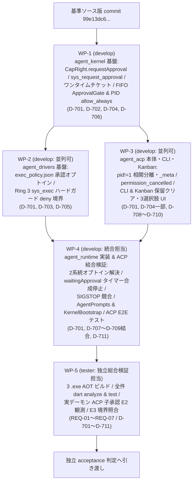

# 41_work_packages.md — 作業パッケージ（WP）分解・依存関係・並列編集境界・確認計画

関連文書:
- 確定要求・受け入れ条件（正本）: [30_requirement.md](./30_requirement.md)（`REQ-01`〜`REQ-07`）
- 全体仕様・優先順位・失効契約（正本）: [40_specification.md](./40_specification.md)（`D-701`〜`D-711`、§3 横断優先順位契約・副作用許容境界・状態失効契約）
- カーネル・ドライバ層詳細設計: [42_spec_kernel_approval.md](./42_spec_kernel_approval.md)（`D-702`〜`D-706`）
- ランタイム・ACP/CLI/Kanban 層詳細設計: [42_spec_runtime_and_acp.md](./42_spec_runtime_and_acp.md)（`D-707`〜`D-711`）
- 進捗正本: [90_status.md](./90_status.md)

基準ソース版: Git commit `99e13dc660a5dc09858ebac313563bdc32b242f5`（未コミット変更 `0` 件）

---

## 1. 全体構成・依存関係・並列編集境界

### 1.1 パッケージ依存関係と実コード静的互換性（事前確認済み事実）

Dart Pub Workspace の単方向依存関係は `agent_kernel` → `agent_drivers` → `agent_runtime` → `agent_acp` である（ただし `packages/agent_acp/lib/src/kanban/` はエンジン 3 パッケージに非依存の純粋 wire/UI 層）。基準ソース版 `99e13dc660a5dc09858ebac313563bdc32b242f5` の全 4 パッケージ（`lib/` および `test/`）を実コード照合し、以下を確認済みである：

1. **`CapRight` に対する網羅的 `switch` ゼロ**: `agent_kernel`, `agent_drivers`, `agent_runtime`, `agent_acp` のいずれにも `CapRight` を対象とする網羅的 `switch` 式・文は存在しない（`CapRight.values` 参照も `skill_registry.dart` L138、`process_syscalls.dart` L747/L819、`context_pager_test.dart` L644 の部分集合検証のみで自動互換）。
2. **後方互換シグネチャ**: `agent_kernel` で追加する引数・フィールド（`SpawnSpec.allowUserApproval`、`deriveForProfile(..., {bool allowUserApproval = false})`、`SyscallHookContext.namespace` / `isApprovalPrecheck`、`ApprovalRequest` の任意メタ属性、`ApprovalGate` のコールバック）はすべて省略可能な名前付き引数／nullable フィールドであるため、`WP-1`（`agent_kernel`）単独完了時点で上位 3 パッケージ未変更のままワークスペース全体の `dart analyze` がエラーゼロで成立する。
3. **上位パッケージ間の依存分離**:
   - `packages/agent_drivers`（`[D-703]`, `[D-705]`）は `WP-1` の `agent_kernel` API（`ProcessProfileId.supportsUserApprovalOptIn`, `ProtectionRing`, `SyscallHookContext.namespace`）のみに依存する。
   - `packages/agent_acp` の本体実装（`[D-708]`, `[D-709]`, `[D-710]`）も `WP-1` の `agent_kernel` API（`ApprovalRequest` 拡張フィールド、`ApprovalGrant`、`SyscallHookContext.isApprovalPrecheck`）のみに依存し、`agent_drivers` / `agent_runtime` の新規シンボルには依存しない（`acp_server.dart` L426 は既に `execPolicy: config.execPolicy` を `KernelBootstrapConfig` へ渡している）。
   - `packages/agent_runtime`（`[D-707]`, `[D-711]`）は `agent_kernel`（`WP-1`）と `agent_drivers`（`WP-2` の `ExecPolicyConfig.subprocessApprovalProfiles`）の双方を使用し、さらに `AcpServer`＋実サブプロセスの結合自動テストは `WP-1`〜`WP-3` と `agent_runtime` が揃った段階で実行可能となる。

### 1.2 WP 一覧と実行依存グラフ（DAG）

未解決の技術調査・利用者判断は 0 件（[30_requirement.md](./30_requirement.md) §3、[40_specification.md](./40_specification.md) §5）であるため、調査 WP は置かず以下の **5 作業パッケージ（`WP-1`〜`WP-5`）** で構成する：

- **`WP-1`（Kernel 承認権・`sys_request_approval`・チケット・FIFO `ApprovalGate`）**: 即時開始可能（先行確定境界）。
- **`WP-2`（Drivers `exec_policy.json` オプトイン・Ring 3 ハードガード）** と **`WP-3`（ACP 相関分離・`_meta`・キャンセル保留クリア・CLI / Kanban UI）**: `WP-1` 完了後、編集パッケージが完全に分離されているため **同時並列実行が可能**（直列実行でも可）。
- **`WP-4`（Runtime タイマー合成停止・`SIGSTOP` 競合・プロンプト／スキーマ結線・ACP 子プロセス結合テスト）**: `WP-2` と `WP-3` の**両方が完了した後**に統合担当（`develop`）が直列実行する。
- **`WP-5`（Windows 3 `.exe` AOT ビルド・全パッケージ回帰・純粋性検査・実デーモン `E2` 観測・`E3` 照合）**: `WP-4` 完了後に独立検証担当（`tester`）が実行し、独立 `acceptance` 判定への引き渡し証跡を揃える。

### 1.3 パッケージ・ファイル編集境界マトリクス（同時編集ゼロ保証）

共有作業ツリーまたは分離作業場所のいずれで実行する場合も下表の専有境界を厳守し、並列実行可能な `WP-2` と `WP-3` の間で同一パッケージ・同一ファイルを同時編集してはならない。

| パッケージ | `WP-1` 専有（先行直列） | `WP-2` 専有（`WP-1` 後・`WP-3` と並列可） | `WP-3` 専有（`WP-1` 後・`WP-2` と並列可） | `WP-4` 専有（`WP-2` & `WP-3` 完了後に直列） | `WP-5`（独立検証専用） |
| :--- | :--- | :--- | :--- | :--- | :--- |
| `packages/agent_kernel` | - `lib/src/capability.dart` - `lib/src/process_profile.dart` - `lib/src/syscall_hook.dart` - `lib/src/approval_gate.dart` - `lib/src/syscall_gate.dart` - `test/subprocess_approval_and_fifo_gate_test.dart`（新規） | **編集禁止** | **編集禁止** | **編集禁止** | コード編集なし |
| `packages/agent_drivers` | **編集禁止** | - `lib/src/exec/exec_policy_config.dart` - `lib/src/exec/sys_exec_classifier.dart` - `lib/src/exec/win32_job_exec_driver.dart` - `test/exec_policy_and_classifier_test.dart` | **編集禁止** | **編集禁止** | コード編集なし |
| `packages/agent_runtime` | **編集禁止** | **編集禁止** | **編集禁止** | - `lib/src/process_syscalls.dart` - `lib/src/isolate_worker_host.dart` - `lib/src/prompts/agent_prompts.dart` - `lib/src/kernel_bootstrap.dart` - `test/agent_prompts_test.dart` - `test/subprocess_approval_runtime_test.dart`（新規） | コード編集なし（一時検証物は `.planworks/` 下のみ使用し完了後削除） |
| `packages/agent_acp` | **編集禁止** | **編集禁止** | - `lib/src/acp_approval_handler.dart` - `lib/src/acp_event_mapper.dart` - `lib/src/acp_server.dart` - `lib/src/cli/acp_cli_runner.dart` - `lib/src/kanban/kanban_acp_bridge.dart` - `lib/src/kanban/kanban_ui_assets.dart` - `test/acp_subprocess_permission_unit_test.dart`（新規） | - `test/acp_subprocess_approval_integration_test.dart`（新規：`WP-2`/`WP-3` 完了後の `AcpServer`＋実サブプロセス結合テスト） ※結合時に `acp_server.dart` 等の微調整が必要な場合も `WP-3` 完了後の直列実行のため競合ゼロ | コード編集なし（`build/*.exe` への AOT ビルド出力と実行観測のみ） |

---

## 2. REQ・設計 ID・WP 対応マップ（`90_status.md` 転記正本）

### 2.1 受け入れ判定に関する前提
- 各 WP の完了条件は作業結果および統合・観測の成立を確認するものであり、**WP の完了報告だけで REQ の `Acceptance: pass` にはならない**。
- 最終的な受け入れ合否は、実装・テスト担当から独立した `acceptance` 担当が [30_requirement.md](./30_requirement.md) §1 の受け入れ条件・確認方法および対象ソース版との照合に基づいて判定する。

### 2.2 `REQ-01` 〜 `REQ-07` 対応マップ

| REQ ID | 要求要約 | 対象設計 ID | 担当 WP（`90_status.md` `WP` 列転記値） | 検証区分 | 各 WP の役割分担 |
| :--- | :--- | :--- | :--- | :--- | :--- |
| **`REQ-01`** | `CapRight.requestApproval` 導入・Ring 2 標準保持・Ring 3 既定オフと `workspace_worker` / `conflict_resolver` 限定 2 系統オプトイン（`explorer` / `web_researcher` 除外） | `D-701`, `D-702`, `D-703`, `D-707`, `D-711` | `WP-1, WP-2, WP-4, WP-5` | `E1` / `E3` | `WP-1`: `CapRight.requestApproval`・`stage1/2/3LeadAgent`・`ProcessProfileId`・`SpawnSpec`・`deriveForProfile` 実装＋単体 `E1` `WP-2`: `ExecPolicyConfig` オプトイン設定・Fail-Closed 検証実装＋単体 `E1` `WP-4`: `sys_spawn` 引数検証・`IsolateWorkerHost` 2 系統解決・`KernelBootstrap` 結線＋ランタイム `E1` `WP-5`: 全体回帰 `E1` ＋ 実装境界 `E3` 照合 |
| **`REQ-02`** | 明示的 `sys_request_approval` システムコール（事前 Stage 1〜3.5・ハードガード検証）と `(pid, syscall, normalizedArgs)` 束縛ワンタイム承認チケット機構 | `D-701`, `D-704`, `D-705`, `D-706`, `D-711` | `WP-1, WP-2, WP-4, WP-5` | `E1` / `E3` | `WP-1`: `sys_request_approval` 事前検証・`ApprovalGrant` 発行/単回消費・決定的 JSON キー実装＋単体 `E1` `WP-2`: Ring 3 ハードガード `deny` 判定・`normalizeRawArgs` 正規化一貫性実装＋単体 `E1` `WP-4`: `SyscallToolSchema` 登録・`filterToolSchemasForPcb` 非保持除外＋ランタイム `E1` `WP-5`: 全体回帰 `E1` ＋ チケット・非バイパス構造 `E3` 照合 |
| **`REQ-03`** | `SyscallGate` Stage 4 の Capability ベース暗黙承認介入（非保持時 `TTY_MONOPOLY_DENIED` 互換）と Ring 3 `sys_exec` ハードガード無条件拒否・Ring 2 互換維持 | `D-701`, `D-704`, `D-705` | `WP-1, WP-2, WP-4, WP-5` | `E1` / `E3` | `WP-1`: Stage 4 `hasRightForContext` 判定・`TTY_MONOPOLY_DENIED` 維持・暗黙承認待機実装＋単体 `E1` `WP-2`: `SysExecClassifier(callerRing:)` ハードガード無条件 `deny`・`Win32JobExecDriver` 補正・Ring 2 互換維持＋単体 `E1` `WP-4`: 隔離 `jj workspace` 子プロセスでの暗黙承認通過・ハードガード遮断ランタイム `E1` `WP-5`: 全体回帰 `E1` ＋ ゲート・分類器・ドライバ `E3` 照合 |
| **`REQ-04`** | `ApprovalGate` における並列承認要求の FIFO 直列化調停（待機中個別キャンセル即時解除）と PID 限定 `allow_always` スコープ・終了時解放 | `D-701`, `D-706`, `D-707` | `WP-1, WP-4, WP-5` | `E1` / `E3` | `WP-1`: `ApprovalGate` 非同期 FIFO 直列化・待機中個別キャンセル即時離脱・`(pid, sig)` 限定 `allow_always`・`clearForPid` 実装＋単体 `E1` `WP-4`: 子終了／Supervisor 再試行時の `clearForPid` 呼び出し＋並列子・再試行新 PID 非波及ランタイム `E1` `WP-5`: 全体回帰 `E1` ＋ `ApprovalGate`・終了クリーンアップ `E3` 照合 |
| **`REQ-05`** | 子プロセス `waitingApproval` 中の `wallTimer` / `heartbeatTimer` 一時停止・`startedAtUtc` シフトと `SIGSTOP` / `SIGCONT`・`sys_wait`・終了回収の競合安全性 | `D-701`, `D-704`, `D-707`, `D-709` | `WP-1, WP-3, WP-4, WP-5` | `E1` / `E3` | `WP-1`: `_awaitApprovalWithLifecycle` コールバック通知・状態復元・Stage 4.5 `suspendController` 再確認実装＋単体 `E1` `WP-3`: 承認待機キャンセル時の `_fm_agent_os/permission_cancelled` 送出実装＋単体 `E1` `WP-4`: `_ManagedChild` 2 要因合成タイマー停止・`startedAtUtc` 単一シフト・`SIGSTOP`×承認双方向競合・`sys_wait` `"waitingApproval"` 観測・`SIGKILL`/ターン終了回収実装＋`E1` `WP-5`: 全体回帰 `E1` ＋ 状態遷移・タイマー制御 `E3` 照合 |
| **`REQ-06`** | ACP `session/request_permission` 子プロセス識別・`_meta` 規約準拠、CLI / Kanban UI 応答・キャンセル時保留クリア、およびプロンプト／スキーマ反映 | `D-701`, `D-708`, `D-709`, `D-710`, `D-711` | `WP-3, WP-4, WP-5` | `E1` / `E2` | `WP-3`: `AcpApprovalHandler`・`AcpEventMapper`・`AcpServer`・`AcpCliRunner`・`KanbanAcpBridge`・`kanban_ui_assets.dart` 実装＋単体/UI/ブリッジ `E1` `WP-4`: `AgentPrompts`・ツールスキーマ・`KernelBootstrap` 結線＋親 `sys_wait` 中の子承認 `AcpServer` 結合 `E1` `WP-5`: 実デーモン／ACP セッション上でのオプトイン `workspace_worker` 承認実行・`sys_wait` 回収 `E2` 実観測 |
| **`REQ-07`** | 既存機能・アーキテクチャ純粋性・ACP `stdout` 純度の回帰維持、4 パッケージ `dart analyze` / `dart test` 通過、および Windows 3 `.exe` AOT ビルド成功 | `D-701`, `D-702`, `D-703`, `D-705`, `D-707`〜`D-711` | `WP-1, WP-2, WP-3, WP-4, WP-5` | `E1` | `WP-1`〜`WP-4`: 各パッケージ純粋性・後方互換維持と段階別 `dart analyze` & `dart test` `WP-5`: 3 `.exe` `dart compile exe`・全 4 パッケージ `dart analyze` & `dart test`（`stage3_architecture_and_purity_test.dart` 含む）総合 `E1` |

### 2.3 設計項目 ID（`D-701` 〜 `D-711`）の実装・検証カバー表

| 設計 ID | 主実装 WP | 統合・総合検証 WP |
| :--- | :--- | :--- |
| `D-701` | `WP-1`, `WP-2`, `WP-3`, `WP-4`（各パッケージ純粋性・非依存境界遵守） | `WP-5`（`stage3_architecture_and_purity_test.dart` 含む全体検証） |
| `D-702` | `WP-1` | `WP-4`, `WP-5` |
| `D-703` | `WP-2` | `WP-4`, `WP-5` |
| `D-704` | `WP-1`（カーネル本体）, `WP-3`（ACP オブザーバ `isApprovalPrecheck`・`onGrantConsumed` 連携） | `WP-4`, `WP-5` |
| `D-705` | `WP-2` | `WP-4`, `WP-5` |
| `D-706` | `WP-1`（`ApprovalGate` 本体）, `WP-4`（ホスト終了時 `clearForPid` 呼び出し） | `WP-5` |
| `D-707` | `WP-4` | `WP-5` |
| `D-708` | `WP-3` | `WP-4`（`AcpServer` 結合テスト）, `WP-5`（`E2` 実観測） |
| `D-709` | `WP-3` | `WP-4`（`AcpServer` 結合テスト）, `WP-5` |
| `D-710` | `WP-3` | `WP-5` |
| `D-711` | `WP-4` | `WP-5` |

---

## 3. 作業パッケージ詳細（WP-1 〜 WP-5）

> **判断規則の参照原則**: オプトイン優先順位、Stage 0.5〜4.5 検査・チケット・ハードガードの勝敗規則、副作用許容境界、および状態失効契約は、[40_specification.md](./40_specification.md) §3 と各 `42_spec_*.md` の該当設計 ID（`D-701`〜`D-711`）を唯一の正本として参照する。実装時に正本と異なる独自の判断規則を作ってはならない。

### WP-1: カーネル層 `CapRight.requestApproval`・`sys_request_approval`・ワンタイムチケット・FIFO `ApprovalGate` 実装

- **WP-ID / 担当役 / 目的 / 対応 REQ・設計 ID**:
  - `WP-1` / 担当役: `develop`
  - 目的: `packages/agent_kernel` 内に `CapRight.requestApproval` とプロファイル別上限分離、`sys_request_approval`（事前 Stage 1〜4 前半検証）とワンタイム `ApprovalGrant`、`SyscallGate` Stage 4 Capability 判定・Stage 4.5 サスペンド再確認、および `ApprovalGate` の FIFO 直列化・個別キャンセル即時離脱・PID 限定 `allow_always` を実装し、単体テストで確認する。
  - 対応 REQ: `REQ-01`（カーネル権利・プロファイル境界）, `REQ-02`（`sys_request_approval`・チケット機構）, `REQ-03`（Stage 4 Capability 判定・`TTY_MONOPOLY_DENIED` 互換）, `REQ-04`（FIFO 直列化・個別キャンセル・PID 限定 `allow_always`・`clearForPid`）, `REQ-05`（Stage 4 ライフサイクル通知・Stage 4.5 サスペンド再確認）, `REQ-07`（Ring 0 純粋性・既存互換）
  - 対応設計 ID: `D-701`, `D-702`, `D-704`, `D-706`
- **必要な入力・参照版**:
  - 基準ソース版: Git commit `99e13dc660a5dc09858ebac313563bdc32b242f5`
  - 仕様正本: [40_specification.md](./40_specification.md) §1 (`D-701`), §3.1〜§3.3 / [42_spec_kernel_approval.md](./42_spec_kernel_approval.md) §1 (`D-702`), §3 (`D-704`), §5 (`D-706`), §6
  - 既存参照ファイル: `packages/agent_kernel/lib/src/{capability,process_profile,syscall_hook,approval_gate,syscall_gate,pcb,supervision}.dart`, `packages/agent_kernel/test/{pcb_capability_quota_test,syscall_gate_and_approval_test,stage3_kernel_contracts_test}.dart`
- **変更する範囲と維持する振る舞い**:
  - 編集対象ファイル（`packages/agent_kernel/` 配下のみに限定）:
    - `packages/agent_kernel/lib/src/capability.dart`
    - `packages/agent_kernel/lib/src/process_profile.dart`
    - `packages/agent_kernel/lib/src/syscall_hook.dart`
    - `packages/agent_kernel/lib/src/approval_gate.dart`
    - `packages/agent_kernel/lib/src/syscall_gate.dart`
    - `packages/agent_kernel/test/subprocess_approval_and_fifo_gate_test.dart`（新規）
  - 編集禁止境界: `packages/agent_drivers/`, `packages/agent_runtime/`, `packages/agent_acp/` 配下すべて。
  - 維持する振る舞い:
    - `agent_kernel` の Ring 0 純粋性（外部依存・`dart:ffi`・上位パッケージ・直接 `stdout` 参照ゼロ、`[D-701]`）。
    - `stage2ForbiddenChildRights` / `stage3ForbiddenChildRights` 定数不変、4 プロファイルの `defaultRights` 既定オフ維持、非保持プロセス Stage 4 遮断時の `EPERM: TTY_MONOPOLY_DENIED`（監査 `DENIED_BY_POLICY`, `approvalRequired: false`）維持、および `pid == 1` に対する `allowAlwaysSignatures` ビュー互換（`[D-702]`, `[D-704]`, `[D-706]`）。
    - 追加コンストラクタ／メソッド引数はすべて任意パラメータ（既定値付き）とし、未変更の上位 3 パッケージとのコンパイル互換を保つこと。
- **作る成果**:
  1. `capability.dart` & `process_profile.dart`: `[D-702]` §1.1〜§1.3 の `CapRight.requestApproval`、`stage1/2/3LeadAgent` 標準付与、`optInRights` / `maxAllowedRights` / `supportsUserApprovalOptIn`、`SpawnSpec.allowUserApproval`（＋`toJson()`）、および `deriveForProfile` の検証順序実装。
  2. `syscall_hook.dart`: `[D-704]` §3.1 の `SyscallHookContext` 任意フィールド（`namespace`, `isApprovalPrecheck`）追加。
  3. `approval_gate.dart`: `[D-706]` §5.1〜§5.3 の `ApprovalRequest` 拡張フィールド、`ApprovalGrant`、`canonicalJsonEncode`、PID 限定 `_allowAlwaysByPid` / `_grantsByPid`、`issueGrant` / `consumeGrant` / `clearForPid` / `hasAllowAlways`、ライフサイクルコールバック（`onApprovalWaitStart`, `onApprovalWaitEnd`, `onGrantConsumed`）、および FIFO `_waitQueue`＋待機中個別 `cancelToken` 即時離脱ディスパッチャ（`RV-001` 対応：キャンセル時も呼び出し元 `evaluate` は即時解除しつつ、`_drainQueue` では `requestApproval` Future の完了〔`cancelToken` 非応答の単純モック救済用 `50ms` 猶予タイムアウト付き〕を待ってから次要素をディスパッチしワイヤ送出順序を保証）実装。
  4. `syscall_gate.dart`: `[D-704]` §3.2〜§3.3 の `sys_request_approval` 標準登録、共通事前検証ヘルパ `_validateAndEvaluateTarget`、Stage 4 `hasRightForContext(..., CapRight.requestApproval)`・ワンタイムチケット消費・`_awaitApprovalWithLifecycle`、および Stage 4.5 サスペンド再確認実装。
  5. `subprocess_approval_and_fifo_gate_test.dart`: [42_spec_kernel_approval.md](./42_spec_kernel_approval.md) §6 のうちカーネル層全項目（`stage1/2/3LeadAgent` 保持・4 プロファイル既定オフ・`deriveForProfile` 減衰／無菌プロファイル `APPROVAL_NOT_ALLOWED_FOR_PROFILE`、`sys_request_approval` の非保持 `CAPABILITY_DENIED`・自己再帰／対象外／引数不正／権利不足／Hook 遮断／`deny` 時の `ApprovalHandler` 0 回・既許可 `alreadyAllowed: true`・`allow_once` 単回チケット消費と 2 回目再確認・別 PID／別引数非流用・`reject_once`／キャンセル、Stage 4 非保持 `TTY_MONOPOLY_DENIED` と保持時暗黙承認、Stage 4.5 `SIGSTOP` 再待機、並列 3 要求の FIFO 最大 in-flight `1`・待機中 2 件目個別キャンセル即時離脱・1 件目キャンセル時の非同期クリーンアップ完了後次要素ディスパッチ順序保証と `cancelToken` 非応答モックでの `50ms` 猶予進行〔`RV-001`〕、PID 限定 `allow_always` と `clearForPid`）。
- **開始条件・依存**: なし（即時開始可能）。
- **完了条件・確認方法（`E1`）**:
  - ワークスペース全体の `dart analyze`（4 パッケージすべて）がエラーゼロで終了すること（上位パッケージへの破壊的変更がないことの確認を含む）。
  - `dart test packages/agent_kernel/test/subprocess_approval_and_fifo_gate_test.dart` が全件パスすること。
  - 既存回帰: `dart test packages/agent_kernel/test` が全件パスすること。
- **統合先・後続への引き渡し**:
  - `WP-2`（`agent_drivers` 担当 `develop`）および `WP-3`（`agent_acp` 担当 `develop`）へ引き渡す（両 WP は同時開始可能）。
- **未実施・未解決**: 実行前に決めることなし。

---

### WP-2: ドライバ層 `.agent_os/exec_policy.json` 承認オプトイン設定・Ring 3 `sys_exec` ハードガード実装

- **WP-ID / 担当役 / 目的 / 対応 REQ・設計 ID**:
  - `WP-2` / 担当役: `develop`
  - 目的: `packages/agent_drivers` 内に `.agent_os/exec_policy.json` の子プロセス承認オプトイン設定（Fail-Closed 検証・構造化警告）、`SysExecClassifier` の Ring 3 ハードガード無条件拒否（`RingDecision.deny`）と Ring 2 完全互換、および `Win32JobExecDriver` の `callerRing`・隔離 `namespace`・引数正規化一貫性を実装し単体テストで確認する。
  - 対応 REQ: `REQ-01`（`exec_policy.json` オプトイン設定）, `REQ-02`（事前検証時の Ring 3 ハードガード・`normalizeRawArgs` 一貫性）, `REQ-03`（Ring 3 `sys_exec` ハードガード無条件拒否・Ring 2 互換）, `REQ-07`（ドライバ純粋性・既存互換）
  - 対応設計 ID: `D-701`, `D-703`, `D-705`
- **必要な入力・参照版**:
  - `WP-1` 完了・照合済みの作業ツリー
  - 仕様正本: [40_specification.md](./40_specification.md) §1 (`D-701`), §3.1〜§3.3 / [42_spec_kernel_approval.md](./42_spec_kernel_approval.md) §2 (`D-703`), §4 (`D-705`), §6.1〜§6.3
  - 既存参照ファイル: `packages/agent_drivers/lib/src/exec/{exec_policy_config,sys_exec_classifier,win32_job_exec_driver}.dart`, `packages/agent_drivers/test/{exec_policy_and_classifier_test,win32_job_exec_test}.dart`
- **変更する範囲と維持する振る舞い**:
  - 編集対象ファイル（`packages/agent_drivers/` 配下のみに完全限定）:
    - `packages/agent_drivers/lib/src/exec/exec_policy_config.dart`
    - `packages/agent_drivers/lib/src/exec/sys_exec_classifier.dart`
    - `packages/agent_drivers/lib/src/exec/win32_job_exec_driver.dart`
    - `packages/agent_drivers/test/exec_policy_and_classifier_test.dart`
  - 編集禁止境界: `packages/agent_kernel/`, `packages/agent_runtime/`, `packages/agent_acp/` 配下すべて（`WP-3` との並列実行安全性確保）。
  - 維持する振る舞い:
    - 直接 `stdout` 出力ゼロ・`runInShell: false`・Win32 Job Object（`KILL_ON_JOB_CLOSE`）・秘密環境変数除去（`[D-701]`）。
    - 未知ルートキー警告互換、優先設定ファイル構文エラー時の下位非フォールバック Fail-Closed、および Ring 2（`pid == 1`）における既存の `askUser` 分類・`'Session allow_always scope: ...'` プレビュー文言の 100% 互換（`[D-703]`, `[D-705]`、`win32_job_exec_test.dart` L866 / `acp_server_test.dart` L1327）。
- **作る成果**:
  1. `exec_policy_config.dart`: `[D-703]` §2.1〜§2.2 の `allowSubprocessUserApproval` / `subprocessApprovalProfiles` パース・Fail-Closed バリデーション（`"explorer"` / `"web_researcher"`・不正型・未知プロファイルへの構造化警告＋除外）、`subprocessApprovalProfiles` フィールドおよび `allowsUserApprovalForProfile(profile)` メソッド、ならびに `[D-705]`（`RV-002` 対応）の `ExecAllowRule.normalizeCommandName` における末尾連続 `.` および `.exe` / `.cmd` / `.bat` / `.ps1` / `.com` 拡張子の反復除去実装。
  2. `sys_exec_classifier.dart`: `[D-705]` §4.1 の `callerRing = ProtectionRing.ring2` 引数追加（`namespaceOverride` 再帰時も `callerRing`・`policy` 伝播）、末尾連続 `.`・`.com` を含む基底名正規化整合、`workingDir` 解決時の `isSkillsMount || isReadOnly`（`workingDir: '/skills/...'`）の `WORKING_DIR_OUT_OF_SCOPE` 拒否（`RV-002`）、`--` 後続の `env` ラッパー読み飛ばし禁止コマンド検査、および `callerRing == ProtectionRing.ring3` におけるハードガード違反・`_validateCustomCommandArgs` 強制検査（`dart` 非ビルトイン呼び出しや未登録コマンド分岐を含む全 `askUser` 候補への適用）による `RingDecision.deny` 化実装。
  3. `win32_job_exec_driver.dart`: `[D-705]` §4.2 の `_resolveWorkingDir` における `isSkillsMount || isReadOnly`（`workingDir: '/skills/...'`）の `EACCES: OUT_OF_WORKSPACE_SCOPE` 拒否および基底名正規化整合（`RV-002`）、`evaluatePolicy` / `approvalPreviewBuilder` への `callerRing`・`namespaceOverride` 引き渡し、`hookCtx.pid != 1` 時の `'Process allow_always scope (pid=... only): ...'` 表示、`!normalized.hadShellMeta` 時の `normalizeRawArgs` における `out['args'] = normalized.args` 正規化一貫性、ならびに `execute` での Ring 3 多層防御ガード実装。
  4. `exec_policy_and_classifier_test.dart`: `[D-703]` の設定パターン・警告・Fail-Closed テスト、および `[D-705]` の Ring 3 `deny`（シェル 10 種・`powershell.exe.` / `curl.com` 等の末尾連続 `.` や `.com` 拡張子指定〔`RV-002`〕・`--` 禁止委譲・`env` 経由禁止コマンド・メタ文字・パス付き実行ファイル・ネットワーク 6 種・`workingDir: '/skills/<skill>'` を含む `/workspace` 外／`allowedSubpaths` 外／保護パス指定〔`RV-002`〕・`dart compile exe ... -o C:\...` 等での `ApprovalHandler` 0 回確認）vs 安全な未登録コマンド `askUser`、Ring 2 `askUser` 互換、`normalizeRawArgs` 一貫性、`SyscallGate`＋`Win32JobExecDriver` 経由の `sys_request_approval` / `sys_exec` 事前遮断テストを追加。
- **開始条件・依存**: `WP-1` が完了・回収済みであること（`WP-3` と同時並列実行可）。
- **完了条件・確認方法（`E1`）**:
  - `dart analyze packages/agent_drivers` がエラーゼロで終了すること。
  - `dart test packages/agent_drivers/test/exec_policy_and_classifier_test.dart packages/agent_drivers/test/win32_job_exec_test.dart packages/agent_drivers/test` が全件パスすること。
- **統合先・後続への引き渡し**:
  - `WP-4`（統合担当 `develop`）へ引き渡す（`WP-4` で `KernelBootstrap`・`IsolateWorkerHost`・`AgentPrompts` へ結線する）。
- **未実施・未解決**: 実行前に決めることなし。

---

### WP-3: ACP 相関分離・`_meta` 準拠・`_fm_agent_os/permission_cancelled`・CLI / Kanban 保留クリア＆3 選択肢 UI 実装

- **WP-ID / 担当役 / 目的 / 対応 REQ・設計 ID**:
  - `WP-3` / 担当役: `develop`
  - 目的: `packages/agent_acp` 内に `pid != 1` 承認要求の親 `toolCallId`／監査非汚染と `_meta['fm_agent_os/approval']` 格納、キャンセル時の `_fm_agent_os/permission_cancelled` 通知、`AcpCliRunner` と `KanbanAcpBridge` の保留承認応答・即時クリア・次ターン入力保護、および `kanban_ui_assets.dart` の保留承認詳細・3 選択肢 UI を実装し、単体／コンポーネントテストで確認する。
  - 対応 REQ: `REQ-05`（承認キャンセル通知連携部）, `REQ-06`（ACP `_meta`・相関分離・CLI・Kanban UI 部）, `REQ-07`（ACP ルート純度・`stdout` 純度・Kanban エンジン非依存・外部 URL ゼロ）
  - 対応設計 ID: `D-701`, `D-704`（§3.1 `isApprovalPrecheck` オブザーバ除外・§3.3 `onGrantConsumed` 連携）, `D-708`, `D-709`, `D-710`
- **必要な入力・参照版**:
  - `WP-1` 完了・照合済みの作業ツリー
  - 仕様正本: [40_specification.md](./40_specification.md) §1 (`D-701`), §3.3 / [42_spec_kernel_approval.md](./42_spec_kernel_approval.md) §3.1, §3.3 (`D-704`) / [42_spec_runtime_and_acp.md](./42_spec_runtime_and_acp.md) §2 (`D-708`), §3 (`D-709`), §4 (`D-710`), §6.2 / [acp_protocol.md](../cheatsheet/acp_protocol.md)
  - 既存参照ファイル: `packages/agent_acp/lib/src/{acp_approval_handler,acp_event_mapper,acp_server}.dart`, `packages/agent_acp/lib/src/cli/acp_cli_runner.dart`, `packages/agent_acp/lib/src/kanban/{kanban_acp_bridge,kanban_server,kanban_ui_assets}.dart`, `packages/agent_acp/test/{acp_server_test,kanban_unit_and_security_test}.dart`
- **変更する範囲と維持する振る舞い**:
  - 編集対象ファイル（`packages/agent_acp/` 配下のみに完全限定）:
    - `packages/agent_acp/lib/src/acp_approval_handler.dart`
    - `packages/agent_acp/lib/src/acp_event_mapper.dart`
    - `packages/agent_acp/lib/src/acp_server.dart`
    - `packages/agent_acp/lib/src/cli/acp_cli_runner.dart`
    - `packages/agent_acp/lib/src/kanban/kanban_acp_bridge.dart`
    - `packages/agent_acp/lib/src/kanban/kanban_ui_assets.dart`
    - `packages/agent_acp/test/acp_subprocess_permission_unit_test.dart`（新規）
  - 編集禁止境界: `packages/agent_kernel/`, `packages/agent_drivers/`, `packages/agent_runtime/` 配下すべて（`WP-2` との並列実行安全性確保）。
  - 維持する振る舞い:
    - `kanban/` 配下のエンジン 3 パッケージ（`agent_kernel`, `agent_drivers`, `agent_runtime`）および `package:agent_acp/agent_acp.dart` 非 import、`kanban_ui_assets.dart` 内の `http://` / `https://` 文字列ゼロ（コメント内含む）、`createElement` / `textContent` のみによる DOM 構築、およびエンジン経路の直接 `stdout` 参照ゼロ（`[D-701]`, `[D-710]`、`stage3_architecture_and_purity_test.dart` E3-3, E3-4）。
    - `request.pid == 1`（かつ `agentReason` 空）における `toolCallId`・`title`・`content`・`options` 表示の 100% 既存互換（`[D-708]`）。
- **作る成果**:
  1. `acp_approval_handler.dart`: `[D-708]` §2.1〜§2.2 の `pid == 1` / `pid != 1` 別 `toolCallId`・`title`・`content`・`options` ラベル整形、`params['_meta']['fm_agent_os/approval']` 格納（ルート直下は ACP 標準キーのみ）、および `[D-709]` §3.1 のキャンセル時 `_fm_agent_os/permission_cancelled` JSON-RPC Notification 送出実装。
  2. `acp_event_mapper.dart` & `acp_server.dart`: `[D-708]` §2.1 の `recordApprovalResolution` における `if (request.pid != 1) return;` 保護、`formatToolTitle` への `'sys_request_approval'` 追加、`[D-704]` §3.1 の `AcpSyscallObserverHook`（`acp_event_mapper.dart`）および `_DeferredAcpObserverHook`（`acp_server.dart`）両方での `!context.isApprovalPrecheck` ガード、ならびに `pid == 1` が事前承認チケットを消費した際の `bootstrap.approvalGate.onGrantConsumed` 連携。
  3. `acp_cli_runner.dart`: `[D-709]` §3.2 の `pid != 1` 対話プロンプト文言切り替え、`_CliSessionState` / `_StdinLineRouter` における保留承認 `requestId` / `toolCallId` 保持と新規待機開始時の未完了 waiter 安全完了・`_fm_agent_os/permission_cancelled` 受信時の ID 一致照合クリア（`RV-001` 対応：先頭要求のキャンセル通知が後続プロセスの承認待ちを誤キャンセルしないこと）、承認待ち中の `/cancel`・`/ps`・`/pause`・`/resume`・`/kill` コマンド透過処理、および `session/prompt` `finally` での無条件待機解除実装。
  4. `kanban_acp_bridge.dart` & `kanban_ui_assets.dart`: `[D-709]` §3.3 の `KanbanPendingPermission`（`daemonRequestId`, `toolCallId`, `approvalMeta`）、`respondPermission` での 3 選択肢（`allow_once`, `allow_always`, `reject_once`）バリデーション・返却、`_fm_agent_os/permission_cancelled` 受信および `session/prompt` `finally` での `_pendingPermissions` 即時クリア＋WebSocket イベント配信、ならびに `[D-710]` §4 の `#global-permissions` コンテナ・カード内タイトル／PID バッジ／理由／プレビュー／3 選択肢ボタン UI 実装。
  5. `acp_subprocess_permission_unit_test.dart`: `AcpApprovalHandler` & `AcpEventMapper`（`pid == 1` vs `pid != 1` の `toolCallId`／監査非汚染、ACP 標準ルートキー検証、`_meta['fm_agent_os/approval']` 内容、キャンセル時の `_fm_agent_os/permission_cancelled` 送出）、`AcpCliRunner`（対話ストリームおよび `--permission-policy` 自動ルールでの連続子承認応答、並列 2 要求の先頭キャンセル時に `_fm_agent_os/permission_cancelled` が ID 一致照合されて後続プロセスの承認待ちを誤キャンセルしないことと新規待機時の未完了 waiter 安全完了〔`RV-001`〕、キャンセル／`/cancel` 後の次ターン REPL 入力非横取り）、`KanbanAcpBridge` & `KanbanServer`（保留承認の `approvalMeta`・3 選択肢応答・`_fm_agent_os/permission_cancelled` およびターン終了時の `_pendingPermissions` クリア、`kanban_ui_assets.dart` の `https?://` ゼロ検証）の自動テスト。
- **開始条件・依存**: `WP-1` が完了・回収済みであること（`WP-2` と同時並列実行可）。
- **完了条件・確認方法（`E1`）**:
  - `dart analyze packages/agent_acp` がエラーゼロで終了すること。
  - `dart test packages/agent_acp/test/acp_subprocess_permission_unit_test.dart packages/agent_acp/test/acp_server_test.dart packages/agent_acp/test/kanban_unit_and_security_test.dart packages/agent_acp/test/acp_cli_and_purity_test.dart` が全件パスすること。
- **統合先・後続への引き渡し**:
  - `WP-4`（統合担当 `develop`）へ引き渡す（`WP-4` で `agent_runtime` 結線と `AcpServer`＋実サブプロセス結合テストを実施する）。
- **未実施・未解決**: 実行前に決めることなし。

---

### WP-4: ランタイム層オプトイン解決・`waitingApproval` タイマー合成停止・`SIGSTOP` 競合・プロンプト結線・ACP 結合検証

- **WP-ID / 担当役 / 目的 / 対応 REQ・設計 ID**:
  - `WP-4` / 担当役: `develop`（統合担当）
  - 目的: `WP-1`・`WP-2`・`WP-3` の全成果を `packages/agent_runtime`（`process_syscalls.dart`, `isolate_worker_host.dart`, `agent_prompts.dart`, `kernel_bootstrap.dart`）へ統合実装し、2 系統オプトイン優先順位、`waitingApproval` タイマー合成一時停止と `startedAtUtc` シフト、`SIGSTOP`×`waitingApproval` 双方向競合、終了時 `clearForPid`、プロンプト／ツールスキーマ反映、および `AcpServer` 親 `sys_wait` 中の子プロセス承認結合テスト（`E1`）を完了する。
  - 対応 REQ: `REQ-01`（ランタイム 2 系統オプトイン解決）, `REQ-02`（`sys_request_approval` スキーマ・フィルタ）, `REQ-03`（実隔離ワークスペース承認・ハードガード結合）, `REQ-04`（終了／再試行時の `clearForPid`・並列ワーカー結合）, `REQ-05`（タイマー合成停止・`startedAtUtc` シフト・`SIGSTOP` 競合・`sys_wait` 観測・終了回収）, `REQ-06`（プロンプト／スキーマ同期・`AcpServer` 子承認結合 `E1`）, `REQ-07`（純粋性・既存テスト回帰）
  - 対応設計 ID: `D-701`, `D-707`, `D-708`〜`D-709`（`AcpServer` 結合確認）, `D-711`
- **必要な入力・参照版**:
  - `WP-1`・`WP-2`・`WP-3` のすべてが完了・照合済みの作業ツリー
  - 仕様正本: [40_specification.md](./40_specification.md) §1 (`D-701`), §3.1〜§3.3 / [42_spec_runtime_and_acp.md](./42_spec_runtime_and_acp.md) §1 (`D-707`), §5 (`D-711`), §6.1, §6.2
  - 既存参照ファイル: `packages/agent_runtime/lib/src/{process_syscalls,isolate_worker_host,kernel_bootstrap}.dart`, `packages/agent_runtime/lib/src/prompts/agent_prompts.dart`, `packages/agent_runtime/test/{agent_prompts_test,step1_2_integration_test,subprocess_heartbeat_and_wait_test,exec_policy_runtime_integration_test,signals_and_supervisor_test}.dart`
- **変更する範囲と維持する振る舞い**:
  - 編集対象ファイル:
    - `packages/agent_runtime/lib/src/process_syscalls.dart`
    - `packages/agent_runtime/lib/src/isolate_worker_host.dart`
    - `packages/agent_runtime/lib/src/prompts/agent_prompts.dart`
    - `packages/agent_runtime/lib/src/kernel_bootstrap.dart`
    - `packages/agent_runtime/test/agent_prompts_test.dart`
    - `packages/agent_runtime/test/subprocess_approval_runtime_test.dart`（新規）
    - `packages/agent_acp/test/acp_subprocess_approval_integration_test.dart`（新規）
  - 維持する振る舞い:
    - `agent_prompts.dart` および `process_runner.dart` の Pure Dart + `package:agent_kernel` 境界維持、子 Isolate への `JjDriver` 非混入、直接 `stdout` 参照ゼロ（`[D-701]`, `[D-711]`）。
    - `leadStep1Instruction` および `canRequestApproval == false`（既定）時の全 4 子プロファイルプロンプト文字列の 1 バイト完全一致維持、Stage 1 `step1_2_integration_test.dart` の 14 ツール一覧維持、および `subprocess_heartbeat_and_wait_test.dart` L156/L167 が検証する `sys_spawn` スキーマ説明の部分文字列（`'allowlisted sys_exec commands'`, `'SIGSTOP'`）維持（`[D-711]` §5.1〜§5.3）。
- **作る成果**:
  1. `process_syscalls.dart`: `[D-707]` §1.1 の `_validateSpawnArgs` / `_parseSpawnSpec` における `allowUserApproval` 検証（`allowUserApproval: false` と `requestedRights: ['requestApproval']` 同時指定時の `EINVAL: CONFLICTING_APPROVAL_ARGS` 含む）、`[D-711]` §5.2 の `defaultSyscallRequiredRights`（`'sys_request_approval': CapRight.requestApproval`）および `buildProcessToolSchemas()`（`sys_request_approval` スキーマ追加、`sys_spawn.allowUserApproval` 追加、`heartbeatTimeoutMs` 説明更新）実装。
  2. `isolate_worker_host.dart`: `[D-707]` §1.1〜§1.3 の `subprocessApprovalProfiles` フィールドと `_deriveChildCspaceForSpec`（初回起動・Supervisor 再試行共通）、`onApprovalWaitStart` / `onApprovalWaitEnd` 結線と `dispose()` 解除、`_ManagedChild.updatePauseState` による 2 要因合成タイマー一時停止（`isSigstopPaused || isApprovalPaused`）と完全解除時の単一 `startedAtUtc` シフト、`sendSignal(sigcont)` の `waitingApproval` / `running` 復帰分岐、`ChildHeartbeatSnapshot.isPaused` 更新、子終了・再試行時の `approvalGate.clearForPid(child.pid)` 呼び出し、および `[D-711]` §5.2(3) の `canRequestApproval` プロンプト引き渡し実装。
  3. `agent_prompts.dart` & `kernel_bootstrap.dart`: `[D-711]` §5.1〜§5.2 の `leadStage2Instruction`（および `leadStage3Instruction`）更新、`buildLeadInstruction(..., subprocessApprovalProfileNames:)`、`buildChildInstruction(..., canRequestApproval:)`、および `KernelBootstrap.create` での `effectiveExecPolicy.subprocessApprovalProfiles` 結線実装。
  4. テスト更新・新設:
     - `agent_prompts_test.dart`: `[D-711]` §5.3 に従う `expectedStage2` / `expectedStage3` 更新と、`subprocessApprovalProfileNames` および `canRequestApproval: true/false`（`explorer` / `web_researcher` 無視確認含む）検証追加。
     - `subprocess_approval_runtime_test.dart`: [42_spec_runtime_and_acp.md](./42_spec_runtime_and_acp.md) §6.1 および `REQ-01`〜`REQ-05` ランタイム検証一式（`sys_spawn` 明示指定・`exec_policy.json` オプトイン・親明示減衰優先・親非保持減衰違反・`CONFLICTING_APPROVAL_ARGS`・無菌プロファイル拒否、オプトイン `workspace_worker` / `conflict_resolver` の明示チケット承認および暗黙承認での隔離 `/workspace` コマンド実行と Ring 3 ハードガード遮断、並列子の FIFO 承認・PID 限定 `allow_always`・Supervisor 再試行新 PID 非波及・終了時 `clearForPid`、短縮タイマー下での長時間承認待機完走と次ステップ `EDQUOT` 非誤発火、`SIGSTOP`×`waitingApproval` 双方向競合、短時間 `sys_wait` での `state: "waitingApproval"` & `isPaused: true` 観測と再 `sys_wait` 回収、承認待ち中 `SIGKILL` / `PARENT_TURN_ENDED` 即時回収・クオータ精算）。
     - `acp_subprocess_approval_integration_test.dart`: [42_spec_runtime_and_acp.md](./42_spec_runtime_and_acp.md) §6.2 の `AcpServer` フルスタック結合テスト（親 `LeadAgent` が `sys_wait` 待機中にオプトイン `workspace_worker` が `sys_request_approval` / `sys_exec` を呼んだ際の `session/request_permission` 標準ルートキー純度・`_meta['fm_agent_os/approval']`・親 `sys_wait` 相関非汚染・子を `reject_once` / `SIGKILL` した際の `_fm_agent_os/permission_cancelled` 送出と `_fm_agent_os/processes` の `"waitingApproval"` スナップショット確認）。
- **開始条件・依存**: **`WP-2` および `WP-3` の両方が完了・回収済みであること**。
- **完了条件・確認方法（`E1`）**:
  - ワークスペース全体の `dart analyze` がエラーゼロで終了すること。
  - `dart test packages/agent_runtime/test/agent_prompts_test.dart packages/agent_runtime/test/subprocess_approval_runtime_test.dart packages/agent_acp/test/acp_subprocess_approval_integration_test.dart` が全件パスすること。
  - 既存回帰: `dart test packages/agent_runtime/test` および `dart test packages/agent_acp/test/acp_server_test.dart packages/agent_acp/test/kanban_daemon_e2e_test.dart` が全件パスすること。
- **統合先・後続への引き渡し**:
  - `WP-5`（独立検証担当 `tester`）へ引き渡す。
- **未実施・未解決**: 実行前に決めることなし。3 バイナリ AOT コンパイルを含む全件テスト実行・実デーモン `E2` 実行観測・独立 `E3` 照合は `WP-5` で実施する。

---

### WP-5: Windows 3 バイナリ AOT ビルド・全パッケージ回帰・実デーモン `E2` 観測・`E3` 境界照合（総合独立検証）

- **WP-ID / 担当役 / 目的 / 対応 REQ・設計 ID**:
  - `WP-5` / 担当役: `tester`（独立検証担当）
  - 目的: `WP-4` 完了時点の成果版に対し、Windows 3 実行ファイルの最新 AOT コンパイル、全 4 パッケージ `dart analyze`・`stage3_architecture_and_purity_test.dart` を含む全自動テストスイート（`E1`）、実 `agent_os_daemon` ACP セッション上でのオプトイン子ワーカー承認実行・`sys_wait` 回収の実観測（`E2`）、および `REQ-01`〜`REQ-05` の実装境界照合（`E3`）を独立セッションで実施し、独立 `acceptance` 判定への証跡一式を揃える。
  - 対応 REQ: `REQ-01`, `REQ-02`, `REQ-03`, `REQ-04`, `REQ-05`, `REQ-06`, `REQ-07`
  - 対応設計 ID: `D-701`〜`D-711`
- **必要な入力・参照版**:
  - `WP-4` 完了時点の作業ツリー（検証開始時に `jj status` / `jj log -r @` / `git rev-parse HEAD` 等で対象ソース版と差分状態を特定・記録すること）
  - 仕様・要求正本: [30_requirement.md](./30_requirement.md) §1, §2 / [40_specification.md](./40_specification.md) §1, §3, §5 / [42_spec_kernel_approval.md](./42_spec_kernel_approval.md) §6 / [42_spec_runtime_and_acp.md](./42_spec_runtime_and_acp.md) §6
- **変更する範囲と維持する振る舞い**:
  - 製品コードおよびテストコード（`packages/**`）の編集は一切行わない（独立検証専用 WP。不一致やテスト失敗が観測された場合は自分で修正せず `implement` leader へ報告して該当 `develop` WP へ差し戻す）。
  - `E2` 実行観測用の一時 Jujutsu リポジトリ・モック LLM スクリプト等を作成する場合は必ずプロジェクトルート直下の `.planworks/` 配下に作成し、`docs/` 配下には一時ファイルを一切作らず、検証完了後に不要な一時物を削除する。
  - AOT ビルド出力先は `packages/agent_acp/test/stage3_architecture_and_purity_test.dart`（L81-84）が参照する `build/` ディレクトリ直下の 3 バイナリとする。
- **作る成果（検証報告と証跡）**:
  1. **`E1` 静的解析・3 バイナリ AOT コンパイル・全 4 パッケージ自動テスト結果**:
     - リポジトリルートでの `dart analyze` エラーゼロ確認。
     - `build/agent_os_daemon.exe`, `build/acp_cli_client.exe`, `build/acp_kanban_app.exe` の `dart compile exe` 成功確認（必ず全体 `dart test` の**前**に実行して最新コードのバイナリで検査すること）。
     - 全 4 パッケージ（`agent_kernel`, `agent_drivers`, `agent_runtime`, `agent_acp`）の `dart test`（`stage3_architecture_and_purity_test.dart` の E3-1〜E3-5 純粋性検査および SDK 除外 PATH での 3 `.exe` 単体起動・NDJSON `stdout` 純度検査を含む）全件パス確認。
  2. **`E2` 実デーモン／ACP セッション上でのオプトイン子ワーカー承認実行観測（`REQ-06`）**:
     - コンパイル済みの実 `build/agent_os_daemon.exe` プロセスを起動し、ACP クライアント（`build/acp_cli_client.exe` または `KanbanAcpBridge`／ACP `stdio` クライアント＋ローカルモック LLM サーバー、隔離 `.planworks/` 内 `jj` リポジトリ）を接続して以下の一連動作を実観測し、入力・観測フレーム・終了結果を記録する：
       1. 親 `LeadAgent` が `sys_spawn(profile: "workspace_worker", allowUserApproval: true, ...)`（または `.agent_os/exec_policy.json` の `"allowSubprocessUserApproval": true`）で実 Isolate 子ワーカーを起動し `sys_wait` に入る。
       2. 実 Isolate 子ワーカーが未登録の安全な直接実行コマンド（例: `where dart`）に対して `sys_request_approval` → `sys_exec` を呼び出す。
       3. デーモンの `stdout` 上に ACP 標準ルートキーのみを持つ `session/request_permission`（タイトルに子 PID／プロファイル表示、`_meta["fm_agent_os/approval"]` に子プロセス属性・理由格納）が送出されることを確認し、クライアントから `allow_once` 応答を返す。
       4. 子ワーカーの隔離 `.agent_os/ws/<pid>` 内でコマンドが成功し、親の `sys_wait` が正常完了（親 `tool_call_update` が汚染されず `completed` / `ALLOWED`）して子の完走要約・`workingChangeId` を回収し、デーモン `stdout` が 100% 純粋な NDJSON であることを確認する。
  3. **`E3` 実装境界の独立照合（`REQ-01`〜`REQ-05`）**:
     - `REQ-01`: `capability.dart`, `process_profile.dart`, `exec_policy_config.dart`, `process_syscalls.dart`, `isolate_worker_host.dart` における `CapRight.requestApproval` 定義・Ring 3 既定オフ・2 系統オプトイン優先順位・`explorer`/`web_researcher` 絶対除外の実装照合。
     - `REQ-02`: `syscall_gate.dart`, `approval_gate.dart` における `sys_request_approval` の Stage 1〜4 前半非バイパス事前検証と `(pid, syscallName, canonicalArgsJson)` ワンタイム単回消費構造の照合。
     - `REQ-03`: `syscall_gate.dart`, `sys_exec_classifier.dart`, `win32_job_exec_driver.dart` における非保持時 `TTY_MONOPOLY_DENIED` 維持・Ring 3 ハードガード無条件 `RingDecision.deny`（`/skills/...` 等の `isSkillsMount || isReadOnly` `workingDir` 拒否、末尾連続 `.`・`.com` 基底名正規化、全 `askUser` 分岐前の `_validateCustomCommandArgs` 強制含む）・Ring 2 互換維持の照合。
     - `REQ-04`: `approval_gate.dart`, `isolate_worker_host.dart` における FIFO `_waitQueue`（最大 in-flight `1`、キャンセル時の `requestApproval` 完了待機ディスパッチ順序保証）・待機中個別 `cancelToken` 即時離脱・`(pid, signature)` 限定記憶・終了時 `clearForPid` の照合。
     - `REQ-05`: `isolate_worker_host.dart`, `syscall_gate.dart`, `quota.dart` における `isSigstopPaused || isApprovalPaused` 2 要因合成停止・単一 `startedAtUtc` シフト・Stage 4.5 サスペンド再確認・`SIGCONT` 復帰状態の照合。
- **開始条件・依存**: `WP-4` が完了・回収済みであること。
- **完了条件・確認方法（厳守する実行順序）**:
  1. 対象ソース版の特定（`git rev-parse HEAD` および `jj status` / `jj diff --stat`）
  2. ワークスペース静的解析：`dart analyze`
  3. **全体テスト前の Windows 3 バイナリ AOT コンパイル**（`stage3_architecture_and_purity_test.dart` が `build/*.exe` を直接実行するため必須）：
     - `dart compile exe packages/agent_acp/bin/agent_os_daemon.dart -o build/agent_os_daemon.exe`
     - `dart compile exe packages/agent_acp/bin/acp_cli_client.dart -o build/acp_cli_client.exe`
     - `dart compile exe packages/agent_acp/bin/acp_kanban_app.dart -o build/acp_kanban_app.exe`
  4. 全 4 パッケージ自動テスト：`dart test`（`packages/agent_kernel`, `packages/agent_drivers`, `packages/agent_runtime`, `packages/agent_acp` 全件）
  5. `REQ-06` 実デーモン／ACP 子ワーカー承認実行観測（`E2`）の実施・記録、`.planworks/` 一時物の清掃、および `REQ-01`〜`REQ-05` の `E3` 実装照合アンカー整理。
- **統合先・後続への引き渡し**:
  - 独立 `acceptance` 担当へ、対象版参照および `REQ-01`〜`REQ-07` の `E1` / `E2` / `E3` 証跡一式を引き渡す。
- **未実施・未解決**: 実行前に決めることなし（本環境は Windows 11 + Dart SDK + Jujutsu `jj` 実機環境であり、`EX` 代替を要する項目は `0` 件）。

---

## 4. 差し戻し・例外発生時の運用規則

- `WP-1`〜`WP-4` の実装中に設計正本（[40_specification.md](./40_specification.md) / [42_spec_kernel_approval.md](./42_spec_kernel_approval.md) / [42_spec_runtime_and_acp.md](./42_spec_runtime_and_acp.md)）の契約では解決できない外的要因や既存コードとの矛盾が判明した場合は、独自の判断規則で仕様を書き換えず、`workflow-contract.md` の help 形式（`症状 / 試したこと / 疑っている外的要因 / 無効になった資産` の 4 行＋再現コマンド）に従って `implement` leader へ報告し、フロー後退判断へ回す。
- `WP-5` でテスト失敗・純粋性違反・AOT ビルドエラー・`E2` 不一致・`E3` 契約不整合が検出された場合は、`tester` 自身でコードを修正せず、失敗コマンドと観測事実を `implement` leader へ返却し、該当する担当 WP（`WP-1`〜`WP-4`）へ差し戻す。
