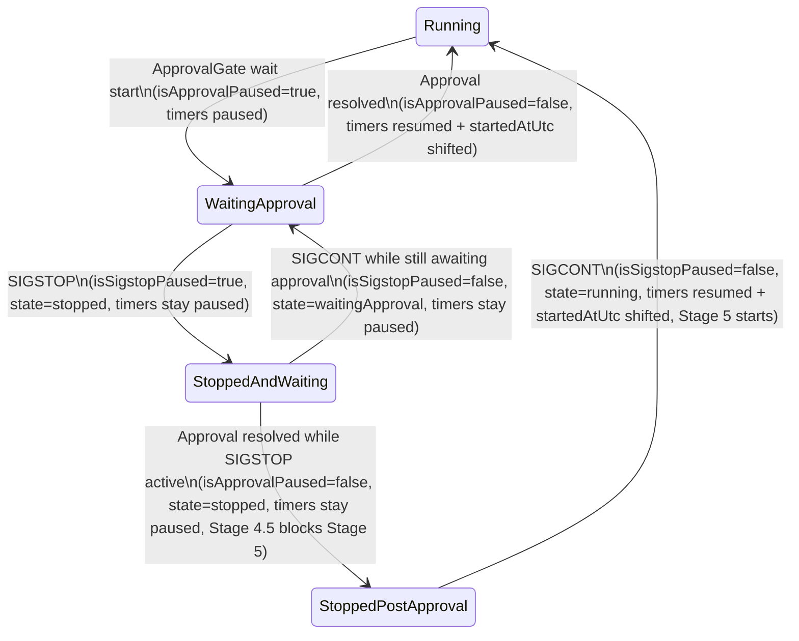

# 42_spec_runtime_and_acp.md — ランタイム・ACP/CLI/Kanban 層（タイマー合成・`SIGSTOP` 競合・ACP `_meta`・保留クリア・プロンプト）詳細設計

関連文書:
- 全体仕様・優先順位・失効契約: [40_specification.md](./40_specification.md)
- 要求・受け入れ条件（正本）: [30_requirement.md](./30_requirement.md)（`REQ-01`, `REQ-04`〜`REQ-07`）
- ACP プロトコル規約: [acp_protocol.md](../cheatsheet/acp_protocol.md)
- カーネル・ドライバ層詳細: [42_spec_kernel_approval.md](./42_spec_kernel_approval.md)

---

## 1. `IsolateWorkerHost` の承認オプトイン解決・タイマー合成一時停止・`SIGSTOP` 競合制御

D-707: IsolateWorkerHost 子プロセス承認オプトイン解決・waitingApproval タイマー合成一時停止・SIGSTOP/SIGCONT 競合制御（[REQ-01], [REQ-04], [REQ-05], [REQ-07]）

### 1.1 `sys_spawn` での 2 系統オプトイン解決と Supervisor 再試行継承（`process_syscalls.dart`, `isolate_worker_host.dart`）

1. **`_validateSpawnArgs`（`packages/agent_runtime/lib/src/process_syscalls.dart`）**:
   - `allowUserApproval` が指定された場合、`bool` でなければ `EINVAL: INVALID_ARGS`（`'Argument "allowUserApproval" must be a boolean.'`）。
   - `allowUserApproval == false` かつ `requestedRights` に `'requestApproval'` が含まれる場合は、Stage 1 で **`EINVAL: CONFLICTING_APPROVAL_ARGS`**（`recoverable: true`）を返す（[40_specification.md](./40_specification.md) §3.1 優先 1）。
2. **`IsolateWorkerHost` コンストラクタと `_deriveChildCspaceForSpec`**:
   - `IsolateWorkerHost` に `Set<ProcessProfileId> subprocessApprovalProfiles = const <ProcessProfileId>{}` を追加する。
   - 初回起動（`spawnChild`）および Supervisor 自動再試行（`_completeChildAndEvaluateSupervision`）の双方から単一ヘルパ `_deriveChildCspaceForSpec(parent: parent, spec: spec, childHandle: handle)` を呼び出し、[40_specification.md](./40_specification.md) §3.1 の優先順位を厳密に適用する：
     ```dart
     SyscallResult<CapabilityTable> _deriveChildCspaceForSpec({
       required ProcessControlBlock parent,
       required SpawnSpec spec,
       required CapHandle childHandle,
     }) {
       final bool effectiveAllowApproval;
       if (spec.allowUserApproval != null) {
         effectiveAllowApproval = spec.allowUserApproval!;
       } else if (spec.requestedRights != null) {
         effectiveAllowApproval =
             spec.requestedRights!.contains(CapRight.requestApproval);
       } else {
         effectiveAllowApproval =
             spec.profile.supportsUserApprovalOptIn &&
             subprocessApprovalProfiles.contains(spec.profile) &&
             parent.cspace.hasAnyRight(CapRight.requestApproval);
       }

       return parent.cspace.deriveForProfile(
         spec.profile,
         requestedRights: spec.requestedRights,
         allowUserApproval: effectiveAllowApproval,
         childHandle: childHandle,
       );
     }
     ```
   - これにより、(a) `explorer` / `web_researcher` への明示要求時は `EPERM: APPROVAL_NOT_ALLOWED_FOR_PROFILE`、(b) 親が `requestApproval` 非保持での明示要求時は `EPERM: CAPABILITY_ATTENUATION_VIOLATION`、(c) 設定オプトイン時でも親が `allowUserApproval: false` または `requestedRights`（`requestApproval` 非含有）を渡した場合は親の減衰が優先、(d) 親が `requestApproval` 非保持で設定のみオンの場合はエラーにせず承認権なしで起動、の全条件が単一箇所で成立する。

### 1.2 `_ManagedChild` における 2 要因合成タイマー制御（二重減算・二重シフト完全防止）

`IsolateWorkerHost` のコンストラクタで `syscallGate.approvalGate.onApprovalWaitStart = _onApprovalWaitStart;` および `onApprovalWaitEnd = _onApprovalWaitEnd;` を結線し（`dispose()` 時に解除）、子プロセスが `ApprovalGate` で待機（FIFO キュー待ち＋ユーザー応答待ち）している全区間を `isApprovalPaused = true` として追跡する。

`_ManagedChild`（`isolate_worker_host.dart`）のタイマー停止状態を以下の **2 要因ブール合成** で一元管理する：

```dart
bool isSigstopPaused = false;
bool isApprovalPaused = false;

bool get isTimerPaused => isSigstopPaused || isApprovalPaused;
```

- **単一遷移メソッド `updatePauseState({bool? sigstopPaused, bool? approvalPaused, required void Function() onWallTimeout, required void Function() onHeartbeatTimeout})`**:
  1. `final wasPaused = isTimerPaused;`
  2. 指定された `sigstopPaused` / `approvalPaused` を更新し、`final nowPaused = isTimerPaused;` を得る。
  3. **`!wasPaused && nowPaused`（稼働中 → 停止区間突入：最初の 1 回のみ実行）**:
     - **壁時計タイマー停止**:
       - `wallTimer?.cancel(); wallTimer = null;`
       - `wallStopwatch.stop();`
       - `remainingWallTimeMs != null` なら `final rem = remainingWallTimeMs! - wallStopwatch.elapsedMilliseconds; remainingWallTimeMs = rem < 1 ? 1 : rem; wallStopwatch.reset();`
       - `pausedAtUtc = DateTime.now().toUtc();`（連続停止区間の開始時刻を 1 回だけ記録）
     - **Heartbeat タイマー停止**:
       - `heartbeatTimer?.cancel(); heartbeatTimer = null;`
       - `idleStopwatch.stop();`
       - `final remHb = heartbeatTimeoutMs - idleStopwatch.elapsedMilliseconds; remainingHeartbeatMs = remHb < 1 ? 1 : remHb;`
       - `isHeartbeatPaused = true;`
  4. **`wasPaused && nowPaused`（停止継続中：例 `waitingApproval` 中に `SIGSTOP` 到着、または一方のみ解除）**:
     - **タイマー・残り時間・`pausedAtUtc` を一切変更しない**（二重減算も誤再開も絶対に発生しない）。
  5. **`wasPaused && !nowPaused`（停止区間完全終了：`isSigstopPaused == false && isApprovalPaused == false` 到達時のみ 1 回実行）**:
     - `!isCompleted && !isCompleting` のとき：
       - `pausedAtUtc != null` なら `final pausedDuration = DateTime.now().toUtc().difference(pausedAtUtc!);` を算出し、`pcb.quotaUsage.startedAtUtc` に `pausedDuration` を **1 回だけ加算シフト** して `pausedAtUtc = null;` とする。
       - `startWallTimer(onWallTimeout)` で残り `remainingWallTimeMs` の壁時計を再開する。
       - `isHeartbeatPaused = false; idleStopwatch.start();` とし、残り `remainingHeartbeatMs` で `heartbeatTimer` を再開する。

### 1.3 `SIGSTOP` / `SIGCONT`・`sys_wait`・子終了クリーンアップとの整合



1. **`sendSignal(sigcont)` の状態復帰補正**:
   `child.pcb.state == ProcessState.stopped` の状態で `SIGCONT` を受けた際、`child.pcb.state = child.isApprovalPaused ? ProcessState.waitingApproval : ProcessState.running;` に遷移させた上で `child.updatePauseState(sigstopPaused: false, ...)` を呼ぶ。これにより、まだ承認応答待ち中であれば `state` は `waitingApproval` に戻り、タイマーは停止を維持する。
2. **`sys_wait` / `snapshotProcesses()` の観測契約**:
   - `ChildHeartbeatSnapshot.isPaused` を `!isCompleted && (isTimerPaused || pcb.state == ProcessState.stopped || pcb.state == ProcessState.waitingApproval)` とする。
   - 子が承認待ち中に親の `sys_wait` が非破壊タイムアウトした場合、および `_fm_agent_os/processes` 照会時、当該子は `state: "waitingApproval"` かつ `heartbeat.isPaused: true` として返却され、承認完了後の再 `sys_wait` で完走結果を回収できる。
3. **子終了・キャンセル・`PARENT_TURN_ENDED` 時のチケット／記憶解放**:
   - `_cleanupChildWorkspaceAndComplete` および `_completeChildAndEvaluateSupervision` にて、必ず **`syscallGate.approvalGate.clearForPid(child.pid)`** を呼び出す。
   - `_killAndCompleteChild`（`SIGKILL`、親 `sys_wait` キャンセル、`PARENT_TURN_ENDED`、`HOST_DISPOSED`）は `child.cancelSource.cancel(reason)` を発火させるため、`ApprovalGate` 待機中の子プロセスも即座に `ApprovalDecision.cancelled()` で離脱し、隔離 `jj workspace` 破棄と `QuotaLedger.settleChildExit` が漏れなく完了する。

---

## 2. `AcpApprovalHandler`・`AcpEventMapper` の子プロセス相関分離と `_meta` 規約

D-708: AcpApprovalHandler・AcpEventMapper の子プロセス相関分離と ACP v1 _meta 規約準拠（[REQ-06], [REQ-07]）

### 2.1 `pid == 1` と `pid != 1` の完全分離（`acp_server.dart`, `acp_event_mapper.dart`, `acp_approval_handler.dart`）

1. **`toolCallId` 相関**:
   - `request.pid == 1`: `toolCallId = activeToolCallIdProvider?.call() ?? request.requestId;`（親 `LeadAgent` のアクティブ `sc_xxxx` ツール呼び出しと相関、既存完全互換）。
   - `request.pid != 1`: **`activeToolCallIdProvider` を参照せず `request.requestId`（例: `apr_sess_01_14`）を使用** する。これにより、親が `sys_wait` 実行中であっても `sys_wait` の `toolCallId` を決して上書き・流用しない。
2. **`AcpEventMapper` 監査決定保護**:
   - `AcpEventMapper.recordApprovalResolution` の先頭で `if (request.pid != 1) return;` を強制する。これにより、子ワーカーの承認が `reject_once` / `cancelled` になっても親 `LeadAgent` の `sys_wait` の `tool_call_update` が誤って `DENIED_BY_USER` にならない。
   - `AcpEventMapper.formatToolTitle` に `'sys_request_approval'` ケース（`'Request approval for ${args['syscall'] ?? ''}'`）を追加する。

### 2.2 `session/request_permission` の表示構造と Extensibility `_meta` 準拠

ACP v1 Extensibility 規約（[acp_protocol.md](../cheatsheet/acp_protocol.md) §3）に従い、`params`・`toolCall`・`options[]` のルート直下には ACP 標準キーのみを配置し、独自属性はすべて `params['_meta']['fm_agent_os/approval']` に格納する。

1. **標準フィールド整形**:
   - **`toolCall.title`**:
     - `request.pid == 1`: `request.title`（既存と 1 バイトも違わず同一）。
     - `request.pid != 1`: `'[Subprocess pid=${request.pid} ${request.processName ?? "worker"}${request.profile != null ? " (${request.profile})" : ""}] ${request.title}'`。
   - **`toolCall.content`**:
     - `request.pid == 1 && (request.agentReason == null || request.agentReason!.isEmpty)` の場合は既存の `content` をそのまま使用する（`sys_tx_squash` の `diff` ブロック等と完全互換）。
     - `request.pid != 1` または `request.agentReason` が非空の場合は、先頭に標準テキストブロック `{'type': 'content', 'content': {'type': 'text', 'text': headerLines}}`（`Requester: pid=..., name=..., profile=...` および `Reason: ...`）を追加し、続けて既存のプレビュー `content` を連結する。
   - **`options[]` の `name` ラベル**:
     - `allow_once`: `'Allow once'`
     - `allow_always`: `request.pid == 1` のときは `'Allow for session'`、`request.pid != 1` のときは `'Allow for this process (pid=${request.pid})'`
     - `reject_once`: `'Deny'`
2. **`params['_meta']['fm_agent_os/approval']` スキーマ**:
   ```json
   {
     "requestId": "apr_sess_01_14",
     "pid": 2,
     "processName": "worker-a",
     "profile": "workspace_worker",
     "ring": "ring3",
     "syscallName": "sys_exec",
     "requestedVia": "sys_request_approval",
     "allowAlwaysScope": "pid",
     "reason": "Run custom verification binary"
   }
   ```
   （`profile`・`reason`・`requestedVia` は非 null 時のみ出力、`allowAlwaysScope` は `pid == 1` なら `"session"`、それ以外は `"pid"`）。

---

## 3. キャンセル時保留クリア（`_fm_agent_os/permission_cancelled`・CLI・Kanban ブリッジ）

D-709: 承認キャンセル通知 _fm_agent_os/permission_cancelled と AcpCliRunner / KanbanAcpBridge の保留状態即時クリア（[REQ-05], [REQ-06], [REQ-07]）

### 3.1 デーモンからの `_fm_agent_os/permission_cancelled` 通知送出（`acp_approval_handler.dart`）

`AcpApprovalHandler.requestApproval` にて `_peer.sendRequest('session/request_permission', ...)` 待機中に `cancelToken` が発火した場合（`session/cancel`、子への `sys_kill(SIGKILL)`、`_fm_agent_os/signal` `SIGKILL`、`PARENT_TURN_ENDED` 等）、`!_peer.isClosed` であれば `requestApproval` から戻る**直前**に以下の JSON-RPC Notification を送出する：

```json
{
  "jsonrpc": "2.0",
  "method": "_fm_agent_os/permission_cancelled",
  "params": {
    "sessionId": "sess_01_abcd",
    "requestId": "apr_sess_01_abcd_14",
    "toolCallId": "apr_sess_01_abcd_14",
    "pid": 2
  }
}
```

- `ApprovalGate._drainQueue()`（[42_spec_kernel_approval.md](./42_spec_kernel_approval.md) §5.3 `[D-706]`）は、キャンセル時も現在処理中の `requestApproval` Future（上記の `_fm_agent_os/permission_cancelled` 同期送出を含む `catch` クリーンアップ；非協調テストスタブに対してのみ 50ms 猶予タイムアウト付き）が完了した後にのみ次の待機要求をディスパッチするため、同一 `stdio` ストリーム上で必ず「前要求の `_fm_agent_os/permission_cancelled` → 次要求の `session/request_permission`」の順序でクライアントに到達し、逆順競合が起きない。
- アンダースコア `_` 始まりの Notification であるため、一般の ACP エディタクライアントは仕様通り安全に無視する。

### 3.2 `AcpCliRunner` における応答・保留 ID 相関管理・キャンセル透過・次ターン入力保護（`acp_cli_runner.dart`）

1. **子プロセス識別プロンプトと自動ポリシー**:
   - `handlePermissionRequest` で `params['_meta']?['fm_agent_os/approval']` から `pid` を読み取り、対話モードのプロンプト文言を `pid != null && pid != 1` なら `'Allow? [y] once / [a] process (pid=$pid) / [n] deny: '`、`pid == 1` なら既存の `'Allow? [y] once / [a] session / [n] deny: '` とする。
   - 非対話 `--permission-policy`（`allow_once`, `allow_always`, `reject_once`, カンマ区切りシーケンス、および `key=decision` ルール）は `title`・`kind`・`contentText` に対してそのまま動作し、連続到着する複数の子プロセス承認要求も順次応答できる。
2. **`_CliSessionState` / `_StdinLineRouter` の保留承認 ID 相関管理・リーク防止・承認待ち中コマンド透過**:
   - `_CliSessionState`（または `_StdinLineRouter`）にて、現在対話待機中の保留承認の `requestId`（`params['_meta']?['fm_agent_os/approval']?['requestId'] as String?`）および `toolCallId`（`toolCall['toolCallId'] as String?`）を保持し、応答完了時または解除時にクリアする。
   - `_StdinLineRouter.readPermissionAnswer()` 開始時に、万一未完了の古い `_permissionWaiter` が残存していた場合は、新しい `Completer<String?>` を登録する前に必ず古い waiter を `complete(null)` で完了させ、未完了 Completer のリークを防止する。
   - `_StdinLineRouter` に `void cancelPermissionWait()` を追加し、未完了の `_permissionWaiter` があれば `_permissionWaiter = null; w.complete(null);` で即時解除する（`handlePermissionRequest` は `answer == null` を受けて `{'outcome': {'outcome': 'cancelled'}}` を返す）。
   - `peer.onNotification` で `method == '_fm_agent_os/permission_cancelled'` を受信した際、`state.handlePermissionCancelled(params)` は **`params['requestId']` または `params['toolCallId']` が現在待機中の保留承認の `requestId` / `toolCallId` と一致する場合にのみ** `stdinRouter?.cancelPermissionWait()` を呼び出して `[Approval cancelled]` を出力する（不一致の遅延・重複キャンセル通知では後続プロセスの承認プロンプトを誤解除しない）。
   - `_StdinLineRouter._onLine` にて、`_permissionWaiter` 待機中であっても入力行が `/cancel` の場合は `_midTurnCommandHandler` を実行した上で**無条件に** `cancelPermissionWait()`（および保持中の `requestId` / `toolCallId` クリア）を呼び、`/ps`・`/pause`・`/resume`・`/kill ...` の場合は `_midTurnCommandHandler` を実行しつつ `_permissionWaiter` を維持する（`/kill` 対象が当該子であれば直後に一致 ID の `_fm_agent_os/permission_cancelled` で自動解除される）。
   - さらに `_dispatchLine` の `session/prompt` `finally` ブロックでも**無条件に** `state.clearPendingPermissionWait()`（`stdinRouter?.cancelPermissionWait()` ＋ 保持 ID クリア）を呼び出し、キャンセル・異常終了後に次ターンの REPL 入力行が奪われることを二重に防止する。

### 3.3 `KanbanAcpBridge` における保留承認管理と即時クリーンアップ（`kanban_acp_bridge.dart`）

1. `KanbanPendingPermission` に任意フィールド `final String? daemonRequestId;`（`_meta['fm_agent_os/approval']['requestId']`）、`final String? toolCallId;`（`toolCall['toolCallId']`）、および `final Map<String, dynamic>? approvalMeta;` を保持し、`toJson()` に `'approvalMeta': ?approvalMeta` を含める。
2. `respondPermission` では `optionId` が `'allow_once'`, `'allow_always'`, `'reject_once'` のいずれかであることを検証し（不正値は `WireJsonRpcException(WireJsonRpcErrorCodes.invalidParams, ...)`）、全 3 選択肢をデーモンへ返却可能にする。
3. `_handleIncomingNotification` で `method == '_fm_agent_os/permission_cancelled'` を受信した際、`daemonRequestId == params['requestId']` または `toolCallId == params['toolCallId']` に一致する保留エントリを `_pendingPermissions` から即座に削除し、未完了の `completer` を `{'outcome': {'outcome': 'cancelled'}}` で完了させ、WebSocket クライアントへ `{'type': 'permission_cancelled', 'requestId': entry.requestId}` イベントを配信する。
4. さらに `_drainLoop()` の `session/prompt` 実行 `finally` ブロックでも、残存する全 `_pendingPermissions` を同様にキャンセル完了させてクリアし、ターン終了後の陳腐化エントリ残留を完全に防ぐ。

---

## 4. Kanban Web UI の保留承認表示と純粋性維持

D-710: Kanban Web UI における保留承認詳細・3 選択肢応答表示と純粋性境界維持（[REQ-06], [REQ-07]）

`packages/agent_acp/lib/src/kanban/kanban_ui_assets.dart` を更新する。

1. **純粋性制約の厳守（`stage3_architecture_and_purity_test.dart` E3-4）**:
   - `packages/agent_acp/lib/src/kanban/` 配下は引き続きエンジン 3 パッケージ（`agent_kernel`, `agent_drivers`, `agent_runtime`）および `package:agent_acp/agent_acp.dart` を一切 import しない。
   - `kanban_ui_assets.dart` 内には外部 CDN はもちろんコメント・文字列リテラルを含め `http://` / `https://` を **1 箇所も含めない**。
   - DOM 構築はすべて `document.createElement` と `.textContent` のみで行い、`innerHTML` への動的文字列注入を行わない（XSS 防止）。
2. **保留承認 UI コンポーネント**:
   - カード内（`perm.taskId === card.taskId || !perm.taskId`）、およびカードが 0 件のときに備えたボード上部の `#global-permissions` コンテナ（未紐付けまたはカード不在時のみ表示）において、各保留承認 `perm` を以下の構成で描画する：
     - **タイトル行**: `(perm.toolCall && perm.toolCall.title) || 'Approval Required'`。
     - **要求元バッジ／理由表示**: `perm.approvalMeta` に `pid` がある場合、`pid !== 1` なら `Subprocess PID <pid> (<profile>)` バッジ、および `reason` があれば理由テキストを表示。
     - **プレビュー抜粋**: `perm.toolCall.content` 内のテキストまたは `diff` パス要約を `.stream-box` に表示。
     - **応答ボタン（3 選択肢対応）**: `perm.options` 配列（空の場合は標準 3 選択肢 `allow_once`, `allow_always`, `reject_once`）を走査してボタンを生成し、クリック時に `api('/api/permissions/respond', 'POST', { requestId: perm.requestId, optionId: opt.optionId }).then(refresh)` を呼び出す。

---

## 5. `AgentPrompts`・`SyscallToolSchema`・`KernelBootstrap` 結線と既存テスト互換

D-711: AgentPrompts・SyscallToolSchema・KernelBootstrap 結線と既存テスト互換維持（[REQ-01], [REQ-02], [REQ-06], [REQ-07]）

### 5.1 `AgentPrompts` 更新（`packages/agent_runtime/lib/src/prompts/agent_prompts.dart`）

Pure Dart + `package:agent_kernel` のみの依存を維持する。

1. **`leadStep1Instruction`**: **一切変更しない**（Stage 1 完全互換）。
2. **`leadStage2Instruction`（およびそれを参照する `leadStage3Instruction`）**:
   - `- sys_spawn:` 説明に `allowUserApproval` オプトイン（`workspace_worker` / `conflict_resolver` のみ有効、既定オフ、`heartbeatTimeoutMs` は `SIGSTOP` および `waitingApproval` 中に一時停止）を追記する。
   - `- sys_request_approval:` 説明（対象 `syscall` と `args`・任意の `reason` を渡して事前検証とユーザー承認を行い、ワンタイム承認チケットを取得する旨）を追加する。
3. **`AgentPrompts.buildLeadInstruction`**:
   ```dart
   static String buildLeadInstruction({
     required int stage,
     List<String> additionalExecRuleSummaries = const <String>[],
     List<String> subprocessApprovalProfileNames = const <String>[],
   })
   ```
   - 追加リストが両方とも空のときは `leadStep1Instruction` / `leadStage2Instruction` / `leadStage3Instruction` の `const` 参照をそのまま返す（`identical(...)` 維持）。
   - `stage >= 2` かつ `subprocessApprovalProfileNames` が非空のときは、`.agent_os/exec_policy.json` により承認要求権が既定有効化されている子プロファイル一覧（および `sys_spawn(allowUserApproval: false)` で個別減衰できる旨）を決定的に末尾へ付与する。
4. **`AgentPrompts.buildChildInstruction`**:
   ```dart
   static String buildChildInstruction({
     required ProcessProfileId profile,
     List<String>? allowedSubpaths,
     List<String> additionalExecRuleSummaries = const <String>[],
     bool canRequestApproval = false,
   })
   ```
   - `canRequestApproval == false`（既定値）のときは、全 4 プロファイルで現行文字列と **1 バイトも違わず一致** する。
   - `explorer` / `webResearcher` では `canRequestApproval` が `true` でも無視して現行文字列を返す。
   - `workspaceWorker` / `conflictResolver` で `canRequestApproval == true` のときは、従来の `TTY monopoly (EPERM)` 固定拒否文言に代えて、「ビルトインおよび `exec_policy.json` 許可コマンドは即時実行でき、それ以外の `/workspace` 内の安全な直接実行コマンドは `sys_request_approval(syscall: "sys_exec", args: {...}, reason: "...")` でワンタイム承認チケットを取得してから `sys_exec` するか、直接 `sys_exec` で承認待機できる（ただしシェル・メタ文字・生 `git`/`jj`・ネットワークコマンド・`/workspace` 外パスは無条件拒否）」旨を案内する。

### 5.2 `SyscallToolSchema` と `KernelBootstrap` 結線（`process_syscalls.dart`, `kernel_bootstrap.dart`）

1. **`defaultSyscallRequiredRights`**: `'sys_request_approval': CapRight.requestApproval` を追加する。
2. **`buildProcessToolSchemas()`**:
   - `sys_request_approval` の `SyscallToolSchema`（`properties: {'syscall': string, 'args': object, 'reason': string}`, `required: ['syscall']`）を追加する。
     - ※Stage 1 単一プロセスモード（`isStage2Multiprocess == false`）では `buildProcessToolSchemas()` 自体が `allToolSchemas` に含まれないため、`step1_2_integration_test.dart` の Step 1-2 固定ツール一覧アサーションと完全互換を保ちつつ、Stage 2/3 および全 ACP セッションでは `filterToolSchemasForPcb` により `CapRight.requestApproval` 保有 PCB（`LeadAgent` およびオプトイン済み `workspace_worker` / `conflict_resolver`）にのみ辞書順ソートで提示される。
   - `sys_spawn` スキーマに `'allowUserApproval': {'type': 'boolean', ...}` を追加し、`heartbeatTimeoutMs` 説明を `'paused during SIGSTOP and waitingApproval'` に更新する。
3. **`KernelBootstrap.create`**:
   - `subprocessApprovalProfiles = effectiveExecPolicy.subprocessApprovalProfiles` を取得し、`IsolateWorkerHost(subprocessApprovalProfiles: subprocessApprovalProfiles, ...)` および `AgentPrompts.buildLeadInstruction(..., subprocessApprovalProfileNames: ...)` へ結線する。
   - `IsolateWorkerHost._launchAttempt` では `canRequestApproval: childCspace.hasAnyRight(CapRight.requestApproval)` を `AgentPrompts.buildChildInstruction` に渡す。

### 5.3 既存テストへの影響範囲表

| 既存テストファイル | 影響と対応方針 |
| :--- | :--- |
| `packages/agent_runtime/test/agent_prompts_test.dart` | `leadStage2Instruction`（およびそれを埋め込む `leadStage3Instruction`）の `sys_spawn` 更新・`sys_request_approval` 追記に合わせて `expectedStage2` / `expectedStage3` 定数を更新し、`canRequestApproval: true/false` および `subprocessApprovalProfileNames` の検証ケースを追加する。`leadStep1Instruction` と全 4 子プロファイルの既定出力アサーションは無修正のままパスする。 |
| `packages/agent_runtime/test/step1_2_integration_test.dart` | `sys_request_approval` スキーマを `buildProcessToolSchemas()`（Stage 2/3）に配置するため、Step 1-2 の 14 ツール一致テストは無修正でパスする。 |
| `packages/agent_kernel/test/pcb_capability_quota_test.dart`, `syscall_gate_and_approval_test.dart`, `stage3_kernel_contracts_test.dart` | `stage2ForbiddenChildRights` / `stage3ForbiddenChildRights` 不変、Ring 3 既定オフ、非保持時 `TTY_MONOPOLY_DENIED` 維持により既存ケースは無修正でパスする。 |
| `packages/agent_runtime/test/capability_tty_and_quota_test.dart`, `exec_policy_runtime_integration_test.dart` | Ring 3 既定オフにより既存の未オプトイン `workspace_worker` / `explorer` の `TTY_MONOPOLY_DENIED` アサーションは無修正でパスする。 |
| `packages/agent_acp/test/acp_server_test.dart`, `kanban_unit_and_security_test.dart`, `kanban_daemon_e2e_test.dart`, `stage3_architecture_and_purity_test.dart` | `pid == 1` の `toolCallId`・`title`・`content` 互換、ACP ルートキー純度、Kanban エンジン非依存・外部 URL ゼロ維持により無修正でパスする。 |

---

## 6. 確認手順（REQ-05 〜 REQ-07 向け）

1. **`REQ-05` 子タイマー一時停止・`startedAtUtc` シフト・`SIGSTOP`×`waitingApproval` 競合テスト（`E1` / `E3`）**:
   - `heartbeatTimeoutMs: 150`, `maxWallTimeMs: 220` のオプトイン `workspace_worker` を起動し、`ApprovalHandler` を Completer で `400ms` 保留した後に `allow_once` 応答させた際、待機中に `HEARTBEAT_TIMEOUT` も `WALL_TIME_QUOTA_EXCEEDED` も発火せず、応答直後の次ステップ syscall でも `QuotaConsumption.checkBeforeSyscall` が `EDQUOT` にならず完走することを確認。
   - 双方向競合：
     - (a) 承認待ち突入 → `SIGSTOP` → 承認応答完了 → Stage 5 ドライバがまだ起動していないことを確認 → `SIGCONT` で Stage 5 が実行され完走することを確認。
     - (b) 承認待ち突入 → `SIGSTOP` → `SIGCONT`（まだ承認未応答）→ `pcb.state == ProcessState.waitingApproval` かつ `heartbeatTimeoutMs` を超えて待機しても誤 kill されず、その後の承認応答で完走することを確認。
   - 承認待ち中の短時間 `sys_wait(timeoutMs: 60)` および `_fm_agent_os/processes` で `state == "waitingApproval"` かつ `heartbeat.isPaused == true` が返り、承認後の再 `sys_wait` で `children` として回収できること、ならびに承認待ち中の `sys_kill(SIGKILL)` / 親ターン終了（`PARENT_TURN_ENDED`）で即時中断・ワークスペース削除・`QuotaLedger` 精算・`clearForPid` が完了することを確認。
2. **`REQ-06` ACP・CLI・Kanban 連携テストおよび実デーモン実行観測（`E1` / `E2`）**:
   - **`E1` 自動テスト**:
     - `AcpServer` 上で親が `sys_wait` 中に子 `workspace_worker` が `sys_request_approval` / `sys_exec` で承認要求した際、`session/request_permission` の `params` ルートキーが `{'sessionId', 'toolCall', 'options', '_meta'}` のみ、`toolCall` キーが標準 5 キーのみ、`options[]` キーが標準 3 キーのみであり、`_meta['fm_agent_os/approval']` に子 `pid`・`profile`・`reason` が格納され、子を `reject_once` しても親 `sys_wait` の `tool_call_update` が正常 `completed`（`ALLOWED`）になること、また並列 2 子プロセス（`pid=2` 実行中・`pid=3` キュー待機中）で `pid=2` がキャンセルされた際にワイヤフレームが必ず `_fm_agent_os/permission_cancelled(pid=2)` → `session/request_permission(pid=3)` の順で送出されることを確認。
     - `AcpCliRunner`（対話入力ストリームおよび `--permission-policy` 自動ルール）で親 `sys_wait` 中の子承認に応答できること、承認待ち中に一致 ID の `_fm_agent_os/permission_cancelled` または `/cancel` を受けた際に `_permissionWaiter` が解除され次ターンの REPL 入力が正常に読める一方、不一致 ID（前要求分）の `_fm_agent_os/permission_cancelled` では現在待機中の後続承認プロンプトが誤解除されないことを確認。
     - `KanbanServer` / `KanbanAcpBridge` で子承認の `pendingPermissions`（タイトル・`approvalMeta`・3 選択肢）取得と `/api/permissions/respond`（`allow_once` / `allow_always` / `reject_once`）応答が動作し、キャンセル・`SIGKILL`・ターン終了時に `_pendingPermissions` が空になることを確認。
   - **`E2` 実デーモン／ACP 実行観測**:
     - 実 `agent_os_daemon` プロセス（ACP `stdio` 接続、または `AcpCliRunner` / `KanbanAcpBridge` 経由）上で、`allowUserApproval: true`（または `.agent_os/exec_policy.json` オプトイン）で起動した実 Isolate `workspace_worker` が未登録の直接実行コマンド（例: `where dart` 等）を `sys_request_approval` → `sys_exec` で承認実行し、親 `LeadAgent` が `sys_wait` で成果を回収する一連の動作を実観測して記録する。
3. **`REQ-07` 全パッケージ回帰・純粋性・Windows 3 実行ファイル AOT ビルド確認（`E1`）**:
   - ワークスペース全体で `dart analyze`、`dart test`（`stage3_architecture_and_purity_test.dart` 含む全テスト）、および `agent_os_daemon.exe`, `acp_cli_client.exe`, `acp_kanban_app.exe` の `dart compile exe` を実行し、全件成功を確認する。
