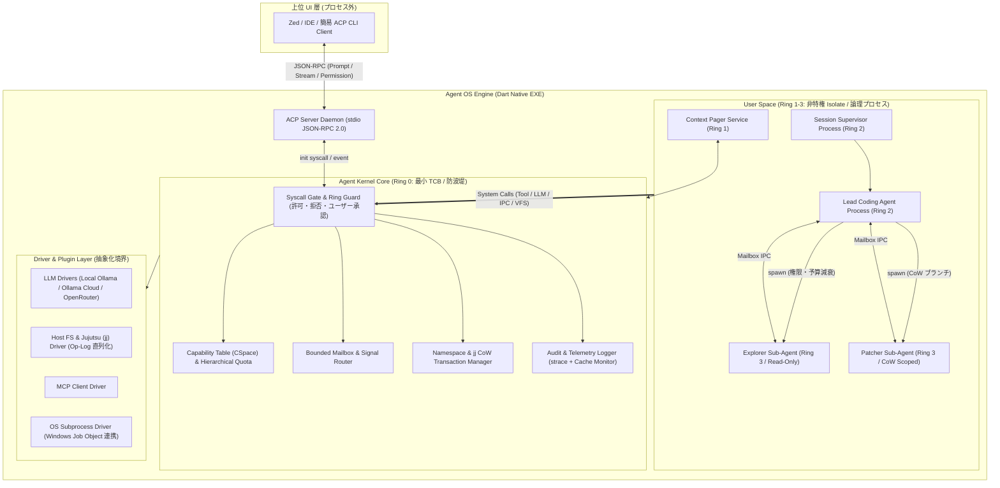

# Agent Kernel 設計検討書：マルチプロセス・メモリ管理を備えた AI コーディングエージェント

本ディレクトリは、[01_idea.md](../../01_idea.md) の構想と [OS 概念調査](../os_concepts/00_index.md) の知見を統合し、**「OS の構造を参考にした、マルチプロセスと仮想メモリ（文脈）管理を備える AI コーディングエージェントエンジン」** の具体的なアーキテクチャ・機能仕様・実現可能性を検討した設計ドキュメント群である。

---

## 1. エグゼクティブサマリー（結論の先出し）

### Q1. 自作できるか？
**十分に自作可能であり、Dart はこの設計と非常に相性が良い。**
従来のコーディングエージェントが肥大化する最大の原因は、「LLM との対話ループ」「ツール実行」「権限制御」「コンテキスト圧縮」「UI 状態管理」をモノリシックに混ぜてしまう点にある。
カーネルを **「LLM を一切知らない、システムコール調停・権限制御・メモリ/VFS 管理・監査だけの薄い防波堤」** として切り出し、エージェントループを **「非特権のユーザー空間プロセス（Dart Isolate / 軽量タスク）」** に押し出すマイクロカーネル／Framekernel 折衷構造をとることで、コア本体のコード量は数千行規模の見通しの良いサイズに収まる。

### Q2. 作ったとして「どれくらいのもの」になるか？
1. **短期（MVP〜初期プロトタイプ）**:
   - 単体性能（1 問 1 答のコーディング力）は背後の LLM（Ollama / OpenRouter 上のモデル）の能力に比例する。
   - しかし、**Jujutsu (`jj`) をネイティブの CoW ストレージ基盤として組み込むことによる圧倒的な安全性（`jj new` による作業分離・`jj op restore` による完全ロールバック）**、**可観測性（全システムコール監査・プロンプトキャッシュ効率の可視化）**、**実験のしやすさ（1 ターンごとのモデル切替・プラグイン着脱）** においては、既存の Git 前提エージェントにはない独自の強みを持つ基盤になる。
2. **中長期（本設計の真価が発揮される領域）**:
   - [01_idea.md](../../01_idea.md) が最終目標に掲げる **「bot・AI チーム・カンバンタスク」** へ進む際、単一エージェント＋Git 前提のツールは必ず「権限の混線」「コンテキスト溢れ」「トークン予算の暴走」「同時ファイル編集のマージ停止」で行き詰まる。
   - 本設計は **マルチプロセス（Actor/Supervisor）・ケーパビリティ減衰・階層クオータ（cgroup）** に加え、**`jj` の無名チェンジ・`jj workspace`・First-Class Conflicts（コンフリクトで止まらない多親マージ）・自動リベース** を OS カーネルのトランザクション層として直結するため、カンバンの各カードを並列・積層（Stacked Changes）で安全に走らせる「`jj` ネイティブ AI チーム OS」へ進化できる。

---

## 2. 採用する基本アーキテクチャ像

OS の歴史的教訓（[OS 概念調査](../os_concepts/00_index.md)）を踏まえ、単一の古典的 OS を模倣するのではなく、以下の **4 つの現代的 OS 設計（＋ Jujutsu ストレージ統合）のハイブリッド** を採用する。

1. **Framekernel（Asterinas）× 最小マイクロカーネル（L4 / Exokernel）**:
   - ハードウェア MMU の代わりに **Dart の型システムと Isolate 境界** を用いて、小さな信頼境界 **Agent Kernel Core (TCB)** と非特権サービス・エージェントプロセスを分離する。
2. **Object-Capability（Zircon / seL4）× 階層的クオータ寄贈（Genode / cgroups v2）**:
   - グローバルな暗黙権限（Ambient Authority）を廃止。親プロセスが持つファイル・ツール・予算（トークン/費用/時間/子プロセス数）の一部を減衰させて子へ渡す。
3. **Actor / Supervisor ツリー（Erlang/OTP・Hubris）**:
   - 有界メールボックス（Bounded Mailbox）によるバックプレッシャ制御と、クラッシュ・ハングを前提とした親 Supervisor による監視・再起動。
4. **Plan 9 プライベート名前空間 × Jujutsu (`jj`) ネイティブ CoW VFS × Prefix 保持型ページング**:
   - 自作の複雑なインメモリ OverlayFS を組む代わりに、**`jj` のワーキングコピー自動スナップショット（`@`）・Operation Log（WAL）・`jj workspace`・First-Class Conflicts** を VFS の Copy-on-Write トランザクション層として採用し、メモリ管理では **LLM の KV キャッシュ（Prefix 一致）を壊さないセグメント化ページング** を行う。

---

## 3. ドキュメント構成

| ドキュメント | 主題 | 扱う主な設計項目 |
| :--- | :--- | :--- |
| [01_kernel_and_process_architecture.md](./01_kernel_and_process_architecture.md) | **カーネル・マルチプロセス・権限制御** | カーネルとエージェントループの分離、PCB（プロセス制御ブロック）、Dart Isolate と Windows Job Object の二層実行、保護リングとユーザー承認ゲート、ケーパビリティ減衰、階層クオータ、有界メールボックス IPC、シグナルと Supervisor |
| [02_memory_and_context_paging.md](./02_memory_and_context_paging.md) | **メモリ管理（仮想コンテキストページング）** | OS ページングと LLM KV キャッシュの衝突問題、Prefix 保持型セグメント設計、Clean/Dirty ページの退避・再ロード（Page Fault）、プロンプト毎のモデル切替と State Spill 防止 |
| [03_vfs_drivers_and_modularity.md](./03_vfs_drivers_and_modularity.md) | **Jujutsu (`jj`) CoW VFS・ドライバ・ACP** | `jj` ネイティブ CoW トランザクション（`Change ID` / `jj op restore` / `jj workspace` / First-Class Conflicts）、LLM/MCP/`jj` ドライバ、Hook/Skill、`strace` 監査とキャッシュ監視、ACP 分離設計 |
| [04_feasibility_and_roadmap.md](./04_feasibility_and_roadmap.md) | **実現可能性評価・リスク・段階的計画** | 要素別の実現難易度と費用対効果、ローカル LLM（Ollama）運用時の現実的課題と対策、Dart パッケージ構成案、Phase 0〜4 の開発ロードマップ |
| [05_three_walls_and_step_plan.md](./05_three_walls_and_step_plan.md) | **3大暗礁の OS 流解決策と直交ステップ計画** | 先行試作で座礁した「権限の混線」「コンテキスト溢れ」「同時ファイル編集の衝突」の根本対策と、1ステップ1課題で確実に進める 7 段階ビルド計画 |
