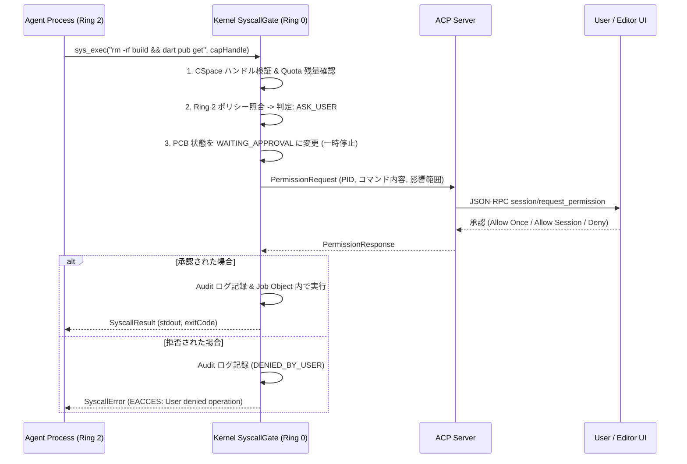

# 1. カーネル構造・マルチプロセス実行モデル・権限制御

[01_idea.md](../../01_idea.md) の中核思想である「カーネルをエージェントループではなくシステムコールの層にする」「プロセス生成・メールボックス・保護リング・ケイパビリティ・cgroup・Supervisor」を具体的なソフトウェア設計へ落とし込む。

---

## 1.1 カーネルの責務境界（Minimality Principle）

L4 マイクロカーネルの最小性原則に従い、**Agent Kernel（Ring 0）には「安全境界と資源調停に不可欠な機構」のみを置き、推論ポリシーを一切持たせない**。

| カーネルが持つもの（Mechanism） | カーネルが持たないもの（User-space Process / Plugin 側） |
| :--- | :--- |
| プロセス生成・破棄と PCB（Process Control Block）管理 | エージェントの思考ループ（ReAct / Plan-and-Solve 等） |
| システムコール受付・引数検証・保護リング判定 | プロンプト文面・コーディング規約・スキル知識 |
| ケーパビリティ表（CSpace）の照合・減衰コピー・失効 | タスク分解ロジック・カンバン進行ルール |
| 階層型クオータ（トークン・費用・時間・子プロセス数）の強制 | コンテキスト要約の具体的プロンプト戦略 |
| 有界メールボックス（IPC）とシグナル配送 | 個別 LLM API のワイヤフォーマット変換（Driver 層） |
| VFS ルーティングと CoW トランザクション管理 | 上位 UI の表示ロジック（ACP クライアント側） |
| 全システムコールの構造化監査ログ（`strace` 相当） | |

### 「ユーザー依頼 → プロセス起動」のライフサイクル
1. ACP Server がクライアント（UI）からプロンプト入力（＋今回の使用プロバイダ/モデル指定）を受け取る。
2. ACP Server はカーネルへ `sys_spawn` / `sys_send` システムコールを発行する。
3. セッション初回であれば `SessionSupervisor` プロセスと `LeadAgent` プロセスが生成され、メールボックスにユーザーメッセージが投入される。
4. `LeadAgent` プロセスがユーザー空間でエージェントループを回し、LLM 推論もファイル読み書きも子エージェント生成もすべて **システムコール** としてカーネルに要求する。

---

## 1.2 マルチプロセスの実装方式（Dart Isolate × Windows Job Object）

Dart で実装するにあたり、「エージェントプロセス」と「外部 OS コマンドプロセス」の **二層隔離モデル** を採用する。

### 第 1 層：エージェントプロセス（Dart Isolate ＋ 論理プロセス抽象）
- **基本単位**: 各エージェントプロセスは独立した `PCB (Process Control Block)` を持つ。
- **実行エンジンの抽象化 (`ProcessRunner`)**:
  - **Isolate モード（標準・推奨）**: Dart の `Isolate.spawn` を使用。ヒープメモリが完全に分離され、他のプロセスの内部状態を直接書き換えることが言語仕様上不可能（Singularity の SIP と同等の隔離性）。通信は `SendPort` / `ReceivePort` 上の型付きシリアライズメッセージと、大容量バイト列用の `TransferableTypedData`（O(1) ゼロコピー所有権移転）で行う。
  - **Green Task モード（軽量テスト・デバッグ用）**: 同一 Isolate 内の非同期タスク（`Zone` 分離）として動かす実装も同一インターフェースで用意する。単体テストの高速実行やステップ実行デバッグが劇的に容易になる。
- **メモリコストの現実解**: Dart Isolate 1 個あたりの初期ヒープは数 MB 程度であるため、同時に数十個のサブエージェント（調査役・実装役・レビュー役）を起動しても数十〜百数十 MB に収まり、現代の PC 環境では全く問題にならない。

### 第 2 層：外部ツール子プロセス（OS Process ＋ Windows Native DLL / Job Object）
コーディングエージェントは `dart test`、リンター、コンパイラ等の外部 OS プロセスを起動する（※VCS 操作である `jj` 自体は生のシェル実行ではなく専用の `JjDriver` で安全に調停する）。ここで **「Dart から Windows Native DLL (Win32 API) を FFI で直接呼べる」** 強みが活きる。
- Linux の `cgroups` に相当する Windows カーネル機構として **Windows Job Object**（`kernel32.dll`: `CreateJobObjectW`, `SetInformationJobObject`, `AssignProcessToJobObject`, `TerminateJobObject`）を利用する。
- **得られる効果**:
  1. エージェントが起動したコマンドがさらに孫プロセスを生成しても、親エージェントのキャンセル・タイムアウト時に **ツリー全体を確実に一括強制終了** できる（`JOB_OBJECT_LIMIT_KILL_ON_JOB_CLOSE` — Windows で頻発するゾンビプロセス残留問題の完全解決）。
  2. 外部コマンドのメモリ上限や CPU レート制限を OS カーネルレベルで強制できる。

---

## 1.3 プロセス制御ブロック（PCB）のデータ構造イメージ

カーネルが各プロセスについて保持する管理構造体は以下の要素で構成される。

```dart
class ProcessControlBlock {
  final Pid pid;
  final Pid? parentPid;
  final String name;                  // 例: "lead-coder", "explorer-1"
  final ProtectionRing ring;          // ring0(kernel) .. ring3(sandboxed)
  ProcessState state;                 // ready, running, waitingSyscall, waitingApproval, stopped, terminated

  final CapabilityTable cspace;       // 保有する偽造不能ハンドルと権限ビット
  final ResourceQuota quota;          // トークン・費用・時間・子プロセス数の上限と現在消費量
  final VfsNamespace namespace;       // このプロセス専用のマウントツリー
  final JjTxContext? jjContext;       // 紐づく jj workspace 名・担当 Change ID・開始時 Operation ID
  final VirtualContextMemory memory;  // ページテーブル・ワーキングセット・KVキャッシュ統計
  final BoundedMailbox mailbox;       // 受信メッセージキュー（上限付き）
  final SupervisionPolicy policy;     // 異常終了時の再起動・エスカレーション方針
}
```

---

## 1.4 システムコール体系と保護リング（Ring 0〜3）

従来のエージェントでは「LLM の Tool Call」と「エージェント自身のランタイム操作」が別物として実装されがちだが、本設計では **すべてを統一された System Call としてカーネルの単一ゲート（`SyscallGate`）に通す**。

### 主要システムコール一覧

| カテゴリ | システムコール名 | 概要 |
| :--- | :--- | :--- |
| **Process** | `sys_spawn`, `sys_exit`, `sys_wait`, `sys_kill` | 子プロセス生成（減衰権限・予算指定）、終了、待機、シグナル送信 |
| **IPC** | `sys_send`, `sys_recv`, `sys_call` | 非同期メール送信、受信待機、タイムアウト付き同期 Request-Reply |
| **VFS** | `sys_open`, `sys_read`, `sys_write`, `sys_stat`, `sys_glob`, `sys_grep` | 仮想名前空間越しのファイル操作（割り当てられた `jj` チェンジ/ワークスペース上で安全に編集） |
| **VCS / Tx (`jj`)** | `sys_jj_status`, `sys_jj_diff`, `sys_jj_log`, `sys_jj_new`, `sys_tx_squash`, `sys_tx_rollback`, `sys_jj_merge` | **`jj` ネイティブのトランザクション制御**（チェンジ分岐、統合、Op-Log ロールバック、多親マージ、競合一覧取得） |
| **Memory** | `sys_mem_pin`, `sys_mem_pagein`, `sys_mem_pageout`, `sys_mem_note` | コンテキストページのピン留め、明示的ロード、退避・構造化ノート保存 |
| **Inference** | `sys_llm_chat` | LLM ドライバを通じた推論要求（トークン/費用クオータ自動減算・キャッシュ計測） |
| **Net (Read)** | `sys_web_search`, `sys_web_fetch` | 外部ネットワーク読取ドライバ（APIキー秘匿・SSRF遮断・本文抽出。`sys_exec` と権限分離） |
| **Exec / Ext** | `sys_exec`, `sys_mcp_call` | OS コマンド実行（Job Object 隔離・生 `git`/`jj` 誤爆防止ガード付き）、MCP ツール呼び出し |

### 境界設計の基準：何が「システムコール」で、何が「短命プロセス（`libc` 相当）」か？（Web検索・調査の例）
L4 マイクロカーネルの最小性原則とケーパビリティ原則に照らすと、**「高水準な調査（クエリ試行錯誤＋LLM 要約）」と「低レベルな外部通信 I/O」は明確に 2 層へ分離する** のが最適である。

1. **「調査（Research）」自体はシステムコールにせず、短命プロセス（ユーザー空間）で実装する**:
   - もし `sys_research` をカーネル内に作ると、カーネル自身がエージェントループ（LLM 呼び出しと要約ポリシー）を抱え込んでしまい、「カーネル＝システムコール層」の原則が崩れる。
   - したがって「調査」は親プロセス向けの **標準ライブラリ（OS の `libc` ラッパー相当：`spawn` + `wait` の定型ヘルパー）** として抽象化し、実体としては **短命な `Researcher` 子プロセス（Ring 3）** を起動して要約結果だけをメールボックスで受け取り、生 HTML 等のノイズは子の `exit()` ごと破棄する。
2. **ただし、その子プロセス内で「`sys_exec`（シェル実行）で `curl` させる」のは避け、専用の `sys_web_search` / `sys_web_fetch`（または MCP ドライバ）をシステムコールにする**:
   - Web 上のテキストは **間接プロンプトインジェクションの最大経路（非信頼データ）** である。Web 取得のために万能権限である `sys_exec`（任意シェル実行）を渡すと、インジェクション成立時にローカルファイルの読み取りや任意コマンド実行を許してしまう（OpenBSD が `pledge("inet")` と `pledge("exec")` を厳格に分け、ブラウザが Network Process からシェル権限を剥奪するのと同じ理由）。
   - `sys_web_search` / `sys_web_fetch` を独立システムコール（ドライバ）にしておけば、**`WebResearcher` 子プロセスに「`/workspace` 読取権限ゼロ・`sys_exec` 権限ゼロ・`net:public_readonly` のみ」という完全無菌のケーパビリティ** を渡せる上、検索 API キーのドライバ内秘匿、ローカル IP（`localhost:11434` 等）への SSRF 遮断、URL 単位の `strace` 監査が確実に機能する。

### 保護リングとユーザー承認ゲート（Call Gate）

[01_idea.md](../../01_idea.md) の「リングのレベルによっては、その間にユーザーの許可確認が入る」仕様を、**Ring レベル × Capability × Security Policy** のマトリクスで決定論的に制御する。

| リング | 想定主体 | 既定の振る舞い |
| :--- | :--- | :--- |
| **Ring 0** | Kernel Core | 特権層。すべての検証と実資源アクセスを調停する（LLM コードは存在しない）。 |
| **Ring 1** | System Services | Context Pager 等の信頼済みシステムサービス。内部管理系 syscall を許可。 |
| **Ring 2** | Lead Agent / Supervisor | 標準エージェント。Read・CoW 内への仮書き込み・安全なテスト実行は即時許可。**実ファイルへの `sys_tx_commit`、破壊的コマンド、ワークスペース外アクセスはユーザー承認ゲート（`ASK_USER`）を発火**。 |
| **Ring 3** | Sub-Agent / Untrusted Skill | サンドボックスプロセス。親から渡された限定ハンドルのみ操作可。承認が必要な特権操作は直接 UI を煩わせず `EPERM` で拒否（または親プロセスへ委譲要求させる）。 |



---

## 1.5 ケーパビリティと階層型リソース管理（Quota）

### ケーパビリティの減衰（Capability Attenuation）
Fuchsia (Zircon) およびに Capsicum に倣い、プロセスは生のパス文字列やグローバルなプロバイダ参照で勝手に操作できず、必ず `CapHandle`（プロセスローカルな整数 ID）を介する。
- **例**: 親（`LeadAgent`）は `/workspace` 全体の `READ | WRITE_COW | COMMIT_REQ` 権限を持つハンドル `h1` を所有。
- 親が調査用の子（`Explorer`）を `sys_spawn` する際、`sys_cap_derive(h1, subpath: "lib/auth", rights: READ)` で権限を絞り込んだ新しいハンドルを作成して渡す。
- `Explorer` が `lib/billing` を読もうとしたり、ファイルを書き換えようとしても、対応するケーパビリティが `CSpace` に存在しないためカーネルが即座に弾く（Confused Deputy やプロンプトインジェクション被害の局所化）。

### 階層的クオータ寄贈（Genode + Linux cgroups v2 モデル）
マルチエージェント化で最も怖い「無限ループによる API 破産」や「fork bomb（無限の子生成）」をカーネルが構造的に阻止する。

- **管理対象メトリクス**:
  1. `maxTotalTokens` / `maxPromptTokens` / `maxCompletionTokens`（トークン上限）
  2. `maxCostMicroUsd`（推論コスト上限：マイクロドル整数管理で浮動小数点誤差を回避）
  3. `maxWallTimeMs`（実行時間上限）
  4. `maxChildProcesses`（同時および累計の子プロセス生成上限）
  5. `maxSyscallCount`（ツールコール総回数上限 — 無限リトライ防止）
- **Quota Donation（寄贈と回収）**:
  - 親が自分の残り予算が `100,000 tokens` のとき、子に `20,000 tokens` を切り出して渡す（この時点で親の利用可能枠は一時的に `80,000` に減る）。
  - 子が `12,000 tokens` 使って正常終了したら、未使用の `8,000 tokens` が親の枠に自動返還される。
  - 子が上限に達した場合、カーネルは `sys_llm_chat` に対して `EDQUOT (Quota Exceeded)` を返し、猶予ターン（1回のまとめ報告送信のみ許可）を与えるか強制終了して親に通知する。

---

## 1.6 IPC（メールボックス）と シグナル・Supervisor

### 有界メールボックス＋型付きエンベロープ
Hubris OS の教訓（無制限の非同期キューは暴走タスクによるメッセージ洪水を引き起こす）を取り入れ、Actor モデルのメールボックスに **容量上限（Bounded Queue: 例 32 通）** と **優先度レーン** を設ける。

- **Control / Signal レーン（最優先・別枠）**: カーネルや親 Supervisor からの `Cancel`, `Pause`, `QuotaWarning`, `Shutdown` シグナル。通常メッセージが詰まっていても即座に届く。
- **Data メールボックス**:
  - メッセージは `IpcEnvelope { msgId, fromPid, replyTo, schemaType, payload, transferredCaps }` の構造を持つ。
  - Zircon Channel と同様、**IPC メッセージに `CapHandle`（例: 作業用一時ディレクトリの参照権限）を添付して他プロセスへ委譲できる**。

### シグナルと Supervisor ツリー（Erlang/OTP スタイル）
- **シグナル種別**:
  - `SIGSTOP` / `SIGCONT`: ユーザーが UI から「ちょっと待って、方針変更！」と割り込んだ際、カーネルが実行中プロセス群を一時凍結し、状態を確認してから再開・指示注入する。
  - `SIGINT` (Graceful Interrupt): 現在のシステムコール完了後にループを抜け、途中経過を要約して終了するよう促す。
  - `SIGKILL`: 即座に Isolate と紐づく Windows Job Object、未コミット CoW 領域を強制破棄して資源を回収する。
- **Supervisor の回復ポリシー**:
  - 子プロセスが JSON パース不能ループ、LLM タイムアウト、未捕捉例外で落ちた場合、カーネルが親 Supervisor のメールボックスへ `ExitSignal(pid, reason, partialSummary, consumedQuota)` を配送する。
  - 親は `RestartPolicy`（`never`, `onFailure(maxRetries: 2)`, `fallbackModel`）に従い、クリーンなコンテキストで再試行するか、別モデルに切り替えて引き継ぐかを判断する。
