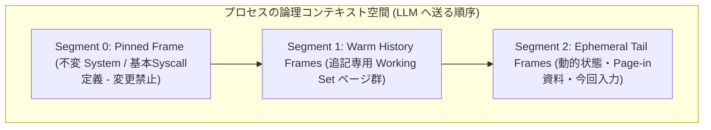

# 2. メモリ管理設計：Prefix キャッシュ協調型・仮想コンテキストページング

[01_idea.md](../../01_idea.md) の以下の 3 要件は、実は密接に絡み合っている。
1. **「文脈管理をページングとみなす」**
2. **「キャッシュヒットも大きな要因になってきたのでキャッシュも監視したい」**
3. **「人間のプロンプト入力ごとにプロバイダとモデルを切り替えられる仕組み」**

本章では、OS の仮想記憶理論をそのまま素朴に持ち込むと発生する「KV キャッシュ破壊問題」を解き明かし、LLM の特性に最適化した **仮想コンテキストメモリ（Virtual Context Memory: VCM）** アーキテクチャを設計する。

---

## 2.1 核心課題：OS ページングと LLM KV キャッシュの構造的衝突

ハードウェアの物理 RAM は「どの物理フレームを書き換えても他のフレームのアクセス速度は変わらない（ランダムアクセス可能）」。
しかし、現代の LLM（Ollama の `llama.cpp` KV キャッシュや OpenRouter 経由の Anthropic/OpenAI/Gemini Prompt Caching）は **「先頭からのトークン列の完全一致（Exact Prefix Match）」** でキャッシュヒット判定を行う。

### 素朴なページングが引き起こす「キャッシュ・スラッシング」
もし初期の MemGPT のように「システムプロンプト内のワーキングメモリ欄を毎ターン書き換える」または「LRU で古い会話ページを毎ターン 1 ページずつ先頭から抜く」設計にすると、何が起きるか？
- **プロンプト先頭付近が毎ターン変化するため、以降の全トークンの KV キャッシュが 100% 無効化（`cached_tokens = 0`）される。**
- ローカル Ollama では毎回フルプロンプトの再評価（Prompt Eval）が走って応答開始まで数秒〜数十秒待たされ、クラウド API ではキャッシュ割引（最大 75〜90% OFF）が一切効かなくなる。

### 解決原則：Prefix-Preserving Segmented Paging
OS における **「セグメンテーション＋ページングの併用」** と **「世代別 GC / ログ構造化マージ（LSM）」** の発想を組み合わせ、仮想コンテキスト空間を **先頭からキャッシュ安定度順の 3 セグメント** に分割する。

1. **Segment 0（Pinned Pages / 常駐固定領域）**:
   - プロセスの基本システム指示、利用可能なシステムコール（Tool）定義。
   - プロセス生存中は **1 バイトたりとも書き換えない**（現在時刻や動的なカレントディレクトリ状態などをここに混ぜない！それらは Segment 2 に置く）。これによりベース Prefix キャッシュが常に保護される。
2. **Segment 1（Append-Only Working Set Pages / 追記履歴領域）**:
   - 過去の対話ターン、システムコール呼び出しと結果のページ列。
   - コンテキスト使用率が **High Watermark（例: 上限の 85%）** に達するまでは、一切途中のページを抜かず末尾へ追記する。これにより、ターン `N` ではターン `N - 1` までの Segment 0 + Segment 1 全体が **90% 以上の確率で KV キャッシュにヒット** する。
3. **Segment 2（Ephemeral & Demand-Paged Region / 末尾動的領域）**:
   - 今ターンでデマンドページング（`sys_mem_pagein` / `sys_read`）された参照資料や、現在のメモリ目次（Page Directory Summary）、最新のユーザー入力。末尾にあるため、ここが毎ターン入れ替わっても Segment 0・1 のキャッシュを一切壊さない。

---

## 2.2 ページ構造と Clean / Dirty ページ置換アルゴリズム

各コンテキスト要素を `ContextPage` としてページテーブル（`PageTable`）で管理する。

### `ContextPage` のメタデータ（PTE: Page Table Entry 相当）
- `pageId`: 一意なページ識別子（例: `pg_0042`）
- `kind`: `systemPinned` | `conversation` | `fileView` | `toolOutput` | `summary`
- `resident`: `true`（現在 LLM コンテキスト内に展開中）/ `false`（スワップ領域または VFS 原本に退避中）
- `dirty`: **OS の Dirty Bit と完全に同じ概念で区別する**
  - **Clean Page (`dirty == false`)**: VFS 上のファイル読み取り結果（`lib/main.dart:1-120`）や `jj diff` / `jj log` 結果など、**VFS や `jj` のコミットストア上に正確な原本が存在し再取得可能なページ**。
  - **Dirty Page (`dirty == true`)**: エージェントの推論過程、ユーザーとの合意事項、複数ファイルを比較して得た知見など、**そのまま捨てると失われる情報**。
- `tokenCount`: 推定（または実測）トークン数
- `lastReferencedTurn` / `referenceCount` / `pinned`: 置換判定用ビット（Clock / 2Q アルゴリズム用）
- `sourceUri`: Clean Page の場合の再ロード元（例: `jj://<change_id>/lib/main.dart?commit=<commit_id>&lines=1-120`）

### バッチ型ページアウト（Amortized Page Eviction）の動作
コンテキスト使用量が **High Watermark（例: 85%）** を超えたときだけページャ（`ContextPager`）が介入し、一気に **Low Watermark（例: 50〜60%）** まで空きを作る（バッチ退避により、キャッシュ再構築のペナルティを十数ターンに 1 回へ償却する）。

1. **Step 1: Clean Page の即時スタブ化（コストゼロ退避 & `jj` リビジョン連携）**
   - 古いファイル閲覧結果や巨大なテスト標準出力（Clean Page）は LLM 要約すら不要。
   - 本体をメモリから外し（`resident = false`）、わずか 1〜2 行の **Page Stub** に置き換える。
   - スタブ例: `[PageOut pg_0018: /workspace/lib/parser.dart (L1-200, change: kxyz, 1,850 tokens) - 再読込は sys_mem_pagein("pg_0018") または sys_read]`
   - **`jj` の `Change ID` × `Commit ID` によるキャッシュコヒーレンシ**: `jj` では同じ作業チェンジ（`Change ID` 不変）でもファイルが編集されるたびに内部スナップショットの `Commit ID` が更新される。そのため、`Commit ID`（またはファイルハッシュ）を比較するだけで `[STALE: 以降に編集あり]` を O(1) で正確に表示でき、必要なら `jj file show -r <commit_id> --ignore-working-copy` で過去の正確な断面すら復元できる。
2. **Step 2: Dirty Page の Write-back と圧縮（zram / Swap 退避）**
   - 古い推論・試行錯誤の連続ターン（Dirty Pages）は、生の全文をディスク上の **Swap Store（`.agent_os/swap/<pid>/pages.jsonl`）** にそのまま退避保存（Write-back）する。
   - コンテキスト内には「決定事項・試して失敗したアプローチ・残課題・元ページ ID 範囲」だけを凝縮した `SummaryPage`（zram 圧縮ページ相当）を生成して配置する。
3. **Step 3: デマンドページング（Page Fault 復帰）**
   - エージェントが後から「さっき退避した `pg_0012` の詳細なエラーログをもう一度見たい」と判断した場合、`sys_mem_pagein("pg_0012")` を呼ぶと Swap Store から Segment 2（末尾一時枠）へ再展開される。

---

## 2.3 プロンプト毎のプロバイダ／モデル切替と「State Spill」の防止

[01_idea.md](../../01_idea.md) の重要機能である **「人間のプロンプト入力ごとにプロバイダとモデルを切り替えられる仕組み」** を実現する上で、Theseus OS が示した **State Spill（状態漏出）の排除** が決定的に効く。

### なぜ既存エージェントはモデル切替で壊れやすいのか？
多くのエージェントは、OpenAI・Anthropic・Ollama それぞれの API レスポンス JSON（固有の `tool_call_id` フォーマット制約、Thinking ブロックの署名、空メッセージ制約、System ロールの位置制約など）をそのまま会話履歴配列に保存してしまう。そのため途中で別プロバイダに切り替えると `400 Bad Request` で破綻する。

### 解決策：正規化中間表現（Canonical IR）とモデル別キャッシュ追跡
1. **プロバイダ非依存の Canonical Page IR**:
   - プロセスの仮想メモリ（`VirtualContextMemory`）内には、どの LLM ベンダーにも依存しない厳格な Dart 型（`UserTurn`, `AssistantThought`, `SyscallInvoke`, `SyscallOutcome`, `ContextAttachment`）のみを保持する。
   - 各 LLM ドライバが推論直前に Canonical IR をそのモデル固有のメッセージ配列へ **ステートレスに射影（Projection）** する。
   - 非対応機能（例: Thinking 非対応モデルへの切替時や、Tool Call 非対応モデルへのフォールバック時）もドライバ側のアダプタが安全にテキスト表現へダウングレードできる。
2. **モデル別コンテキスト窓のリサイズ適応（Dynamic Frame Resizing）**:
   - 例: ターン 1〜5 を OpenRouter の 200k コンテキストモデルで実行（現在 45k トークン使用中）→ ターン 6 で人間がローカル Ollama の 32k コンテキストモデルに切り替えた場合。
   - カーネルが `sys_llm_chat` 実行前に新モデルのフレーム上限（32k）を検知し、自動的に `ContextPager` を起動して 32k の Low Watermark（例: 20k）に収まるまで Clean/Dirty ページを退避してからローカルモデルへ渡す（メモリ溢れエラーを自動回避！）。
3. **KV キャッシュウォーム状態の可視化**:
   - カーネルのメモリ統計は「直前にどのプロバイダ・モデルで何トークンまでキャッシュが温まっているか」を記録する。
   - モデル切替時には「キャッシュが Cold になること（初回評価コスト）」をテレメトリに明示し、ローカル Ollama 利用時は `keep_alive` パラメータを制御して VRAM アンロードを防ぐ。
