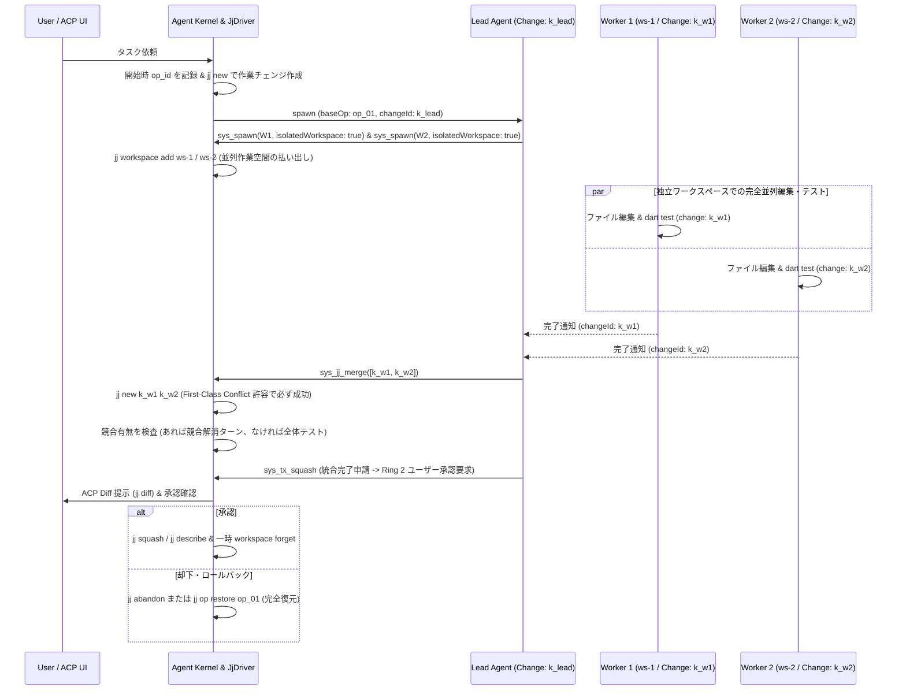

# 3. Jujutsu (`jj`) ネイティブ CoW VFS・ドライバ層・モジュラー設計・ACP 分離

[01_idea.md](../../01_idea.md) の発展案 4・5・7（仮想ファイルシステム・名前空間・Copy-on-Write トランザクション・監査ログ・ドライバ層）およびモジュラー設計、ACP 分離を、**最初から Jujutsu (`jj`) を中核ストレージ基盤に据えた設計** として定義する。

---

## 3.1 なぜ `jj` が「エージェント OS の CoW ファイルシステム」そのものなのか

既存のほぼすべてのコーディングエージェントは Git 前提で作られているため、`git stash` の退避ミス、ブランチ名の氾濫、マージコンフリクトによる作業ツリーのロック停止、人間の未コミット変更の巻き込み事故を常に抱えている。

対して **Jujutsu (`jj`)** が持つ以下の 5 つの性質は、OS が ZFS / Btrfs / OverlayFS / WAL で実現しようとしてきた機構と **1 対 1 で対応** しており、複雑なインメモリ CoW ファイルシステムを自作せずとも最高水準のトランザクション機能が得られる。

| OS のストレージ・並行制御概念 | Jujutsu (`jj`) のネイティブ機構 | エージェント OS にもたらす決定的な利点 |
| :--- | :--- | :--- |
| **自動スナップショット（Working Copy = Commit）** | ワーキングコピー自体が常に 1 つのコミット（`@`）。`index (staging)` が不要 | エージェント開始時に `jj new` を 1 回打つだけで、人間の直前作業（`@-`）が **不変の親コミットとして 100% 保護** される。外部ツール（`dart test`）も実ファイル上でそのまま動く。 |
| **WAL（Write-Ahead Log）と原子的ロールバック** | **Operation Log (`jj op log`)** と `jj op restore <op_id>` / `jj undo` | リポジトリに対する全操作履歴が不変 ID 付きで記録される。エージェントが暴走しても、開始時の `op_id` へ 1 コマンドで **副作用ゼロの完全ロールバック** が可能。 |
| **無名 CoW ブランチと安定ポインタ** | ブランチ名不要の無名コミットと、書き換えても不変な **`Change ID`** | ブランチ命名規則で悩む必要がない。PCB（プロセス制御ブロック）は担当タスクの `Change ID` を握るだけでよい。 |
| **プロセス別プライベート作業空間** | **`jj workspace add <path> -r <rev>`** | 複数エージェントやカンバンタスクごとに軽量な独立作業ディレクトリを即座に生成でき、終了時は `jj workspace forget` で綺麗に回収できる。 |
| **ロックしない楽観的並行制御（MVCC マージ）** | **First-Class Conflicts**（コンフリクトをコミット内の木構造データとして保存）＋ 自動リベース | 複数ワーカーの成果を `jj new <c1> <c2> <c3>` で合流させた際、**たとえ同じ行が衝突していてもコマンドが失敗・停止しない**。競合箇所だけが構造化記録され、後から安全に解消できる。また親タスク修正時に子タスク（Stacked Changes）が **自動リベース** される。 |

---

## 3.2 プライベート名前空間と `jj` トランザクション VFS の動作設計

### プロセスごとの仮想名前空間ツリー
各プロセスはホストの無制限なファイルシステムを直接触らず、自身の `VfsNamespace` にマウントされた仮想パスのみを認識する。

| 仮想パス | バックエンド（マウント対象） | 用途・特徴 |
| :--- | :--- | :--- |
| `/workspace` | `JjWorkspaceMount(wsRoot, changeId, allowedSubpaths)` | 担当する `jj` ワークスペース（単一実行時はメイン上の新規 `@`、並列実行時は `.agent_os/ws/<ws_id>`）へのスコープ制限付きマウント |
| `/skills` | `ReadOnlyMount(SkillRegistry)` | 有効化されたスキル定義（`SKILL.md` 等）。オンデマンド参照により初期コンテキストを節約 |
| `/mem` | `SwapStoreMount(ProcessMemory)` | 退避ページやエージェント自身の長期構造化メモ |
| `/proc/self` | `ProcFsMount(PCB)` | 自身の残りトークン予算（`quota`）、担当 `Change ID`、現在モデル、子プロセス一覧を読める仮想情報 |
| `/mcp/<server>` | `McpResourceMount` | MCP サーバーが公開するリソースやプロンプトの透過マウント |

### トランザクションのライフサイクル（Single & Multi-Agent）

---

## 3.3 ドライバ層（`JjDriver`・`LlmDriver`・`McpDriver`）

### 1. `JjDriver`（最重点設計：Op-Log 直列化と安全ガード）
`jj` は非常に強力だが、複数のエージェントプロセスが勝手気ままに生 CLI の `jj` を同時発火すると **Concurrent Operation Heads（`@` のオペレーション分岐）** が発生しうる。また、世の中の多くの LLM は事前学習の癖でつい `git status` や `git checkout` を叩こうとする。
これをカーネルの **`JjDriver` ＋ Syscall Hook** で完璧に制御する。

1. **ミューテックスによる `jj` メタデータ更新の直列化（Op-Head 分岐の完全防止）**:
   - 各ワーカーによる `/workspace` 内の通常ファイル読み書きや `dart test` 実行は、それぞれの `jj workspace` ディレクトリ上で **ロックなし・100% 並列** に走る。
   - 一方、`jj` コマンドによるリポジトリ操作（`new`, `describe`, `squash`, `rebase`, `abandon`, `workspace add/forget`, 明示的スナップショット）は、すべてカーネル内の **`JjDriver` 単一実行キュー（Mutex）** を通してミリ秒単位で直列実行する。これにより Op-Head の意図しない分岐が絶対に起きない。
2. **`--ignore-working-copy` による高速・非破壊な並列クエリ**:
   - 調査エージェントが履歴や過去リビジョンの差分・ファイルを読む際（`sys_jj_log`, `sys_jj_diff`, `sys_jj_show`）は、ドライバが自動的に `--ignore-working-copy`（または `--at-op`）を付与する。ワーキングコピーのスナップショット処理を誘発しないため、ロック不要で超高速・安全に並列参照できる。
3. **構造化テンプレート出力（機械可読パース）**:
   - 人間向けの整形テキストではなく、`jj log --no-graph -T '...'` のテンプレート機能を使って `change_id`, `commit_id`, `conflict`（真偽値）, `empty`（真偽値）, `description` を JSON ライクに確定パースする。
4. **破壊的操作の保護リング分離**:
   - リモート影響を伴う `jj git push` やブックマーク強制移動、セッション開始時点より前への `jj op restore` は Ring 2 でも無条件実行させず、必ず `ASK_USER`（ACP 承認ゲート）または禁止とする。

### 2. `LlmDriver`（Local Ollama / Ollama Cloud / OpenRouter）

| ドライバ | 接続先エンドポイント | 特徴・実装ポイント |
| :--- | :--- | :--- |
| **OllamaLocalDriver** | `http://localhost:11434/v1/` (または `/api/chat`) | **API キー不要で即開発可能**。`keep_alive` 指定で KV キャッシュ蒸発を抑止し、`prompt_tokens_details.cached_tokens`（またはネイティブ `prompt_eval_cached_count`）を収集。 |
| **OllamaCloudDriver** | Ollama Cloud API エンドポイント | ローカルと同一のドライバ基盤を共有しつつ Bearer 認証とクラウドモデル群に対応。 |
| **OpenRouterDriver** | `https://openrouter.ai/api/v1/chat/completions` | 単一キーで主要モデル群を横断切替。`stream_options: {"include_usage": true}` を付与し、`cached_tokens`, `cache_write_tokens`, `cache_discount` および実課金額を抽出。 |

### 3. `McpDriver`
- JSON-RPC (`stdio` / Streamable HTTP) で外部 MCP サーバーへ接続。発見したツールは動的なシステムコール拡張（ケーパビリティ制御・監査対象）として登録する。

---

## 3.4 モジュラーシステム（Plugin / Tool / Hook / Skill）

1. **Provider & Syscall Tool Plugin**:
   - コアパッケージ（`agent_kernel`）には抽象インターフェースとレジストリのみを置き、具象ツール群やプロバイダ群を起動時構成（Manifest / DI）でアタッチする。
2. **Hook Plugin（eBPF 風システムコール・インターセプタ）**:
   - **フックポイント**: `beforeSyscall`, `afterSyscall`, `beforeLlmRequest`, `afterLlmResponse`, `onTxSquash`。
   - **キラー活用例（Anti-Git-Habit Guard Hook）**:
     - エージェントが `sys_exec` でうっかり生の `git ...` や生の `jj ...` コマンドを実行しようとした瞬間、`beforeSyscall` フックがそれをインターセプトしてブロックし、**「この環境は Jujutsu (`jj`) カーネル管理下です。生の `git`/`jj` コマンドではなく `sys_jj_status`, `sys_jj_diff`, `sys_jj_new` システムコールを使用してください」** というガイドエラーを即座に返す。これで LLM の Git 手癖によるリポジトリ破壊を 100% 防ぎつつ自律修正させられる。
3. **Skill Plugin（データ駆動・外部ディレクトリ読み込み）**:
   - 再コンパイル不要な Markdown + 権限マニフェスト（`SKILL.md`）としてロード。例えば「`jj` 流の Stacked Changes 分割スキル」や「First-Class Conflict 解消スキル」も Skill としてモジュール化できる。

---

## 3.5 監査ログ（`strace` × `jj op log` 連携）と ACP 分離

### 監査ストリームと `jj` Operation ID の紐づけ
1. **Syscall Audit Log (`syscalls.jsonl`)**:
   - 全システムコールについて `timestamp`, `pid`, `ring`, `syscallName`, `argsSummary`, `decision`, `durationMs` に加え、**その時点の `jjChangeId` と `jjOpId`** を記録する。
   - これにより「このシステムコールを実行した直後のコード状態」へ `jj --at-op <jjOpId>` でいつでもタイムトラベル検証できる（OS の決定論的リプレイ `rr` に匹敵するデバッグ体験！）。
2. **LLM I/O & Cache Telemetry (`llm_io.jsonl`)**:
   - 生リクエスト/レスポンス（デバッグ用）とともに、`provider`, `model`, `promptTokens`, `completionTokens`, **`cachedTokens`**, **`cacheHitRate`**, `costMicroUsd`, `ttftMs` を記録し、Prefix キャッシュの効き具合を常時監視する。

### ACP (Agent Client Protocol) による上位 UI 分離
- エンジン本体は UI を持たず **ACP (JSON-RPC 2.0 over `stdio`)** サーバーとして動作。
- プロンプト毎のモデル切替指定、`session/update` による思考・システムコール・`jj diff`・キャッシュヒット率のストリーミング通知、`session/request_permission` による承認確認を行う。
- リポジトリ内に同梱する軽量 **簡易 ACP CLI クライアント (`acp_cli_client`)** から、モデル切替や `jj` トランザクションの承認／ロールバック（`undo`）を手軽に対話テストできる構成とする。
