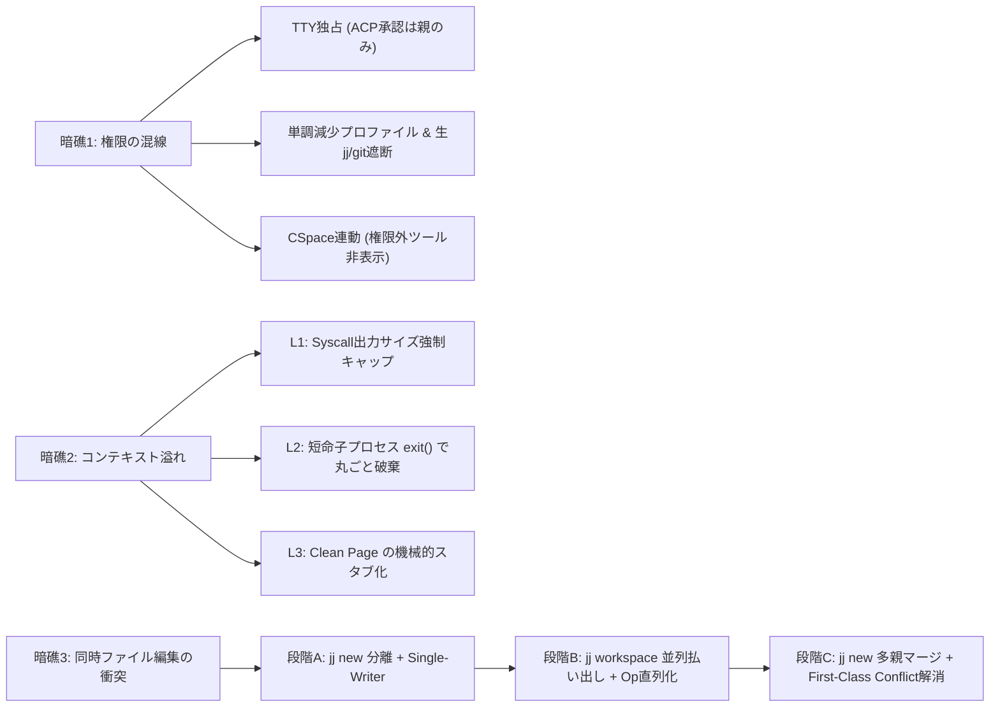

# 5. 「3つの暗礁」に対する OS × Jujutsu (`jj`) 流の解決策と、絶対に詰まらない直交ステップ計画

先行プロトタイプで実際に直面し、開発が暗礁に乗り上げた **「権限の混線」「コンテキスト溢れ」「同時ファイル編集の衝突」** の 3 課題は、**OS のプロセス保護原則** と **Jujutsu (`jj`) の次世代 VCS プリミティブ** を組み合わせることで、驚くほどシンプルかつ決定的に解決できる。

本章では、**① なぜ先行試作が座礁したのか**、**② OS × `jj` による「作り込みすぎない」根本解決パターン**、そして **③ 1 ステップにつき 1 課題だけを確実に潰す 7 段階の直交ビルド計画** を定義する。

---

## 5.1 なぜ先行プロトタイプは暗礁に乗り上げたのか？

この 3 つの課題は、**同時に正面から解こうとすると組み合わせ爆発を起こす**。

- マルチプロセスを入れながら、同じワーキングコピー上で子プロセスにも書き込みを許すと → **「同時編集の衝突」** と **「承認ダイアログの混線」** が同時に噴出する。
- 衝突を避けようとして「自前のインメモリ仮想ファイルシステム」を作ると → 外部コマンド（テストやコンパイラ）との同期で泥沼化し、Git の `worktree` や `merge` を使うと → ブランチ管理とコンフリクト発生時の作業ツリー停止で自動化が壊れる。
- さらに長大な調査ログを「LLM による自動要約」で縮めようとすると → 要約劣化で重要な行番号が消え、何度も同じファイルを読み直す **スラッシング** に陥る。

ここで **`jj` 志向** に振り切ることが最大の突破口になる。なぜなら **`jj` は「自動スナップショット・WAL ロールバック (`jj op`)・無名チェンジ・First-Class Conflicts（競合しても止まらないマージ）」を最初から備えたソースコード用 CoW ストレージそのもの** だからである。

---

## 5.2 課題別：OS × `jj` に学ぶ「最小コスト・最大効果」の解決パターン

### 暗礁 1：「権限の混線」をどう根絶するか

1. **TTY フォアグラウンド独占原則（UNIX Job Control `SIGTTIN` / OpenSSH Monitor 方式）**
   - **ユーザーに承認確認（ACP Permission）を出せるのは、セッション内で「フォアグラウンドの親（Lead）」ただ 1 人に限定する**。
   - バックグラウンドの子プロセスが要承認操作を呼んだ場合は UI に飛ばさず、カーネルが即 `EPERM` で弾く（子は親へ提案・依頼メッセージを返す）。これで複数プロセスからの承認ダイアログ乱射は 100% 消滅する。
2. **権限の単調減少・昇格禁止（OpenBSD `pledge` / `unveil` 方式）**
   - 途中からの権限昇格機構を一切作らない。`Explorer (Read-Only)` / `WorkspaceWorker (専用 jj workspace 内のみ編集可)` / `Lead (統合・承認要求可)` のように、`親 ⊇ 子` の部分集合しか渡せないルールを `SyscallGate` 1 箇所で強制する。
3. **存在自体の隠蔽（CSpace からの Tool Schema 自動生成）＋ 生 VCS コマンド遮断**
   - 権限のないシステムコールは LLM に渡す Tool Schema 自体から除外する。また `sys_exec` 内で生の `jj` や `git` を叩こうとした場合は Hook で遮断し、必ずカーネル管理下の `sys_jj_*` を通させる。

---

### 暗礁 2：「コンテキスト溢れ」をどう根絶するか（LLM 要約に頼らない 3 段防衛）

1. **防衛線 L1：カーネル I/O ペイロード上限（パイプ＋ページネーション強制）**【LLM 不要】
   - `sys_read` や `sys_jj_diff`、`sys_exec` 1 回あたりの返却上限（例: 最大 200 行 / 8KB）をカーネルでハードリミットし、超過分は一時ログ保存＋先頭・末尾サマリのみ返す。これで 1 ターン一撃死がなくなる。
2. **防衛線 L2：`fork` + `exit()` による「プロセス寿命でのメモリ全回収」**【要約劣化ゼロ】
   - OS で最も確実でバグがないメモリ解放は GC ではなく **短命プロセスの `exit()`（アドレス空間丸ごと破棄）**。
   - コード探索やテスト失敗原因の特定は使い捨ての `Explorer` 子プロセスにやらせ、数百トークンの結論レポートだけを親へメール送信して子を `exit` させれば、親のコンテキストは汚れない。
3. **防衛線 L3：Clean Page の決定論的スタブ化（`jj` コミットストア原本の活用）**【LLM 不要】
   - 長寿プロセスでメモリが閾値を超えたら、LLM 要約の前に **「過去に読んだファイル内容や `jj diff` 結果（原本が `jj` リポジトリにある Clean Page）」だけを古い順に 1 行のスタブへ機械的に置換** する（`Commit ID` 比較で変更有無も自動判定）。原本が `jj` にあるため情報消失リスクがゼロである。

---

### 暗礁 3：「同時ファイル編集の衝突」を OS × `jj` でどう根絶するか

自作の仮想ファイルシステムを書く必要はない。OS のロック原則と `jj` のネイティブ機能を以下の 3 段階で組み合わせる。

1. **段階 A（単一ワークスペース内）：Single-Writer ＋ `jj new` 作業レイヤ分離**
   - タスク開始時にカーネルが `op_id` を控え、`jj new` で人間の作業コミット（`@-`）の上にエージェント専用チェンジ（`@`）を切る。
   - 単一ワークスペースを共有する間は **書き込みプロセスを 1 人（Lead または専任 Patcher）に限定** し、さらにファイル書き込み時は Base Hash（CAS）を照合する。失敗時は `jj abandon` または `jj op restore <op_id>` で 100% 無傷で元に戻る。
2. **段階 B（並列ワーカー実行）：`jj workspace add` による物理分離 ＋ `JjDriver` 直列化**
   - 複数の実装ワーカーを同時に走らせる際は、ワーカーごとに `jj workspace add .agent_os/ws/<pid> -r <base_change>` で **独立した実ディレクトリと無名 `Change ID`** を割り当てる。
   - 各ワーカーは自分のディレクトリで誰にも邪魔されず編集・`dart test` を並列実行できる。また `jj` 自体のメタデータ操作はカーネルの `JjDriver` がミューテックス直列化するため、Op-Head 分岐も起きない。
3. **段階 C（成果の合流とカンバン積層）：`jj new <c1> <c2>` 多親マージ ＆ First-Class Conflicts**
   - ここが Git では不可能な **`jj` 最大の真価** である。ワーカー 1（`c1`）とワーカー 2（`c2`）が完了したら、親が `sys_jj_merge([c1, c2])`（内部で `jj new c1 c2`）を呼ぶ。
   - **別々のファイル（または別々の行）なら**: 即座にクリーンな統合コミットが完成する。
   - **万が一同じ行を編集して衝突しても**: Git のようにマージコマンドが異常終了してリポジトリがロックされることが一切ない。`jj` は **First-Class Conflict** として競合状態をコミットツリー内に正常記録する。親（または専任の Conflict Resolver プロセス）は `sys_jj_conflicts` で競合ファイル一覧だけを受け取り、該当箇所だけを落ち着いて修正して `jj squash` すればよい。
   - **さらにカンバンの依存タスク（Stacked Changes）**: タスク A のチェンジの上にタスク B のチェンジを積んで並列進行し、後から人間がタスク A に手直しを指示しても、`jj` の **自動リベース** によってタスク B 側へ変更が自動追従する。

---

## 5.3 詰まらないための「1ステップ・1課題」7 段階ビルド計画（`jj` 志向版）

**「1 つのステップでは、新しい複雑さを 1 軸しか導入しない（他の軸はロックしておく）」** 原則に基づく実装順序を以下に示す。

| Step | 今回解く「たった1つの主題」 | 他の軸にかける「意図的な安全ロック（やらないこと）」 | クリア判定（完了ゲート） |
| :--- | :--- | :--- | :--- |
| **Step 1** 防波堤と `jj` 読取 | **Syscall 境界・監査ログ・I/O キャップ・`JjDriver`（読取系）** （Ollama / OpenRouter 毎ターン切替 + `cached_tokens` 監視 + `--ignore-working-copy` 参照） | ・シングルプロセスのみ ・**Read-Only のみ**（ファイル変更なし） | 巨大リポジトリや `jj log`/`jj diff` を読ませてもコンテキスト一撃死せず、モデル切替と `jjOpId` 付き監査ログが動く |
| **Step 2** `jj` 単一トランザクション編集 | **`jj new` 作業分離 ＋ CAS 編集 ＋ `jj op restore` ロールバック ＋ ACP 承認** （Windows Job Object コマンド実行 & 生 `git`/`jj` 遮断 Hook 含む） | ・**シングルプロセスのみ** （承認要求元もライターも 1 人なので混線・競合は原理的にゼロ） | **実用的な `jj` ネイティブ・シングルエージェントが完成**。人間の `@-` を一切汚さず「編集 → テスト → `undo` ロールバック or 承認 `squash`」が完走する |
| **Step 3** 決定論的メモリ管理 | **Prefix 保持 3 セグメント構造 ＋ Clean Page スタブ退避** （古いファイル読取・`jj diff` 結果の 1 行ポインタ化と `Commit ID` 鮮度判定） | ・シングルプロセスのみ ・**LLM 要約はまだ作らない**（機械的スタブ化のみ） | 40 ターン以上の連続調査・修正でもコンテキスト溢れせず、`cached_tokens` の高いヒット率が維持される |
| **Step 4** Read-Only マルチプロセス | **Dart `Isolate` 子プロセス生成 ＋ 有界メールボックス ＋ 権限減衰** （短命 `Explorer` による並列調査と `exit()` メモリ全回収） | ・**子プロセスは全員 Read-Only 固定（`--ignore-working-copy`）** ・**子の UI 承認要求は一律禁止** （何並列でも編集競合ゼロ・承認混線ゼロ！） | 親が 3 並列で `Explorer` を走らせて結論だけを受け取り、親のコンテキストを汚さず親 1 人が `jj` チェンジ上で編集を完遂できる |
| **Step 5** `jj workspace` 並列編集 | **ワーカーごとの `jj workspace add` 払い出し ＋ `JjDriver` Op 直列化** （非重複タスクの並列編集・並列テスト実行） | ・まずは **変更対象パスが重ならないタスク分担** に限定（または子からのパッチ直列適用） | 複数の実装ワーカーが各自の `jj workspace` で同時にコード変更と `dart test` を走らせても、Op-Head 分岐や承認混線が 0 件である |
| **Step 6** 多親マージと競合解消 | **`jj new <c1> <c2>` 多親マージ ＋ First-Class Conflicts 検出・解消フロー** （重複編集時の非停止マージと Resolver プロセス連携） | ・メモリ管理は Step 3 のまま安定維持 | 2 つのワーカーが意図的に同じファイルを編集しても停止せず、競合コミットから競合箇所だけを解消してテスト通過まで統合できる |
| **Step 7** Dirty Swap・監督・カンバン積層 | **Dirty Page Swap 退避 ＋ Supervisor 自動回復 ＋ Stacked Changes カンバン運用** | — | 依存関係のある複数カンバンタスクが Stacked Changes（自動リベース連動）や並列ワークスペースとして自律進行し、ACP クライアントからレビュー・統合できる |

---

## 5.4 まとめ：なぜ「OS 構造 × `jj`」が最強の組み合わせなのか

1. **自作で泥沼化する領域を `jj` が肩代わりしてくれる**: 以前なら数千行かけてバグと戦う必要があった「CoW ファイルシステム・スナップショット・ロールバック・3-way マージ」を、`JjDriver`（数百行のラッパー＋直列化キュー）として OS カーネルの背後に据えるだけで世界最高峰の実装が手に入る。
2. **逆に、`jj` 単体では防げない領域を「OS カーネル構造」が守る**: LLM が勝手に危険なコマンドを叩くこと、並列実行で Op-Head を分岐させること、トークン予算を使い果たすこと、親のコンテキストを溢れさせることは、**Ring 0 カーネル（`SyscallGate`・ケーパビリティ・Quota・`Isolate` 分離・Clean Page スタブ化）** が完全に制御する。
3. **Step 2 で早くも「自分が毎日使える `jj` 特化コーディングエージェント」が立ち上がる** ため、モチベーションを保ちながら 1 段ずつ確実に AI チーム／カンバン構想まで登り切ることができる。
